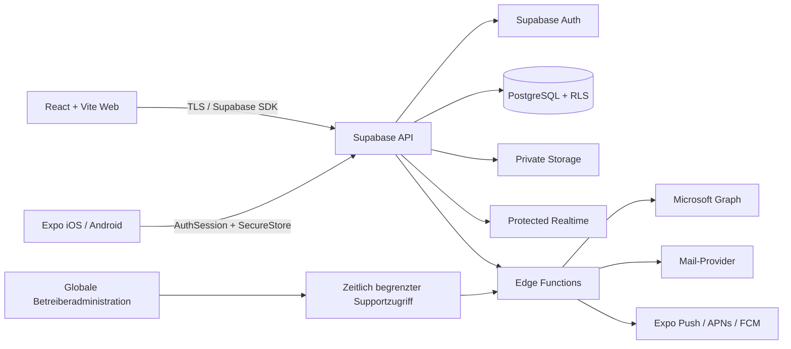

# Technische Architektur

## Leitentscheidungen

TicketHub trennt die Plattform-, Mandanten- und Abteilungsgrenze ausdrücklich. Jede fachliche Ressource trägt einen `tenant_id`; ticketbezogene Ressourcen enthalten zusätzlich eine Abteilungsbeziehung. Der Browser und die mobile App übermitteln Kontext, erhalten daraus aber **nie** Autorisierung. Die effektive Berechtigung wird in PostgreSQL-RLS und in privilegierten Edge Functions aus Mitgliedschaft, Rollen, Abteilung und Sachbezug ermittelt.

Supabase wird in der spezifischen Region **Central Europe (Zurich), `eu-central-2`** angelegt. Eine spezifische Region ist nötig, da allgemeine Regionsgruppen keine garantierte Jurisdiktion darstellen. Die Auswahl steuert den Ort der Primärdaten, ersetzt jedoch keine Datenschutzprüfung.[1] Datenbank- oder storageintensive Edge-Function-Aufrufe werden mit der Region `eu-central-2` ausgeführt, weil regionale Aufrufe dort explizit unterstützt werden.[2]

## Systemkontext

Die gerenderte Fassung liegt unter [`docs/architecture/system-overview.png`](docs/architecture/system-overview.png); die Mermaid-Quelle ist versioniert unter [`docs/architecture/system-overview.mmd`](docs/architecture/system-overview.mmd).

## Monorepo

| Bereich                | Verantwortung                                                                                 |
| ---------------------- | --------------------------------------------------------------------------------------------- |
| `apps/web`             | Vite/React, Tailwind, shadcn/ui, TanStack Query/Table, Tiptap und i18n.                       |
| `apps/mobile`          | Expo Router, React Native, NativeWind, Push, sichere Tokens, Deep Links und native Uploads.   |
| `packages/types`       | Stabiler, runtimefreier Domänenvertrag.                                                       |
| `packages/validation`  | Zod-Schemata an API- und Formgrenzen.                                                         |
| `packages/permissions` | Gemeinsamer Katalog und referenzierbare Berechtigungslogik; die Datenbank bleibt autoritativ. |
| `packages/config`      | Produktname, Locale- und Kommentarstandards.                                                  |
| `supabase`             | Migrationen, später Edge Functions, Seeds, RLS- und Integrationstests.                        |

Geteilt werden Geschäftsregeln, Typen, Validierungen, Übersetzungen, Design-Tokens und API-Clients. Web- und Mobile-Komponenten bleiben plattformspezifisch.

## Mandanten- und Abteilungsmodell

1. Ein **Mandant** ist eine Organisation mit eigenen Domains, Branding, Rollen, Daten und Integrationen.
2. Eine **Abteilung** ist ein Sicherheits- und Arbeitsbereich innerhalb eines Mandanten. ICT und Infrastruktur sind anfängliche, nicht fest verdrahtete Abteilungen.
3. Eine Mitgliedschaft ist mandantenbezogen; eine Abteilungsmitgliedschaft ist zusätzlich nötig, um abteilungsbezogene Agentenrechte auszunutzen.
4. Beim sicheren Mandantenwechsel werden Query-Cache, Realtime-Abonnements, Offline-Daten und Navigation zurückgesetzt. Ein Mandantenwechsel ist nicht bloss ein UI-Filter.
5. Eine unbekannte oder nicht verifizierte Domain erzeugt keinen Mandantenkontext. Erst nach DNS-Verifikation wird ein Mapping `hostname → tenant_id` aktiv.

## Anfrage- und Vertrauensfluss

**Normale Datenabfrage:** Die App sendet das Supabase-Access-Token. PostgreSQL erhält `auth.uid()` und prüft RLS. Der von der App gelieferte `tenant_id` ist höchstens ein Filter, nie ein Nachweis.

**Mutationen:** Tickets, Rollen, Domains, Exporte und Integrationsdaten laufen über kleine, auditierte Edge Functions oder RPCs. Diese validieren Zod-Eingaben, laden die tatsächliche Ressource, prüfen die Berechtigung erneut und schreiben Audit-Ereignisse in derselben Transaktion, soweit möglich.

**Globale Betreiber:** Plattformrechte sind nicht mit Mandantenrollen kombinierbar. Vertraulicher Supportzugriff erfordert MFA, Grund, Ablaufzeit, least-privilege Leserechte und einen nicht löschbaren Plattform-Audit-Eintrag. Impersonation ohne Audit wird nicht angeboten.

## UX-Richtung für Phase 3

Die UI folgt dem Stil **„ruhige operative Klarheit“**: informationsdichte, aber luftige Arbeitsflächen; eine seitliche Aufgabenleiste statt verschachtelter Modale; klar sichtbare Sicherheits- und Statuschips. Die Primärfarbe signalisiert handlungsfähigen Support, während interne Hinweise konsequent als nicht nach aussen gerichtete Information gekennzeichnet werden. Die mobile App priorisiert Portrait-Nutzung und Einhandbedienung mit einer Bottom-Navigation für Start, Tickets, Neu, Mitteilungen und Profil.

## Hintergrundarbeit und Integrationen

Zeitbasierte SLA-Prüfungen, E-Mail-Abholung, Webhooks, Exporte, Malware-Scans und Zustellwiederholungen sind zustandsbehaftete Jobs. Sie werden als Datenbank-Job mit Idempotenzschlüssel und Retry-Status modelliert und durch einen externen Scheduler oder einen dafür geeigneten Serverless-Trigger ausgelöst. Statisches Webhosting wird nicht als dauerhafter Worker missbraucht.

## Nicht Teil von Phase 1

Es bestehen noch keine React-/Expo-Screens, keine produktive Domainzuordnung, keine Storage-Buckets, keine Realtime-Kanäle und keine Entra- oder Graph-Verbindung. Die Architektur reserviert diese Grenzen, ohne ihre Implementierung vorzutäuschen.

## Referenzen

[1] https://supabase.com/docs/guides/platform/regions "Supabase Available regions"

[2] https://supabase.com/docs/guides/functions/regional-invocation "Supabase Regional Invocations"
