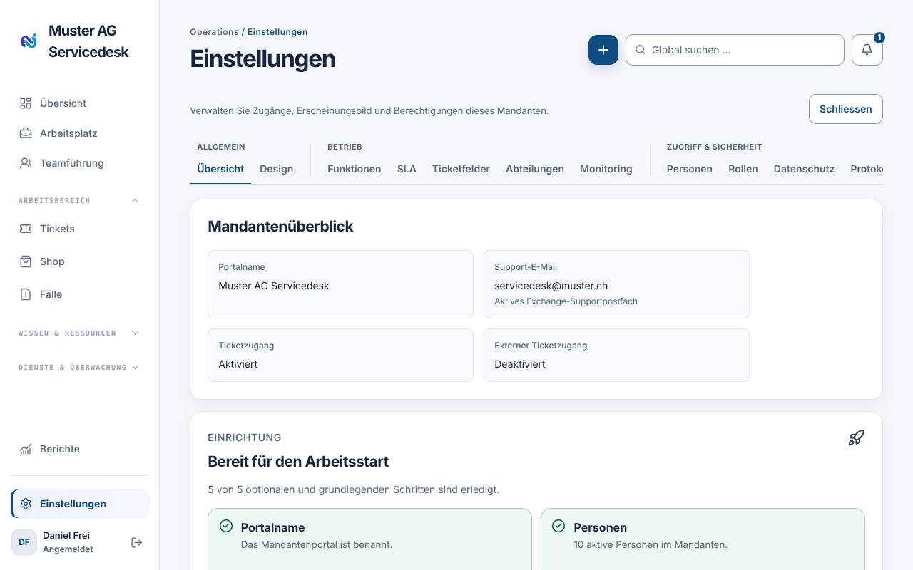
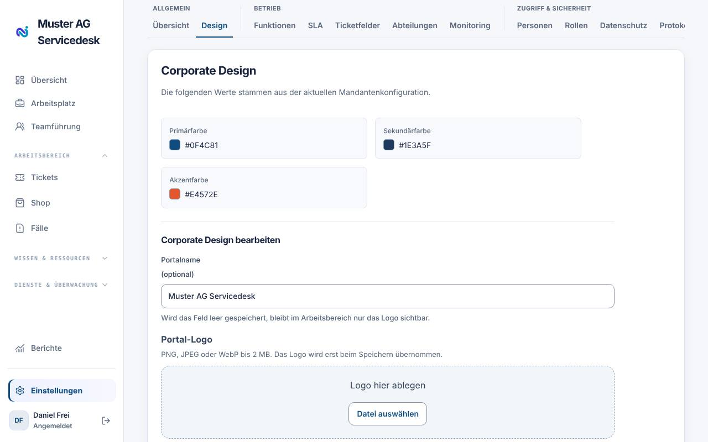
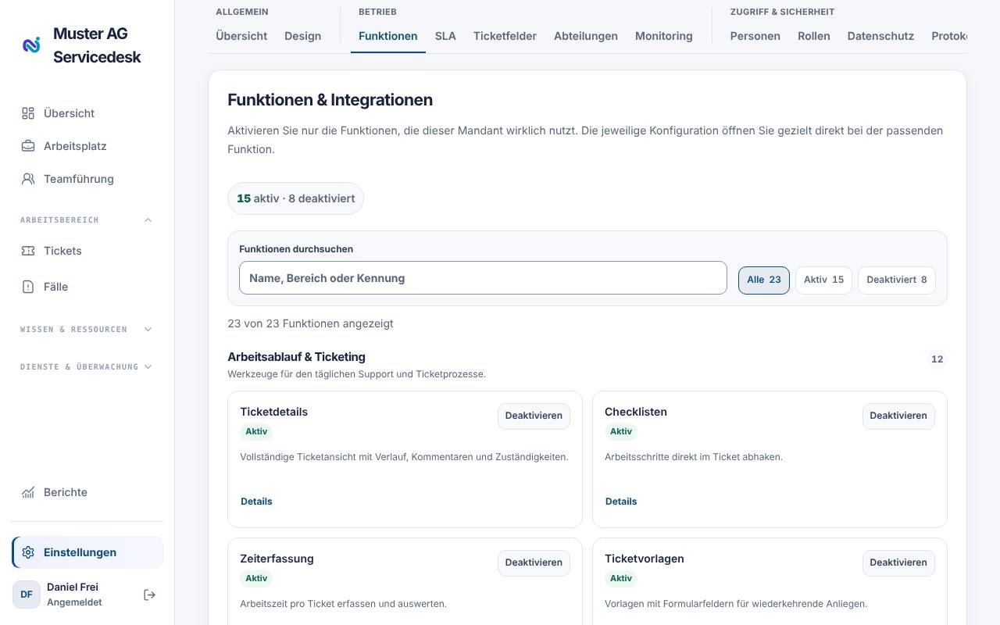
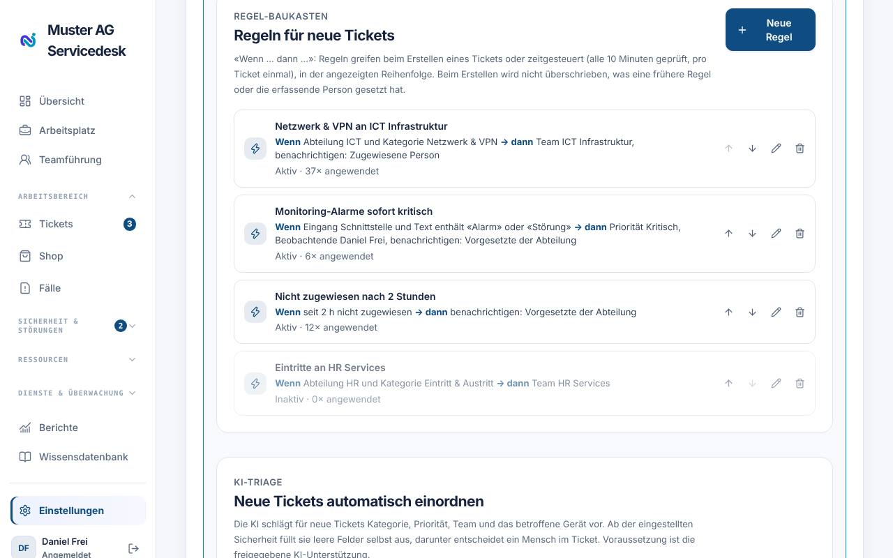
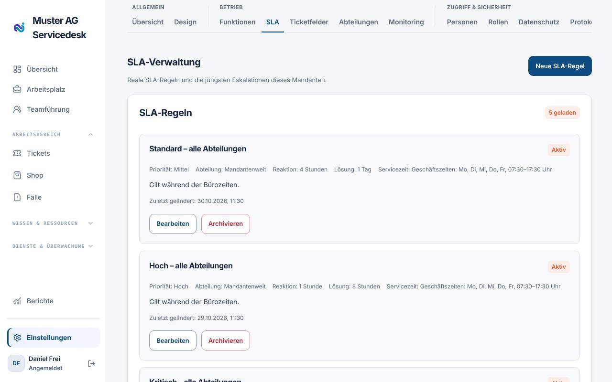
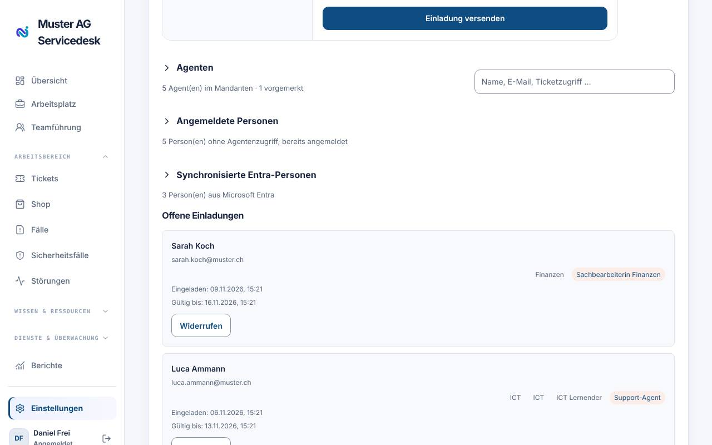
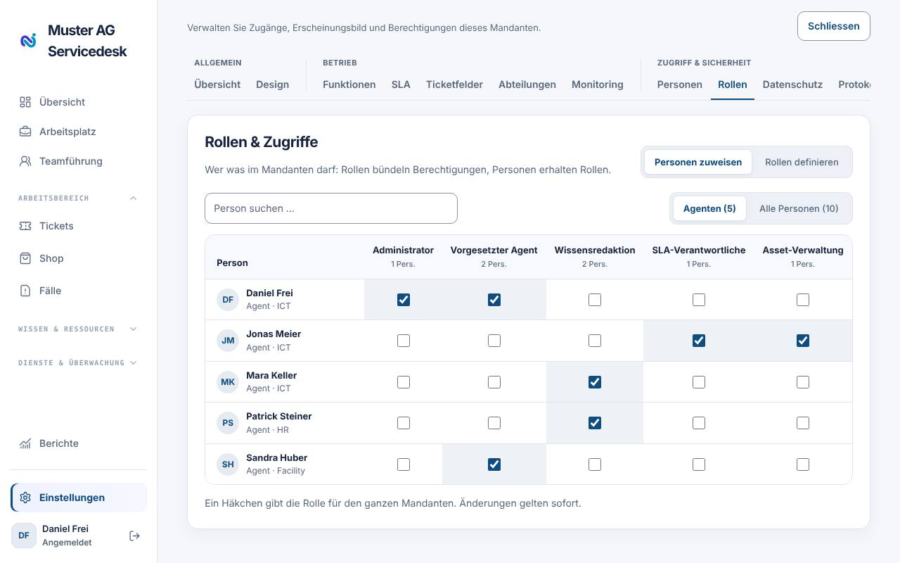
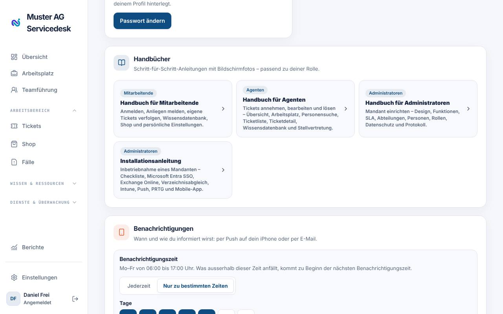

# Handbuch für Administratoren

Dieses Handbuch richtet sich an Personen mit der Rolle **Administrator**
(technisch «Tenant administrator»). Administratoren verwalten den gesamten
Mandanten: Erscheinungsbild, Funktionen, Abläufe, Personen und Berechtigungen.
Für die tägliche Ticketarbeit gilt zusätzlich das _Handbuch für Agenten_, für
die erstmalige Einrichtung von Microsoft 365, SSO und Monitoring die
_Installationsanleitung_.

## Einstellungen öffnen

Der Menüpunkt **Einstellungen** ist nur für Administratoren sichtbar und
steht unten in der linken Navigation. Die Einstellungen sind in Register
gegliedert:

| Gruppe               | Register                                                                                     |
| -------------------- | -------------------------------------------------------------------------------------------- |
| Allgemein            | Übersicht, Design                                                                            |
| Betrieb              | Funktionen, SLA, Ticket-Lebenszyklus, Ticketfelder, Abteilungen, E-Mail-Vorlagen, Monitoring |
| Zugriff & Sicherheit | Personen, Rollen, Datenschutz, Protokoll                                                     |

Mit **Schliessen** kehrst du in den Arbeitsbereich zurück.

## Übersicht

Der **Mandantenüberblick** zeigt Portalname, Support-E-Mail, Ticketzugang und
externen Ticketzugang. Darunter führt die Checkliste **«Bereit für den
Arbeitsstart»** durch die wichtigsten Einrichtungsschritte; jeder Punkt
springt direkt in das passende Register. Arbeite die Checkliste beim
Start eines neuen Mandanten von oben nach unten ab.

## Design (Corporate Design)

Unter **Design → Corporate Design bearbeiten** passt du das Portal an dein
Unternehmen an:

- **Portalname** (optional, max. 160 Zeichen). Leer lassen, wenn nur das Logo
  erscheinen soll.
- **Portal-Logo**: PNG, JPEG oder WebP bis 2 MB («Datei auswählen», «Logo
  entfernen»).
- **Primärfarbe, Sekundärfarbe, Akzentfarbe**.

Die **Portalansicht** zeigt die Wirkung sofort. Mit **Corporate Design
speichern** übernimmst du die Änderungen für alle Personen des Mandanten.

**Anrede:** Unter **Design → Anrede** legst du fest, ob nextDesk alle Texte duzt (Standard) oder siezt. Die Einstellung gilt für die Oberfläche, die Mobile-App, E-Mails, Mitteilungen und die Handbücher und wirkt sofort für alle Personen des Mandanten.

## Funktionen & Integrationen

Im Register **Funktionen** schaltest du Module für den ganzen Mandanten ein
oder aus. Suche über **Funktionen durchsuchen** oder filtere nach
_Alle / Aktiv / Deaktiviert_. Jede Karte hat **Aktivieren** bzw.
**Deaktivieren** und – wo vorhanden – **Konfigurieren**.

> Die Konfiguration ändert den Funktionsstatus nicht. Eine deaktivierte
> Funktion behält ihre Konfiguration, verwendet sie aber nicht.

Wichtige Funktionen und ihre Konfiguration:

| Funktion                                                              | Was sie bewirkt / wo konfiguriert                                                                                       |
| --------------------------------------------------------------------- | ----------------------------------------------------------------------------------------------------------------------- |
| Self-Service, Anfragendenportal                                       | Portal für Mitarbeitende mit Wissensartikeln und eigenen Tickets                                                        |
| Wissensdatenbank                                                      | Artikel für Agenten und Mitarbeitende                                                                                   |
| Ticketvorlagen                                                        | **Vorlagen verwalten → Neue Vorlage**: Name, Betreff- und Beschreibungsvorlage, Abteilung, Priorität, Checklistenpunkte |
| SLA-Automatisierung                                                   | Erinnerungen, automatisches Lösen/Schliessen, Regeln für neue Tickets, KI-Triage, Drittanbieter (siehe unten)           |
| E-Mail-Kanal (Exchange Online)                                        | Support-Postfächer, Phishing-Meldungen und Massnahmen je Urteil für Sicherheitsfälle (siehe Installationsanleitung)     |
| Push-Benachrichtigungen                                               | Inhaltsstufe («Nur Ticketnummer» empfohlen); wann jemand Mitteilungen erhält, legt jede Person selbst fest              |
| KI-Assistenz                                                          | Freigabe für Wissensentwürfe mit Claude und Selbstbedienungs-Assistent im Portal                                        |
| Asset-Management                                                      | Geräte und Microsoft Intune; Monitoring liegt im Register «Monitoring»                                                  |
| IP-Adressverwaltung                                                   | Subnetze, VLANs, IP-Adressen und Funde unter «IP-Adressen»; je Abteilung abschaltbar                                    |
| Service-Reporting                                                     | Berichte und Auswertungen                                                                                               |
| Raumplanung, Eintritte, Bestandsverwaltung, Verträge, Serviceaufgaben | Zusatzmodule für einzelne Abteilungen                                                                                   |
| Single Sign-On                                                        | Anmeldung mit Microsoft Entra ID (siehe Installationsanleitung)                                                         |

### Microsoft Teams im Shop

Die Funktion **Microsoft Teams im Shop** ist standardmässig aus. Schalte
sie ein, damit Mitarbeitende im Shop neue Teams bestellen können (Wizard mit
Kanälen, Personen und Laufzeit; Erinnerung 14, 7 und 1 Tag vor dem Ende,
danach Archivierung) und das Menü **Teams** erscheint.

In der Karte der Funktion:

1. **Zustimmungslink**: Der Microsoft-Admin öffnet ihn einmalig und erteilt
   der nextDesk-App die Teams-Rechte.
2. **Verbindung prüfen**: zeigt, ob alles erteilt ist oder welches Recht
   noch fehlt. Nach der Zustimmung kann es einige Minuten dauern.
3. **Längste Laufzeit** (Monate, Standard 12) und **Gäste dürfen eingeladen werden**.

Die Einrichtungsschritte stehen im Installationshandbuch.

### Hinweise für Anfragende

Mit der Funktion **Hinweise für Anfragende** (standardmässig aus) bewirbt die
ICT eigene Dienste: als Karte in Ticket-Mails, als Banner oder Hinweisleiste
im Portal und als Karte in der iPhone- und Android-App. Die Hinweise gelten
immer für alle Anfragenden.

In der Karte der Funktion:

1. **Neuer Hinweis**: Titel (höchstens 60 Zeichen), Text (höchstens 220),
   Schaltfläche und Ziel (_Shop_, _Wissensartikel_, _Ticket erfassen_ oder
   eine https-Adresse), Symbol (bis 4 Zeichen) und Farbe.
2. **Wo erscheint er?** Portal-Banner, Portal-Hinweisleiste, E-Mails an
   Anfragende, App. Die Vorschau zeigt Portal und E-Mail.
3. **Zeitplan:** Start (Standard heute) und **Ende** (Pflicht). Mit
   **Veröffentlichen** wird der Hinweis aktiv, mit **Als Entwurf speichern**
   nicht. Aktive Hinweise lassen sich pausieren.
4. **Wegklicken erlauben**: Wer den Hinweis ausblendet, sieht ihn nicht mehr.
5. **Statistik** pro Hinweis: Ansichten, Klicks und Wegklicks (Portal und App
   getrennt von den Mails; ohne Personenbezug).

**Allgemeine Regeln:** In Mails erscheint höchstens ein Hinweis, und pro
Person höchstens einer alle _N_ Tage (Standard 7; 0 = immer). Mehrere
aktive Hinweise wechseln sich ab. Sicherheits-, Phishing-, Erinnerungs- und
Freigabemails enthalten nie einen Hinweis; das lässt sich nicht ändern.

### SLA-Automatisierung konfigurieren

Unter **Funktionen → SLA-Automatisierung → Konfigurieren**:

- **Erinnern, lösen, schliessen** (läuft stündlich) hat ein eigenes Register
  **Ticket-Lebenszyklus**, siehe unten.
- **Regeln für neue Tickets**: Auslöser «Beim Erstellen eines Tickets» oder
  «Zeitgesteuert». Im Teil **Wenn …** definierst du Bedingungen (z. B.
  Stichworte in Betreff oder Beschreibung), im Teil **… dann** die Aktion
  (Team zuweisen, Person zuweisen, Priorität setzen). **Regel speichern**.
- **Neue Tickets automatisch einordnen** (KI-Triage).
- **Automatisierungen**: Mit **Vorschau ausführen** prüfst du Regeln vor
  dem Einsatz, das **Prüfintervall in Tagen** erinnert an die regelmässige
  Kontrolle.
- **Drittanbieter**: externe Lieferanten, an die Agenten Tickets übergeben
  können (siehe unten).

### Drittanbieter erfassen

Agenten können ein Ticket über **An Drittanbieter übergeben** an eine externe
Firma (z. B. Hersteller oder Support-Partner) weitergeben. Dafür muss
mindestens ein Drittanbieter erfasst sein. Sonst zeigt der Dialog den Hinweis
«Es sind noch keine Drittanbieter erfasst».

1. Öffne **Funktionen → SLA-Automatisierung → Konfigurieren** und
   scrolle zum Bereich **Drittanbieter**.
2. Wähle **Drittanbieter erfassen** und fülle aus: _Name_ (Pflicht),
   _E-Mail_, _Telefon_ und _Erinnerung nach (Stunden)_.
3. Lass **Aktiv** eingeschaltet und wähle **Speichern**.

_Erinnerung nach (Stunden)_ ist die Frist, nach der die zugewiesene Person
erinnert wird, wenn der Anbieter nicht antwortet. Erlaubt sind 1 bis 2160
Stunden (90 Tage), voreingestellt sind 48. Mit dem Stift bearbeitest du einen
Eintrag; mit **Aktiv** schaltest du einen Anbieter ab, ohne ihn zu löschen.

> Du benötigst die Berechtigung **Automationen verwalten**. Ohne sie
> verweist der Dialog der Agenten auf die Mandantenadministration.

Bei der Übergabe wechselt das Ticket auf **Wartend auf Drittanbieter**. Ist es
noch niemandem zugewiesen, bleibt der Status **Neu**, bis jemand es übernimmt.

## Ticket-Lebenszyklus

Das Register **Ticket-Lebenszyklus** (setzt die SLA-Automatisierung voraus)
steuert, wie lange ein Ticket in einem Status bleibt, bevor nextDesk handelt.
Die Regeln laufen stündlich und sind zunächst alle ausgeschaltet:

- **Erinnerung** bei «Wartend auf Kunde»: _Erinnern nach Tagen_ und
  _Höchstens so viele Erinnerungen_.
- **Automatisch lösen**: _Lösen nach Tagen (ab Beginn der Wartezeit)_.
- **Gelöste Tickets automatisch schliessen**: _Schliessen nach Tagen_. So lange
  bleibt ein Ticket auf «Gelöst», bevor es geschlossen wird. Antwortet die
  anfragende Person vorher, wird das Ticket wieder geöffnet.

Das automatische Schliessen verlangt keine SLA-Ursache.

## SLA-Regeln

Das Register **SLA** erscheint, sobald die SLA-Automatisierung aktiv ist.
Mit **Neue SLA-Regel** legst du fest:

- **Name der Regel** und **Definition & Auswirkung**
- **Priorität** und **Abteilung** (oder _Mandantenweit_)
- **Servicezeit**: Wochentage und Von/Bis in der Zeitzone Europe/Zurich
- **Reaktionszeit** und **Lösungszeit** in Minuten
- **Regel aktiv**

Die Fristen zählen nur innerhalb der **Servicezeit**: Ein Ticket, das am Abend
eingeht, verbraucht bis zum nächsten Morgen keine Zeit. Auch die Hinweise an
Leitungen richten sich danach: «Team: Ticket ohne Antwort» kommt, sobald die
**Reaktionszeit** in Servicezeit abgelaufen ist (ohne SLA nach 24 Stunden
Servicezeit), «Team: SLA in Gefahr» eine Stunde vor Ablauf der Lösungszeit.

Unter **Aktuelle Eskalationen** siehst du Tickets, deren SLA gefährdet oder
verletzt ist. Nicht mehr benötigte Regeln **archivierst** du, statt sie zu
löschen.

### SLA-Pause nach Status

Im Abschnitt **SLA-Pause nach Status** legst du pro offenem Status fest, ob
er **die SLA anhält**. Voreingestellt (auch für neue Mandanten) halten
**Wartend**, **Wartend auf Kunde** und **Wartend auf Drittanbieter** die SLA
an; abgeschlossene Status erscheinen nicht, dort endet die SLA ohnehin.

- Solange ein Ticket in einem solchen Status ist, wird keine SLA-Verletzung
  ausgelöst, es gibt keine Warnung «Team: SLA in Gefahr» bzw. «Team: Ticket
  ohne Antwort», und das Ticket zählt bei der Überlastungswarnung und den
  Zeitregeln «SLA läuft bald ab» nicht als fällig.
- Verlässt das Ticket den Status, werden Reaktionsfrist (falls noch keine
  Erstantwort erfolgt ist) und Lösungsfrist um die pausierte **Servicezeit**
  verschoben – nach der Servicezeit der SLA-Regel, die beim Erstellen des
  Tickets galt. Das gilt auch, wenn ein pausiertes Ticket direkt gelöst oder
  geschlossen wird, damit die Wartezeit in den SLA-Berichten nicht zählt.
- Bereits überschrittene Fristen bleiben überschritten.
- Änderst du die Einstellung, werden offene Tickets in diesem Status sofort
  pausiert bzw. fortgesetzt.

Die Einstellung braucht die mandantenweite Berechtigung **SLA-Profile
verwalten**. Jede Änderung steht im Protokoll.

## Ticketfelder

Unter **Ticketfelder** gestaltest du das Ticketformular. Felder unter
_Immer enthalten_ sind fix. Weitere Felder fügst du über **Feld auswählen**
bzw. **Feld hinzufügen** hinzu, legen den Feldtyp fest, markieren sie bei
Bedarf als **Pflichtfeld** und speichern mit **Feld speichern**. Die
Reihenfolge änderst du per Ziehen und Ablegen.

## Abteilungen und Teams

Im Register **Abteilungen**:

1. **Abteilungen** anlegen (Name → _Abteilung anlegen_). Nicht mehr
   benötigte Abteilungen archivieren.
2. **Abteilungsleitungen**: Leitung und Stellvertretung für interne
   Rückfragen zu Tickets.
3. **Teams pro Abteilung**: Name, Abteilung und Supportstufe
   (1st/2nd/3rd Level). Über **Mitglieder verwalten** ordnest du Agenten zu.
4. **Module pro Abteilung**: welche Abteilung welche Zusatzmodule nutzt.

## E-Mail-Vorlagen

Im Register **E-Mail-Vorlagen** steuerst du alle E-Mails, die nextDesk
automatisch versendet. Die Vorlagen sind nach Kategorie geordnet:

- **Tickets**: Eingangsbestätigung, Antwort des Supports, Ticket gelöst
- **Phishing-Meldungen**: Rückmeldungen an Personen, die eine Phishing-Mail gemeldet haben: Danke,
  Ergebnis (je Beurteilung eine eigene Vorlage) und Rückfrage «geklickt?». Die
  Vorlage «Gestaltung» legt Überschrift und Hinweis fest; ausgeschaltet
  werden gar keine Rückmeldungen versendet
- **Interne Mitteilungen**: Abteilungsrückfrage, Abteilungsantwort und
  Benachrichtigungen an Mitarbeitende
- **Statusseite**: Anmeldung bestätigen und Statusänderung

Jede Vorlage hat rechts einen Schieber. Damit schaltest du den Versand sofort
ein oder aus; ausgeschaltet wird diese E-Mail nicht mehr gesendet (die
Nachricht bleibt als «Vorlage deaktiviert» markiert). Öffne eine Vorlage,
um die Texte zu bearbeiten:

1. Betreff, Überschriften, Texte und Hinweise anpassen. In den Feldern steht
   genau der Text, der versendet wird. Rechts siehst du eine **Vorschau mit
   Beispieldaten**, die sich beim Tippen aktualisiert. Ein geleertes Feld
   verwendet wieder den Standardtext.
2. Mit Platzhaltern wie `{{ticketNumber}}`, `{{ticketSubject}}` oder
   `{{portalName}}` fügst du Werte ein. Welche Platzhalter gelten, steht
   unter dem Formular.
3. **Speichern**. Mit **Auf Standard** setzt du die Vorlage zurück.

Der Text einer Antwort des Supports (was deine Agenten im Ticket schreiben)
und die Details der Ereignisse
(z. B. Ticketbetreff in Benachrichtigungen) bleiben unverändert. Die Schalter
unter _Funktionen → E-Mail-Kanäle_ (Eingangsbestätigung, Agentenantworten,
Lösung) gelten zusätzlich: Eine E-Mail wird nur gesendet, wenn beide aktiv sind.

## Monitoring

Das Register **Monitoring** (setzt Asset-Management voraus) bündelt:

- **Monitoring (PRTG)** – Störungen aus PRTG-Alarmen (ohne Tickets, im
  Bereich **Sicherheit und Störungen**, Eintrag **Störungen**). Du wählst das **Team für die Alarmierung**
  (nur dieses Team sieht Störungen),
  ob auch Warnungen eine Störung öffnen, wie oft unbestätigte Störungen erneut
  alarmieren, ob Folgestörungen gebündelt werden und ob während einer Wartung
  alarmiert wird. Ist die Option
  «Systemstatus des verknüpften Dienstes anpassen» aktiv, ändern Alarme den
  Status der Dienste, die am Gerät in der Infrastruktur hinterlegt sind (ein
  Gerät kann mehrere Dienste haben). Unter **Alarme aus PRTG** beendest du
  einen hängenden Alarm mit **Alarm beenden**.
- **Externe Statusquellen** – offizielle Statusmeldungen von Anbietern, die
  alle 5 Minuten gelesen werden: Microsoft 365 (alle Dienste deines Mandanten,
  auch Teams, Outlook, OneDrive, SharePoint), GitHub, Claude, Google Gemini,
  Apple App Store, Google Play Store und Init7. Hake die gewünschten
  Quellen an und **speichere** sie; **Jetzt prüfen** liest sie sofort. Eine
  gemeldete Störung erscheint unter **Störungen** als «Extern» und
  benachrichtigt das Team für die Alarmierung, ebenso jedes Update des Anbieters und die Behebung. Titel und Texte
  der Anbieter erscheinen als kurze deutsche Fassung; dafür nutzt nextDesk die
  konfigurierte KI (ANTHROPIC_API_KEY), sonst bleibt der Originaltext. Pro Quelle siehst du,
  wann zuletzt geprüft wurde und ob ein Fehler auftrat. WWZ und Swisscom
  bieten keine maschinenlesbare Quelle; überwache diese Anschlüsse mit
  einem Ping- oder HTTP-Sensor in PRTG.
- **Zertifikate und Domains** – Erinnerung vor Ablauf
- **Backup-Überwachung** – z. B. Veeam-Jobs per E-Mail oder Webhook

Die Einrichtung ist in der _Installationsanleitung_ beschrieben.

## Personen und Agenten

Im Register **Personen** (Überschrift «Personen & Agenten») verwaltest du
alle Zugänge.

### Person einladen

1. Unter **Person einladen** Vor- und Nachname, E-Mail-Adresse, Angebot und
   Funktion erfassen.
2. Soll die Person Tickets bearbeiten, **Arbeitet als Support-Agent**
   den Schalter aktivieren und einen **Ticketzugriffsbereich** wählen (Pflicht
   für Agenten). Die Abschnitte **Person** und **Zugang** stehen rechts, die
   Zusammenfassung links.
3. **Einladung versenden**. Die Einladung ist 7 Tage gültig.

Offene Einladungen siehst du unter **Offene Einladungen** und kannst sie dort
widerrufen. Darunter stehen die Listen **Agenten** (mit Suche) und
**Angemeldete Personen**.

Mit **Bearbeiten** änderst du bei einer Person Name, vorgesetzte Person,
Ticketzugriffsbereich und **Team** (z. B. _Servicedesk_ oder _System
Engineer_). Die Teams erscheinen, sobald der Ticketzugriffsbereich gewählt
ist – bei Agenten und bei Mandantenadministratoren, die automatisch
Agentenzugang haben. Speichern mit **Person speichern**.

> Mit aktivem SSO werden Personen aus zugelassenen Domains beim ersten Login
> automatisch als _anfragende Person_ angelegt. Agentenrechte gibt es nur per
> Einladung, Vormerkung oder Rollenzuweisung.

### Personen aus Microsoft Entra

Ist der Verzeichnisabgleich eingerichtet, erscheinen Personen aus Entra in
der Liste. Du kannst eine Person **als Agent vormerken** – Name, vorgesetzte
Person, Ticketzugriffsbereich und Team werden bei der ersten
Microsoft-Anmeldung übernommen.

## Rollen und Berechtigungen

Das Register **Rollen** («Rollen & Zugriffe») hat zwei Ansichten, die du
oben umschaltest:

**Personen zuweisen**

- Suche über **Person suchen …** und filtere nach **Agenten** oder
  **Alle Personen**.
- In der Tabelle setzt du pro Person ein Häkchen bei der gewünschten Rolle;
  ohne Häkchen ist die Rolle wieder entzogen. Die Änderung wirkt sofort für
  den ganzen Mandanten.
- Rollen, die nur für eine Abteilung oder ein Team gelten, stehen unter
  **Auf Abteilung oder Team begrenzte Zuweisungen**; dort nimmst du sie mit
  **Entziehen** wieder weg.

**Rollen definieren**

- Links wählst du eine bestehende Rolle oder **+ Neue Rolle**.
  Systemrollen sind mit «System» markiert und geschützt.
- Bei einer neuen Rolle gibst du den **Namen der neuen Rolle** ein, wählst
  unter **Berechtigungen** die gewünschten Rechte (je Gruppe mit **Alle
  auswählen**) und klicken auf **Rolle erstellen**. Unter jeder Berechtigung
  steht kurz, was sie erlaubt; Rechte mit weitreichendem Zugriff sind als
  «Erweitert» markiert.
- Bestehende eigene Rollen änderst du und speicherst mit **Änderungen
  speichern**; mit **Rolle deaktivieren** bzw. **Rolle aktivieren** schaltest
  du sie ab oder wieder ein.

Für die IP-Adressverwaltung gibt es die Rechte «IP-Adressverwaltung
ansehen» und «IP-Adressen, Subnetze und VLANs verwalten». Bestehende Rollen
mit Asset-Verwaltung haben beide Rechte erhalten, Rollen mit Asset-Lesen das
Ansehen; passe das bei Bedarf hier an. Das Modul lässt sich wie andere
Module pro Abteilung einschalten; Subnetze, VLANs und Standorte mit einer
Abteilung sehen nur deren Mitglieder.

**IP-Adressverwaltung: API und Webhooks**

Im Register **API & Webhooks** der IP-Adressverwaltung (Recht «IP-Adressen,
Subnetze und VLANs verwalten») richtest du die REST-API für andere Systeme
ein:

- **API-Schlüssel**: Name und Rechte («Nur lesen» oder «Lesen und
  schreiben») wählen. Der Schlüssel wird nur einmal angezeigt; Systeme senden
  ihn als `Authorization: Bearer …`. Nicht mehr benötigte Schlüssel
  widerrufst du sofort.
- **Webhooks**: Adresse (HTTPS) und Ereignisse wählen (z. B. Adresse
  reserviert, Subnetz geändert, neuer Fund). Jede Zustellung ist mit dem
  angezeigten Geheimnis signiert; mit **Testen** sendest du eine
  Probenachricht, mit **Pausieren** hältst du die Zustellung an.

Die Beschreibung der Endpunkte liegt im Repository unter
`docs/ipam-api.openapi.yaml`, Beispiele unter `docs/ipam-api-beispiele.md`.

Die Basisrollen _Requester_ (alle angemeldeten Personen) und _Support agent_
(über «Arbeitet als Support-Agent») werden nicht direkt vergeben.

> **Handbücher und Rollen:** Welche Handbücher eine Person im Profil sieht,
> folgt automatisch ihren Rollen: alle Mitglieder das Handbuch für
> Mitarbeitende, Personen mit Ticketbearbeitung zusätzlich das Handbuch für
> Agenten, Administratoren alle Handbücher inklusive Installationsanleitung.

## Datenschutz und Aufbewahrung

Unter **Datenschutz** («Aufbewahrung & Datenschutz») legst du Fristen in
Tagen fest für _Geschlossene Tickets_, _Private Anhänge_ und das
_Audit-Protokoll_. Die **Rechtliche Aufbewahrungssperre** verhindert jede
Bereinigung. Diese Werte sind Richtlinien – Tickets und Anhänge löscht
nextDesk nie automatisch. Ausnahmen: Gelöschte Tickets liegen 90 Tage im
Papierkorb und werden danach endgültig entfernt, und die **Betriebsdaten**
werden täglich bereinigt. Die Aufbewahrungssperre hält beides an.

Unter **Betriebsdaten (automatische Bereinigung)** legst du die Fristen in
Monaten fest (1–120):

| Bereich             | Standard  | Was bereinigt wird                                                                                        |
| ------------------- | --------- | --------------------------------------------------------------------------------------------------------- |
| Monitoring          | 24 Monate | gelöste PRTG-Meldungen, Verlauf gelöster und geschlossener Störungen, veraltete Sensorzustände            |
| IP-Adressverwaltung | 24 Monate | Beobachtungen der Discovery, Adressverlauf, Änderungsprotokoll; zugestellte Webhooks nach 30 Tagen        |
| Phishing-Meldungen  | 12 Monate | meldende Person und Kopfzeilen abgeschlossener Fälle werden anonymisiert; Absender, Links und IPs bleiben |

## Protokoll

Das **Protokoll** (Änderungsprotokoll) zeichnet alle administrativen
Änderungen auf. Filtere nach Person, Aktion, Objekt, Schweregrad und
Zeitraum, öffne einen Eintrag für _Änderungen_ und _Metadaten_ und
exportiere bei Bedarf als **CSV** oder **JSON**.

## Systemstatus veröffentlichen

Der **Systemstatus** liegt im Bereich **Dienste und Überwachung** (nicht in den Einstellungen).
Dort planst du **Wartungen** und veröffentlichst eine **öffentliche
Statusseite** sowie ein **SharePoint-Badge** (SVG-Bild) für das Intranet.
Das Badge in der Navigation und die Seiten aktualisieren sich selbst (intern
alle 30 Sekunden, öffentlich jede Minute); ein manuelles Neuladen ist nicht
nötig.

### Störungsmeldungen

Unter **Störungsmeldungen** erfasst du mit **Neue Meldung** eine Meldung mit
**Titel**, **Zustand** (Wird untersucht, Ursache erkannt, Wird beobachtet,
Behoben), **Text** und den **betroffenen Diensten**. Mit **Update erfassen**
ergänzt du den Verlauf; jedes Update ändert Zustand und Text, der bisherige
Verlauf bleibt sichtbar. Ist **Auf der öffentlichen Statusseite zeigen und
Abonnenten informieren** aktiv, erscheint die Meldung auf der öffentlichen
Statusseite (aktuelle Meldungen und die der letzten 14 Tage mit Verlauf).
Alle Meldungen erscheinen ausserdem als Banner im Portal und beim Erfassen
eines Tickets. Aus einer Monitoring-Störung veröffentlichen Agenten die
Meldung direkt mit **Öffentliche Meldung**; sie ist dann mit der Störung
verknüpft. Meldungen erfassen dürfen Personen, die Störungen bearbeiten, oder
mit der Berechtigung, Assets zu verwalten.

### Wartungsfenster automatisch

Zu Beginn eines Wartungsfensters setzt nextDesk die verknüpften Dienste
automatisch auf **Wartung** (Prüfung alle 5 Minuten) und merkt sich den
vorherigen Status. Am Ende oder wenn du das Fenster abschliesst oder absagst,
wird der Status zurückgesetzt – aber nur, wenn der Dienst noch auf Wartung
steht und kein anderes laufendes Fenster ihn betrifft. Während der Wartung
unterdrückt die Monitoring-Anbindung Alarme für diese Dienste (sofern unter
**Monitoring** eingeschaltet). Sind dem
Fenster Geräte zugeordnet (z. B. aus der Infrastruktur geplant), entsteht nach
dem Ende ein Eintrag im **Wartungsprotokoll** der Geräte.

### Verfügbarkeit

Mit **Verfügbarkeit in Prozent zeigen** erscheint auf der öffentlichen
Statusseite pro Dienst die Verfügbarkeit der letzten 90 Tage (z. B. «99.8 % in
90 Tagen»). Die Berechnung stützt sich auf den Statusverlauf: «In Betrieb» und
«Wartung» gelten als verfügbar. Intern siehst du die Werte immer, ebenso im
**Servicebericht** (Abschnitt Verfügbarkeit) und in den **Details** eines
Dienstes.

### Statusmeldungen per E-Mail

Auf der öffentlichen Statusseite können sich Besucherinnen und Besucher unter
**Per E-Mail benachrichtigen** mit ihrer Adresse anmelden. Diese erhalten zuerst
eine Mail mit dem Knopf **Anmeldung bestätigen** (Schutz davor, dass fremde
Adressen eingetragen werden). Danach bekommen sie bei jeder Statusänderung
eines öffentlich sichtbaren Dienstes eine E-Mail mit altem und neuem Status,
bei jeder öffentlichen Störungsmeldung und jedem Update eine E-Mail sowie bei
Beginn und Ende eines öffentlichen Wartungsfensters je eine E-Mail (statt
einzelner Mails pro Dienst). Jede Mail enthält einen Link **Abmelden**.

Voraussetzung ist ein aktives Exchange-Postfach (Einstellungen → E-Mail); die
Mails gehen über dieses Postfach. Text und Betreff passt du unter
**E-Mail-Vorlagen → Statusseite: Statusänderung** an.

## Eigenes Profil und Handbücher

Deine persönlichen Einstellungen öffnest du unten links über deinen Namen →
**Persönliche Einstellungen**. Unter **Handbücher** findest du alle vier
Handbücher.

