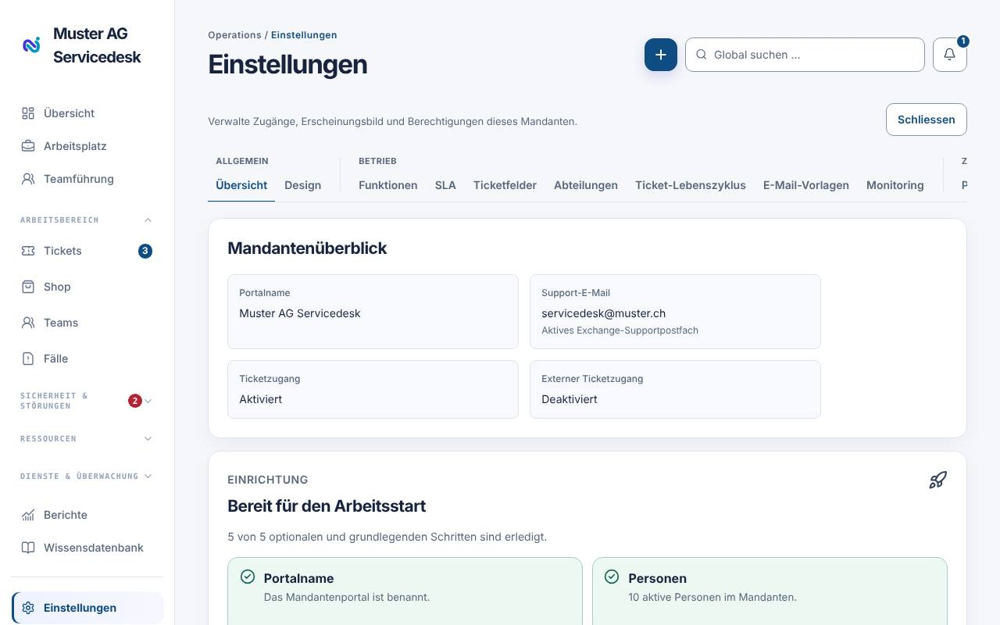
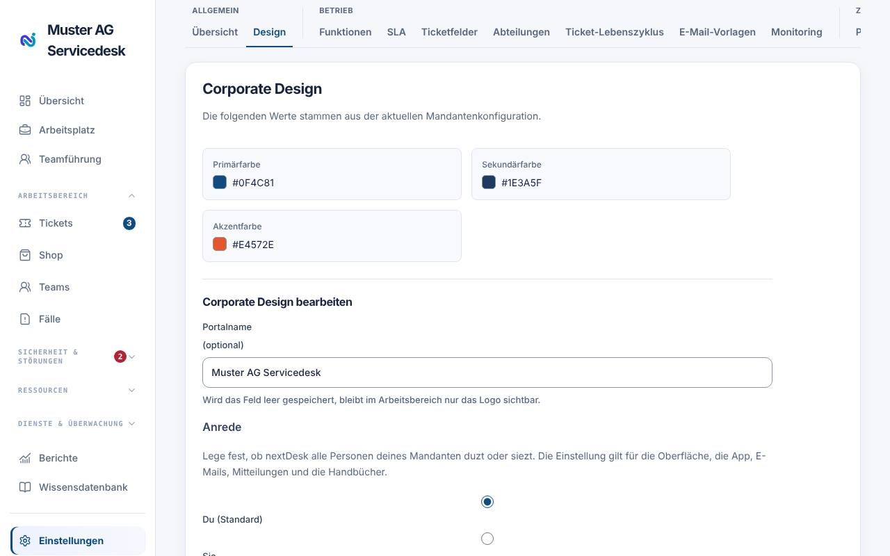
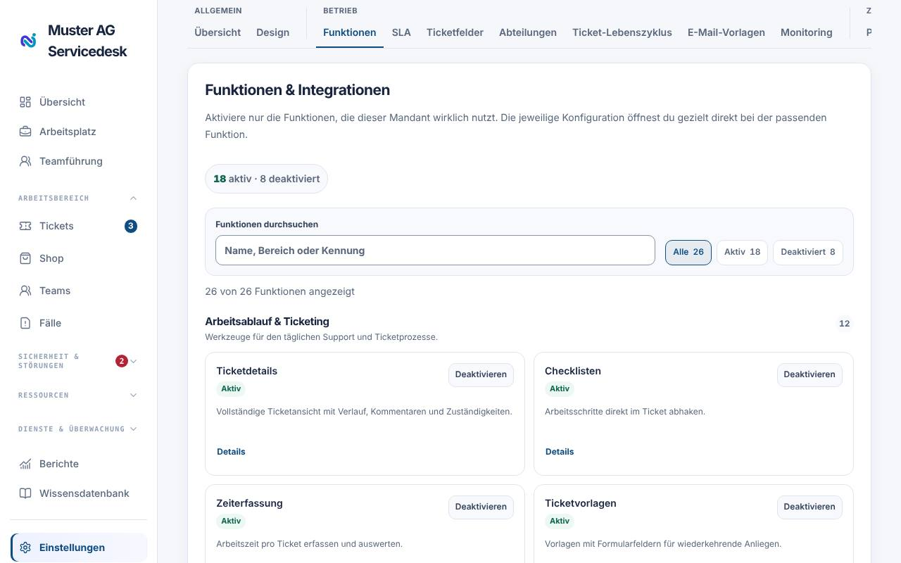
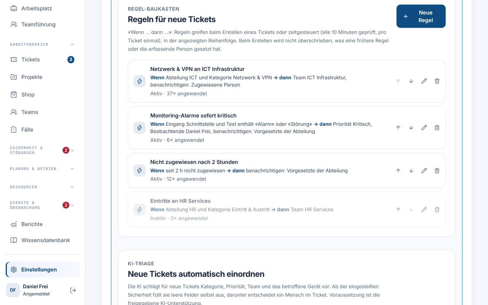
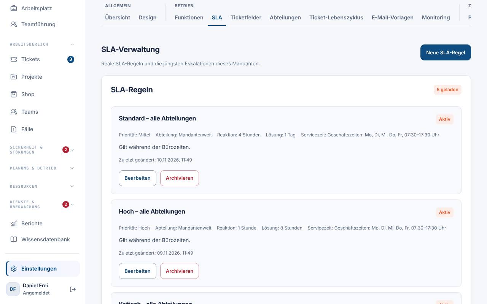
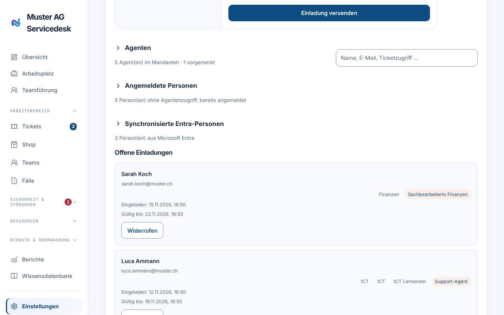
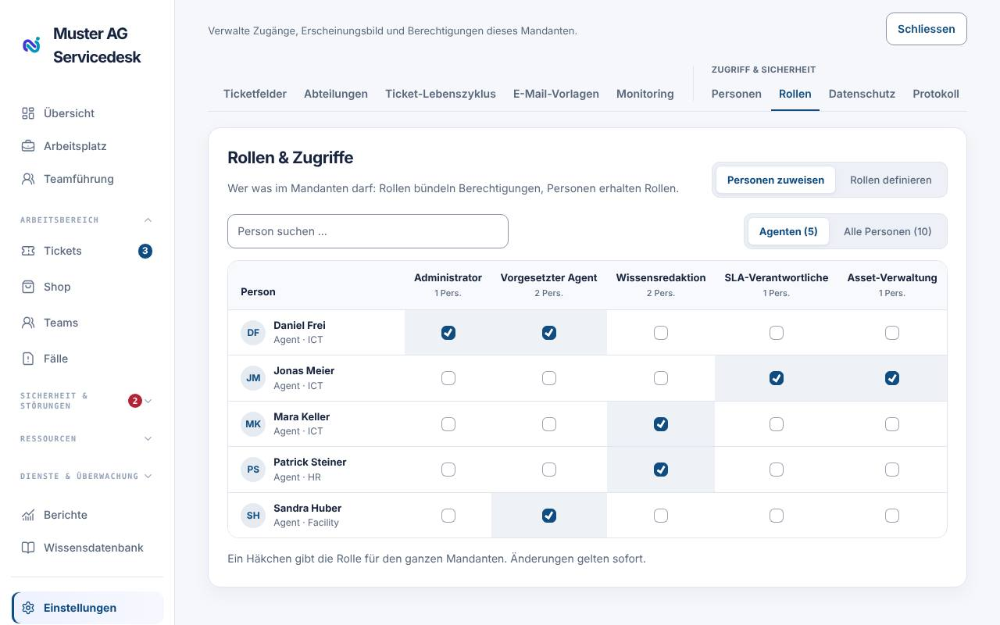
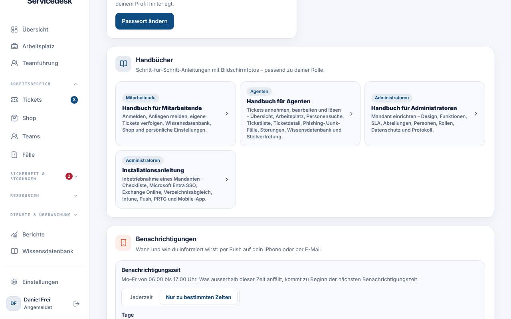

# Handbuch für Administratoren

Dieses Handbuch richtet sich an Personen mit der Rolle **Administrator**
(technisch «Tenant administrator»). Administratoren verwalten den gesamten
Mandanten: Erscheinungsbild, Funktionen, Abläufe, Personen und Berechtigungen.
Für die tägliche Ticketarbeit gilt zusätzlich das _Handbuch für Agenten_, für
die erstmalige Einrichtung von Microsoft 365, SSO und Monitoring die
_Installationsanleitung_.

## Einstellungen öffnen

Der Menüpunkt **Einstellungen** ist nur für Administratoren sichtbar und
steht unten in der linken Navigation. Die Einstellungen sind in Register
gegliedert:

| Gruppe               | Register                                               |
| -------------------- | ------------------------------------------------------ |
| Allgemein            | Übersicht, Design                                      |
| Betrieb              | Funktionen, SLA, Ticketfelder, Abteilungen, Monitoring |
| Zugriff & Sicherheit | Personen, Rollen, Datenschutz, Protokoll               |

Mit **Schliessen** kehren Sie in den Arbeitsbereich zurück.

## Übersicht

Der **Mandantenüberblick** zeigt Portalname, Support-E-Mail, Ticketzugang und
externen Ticketzugang. Darunter führt die Checkliste **«Bereit für den
Arbeitsstart»** durch die wichtigsten Einrichtungsschritte; jeder Punkt
springt direkt in das passende Register. Arbeiten Sie die Checkliste beim
Start eines neuen Mandanten von oben nach unten ab.

## Design (Corporate Design)

Unter **Design → Corporate Design bearbeiten** passen Sie das Portal an Ihr
Unternehmen an:

- **Portalname** (optional, max. 160 Zeichen). Leer lassen, wenn nur das Logo
  erscheinen soll.
- **Portal-Logo**: PNG, JPEG oder WebP bis 2 MB («Datei auswählen», «Logo
  entfernen»).
- **Primärfarbe, Sekundärfarbe, Akzentfarbe**.

Die **Portalansicht** zeigt die Wirkung sofort. Mit **Corporate Design
speichern** übernehmen Sie die Änderungen für alle Personen des Mandanten.

## Funktionen & Integrationen

Im Register **Funktionen** schalten Sie Module für den ganzen Mandanten ein
oder aus. Suchen Sie über **Funktionen durchsuchen** oder filtern Sie nach
_Alle / Aktiv / Deaktiviert_. Jede Karte hat **Aktivieren** bzw.
**Deaktivieren** und – wo vorhanden – **Konfigurieren**.

> Die Konfiguration ändert den Funktionsstatus nicht. Eine deaktivierte
> Funktion behält ihre Konfiguration, verwendet sie aber nicht.

Wichtige Funktionen und ihre Konfiguration:

| Funktion                                                              | Was sie bewirkt / wo konfiguriert                                                                                       |
| --------------------------------------------------------------------- | ----------------------------------------------------------------------------------------------------------------------- |
| Self-Service, Anfragendenportal                                       | Portal für Mitarbeitende mit Wissensartikeln und eigenen Tickets                                                        |
| Wissensdatenbank                                                      | Artikel für Agenten und Mitarbeitende                                                                                   |
| Ticketvorlagen                                                        | **Vorlagen verwalten → Neue Vorlage**: Name, Betreff- und Beschreibungsvorlage, Abteilung, Priorität, Checklistenpunkte |
| SLA-Automatisierung                                                   | Erinnerungen, automatisches Lösen/Schliessen, Regeln für neue Tickets, KI-Triage, Drittanbieter (siehe unten)           |
| E-Mail-Kanal (Exchange Online)                                        | Support-Postfächer und Phishing-Meldungen (siehe Installationsanleitung)                                                |
| Push-Benachrichtigungen                                               | Inhaltsstufe («Nur Ticketnummer» empfohlen); wann jemand Mitteilungen erhält, legt jede Person selbst fest              |
| KI-Assistenz                                                          | Freigabe für Wissensentwürfe mit Claude und Selbstbedienungs-Assistent im Portal                                        |
| Asset-Management                                                      | Geräte und Microsoft Intune; Monitoring liegt im Register «Monitoring»                                                  |
| Service-Reporting                                                     | Berichte und Auswertungen                                                                                               |
| Raumplanung, Eintritte, Bestandsverwaltung, Verträge, Serviceaufgaben | Zusatzmodule für einzelne Abteilungen                                                                                   |
| Single Sign-On                                                        | Anmeldung mit Microsoft Entra ID (siehe Installationsanleitung)                                                         |

### SLA-Automatisierung konfigurieren

Unter **Funktionen → SLA-Automatisierung → Konfigurieren**:

- **Erinnern, lösen, schliessen** (läuft stündlich): _Erinnern nach Tagen_,
  _Höchstens so viele Erinnerungen_, _Lösen nach Tagen (ab Beginn der
  Wartezeit)_, _Schliessen nach Tagen_.
- **Regeln für neue Tickets**: Auslöser «Beim Erstellen eines Tickets» oder
  «Zeitgesteuert». Im Teil **Wenn …** definieren Sie Bedingungen (z. B.
  Stichworte in Betreff oder Beschreibung), im Teil **… dann** die Aktion
  (Team zuweisen, Person zuweisen, Priorität setzen). **Regel speichern**.
- **Neue Tickets automatisch einordnen** (KI-Triage).
- **Automatisierungen**: Mit **Vorschau ausführen** prüfen Sie Regeln vor
  dem Einsatz, das **Prüfintervall in Tagen** erinnert an die regelmässige
  Kontrolle.
- **Drittanbieter**: externe Lieferanten mit E-Mail, Telefon und _Erinnerung
  nach (Stunden)_.

## SLA-Regeln

Das Register **SLA** erscheint, sobald die SLA-Automatisierung aktiv ist.
Mit **Neue SLA-Regel** legen Sie fest:

- **Name der Regel** und **Definition & Auswirkung**
- **Priorität** und **Abteilung** (oder _Mandantenweit_)
- **Servicezeit**: Wochentage und Von/Bis in der Zeitzone Europe/Zurich
- **Reaktionszeit** und **Lösungszeit** in Minuten
- **Regel aktiv**

Unter **Aktuelle Eskalationen** sehen Sie Tickets, deren SLA gefährdet oder
verletzt ist. Nicht mehr benötigte Regeln **archivieren** Sie, statt sie zu
löschen.

## Ticketfelder

Unter **Ticketfelder** gestalten Sie das Ticketformular. Felder unter
_Immer enthalten_ sind fix. Weitere Felder fügen Sie über **Feld auswählen**
bzw. **Feld hinzufügen** hinzu, legen den Feldtyp fest, markieren sie bei
Bedarf als **Pflichtfeld** und speichern mit **Feld speichern**. Die
Reihenfolge ändern Sie per Ziehen und Ablegen.

## Abteilungen und Teams

Im Register **Abteilungen**:

1. **Abteilungen** anlegen (Name → _Abteilung anlegen_). Nicht mehr
   benötigte Abteilungen archivieren.
2. **Abteilungsleitungen**: Leitung und Stellvertretung für interne
   Rückfragen zu Tickets.
3. **Teams pro Abteilung**: Name, Abteilung und Supportstufe
   (1st/2nd/3rd Level). Über **Mitglieder verwalten** ordnen Sie Agenten zu.
4. **Module pro Abteilung**: welche Abteilung welche Zusatzmodule nutzt.

## Monitoring

Das Register **Monitoring** (setzt Asset-Management voraus) bündelt:

- **Monitoring (PRTG)** – Tickets aus PRTG-Alarmen. Sie wählen Abteilung,
  **Team**, Priorität und ob auch Warnungen Tickets erzeugen. Ist die Option
  «Systemstatus des verknüpften Dienstes anpassen» aktiv, ändern Alarme den
  Status der Dienste, die am Gerät in der Infrastruktur hinterlegt sind (ein
  Gerät kann mehrere Dienste haben). Unter **Alarme aus PRTG** beenden Sie
  einen hängenden Alarm mit **Alarm beenden**.
- **Zertifikate und Domains** – Erinnerung vor Ablauf
- **Backup-Überwachung** – z. B. Veeam-Jobs per E-Mail oder Webhook

Die Einrichtung ist in der _Installationsanleitung_ beschrieben.

## Personen und Agenten

Im Register **Personen** (Überschrift «Personen & Agenten») verwalten Sie
alle Zugänge.

### Person einladen

1. Unter **Person einladen** Vor- und Nachname, E-Mail-Adresse, Angebot und
   Funktion erfassen.
2. Soll die Person Tickets bearbeiten, **Arbeitet als Support-Agent**
   ankreuzen und einen **Ticketzugriffsbereich** wählen (Pflicht für Agenten).
3. **Einladung versenden**. Die Einladung ist 7 Tage gültig.

Offene Einladungen sehen Sie unter **Offene Einladungen** und können sie dort
widerrufen. Darunter stehen die Listen **Agenten** (mit Suche) und
**Angemeldete Personen**.

Mit **Bearbeiten** ändern Sie bei einer Person Name, vorgesetzte Person,
Ticketzugriffsbereich und **Team** (z. B. _Servicedesk_ oder _System
Engineer_). Die Teams erscheinen, sobald der Ticketzugriffsbereich gewählt
ist – bei Agenten und bei Mandantenadministratoren, die automatisch
Agentenzugang haben. Speichern mit **Person speichern**.

> Mit aktivem SSO werden Personen aus zugelassenen Domains beim ersten Login
> automatisch als _anfragende Person_ angelegt. Agentenrechte gibt es nur per
> Einladung, Vormerkung oder Rollenzuweisung.

### Personen aus Microsoft Entra

Ist der Verzeichnisabgleich eingerichtet, erscheinen Personen aus Entra in
der Liste. Sie können eine Person **als Agent vormerken** – Name, vorgesetzte
Person, Ticketzugriffsbereich und Team werden bei der ersten
Microsoft-Anmeldung übernommen.

## Rollen und Berechtigungen

Das Register **Rollen** («Rollen & Zugriffe») hat zwei Ansichten, die Sie
oben umschalten:

**Personen zuweisen**

- Suchen Sie über **Person suchen …** und filtern Sie nach **Agenten** oder
  **Alle Personen**.
- In der Tabelle setzen Sie pro Person ein Häkchen bei der gewünschten Rolle;
  ohne Häkchen ist die Rolle wieder entzogen. Die Änderung wirkt sofort für
  den ganzen Mandanten.
- Rollen, die nur für eine Abteilung oder ein Team gelten, stehen unter
  **Auf Abteilung oder Team begrenzte Zuweisungen**; dort nehmen Sie sie mit
  **Entziehen** wieder weg.

**Rollen definieren**

- Links wählen Sie eine bestehende Rolle oder **+ Neue Rolle**.
  Systemrollen sind mit «System» markiert und geschützt.
- Bei einer neuen Rolle geben Sie den **Namen der neuen Rolle** ein, wählen
  unter **Berechtigungen** die gewünschten Rechte (je Gruppe mit **Alle
  auswählen**) und klicken auf **Rolle erstellen**. Unter jeder Berechtigung
  steht kurz, was sie erlaubt; Rechte mit weitreichendem Zugriff sind als
  «Erweitert» markiert.
- Bestehende eigene Rollen ändern Sie und speichern mit **Änderungen
  speichern**; mit **Rolle deaktivieren** bzw. **Rolle aktivieren** schalten
  Sie sie ab oder wieder ein.

Die Basisrollen _Requester_ (alle angemeldeten Personen) und _Support agent_
(über «Arbeitet als Support-Agent») werden nicht direkt vergeben.

> **Handbücher und Rollen:** Welche Handbücher eine Person im Profil sieht,
> folgt automatisch ihren Rollen: alle Mitglieder das Handbuch für
> Mitarbeitende, Personen mit Ticketbearbeitung zusätzlich das Handbuch für
> Agenten, Administratoren alle Handbücher inklusive Installationsanleitung.

## Datenschutz und Aufbewahrung

Unter **Datenschutz** («Aufbewahrung & Datenschutz») legen Sie Fristen in
Tagen fest für _Geschlossene Tickets_, _Private Anhänge_ und das
_Audit-Protokoll_. Die **Rechtliche Aufbewahrungssperre** verhindert jede
Bereinigung. Die Werte sind Richtlinien – nextDesk löscht nie automatisch.

## Protokoll

Das **Protokoll** (Änderungsprotokoll) zeichnet alle administrativen
Änderungen auf. Filtern Sie nach Person, Aktion, Objekt, Schweregrad und
Zeitraum, öffnen Sie einen Eintrag für _Änderungen_ und _Metadaten_ und
exportieren Sie bei Bedarf als **CSV** oder **JSON**.

## Systemstatus veröffentlichen

Der **Systemstatus** liegt im Arbeitsbereich (nicht in den Einstellungen).
Dort planen Sie **Wartungen** und veröffentlichen eine **öffentliche
Statusseite** sowie ein **SharePoint-Badge** (SVG-Bild) für das Intranet.
Das Badge in der Navigation und die Seiten aktualisieren sich selbst (intern
alle 30 Sekunden, öffentlich jede Minute); ein manuelles Neuladen ist nicht
nötig.

## Eigenes Profil und Handbücher

Ihre persönlichen Einstellungen öffnen Sie unten links über Ihren Namen →
**Persönliche Einstellungen**. Unter **Handbücher** finden Sie alle vier
Handbücher.

## Wie mache ich …?

Kurze Anleitungen für die häufigsten Aufgaben. Jede Anleitung steht auch als
interner Artikel in der **Wissensdatenbank**.

### Wie öffne ich die Einstellungen?

Der Menüpunkt **Einstellungen** steht nur Administratoren zur Verfügung, unten
in der linken Navigation. Die Register sind in Gruppen gegliedert:

- **Allgemein** – Übersicht, Design
- **Betrieb** – Funktionen, SLA, Ticketfelder, Abteilungen, Monitoring
- **Zugriff & Sicherheit** – Personen, Rollen, Datenschutz, Protokoll

Mit **Schliessen** kehren Sie in den Arbeitsbereich zurück.

### Wie arbeite ich die Checkliste «Bereit für den Arbeitsstart» ab?

1. Öffnen Sie **Einstellungen → Übersicht**. Der Mandantenüberblick zeigt
   Portalname, Support-E-Mail, Ticketzugang und externen Ticketzugang.
2. Arbeiten Sie die Checkliste **«Bereit für den Arbeitsstart»** beim Start
   eines neuen Mandanten von oben nach unten ab.
3. Jeder Punkt springt direkt in das passende Register.

### Wie passe ich das Corporate Design an?

1. Öffnen Sie **Einstellungen → Design → Corporate Design bearbeiten**.
2. Erfassen Sie optional den **Portalnamen** (max. 160 Zeichen). Lassen Sie ihn
   leer, wenn nur das Logo erscheinen soll.
3. Laden Sie das **Portal-Logo** hoch (PNG, JPEG oder WebP bis 2 MB; «Datei
   auswählen», «Logo entfernen»).
4. Wählen Sie **Primärfarbe**, **Sekundärfarbe** und **Akzentfarbe**.
5. Prüfen Sie die Wirkung in der **Portalansicht** und übernehmen Sie sie mit
   **Corporate Design speichern**. Die Änderung gilt für alle Personen des
   Mandanten.

### Wie schalte ich eine Funktion ein oder aus?

1. Öffnen Sie **Einstellungen → Funktionen**.
2. Suchen Sie über **Funktionen durchsuchen** oder filtern Sie nach _Alle /
   Aktiv / Deaktiviert_.
3. Klicken Sie auf der Karte auf **Aktivieren** bzw. **Deaktivieren**. Wo
   vorhanden, öffnet **Konfigurieren** die Einstellungen der Funktion.

Die Konfiguration ändert den Funktionsstatus nicht. Eine deaktivierte Funktion
behält ihre Konfiguration, verwendet sie aber nicht.

### Wie lege ich eine Ticketvorlage an?

1. Aktivieren Sie unter **Einstellungen → Funktionen** die Funktion
   **Ticketvorlagen**.
2. Wählen Sie **Vorlagen verwalten → Neue Vorlage**.
3. Erfassen Sie Name, Betreff- und Beschreibungsvorlage, Abteilung, Priorität
   und Checklistenpunkte.

### Wie konfiguriere ich die SLA-Automatisierung?

Öffnen Sie **Einstellungen → Funktionen → SLA-Automatisierung →
Konfigurieren**:

1. **Erinnern, lösen, schliessen** (läuft stündlich): _Erinnern nach Tagen_,
   _Höchstens so viele Erinnerungen_, _Lösen nach Tagen (ab Beginn der
   Wartezeit)_, _Schliessen nach Tagen_.
2. **Regeln für neue Tickets**: Wählen Sie den Auslöser «Beim Erstellen eines
   Tickets» oder «Zeitgesteuert». Definieren Sie im Teil **Wenn …**
   Bedingungen (z. B. Stichworte in Betreff oder Beschreibung) und im Teil
   **… dann** die Aktion (Team zuweisen, Person zuweisen, Priorität setzen).
   Speichern Sie mit **Regel speichern**.
3. **Neue Tickets automatisch einordnen** (KI-Triage) bei Bedarf aktivieren.
4. **Automatisierungen**: Mit **Vorschau ausführen** prüfen Sie Regeln vor dem
   Einsatz; das **Prüfintervall in Tagen** erinnert an die regelmässige
   Kontrolle.
5. **Drittanbieter**: externe Lieferanten mit E-Mail, Telefon und _Erinnerung
   nach (Stunden)_ erfassen.

### Wie lege ich eine SLA-Regel an?

Das Register **SLA** erscheint, sobald die SLA-Automatisierung aktiv ist.

1. Wählen Sie **Neue SLA-Regel**.
2. Erfassen Sie **Name der Regel** und **Definition & Auswirkung**.
3. Wählen Sie **Priorität** und **Abteilung** (oder _Mandantenweit_).
4. Legen Sie die **Servicezeit** fest: Wochentage und Von/Bis in der Zeitzone
   Europe/Zurich.
5. Erfassen Sie **Reaktionszeit** und **Lösungszeit** in Minuten und setzen Sie
   **Regel aktiv**.

Unter **Aktuelle Eskalationen** sehen Sie Tickets, deren SLA gefährdet oder
verletzt ist. Nicht mehr benötigte Regeln **archivieren** Sie, statt sie zu
löschen.

### Wie gestalte ich das Ticketformular?

1. Öffnen Sie **Einstellungen → Ticketfelder**. Felder unter _Immer
   enthalten_ sind fix.
2. Fügen Sie über **Feld auswählen** bzw. **Feld hinzufügen** weitere Felder
   hinzu und legen Sie den Feldtyp fest.
3. Markieren Sie ein Feld bei Bedarf als **Pflichtfeld** und speichern Sie mit
   **Feld speichern**.
4. Ändern Sie die Reihenfolge per Ziehen und Ablegen.

### Wie lege ich Abteilungen und Teams an?

Öffnen Sie **Einstellungen → Abteilungen**:

1. Legen Sie **Abteilungen** an (Name → _Abteilung anlegen_). Nicht mehr
   benötigte Abteilungen archivieren Sie.
2. Bestimmen Sie die **Abteilungsleitungen**: Leitung und Stellvertretung für
   interne Rückfragen zu Tickets.
3. Erfassen Sie **Teams pro Abteilung**: Name, Abteilung und Supportstufe
   (1st/2nd/3rd Level). Über **Mitglieder verwalten** ordnen Sie Agenten zu.
4. Legen Sie unter **Module pro Abteilung** fest, welche Abteilung welche
   Zusatzmodule nutzt.

### Wie beende ich einen hängenden Monitoring-Alarm?

Das Register **Monitoring** setzt aktiviertes Asset-Management voraus.

1. Öffnen Sie **Einstellungen → Monitoring → Monitoring (PRTG)**.
2. Suchen Sie unter **Alarme aus PRTG** den offenen Alarm.
3. Klicken Sie auf **Alarm beenden**.

Dabei werden die gestörten Dienste zurückgesetzt. Die Einrichtung des
Monitorings steht in der _Installationsanleitung_.

### Wie lade ich eine Person ein?

1. Öffnen Sie **Einstellungen → Personen → Person einladen** und erfassen Sie
   Vor- und Nachname, E-Mail-Adresse, Angebot und Funktion.
2. Soll die Person Tickets bearbeiten, kreuzen Sie **Arbeitet als
   Support-Agent** an und wählen einen **Ticketzugriffsbereich** (Pflicht für
   Agenten).
3. Klicken Sie auf **Einladung versenden**. Die Einladung ist 7 Tage gültig.

Offene Einladungen sehen und widerrufen Sie unter **Offene Einladungen**. Mit
**Bearbeiten** ändern Sie Name, vorgesetzte Person, Ticketzugriffsbereich und
**Team**; speichern Sie mit **Person speichern**. Mit aktivem SSO werden
Personen aus zugelassenen Domains beim ersten Login automatisch als _anfragende
Person_ angelegt. Agentenrechte gibt es nur per Einladung, Vormerkung oder
Rollenzuweisung.

### Wie merke ich eine Person aus Microsoft Entra als Agent vor?

Ist der Verzeichnisabgleich eingerichtet, erscheinen Personen aus Entra im
Register **Personen**.

1. Suchen Sie die Person in der Liste.
2. Wählen Sie **als Agent vormerken**.

Name, vorgesetzte Person, Ticketzugriffsbereich und Team werden bei der ersten
Microsoft-Anmeldung übernommen.

### Wie weise ich Rollen zu?

1. Öffnen Sie **Einstellungen → Rollen** und wählen Sie die Ansicht **Personen
   zuweisen**.
2. Suchen Sie über **Person suchen …** und filtern Sie nach **Agenten** oder
   **Alle Personen**.
3. Setzen Sie in der Tabelle pro Person ein Häkchen bei der gewünschten Rolle.
   Ohne Häkchen ist die Rolle wieder entzogen. Die Änderung wirkt sofort für
   den ganzen Mandanten.
4. Rollen, die nur für eine Abteilung oder ein Team gelten, stehen unter **Auf
   Abteilung oder Team begrenzte Zuweisungen**; dort nehmen Sie sie mit
   **Entziehen** wieder weg.

Die Basisrollen _Requester_ und _Support agent_ werden nicht direkt vergeben.

### Wie erstelle ich eine eigene Rolle?

1. Öffnen Sie **Einstellungen → Rollen** und wählen Sie die Ansicht **Rollen
   definieren**.
2. Klicken Sie links auf **+ Neue Rolle** und geben Sie den **Namen der neuen
   Rolle** ein.
3. Wählen Sie unter **Berechtigungen** die gewünschten Rechte (je Gruppe mit
   **Alle auswählen**). Unter jeder Berechtigung steht kurz, was sie erlaubt;
   Rechte mit weitreichendem Zugriff sind als «Erweitert» markiert.
4. Klicken Sie auf **Rolle erstellen**.

Bestehende eigene Rollen ändern Sie und speichern mit **Änderungen
speichern**; mit **Rolle deaktivieren** bzw. **Rolle aktivieren** schalten Sie
sie ab oder wieder ein. Systemrollen sind mit «System» markiert und geschützt.

### Wie lege ich Aufbewahrungsfristen fest?

1. Öffnen Sie **Einstellungen → Datenschutz** («Aufbewahrung & Datenschutz»).
2. Legen Sie Fristen in Tagen fest für _Geschlossene Tickets_, _Private
   Anhänge_ und das _Audit-Protokoll_.
3. Setzen Sie bei Bedarf die **Rechtliche Aufbewahrungssperre**; sie
   verhindert jede Bereinigung.

Die Werte sind Richtlinien – nextDesk löscht nie automatisch.

### Wie prüfe ich das Protokoll?

1. Öffnen Sie **Einstellungen → Protokoll** (Änderungsprotokoll). Es zeichnet
   alle administrativen Änderungen auf.
2. Filtern Sie nach Person, Aktion, Objekt, Schweregrad und Zeitraum.
3. Öffnen Sie einen Eintrag für _Änderungen_ und _Metadaten_.
4. Exportieren Sie bei Bedarf als **CSV** oder **JSON**.

### Wie veröffentliche ich den Systemstatus?

Der **Systemstatus** liegt im Arbeitsbereich, nicht in den Einstellungen.
Dort planen Sie **Wartungen** und veröffentlichen eine **öffentliche
Statusseite** sowie ein **SharePoint-Badge** (SVG-Bild) für das Intranet. Das
Badge in der Navigation und die Seiten aktualisieren sich selbst (intern alle
30 Sekunden, öffentlich jede Minute); ein manuelles Neuladen ist nicht nötig.

### Wie sehe ich, welche Handbücher eine Person sieht?

Die Handbücher im Profil folgen automatisch den Rollen: Alle Mitglieder sehen
das Handbuch für Mitarbeitende, Personen mit Ticketbearbeitung zusätzlich das
Handbuch für Agenten, Administratoren alle Handbücher inklusive
Installationsanleitung. Ihre eigenen Handbücher öffnen Sie über Ihren Namen
unten links → **Persönliche Einstellungen → Handbücher**.
