# Handbuch für Agenten

Dieses Handbuch richtet sich an alle, die in nextDesk Tickets bearbeiten.
Grundlagen wie Anmeldung, persönliche Einstellungen und die Mobile-App
beschreibt das _Handbuch für Mitarbeitende_, das Ihnen ebenfalls zur
Verfügung steht.

## Einführungstour

Beim ersten Login startet eine kurze **Einführung** (Startseite, Tickets,
Im Ticket, Benachrichtigungen, Darstellung). Sie können sie mit **Einführung
beenden** abbrechen und später über _Persönliche Einstellungen → Darstellung
anpassen → Einführung erneut starten_ wiederholen.

## Navigation

Die linke Navigation ist gegliedert in:

- **Übersicht** – Ihre Startseite mit Kennzahlen
- **Arbeitsplatz** – Team-Queues, Erwähnungen, Stellvertretung, Wiedervorlagen
- **Teamführung** – nur für Leitungen von Abteilungen
- **Arbeitsbereich**: Tickets, Shop, Fälle, Sicherheitsfälle, Störungen
  (Sicherheitsfälle und Störungen nur für das zuständige Team, siehe unten)
- **Planung und Betrieb**: Raumplanung, Eintritte, Serviceaufgaben
- **Ressourcen**: Assets, Lager, Verträge, Lizenzen
- **Dienste und Überwachung**: Dienste, Infrastruktur, IP-Adressen,
  Systemstatus
- **Berichte**
- **Wissensdatenbank**

Welche Einträge Sie sehen, hängt von den freigeschalteten Funktionen und
Ihren Berechtigungen ab.

Zahlen neben den Einträgen zeigen, was auf Sie wartet: bei **Tickets** die
offenen Tickets, die noch keinem Agenten zugewiesen sind (auch wenn schon ein
Team gesetzt ist) – dieselbe Zahl wie in der Kachel «Nicht zugewiesene
Tickets» –, bei
**Sicherheitsfällen** die offenen Fälle, die noch niemandem zugewiesen
sind, bei **Störungen** die aktiven Störungen, die noch niemand bestätigt
hat, bei **Raumplanung**, **Shop** und
**Eintritte** die offenen Anfragen. Die Zahlen aktualisieren sich jede Minute.

Das **Systemstatus-Badge** oben in der Navigation und die Seite
**Systemstatus** aktualisieren sich selbst (alle 30 Sekunden und beim
Zurückkehren in den Tab). In der **Infrastruktur** hat ein Gerät einen oder
mehrere **Dienste (für Systemstatus)**, die bei einer Überwachungsstörung
(PRTG) ihren Status ändern, die **Höheneinheit** als «von … bis» und
Wartungseinträge mit Datum und optionaler **Uhrzeit**. In der
**Wartungscheckliste** erfassen Sie jeden Punkt in einer eigenen Zeile mit
einem eigenen **Datum** (z. B. wann er erledigt wurde oder wann er dran ist);
**Punkt hinzufügen** ergänzt eine Zeile, × entfernt sie. In der Ansicht **Racks**
erfassen Sie mit **Rack erfassen** ein Rack (Name, Standort, Höhe in HE,
Notizen; einen fehlenden Standort legen Sie dort mit **+ Neuer Standort …**
an) und ändern es über den **Stift** am Rack. Ein neuer Name oder
Standort gilt auch für die Geräte im Rack; die Höhe muss mindestens bis zum
obersten Gerät reichen. Leere Racks lassen sich löschen. Geräte mit einer
aktiven Störung aus PRTG erscheinen im Rack rot mit blinkender Leuchte.

Oben rechts stehen **+ (Erfassen)**, die **globale Suche** und die
**Benachrichtigungen**.

## Personen suchen und Personenübersicht

In der **globalen Suche** finden Sie als Agent auch **Personen**: alle
Mitarbeitenden aus Microsoft Entra sowie Ticketkontakte, die nicht im
Verzeichnis stehen. Suchen Sie nach Name, E-Mail-Adresse, Funktion oder
Abteilung. Die Reiter _Alle / Personen / Tickets …_ filtern die Treffer. Neben
dem Namen sehen Sie die Anzahl offener Tickets; gesperrte Konten sind als
**Deaktiviert** markiert. Mitarbeitende ohne Agentenrolle sehen keine Personen.

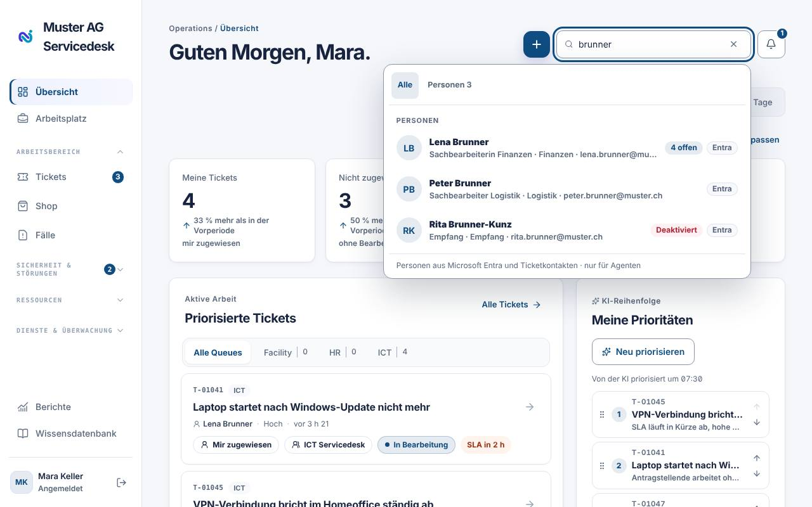

Ein Klick auf eine Person öffnet die **Personenübersicht**. Sie erreichen sie
auch im Ticket über den Namen unter **Anfragende Person** (in der App:
**Personenübersicht** unter der anfragenden Person).

- **Kopf**: Foto (aus Microsoft Entra, sonst die Initialen), Funktion,
  Abteilung, E-Mail, vorgesetzte Person, letzte Anmeldung und Kontostatus aus
  Entra. Mit **Ticket für … erfassen** öffnet sich das
  Ticketformular mit der Person als anfragender Person.
- **Kennzahlen**: offene Tickets (davon wartend auf die Person), Tickets der
  letzten 12 Monate, durchschnittliche Lösungszeit im Vergleich zum Mandanten
  und die **Zufriedenheit**.
- **Reiter**: **Tickets** (alle, auch geschlossene; filterbar nach _Alle /
  Offen / Geschlossen_), **Geräte** aus Intune und Assets (ein Klick öffnet das Gerät), **Lizenzen**,
  **Bestellungen** aus dem Shop und der **Verlauf** als Zeitleiste. Geräte,
  Lizenzen und Bestellungen erscheinen nur, wenn das Modul aktiv ist und Sie
  die Berechtigung dafür haben.
- **Häufige Themen**: die Kategorien, zu denen die Person am häufigsten
  Tickets erfasst.

Sie sehen nur Tickets, die Sie auch sonst öffnen dürfen.

> **Datenschutz:** Einzelne Bewertungen und Kommentare der Person werden nie
> angezeigt. nextDesk zeigt nur den **Durchschnitt** (mit Anteil zufriedener
> Bewertungen, Mandantenvergleich und Tendenz), schon ab der ersten Bewertung.

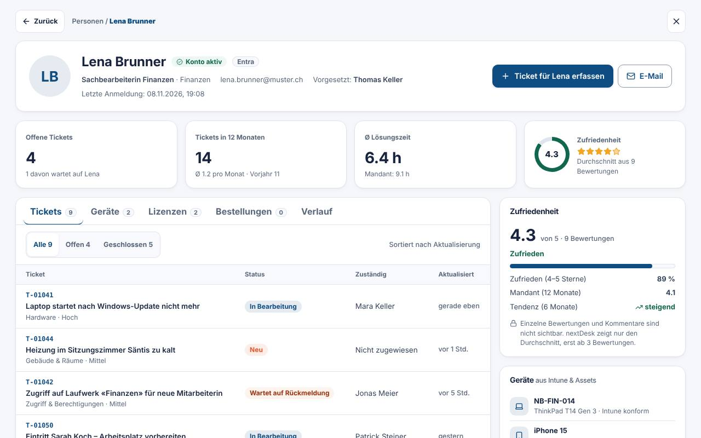

## Übersicht

Die **Übersicht** begrüsst Sie und zeigt für den gewählten Zeitraum
(_Heute / 7 Tage / 30 Tage_) die Kennzahlen **Offene Tickets**, **Meine
Tickets**, **Nicht zugewiesene Tickets** und **Gelöste Tickets**. Ein Klick
auf eine Kachel öffnet die passende gefilterte Liste.

Weitere Blöcke:

- **Priorisierte Tickets** und **Meine Prioritäten** – von der KI
  vorgeschlagene Reihenfolge; per Ziehen anpassen, **Neu priorisieren** oder
  **Eigene Reihenfolge verwerfen**
- **Freigaben** – Entscheidungen, die auf Sie warten
- **Meine Kennzahlen** – z. B. heute gelöst, Median der ersten Antwort
- **Gerade passiert** – die neuesten Ereignisse

Mit **Startseite anpassen** blenden Sie Blöcke ein oder aus.

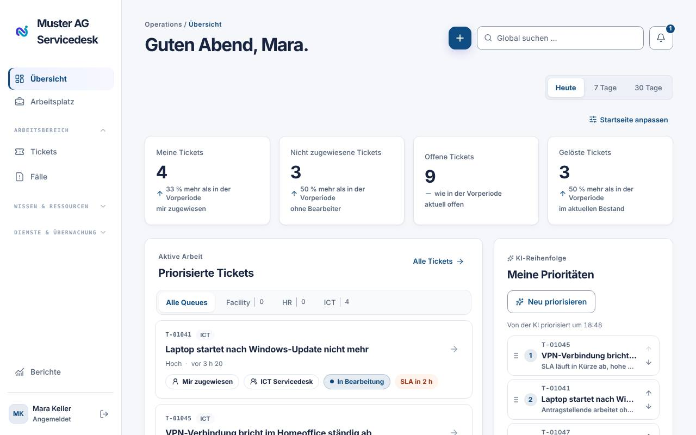

## Arbeitsplatz

Der **Arbeitsplatz** bündelt Ihre persönliche Arbeit in Registern:

- **Team** – die **Team-Warteschlangen**: offene Tickets pro Team, Ihre
  eigenen Teams zuoberst (markiert mit _Mein Team_). Daneben steht, wie viele
  davon noch **ohne Bearbeiter** sind. **Ohne Teamzuordnung** sammelt offene
  Tickets, die noch keinem Team zugeteilt sind. Ein Klick zeigt genau diese
  Tickets in der Ticketliste (Filter «Warteschlange: …», mit × entfernen).
- **Erwähnungen** – wo Sie mit @ erwähnt wurden
- **Stellvertretung** – Tickets abwesender Kolleginnen und Kollegen
- **Störungen** – aktive Störungen
- **Wiedervorlagen** – Tickets, die Sie sich zu einem Datum vorgemerkt haben
- **Mein Bereich** – eigene Tickets, Geräte, Freigaben und **Phishing melden**

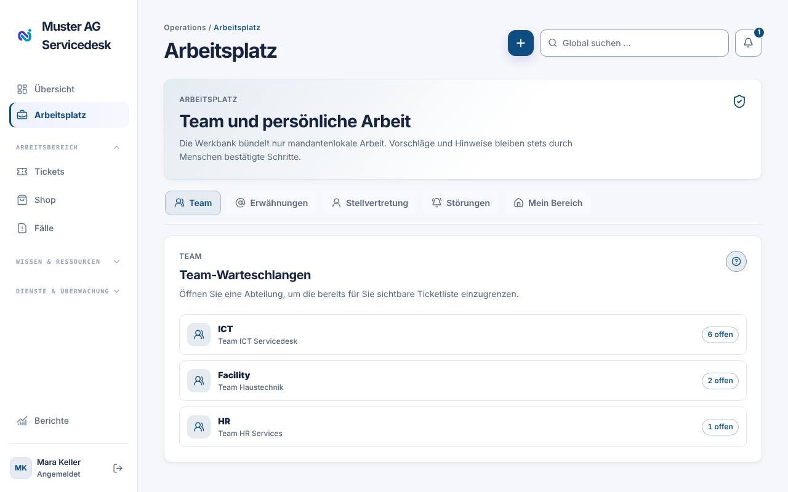

### Abwesenheit und Stellvertretung

Unter **Arbeitsplatz → Stellvertretung → Stellvertretung anlegen** wählen Sie
die stellvertretende Person, Beginn, Ende und eine Notiz und speichern mit
**Stellvertretung speichern**. Ihre Tickets erscheinen in dieser Zeit bei der
Stellvertretung.

### Phishing melden

Unter **Mein Bereich → Phishing melden** laden Sie eine verdächtige E-Mail
(.eml oder .msg) hoch oder fügen die Kopfzeilen ein und klicken auf
**Melden**. In Outlook geht es auch mit **Melden → Phishing melden**. Daraus
entsteht ein Sicherheitsfall (siehe unten).

## Sicherheitsfälle

**Sicherheitsfälle** (in der App **Phishing**) sehen nur die Mitglieder des
Sicherheitsteams, das in den Phishing-Einstellungen gewählt ist. Ohne gewähltes
Team sehen sie alle Agenten.

Gemeldete Phishing-Mails erscheinen nicht in der Ticketliste (weder im Web
noch in der App), sondern unter **Sicherheitsfälle**. Meldet mehr als eine Person dieselbe E-Mail, entsteht
nur ein Fall; alle Melder hängen daran (Kennzeichen **Kampagne**). Die Kacheln
zeigen, was zu beurteilen ist, wie viele Fälle noch Massnahmen haben, die
Meldungen von heute, die mittlere Zeit bis zum Urteil und wie oft Melder
angegeben haben, geklickt zu haben.

Ein Klick auf eine Kachel zeigt darunter die passenden Fälle: _Meldungen
heute_ die heute gemeldeten, _Zeit bis Urteil_ die in den letzten 30 Tagen
beurteilten, _Geklickt_ die Fälle, bei denen jemand angegeben hat, geklickt zu
haben. **Filter aufheben** führt zurück zu den Fällen, die zu beurteilen sind.

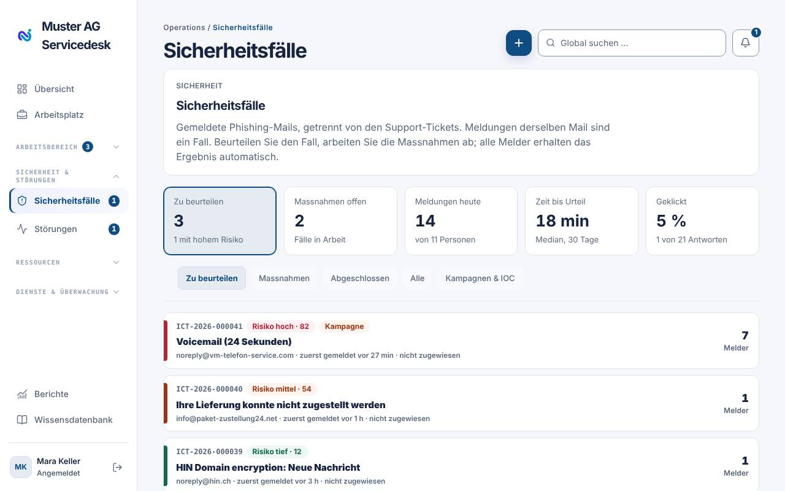

Ein Klick öffnet den Fall. Die gemeldete E-Mail steht in einer **sicheren
Ansicht**: Links sind entschärft (`hxxps`, `[.]`) und nicht anklickbar, Bilder
werden nicht geladen und Anhänge erscheinen nur mit Name und Grösse. Daneben
stehen die Befunde der automatischen Analyse (SPF, DKIM, DMARC, Absender,
Links, Anhänge) und die Risikoeinschätzung. Bei hohem Risiko soll das Urteil
innerhalb von 30 Minuten fallen, bei mittlerem innerhalb von 4 Stunden,
sonst innerhalb eines Tages.

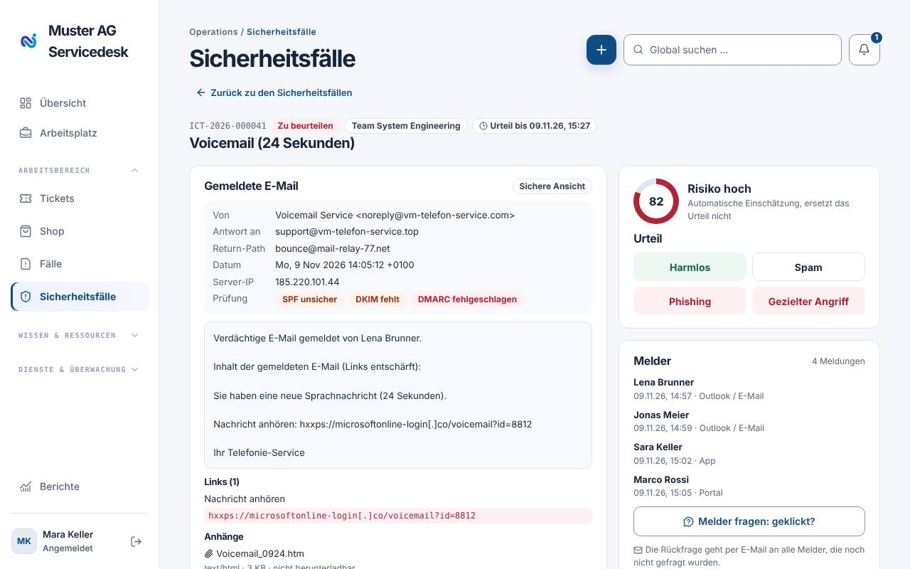

Unter **Zuständig** weisen Sie den Fall einer Person zu (oder mit **Mir
zuweisen** sich selbst). Zur Auswahl stehen die Agenten, die den Fall
bearbeiten dürfen, bei einem Team die Mitglieder dieses Teams. In der Liste
steht bei jedem Fall, wer zuständig ist.

So bearbeiten Sie einen Fall:

1. **Urteil fällen**: _Harmlos_, _Spam_, _Phishing_ oder _Gezielter Angriff_
   wählen und bestätigen. Alle Melder erhalten danach automatisch eine E-Mail
   mit dem Ergebnis.
2. **Massnahmen abarbeiten**: Je nach Urteil erscheint eine Checkliste (z. B.
   Absender sperren, Mail aus allen Postfächern entfernen). Haken Sie erledigte
   Schritte ab.
3. **Melder fragen: geklickt?** schickt allen Meldern eine kurze Rückfrage.
   Ihre Antwort (_Geklickt_ / _Nicht geklickt_) erscheint bei der Person; wer
   geklickt hat, löst eine Benachrichtigung an das Sicherheitsteam aus.
4. **Fall abschliessen**, sobald alles erledigt ist. Bei _Harmlos_ ohne
   Massnahmen schliesst sich der Fall direkt nach dem Urteil.

Melder bekommen für Phishing-Meldungen keine Eingangsbestätigung, nur eine
Dankesnachricht und später das Ergebnis.

In der **iOS- und Android-App** heisst der Bereich **Phishing** (untere
Leiste, links vom Home-Knopf). Dort fällen Sie das Urteil, weisen den Fall zu,
haken Massnahmen ab, fragen die Melder nach einem Klick und schliessen den
Fall ab. Ein Tipp auf eine Phishing-Mitteilung öffnet den Fall direkt.

## Störungen

**Störungen** sehen nur die Mitglieder des Teams für die Alarmierung aus den
PRTG-Einstellungen. Ohne gewähltes Team sehen sie alle Agenten.

Meldungen aus PRTG landen nicht in der Ticketliste, sondern unter
**Störungen** im Arbeitsbereich. Ein Ticket braucht es dafür nicht: Sie
bearbeiten die Störung vollständig dort.

- **Eine Störung pro Gerät**: Weitere Sensoren desselben Geräts (z. B. Ping
  und SNMP) hängen an derselben Störung. Kommt das Gerät innerhalb von
  10 Minuten erneut in Störung, öffnet sich die bisherige Störung wieder.
- **Folgestörungen**: Fällt ein Gerät aus, das hinter einem bereits gestörten
  Gerät hängt (Uplink in der Infrastruktur), erscheint es eingerückt als
  Folgestörung und wird nicht separat alarmiert. Es behebt sich mit der
  Ursache.
- **Alarmierung**: Sobald PRTG eine Störung meldet, erhält das in den
  Monitoring-Einstellungen gewählte Team (ohne Team alle Agenten) sofort eine
  Push-Mitteilung und eine E-Mail. Solange niemand die Störung bestätigt, wird
  in dem eingestellten Abstand (Standard 15 Minuten) erneut alarmiert. Wird
  aus einer Warnung ein Ausfall, kommt ebenfalls ein Alarm. Während einer
  Wartung im Systemstatus wird die Störung erfasst, aber nicht alarmiert.
- **Kacheln**: _Aktiv_ (Ausfälle und Warnungen), _Unbestätigt_ (mit der
  ältesten offenen Zeit), _Betroffene Dienste_, _Behebungszeit_ (Median der
  letzten 30 Tage) und _Verfügbarkeit_ der überwachten Geräte. Ein Klick auf
  eine Kachel zeigt darunter die passenden Störungen; **Filter aufheben** führt
  zurück zu den aktiven.
- **Register**: _Aktiv_, _Behoben_ und _Alle_. Die Dauer läuft live mit, und
  die Liste aktualisiert sich alle 30 Sekunden.
- **Automatisch erledigt**: Meldet PRTG wieder OK, verschwindet die Störung
  aus _Aktiv_ und ist automatisch abgeschlossen. Sie muss weder bestätigt noch
  von Hand abgeschlossen werden, und die Alarmierung hört auf.

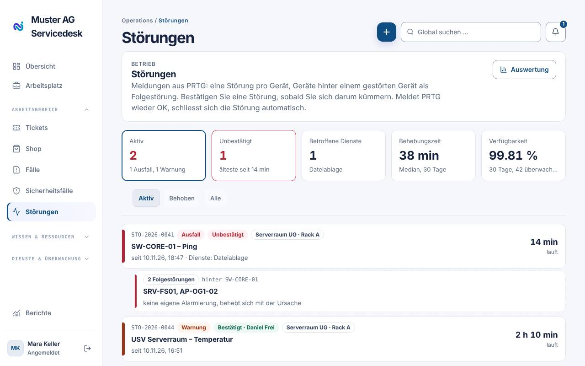

Ein Klick öffnet die Störung:

1. **Bestätigen: ich kümmere mich** stoppt die erneute Alarmierung und weist
   Ihnen die Störung zu, falls noch niemand zuständig ist. Unter
   **Zuständig** ändern Sie die Person (oder **Mir zuweisen**).
2. Der **Verlauf** zeigt alle PRTG-Meldungen und was in nextDesk geschah
   (geöffnet, alarmiert, bestätigt, Notizen). Mit **Notiz zum Verlauf
   hinzufügen** halten Sie fest, was Sie geprüft oder veranlasst haben.
3. **Letzte 24 Stunden** zeigt, wann das Gerät gestört war, und warnt, wenn
   es in dieser Woche mehrfach ausgefallen ist. Darunter stehen die
   **Sensoren** mit ihrem letzten Stand.
4. Rechts sehen Sie **Gerät** (Ort, Adresse, PRTG-Objekt), die
   **Abhängigkeiten** (vorgelagerte Geräte und Folgestörungen) und die
   **betroffenen Dienste**. Der Systemstatus wird automatisch gesetzt und nach
   der Behebung zurückgesetzt.
5. Meldet PRTG wieder OK, schliesst sich die Störung automatisch. Bei Bedarf
   tragen Sie unter **Ursache nachtragen** die Ursache (Strom, Netzwerk,
   Hardware, Software, Wartung, Extern, Unbekannt) nach; das ist freiwillig
   und fliesst in die Auswertung ein. Eine noch aktive Störung schliessen Sie
   unter **Abschliessen** mit Ursache von Hand ab, etwa wenn ein «Up» von PRTG
   verloren ging; Folgestörungen werden mit abgeschlossen.

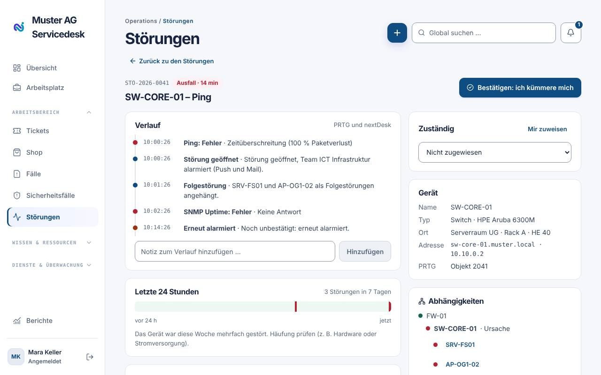

Über **Auswertung** sehen Sie für 30 oder 90 Tage die Anzahl Störungen, die
mittlere Behebungszeit, die Verfügbarkeit, die häufigsten Ursachen und die
Geräte mit den meisten Störungen.

Die Benachrichtigungen dazu schalten Sie unter _Persönliche Einstellungen →
Benachrichtigungen → Störungen_ (Push und E-Mail) ein oder aus.

In der **iOS- und Android-App** finden Sie **Störungen** in der unteren Leiste
links vom Home-Knopf (Tickets, Störungen, Phishing). Dort sehen Sie die aktiven und unbestätigten
Störungen samt Folgestörungen, bestätigen sie, weisen sie zu, ergänzen Notizen
und schliessen sie ab oder tragen die Ursache nach. Ein Tipp auf eine
Störungs-Mitteilung öffnet die Störung direkt.

## Ticketliste

Unter **Tickets** arbeiten Sie die Warteschlangen ab. Jede Ticketkarte zeigt
neben Nummer und Betreff auch die **anfragende Person** – in der Liste, auf
der Übersicht, im Kanban und in der App.

- **Queues**: Register pro Warteschlange. Arbeiten Sie in Teams mehrerer
  Supportstufen, erscheinen zusätzlich _Alle Stufen / 1st / 2nd / 3rd Level_.
  Wählen Sie eine Stufe, zeigen auch die Kacheln oben nur die Zahlen dieser
  Stufe.
- **Filter & Sortierung**: Suche, Status, Priorität, Agent (_Mir zugewiesen_,
  _Nicht zugewiesen_), Abteilung, Sortierung. **Filter zurücksetzen** stellt
  alles zurück.
- **Gespeicherte Ansichten**: Filter als **Neue Ansicht** speichern und auf
  Wunsch mit der Abteilung teilen («Teilen mit»).
- **Ansicht**: Listendichte (_Kompakt / Standard / Komfortabel_) und
  Listen-Detail-Ansicht (Liste links, Ticket rechts).
- **Mehrfachauswahl**: mehrere Tickets markieren → **Neuer Status** →
  **Status für Auswahl setzen**.

### Gelöschte Tickets (Papierkorb)

Mit der Berechtigung zum Löschen können Sie markierte Tickets über
**Löschen** entfernen. Sie kommen in den **Papierkorb**: Sie sind nirgends mehr
sichtbar (Listen, Suche, Berichte, App), lösen keine Benachrichtigungen oder
Mails mehr aus und lassen sich **90 Tage lang wiederherstellen**. Danach werden
sie automatisch endgültig entfernt, samt Kommentaren und Anhängen.

Den Papierkorb öffnen Sie in der Ticketliste über **Filter & Sortierung →
Gelöschte Tickets anzeigen**. Dort sehen Sie, wer ein Ticket wann gelöscht hat
und wie lange es noch wiederherstellbar ist. Ein Klick zeigt das Ticket mit
Beschreibung und Verlauf; **Wiederherstellen** holt es unverändert zurück.

**Tastenkürzel:** `?` zeigt die Hilfe, `J`/`K` springen zum nächsten bzw.
vorherigen Ticket, `Enter` öffnet, `Esc` schliesst.

### Kanban

Über den Umschalter **Liste / Kanban** sehen Sie die Tickets als Spalten nach
Status. Ziehen Sie eine Karte in eine andere Spalte, um den Status zu ändern.

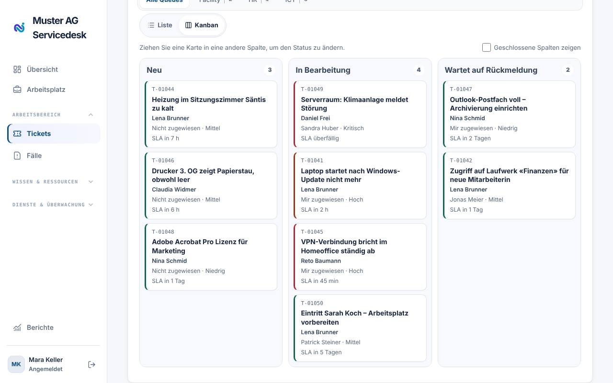

## Ein Ticket bearbeiten

Öffnen Sie ein Ticket mit einem Klick. Im Kopf- und Infobereich ändern Sie
direkt **Status**, **Priorität**, **Kategorie**, **Team** und **zugewiesene
Person**. Ein Klick auf den Namen der **anfragenden Person** öffnet ihre
Personenübersicht. Mit dem **Stift** in der Karte **Beschreibung** bearbeiten
Sie Betreff und Beschreibung direkt dort (**Beschreibung speichern** oder
Strg/⌘ + Enter).

Oben rechts im Ticketkopf sehen Sie als runde Profilbilder (ohne Foto: Kürzel)
alle Kolleginnen und Kollegen, die das Ticket gerade geöffnet haben. Bewegen Sie die Maus über ein
Bild, sehen Sie den Namen. Ein grüner Rand bedeutet, dass die Person gerade
etwas ändert; so vermeiden Sie doppelte Arbeit.

**Status ändern heisst Ticket übernehmen:** Wer den Status eines Tickets ändert
(im Ticketdetail, auf der Kachel in Liste und Kanban oder in der App), wird
automatisch als **zugewiesene Person** eingetragen, sofern er oder sie das
Ticket bearbeiten darf. Das gilt auch für ein neues, noch nicht zugewiesenes
Ticket: der Status «Neu» lässt sich dann direkt ändern. Wählen Sie im selben
Schritt eine andere Person aus, gilt diese Auswahl. Bei der Mehrfachauswahl
(Sammelaktion) wird nicht automatisch zugewiesen.

Über der Beschreibung zeigt die kompakte **Ticket-Zeitachse** alle
Ereignisse, die Reaktions- und Lösungsfrist sowie längere Lücken. Darunter
folgt die **Unterhaltung** mit allen Nachrichten und Notizen.

Rechts unter der **Übersicht** liegt die Karte **Koordination**. Sie zeigt die
**Supportstufe** mit dem zuständigen Team (**An nächste Stufe übergeben**,
**Verlauf der Stufen**) sowie Teil-Tickets und Drittanbieter (**Aufteilen**,
**An Drittanbieter übergeben**).

Tickets aus E-Mails enthalten die E-Mail-Signatur nicht mehr. Stammt die Mail
von einer Adresse ausserhalb Ihrer Organisation, stehen unter **Anfragende
Person** zusätzlich die E-Mail-Adresse und alle Telefonnummern aus der
Signatur; ein Klick startet Anruf oder E-Mail.

Hat die anfragende Person genau ein Gerät (zugewiesen oder als primäre Person
in Intune), verknüpft nextDesk es beim Erstellen des Tickets automatisch. Bei
mehreren Geräten erscheinen sie unter **Asset / Katalogeintrag verknüpfen**
als **Geräte der anfragenden Person**; ein Klick verknüpft das passende Gerät.

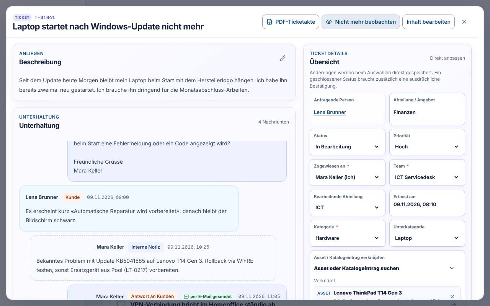

### Antworten und interne Notizen

Wählen Sie im Antwortbereich den Modus:

- **Antwort an anfragende Person** → **Externe Antwort senden**. Die Person
  sieht die Antwort im Portal und per E-Mail.
  Im Antwortfeld steht bereits die Begrüssung «Lieber Vorname» mit Platz
  darunter; ein Klick ins Feld setzt den Cursor direkt dahinter. Sie können die
  Begrüssung ändern oder löschen. Eine Antwort, die nur aus der Begrüssung
  besteht, wird nicht gesendet.
  Antworten an die anfragende Person sind nur möglich, wenn das Ticket
  **zugewiesen**, **in Bearbeitung** und einer **Kategorie** zugeordnet ist
  (sofern die Abteilung Kategorien hat). Sonst bleibt nur die interne Notiz
  wählbar; der Hinweis am Knopf nennt, was fehlt.
- **Interne Notiz** → **Interne Notiz speichern**. Nur für berechtigte
  Mitarbeitende sichtbar.

Praktische Helfer:

- **Antwort senden und als gelöst markieren** in einem Schritt
- `@Name` erwähnt Kolleginnen und Kollegen
- **Bilder hochladen**, **Makro anwenden**, **KI-Entwurf erstellen**
  (falls KI-Assistenz aktiv)

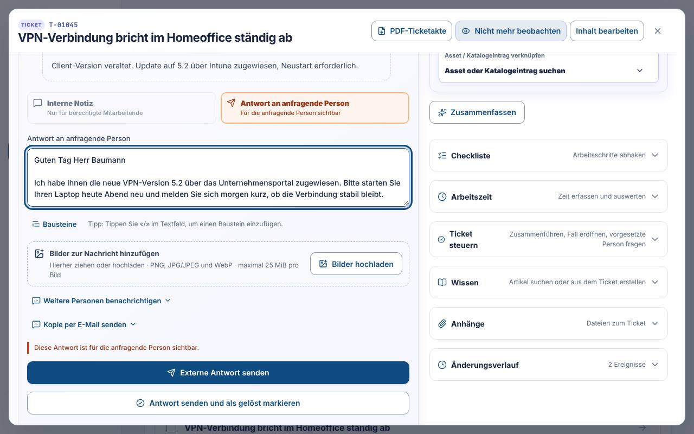

### Anhänge

Unter der **Beschreibung** zeigt eine schlanke Zeile alle **Anhänge** als Chips
(Typ-Symbol oder Bildvorschau, Name, Grösse). Ein Klick lädt die Datei herunter,
das **×** löscht sie nach Rückfrage. Ab fünf Dateien erscheint **+n weitere**.
Mit **+ Anhang** wählen Sie eine oder mehrere Dateien aus; Sie können sie auch
direkt auf die Zeile ziehen (max. 25 MiB pro Datei).

### Weitere Aktionen im Ticket

| Aktion                                      | Wofür                                                   |
| ------------------------------------------- | ------------------------------------------------------- |
| Anhang hinzufügen                           | Dateien zum Ticket ablegen                              |
| Beobachtende hinzufügen / Personen in Kopie | Weitere Personen informieren                            |
| Tickets zusammenführen                      | Doppelte Meldungen bündeln                              |
| Aufteilen                                   | Ein Ticket in mehrere Aufgaben trennen                  |
| An nächste Stufe übergeben                  | Eskalation an 2nd/3rd Level mit Übergabenotiz (Pflicht) |
| An Drittanbieter übergeben                  | Lieferanten einbeziehen, mit Erinnerung                 |
| Vorgesetzte Person fragen                   | Interne Rückfrage an die Abteilungsleitung              |
| Freigabe anfordern                          | Genehmigung einholen (z. B. Kosten, Berechtigungen)     |
| Wiedervorlage setzen                        | Ticket zu einem Datum wieder vorlegen                   |
| Arbeitszeit erfassen, Checkliste            | Aufwand und Arbeitsschritte dokumentieren               |
| Zusammenfassen (KI)                         | Kurzfassung langer Verläufe                             |
| Ticketakte als PDF                          | Ticket drucken oder ablegen                             |

### An Drittanbieter übergeben

Mit **An Drittanbieter übergeben** erfassen Sie einen Lieferantenfall, wenn eine
externe Firma das Problem lösen muss:

1. Wählen Sie den **Drittanbieter**.
2. Tragen Sie bei Bedarf die **externe Fallnummer** des Anbieters und eine
   **Notiz** ein.
3. Bestätigen Sie die Übergabe.

Das Ticket wechselt auf **Wartend auf Drittanbieter**. Antwortet der Anbieter
nicht innerhalb der beim Drittanbieter eingestellten Zeit (Voreinstellung 48
Stunden), werden Sie als zugewiesene Person automatisch erinnert. Ist das
Ticket noch niemandem zugewiesen, wird der Fall erfasst, der Status bleibt
aber **Neu**, bis es zugewiesen ist.

Erscheint stattdessen «Es sind noch keine Drittanbieter erfasst», hat der
Mandant noch keine Anbieter angelegt. Wer die Berechtigung **Automationen
verwalten** hat, erfasst sie in den Mandanteneinstellungen unter
SLA-Automatisierung (siehe Administrationshandbuch); sonst wenden Sie sich an
die Mandantenadministration.

Wird eine SLA verletzt, erfassen Sie die **Ursache der SLA-Verletzung**. Das
ist Pflicht: Ein Ticket mit verletzter SLA lässt sich erst **lösen oder
schliessen**, wenn die Ursache erfasst ist (auch bei der Sammelaktion). Beim
Abschluss kann sie direkt im Bestätigungsfeld eingetragen werden.

### Bewertung der anfragenden Person

Sobald ein Ticket **gelöst** ist, kann die anfragende Person es mit 1 bis 5
Sternen und einem Kommentar bewerten – im Web und in der iPhone-App. Eine
abgegebene Bewertung sehen Sie im Ticket unter «Bewertung der anfragenden
Person». Die Auswertung über alle Tickets finden Sie unter **Berichte →
Feedback-Themen** (mit KI-Assistenz zusätzlich nach Themen gruppiert).

## Ticket für jemanden erfassen

Über **+ → Ticket erfassen** öffnen Sie das Formular. Als Agent wählen Sie
die **anfragende Person** (Suche, «Mich auswählen» oder neue Person), füllen
Betreff, Einordnung, Priorität und Beschreibung aus (Zusammenfassung links, Abschnitte rechts, Pflichtfelder mit **\***) und können direkt einen
**zugewiesenen Agenten** setzen. Abschliessen mit **Ticket erstellen**.

Im selben Menü erfassen Sie – je nach Freischaltung – auch Wiedervorlagen,
Fälle, Serviceaufgaben, Wissensartikel, Lagerartikel, Verträge und Lizenzen.

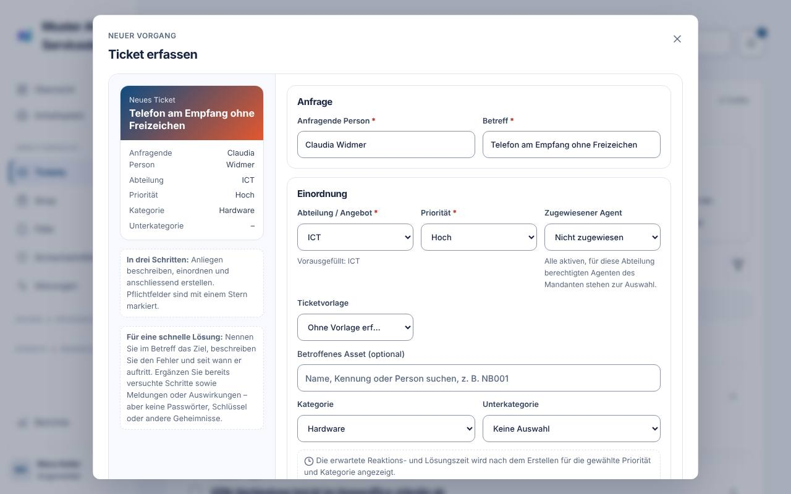

## Wissensdatenbank pflegen

Die Wissensdatenbank ist eine Suchzentrale: Tippen Sie ein Stichwort ins
Suchfeld (Taste `/` springt hinein), die Treffer erscheinen beim Tippen. Mit
der Themenreihe (seitlich scrollbar, mit Symbol und Artikelzahl) und dem
Umschalter **Alle Artikel / Intern / Extern / Entwurf** grenzen Sie die Liste ein. Ohne
Suche und Filter zeigt die Startseite die neusten Artikel als Karten. Status, Sichtbarkeit und «Überarbeiten?» sehen nur
Agenten. Ein Klick öffnet den Artikel auf einer eigenen Leseseite mit
**Bearbeiten**, **Veröffentlichen**, **Archivieren** und **Löschen**.

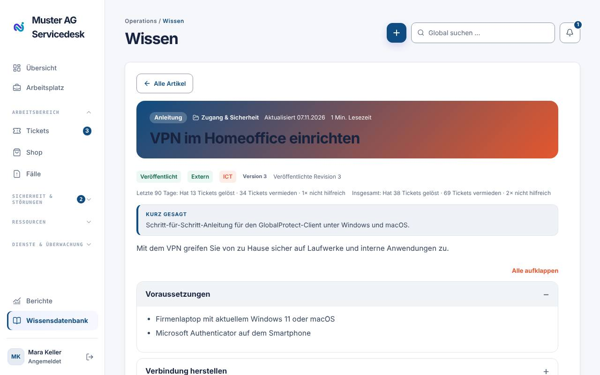

Der Artikel erscheint im Verlauf der Farben aus **Einstellungen → Design**
(Verlauf von der Primärfarbe zur Akzentfarbe). Oben stehen die
Art (z. B. Anleitung, FAQ, Störung, Referenz, Information), Thema, Datum und
Lesezeit, darunter **Kurz gesagt**. Ab drei Abschnitten (Überschriften mit
`##`) klappen die Abschnitte auf und zu; **Alle aufklappen** öffnet alle. Die
Art ergibt sich aus dem Text: nummerierte Listen werden Schritte, Überschriften
mit Fragezeichen werden Fragen und Antworten, «Symptom», «Ursache» und «Lösung»
werden Störung, Tabellen werden Referenz. Absätze, die mit **Hinweis:**,
**Tipp:** oder **Achtung:** beginnen, werden farbige Hinweisboxen.

Als Agent lesen Sie nicht nur Artikel, sondern schreiben sie auch:

1. **Neuer Artikel** – Titel, optional eine **Kurzfassung** (ein bis zwei Sätze,
   erscheint als «Kurz gesagt»; ohne Kurzfassung gilt der erste Absatz),
   Inhalt (Markdown mit Bildern), Kategorie und Sichtbarkeit (_Intern_ oder
   _Extern_ für Mitarbeitende). Die **Live-Vorschau** zeigt den Artikel schon
   im späteren Design.
2. Optional **Mit KI aufbereiten** oder direkt aus einem gelösten Ticket
   **Entwurf mit KI erstellen**.
3. **Speichern** – der Artikel ist sofort **veröffentlicht**, eine Freigabe ist
   nicht nötig. Frühere Fassungen bleiben im Verlauf erhalten. Veraltete
   Artikel **archivieren**.

Die KI schreibt Artikel so, dass sie in diesem Design gut aussehen (kurze
Einleitung, Abschnitte, Schritte, Hinweise). KI-Entwürfe aus Tickets erscheinen zuerst als _Entwurf_; mit **Speichern** oder
**Veröffentlichen** gehen sie live.

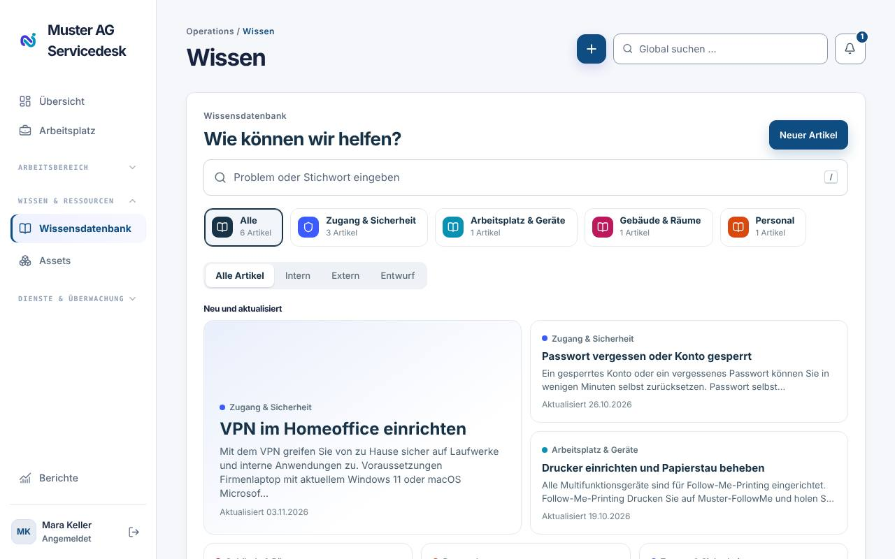

## Lager: Artikel erfassen und ausleihen

**Lager → Artikel → Artikel erfassen** (und **Bearbeiten** in der Liste) öffnet
dasselbe Formular wie ein Artikel im Shop: Bezeichnung, Fotos (per Drag and
Drop oder Auswahl), Kategorien, Artikelnummer, Beschreibung, technische Angaben
und alle weiteren Shop-Felder. Dazu kommen die Lagerangaben **Einheit** und
**Mindest-/Zielbestand**.

- **Zum Bestellen anbieten** (Schieber): Eingeschaltet kann der Artikel im Shop
  bestellt werden. Er hat **Mindest- und Zielbestand**.
- **Zum Ausleihen anbieten** (Schieber): Der Artikel wird im Shop ausgeliehen
  und zurückgegeben (z. B. Presenter). Er hat dann keinen Mindest- und
  Zielbestand, sondern einen **Bestand** mit **Lagerort**; Änderungen daran
  werden als Lagerbewegung gebucht. Den **Lagerort** können Sie im Formular
  wechseln; der Bestand wird dann beim Speichern umgelagert.
- Sie können **beides** einschalten: Der Artikel erscheint dann im Shop
  einmal zum Bestellen und einmal zum Ausleihen. Sind beide Schieber aus, bleibt
  der Artikel nur im Lager (nötig sind dann Bezeichnung, ein Bild, Kategorie,
  Artikelnummer und die Lagerangaben). Ausschalten nimmt die jeweilige Art beim
  Speichern aus dem Shop; der Lagerartikel bleibt bestehen.

**Etiketten drucken** wie bei den Assets: In der Artikelliste wählen Sie Artikel
mit **Für Etikett auswählen** (oder **Alle sichtbaren**) und drucken mit
**Etiketten drucken** Etiketten mit QR-Code, Bezeichnung, Artikelnummer und
Lagerort (Bogenformate oder Etikettendrucker). Der QR-Code enthält einen
Web-Link: Er öffnet den Artikel im Lager von nextDesk. Im Druckdialog legen Sie
unter **Anzahl Etiketten** fest, wie viele Etiketten pro Artikel gedruckt
werden (z. B. 10 gleiche Etiketten für ein Fach). Die Scan-Funktion der
iOS-App erkennt ihn ebenfalls und zeigt nur diesen Artikel im Lager; mit
**Alle Artikel anzeigen** sehen Sie wieder die ganze Liste. Wer beim Scannen mit
der Kamera noch nicht angemeldet ist, landet nach der Anmeldung direkt beim
Artikel.

Mit **Löschen** im Formular entfernen Sie einen Artikel endgültig (auch aus dem
Shop). Hat er schon Bewegungen oder Reservationen, lässt er sich nicht löschen;
nextDesk bietet dann an, ihn zu **archivieren**.

Unter **Lagerorte** ändern Sie Ortscode und Bezeichnung mit dem Stift
(**Bearbeiten**). Mit dem Papierkorb (**Löschen**) steht ein Lagerort nicht
mehr zur Auswahl; bisherige Buchungen bleiben erhalten. Buchen Sie einen
vorhandenen Bestand vorher an einen anderen Ort um. Gelöschte Lagerorte
erscheinen blass und lassen sich mit **Wieder aktivieren** zurückholen.

## Shop: Artikel nur für Kaderstufen

Im Shop legen Sie beim **Artikel hinzufügen** bzw. **Bearbeiten** unter
**Sichtbar für** fest, wer den Artikel sieht:

- **Alle Mitarbeitenden** (Standard) – keine Einschränkung.
- **Kaderstufe 1**, **2** und/oder **3** – nur Personen genau dieser Stufen
  sehen und bestellen den Artikel. Eine höhere Stufe sieht die Artikel tieferer
  Stufen nicht automatisch; kreuzen Sie dafür mehrere Stufen an.

Agenten sehen immer alle Artikel; eingeschränkte Artikel tragen das Etikett
«Nur Kaderstufe …». Bestellen Sie für eine andere Person, weist der Warenkorb
darauf hin, wenn ein Artikel für deren Kaderstufe nicht freigegeben ist – die
Bestellung ist trotzdem möglich.

Die Stufe einer Person ergibt sich aus ihrer **Funktion in Entra**. Die
Zuordnung pflegen Sie im Shop über **Kaderstufen** (z. B. Geschäftsleitung →
Kaderstufe 1, Fachbereichsleitung und Angebotsleitung → Kaderstufe 2,
Teamleitung → Kaderstufe 3). Dort können Sie für einzelne Personen eine Stufe
auch von Hand festlegen oder «Kein Kader» setzen. Ändert sich die Funktion in
Entra, gilt die neue Stufe nach dem nächsten Abgleich automatisch.

## IP-Adressen

Unter **Dienste und Überwachung → IP-Adressen** verwalten Sie Subnetze,
VLANs, Standorte und einzelne IP-Adressen (IPv4 und IPv6). Der Bereich
erscheint, wenn das Modul _IP-Adressverwaltung_ eingeschaltet ist und Sie das
Recht «IP-Adressverwaltung ansehen» haben; Änderungen brauchen «IP-Adressen,
Subnetze und VLANs verwalten». Subnetze, VLANs und Standorte mit einer
Abteilung sehen nur deren Mitglieder; ohne Abteilung gelten sie für alle.

Oben zeigen die Kennzahlen die Anzahl Subnetze, die belegten IPv4-Adressen,
die Subnetze über der Warnschwelle und die offenen Funde. Über das Suchfeld
finden Sie eine IP, ein Subnetz, einen Hostnamen oder eine MAC-Adresse.

**Adressräume**

- Links steht der **Baum** je VRF (zuerst «Global»): Supernetze mit ihren
  Teilnetzen. Der Balken zeigt die Auslastung; ab der Warnschwelle des
  Subnetzes (standardmässig 85 %) wird er gelb, ab 95 % rot.
- Rechts steht das gewählte Subnetz mit VLAN, Standort, Gateway, DHCP-Pool
  und Auslastung. Liegt genug Verlauf vor, nennt nextDesk, wann die
  Warnschwelle erreicht und wann das Subnetz voraussichtlich voll ist.
- Für ein /22 oder kleiner zeigt ein **Belegungsraster** jede Adresse als
  Feld: Aktiv, Reserviert, DHCP-Pool, Ghost-IP, Konflikt, Veraltet,
  Gateway, Netz/Broadcast und Frei. Grössere Subnetze und IPv6 erscheinen als
  Liste mit Seiten und Filter.
- **Nächste freie IP** schlägt die erste freie Adresse ausserhalb von
  Gateway und DHCP-Pool vor. Im Dialog **Adresse reservieren** ergänzen Sie
  Hostname, Zweck, verantwortliche Person oder Team und auf Wunsch ein
  Ablaufdatum («Befristet bis»).
- **Nächstes freies Subnetz** rechnet im gewählten Supernetz das nächste
  freie Teilnetz der gewünschten Grösse aus (z. B. /24) und legt es an.
- **Aufteilen** zerlegt ein Subnetz in gleich grosse Teilnetze; bereits
  erfasste Teilnetze bleiben unverändert.
- Ein Subnetz legen Sie über **Subnetz anlegen** in CIDR-Schreibweise an
  (z. B. 10.20.30.0/24). Dasselbe Subnetz darf im selben VRF nur einmal
  vorkommen, verschachtelte Subnetze sind erlaubt. Gateway und DHCP-Pool
  müssen im Subnetz liegen. Mit dem Papierkorb archivieren Sie ein Subnetz
  (Status «Veraltet»); Adressen und Verlauf bleiben erhalten.

**Eine Adresse**

Ein Klick auf ein Feld oder eine Zeile öffnet die Adresse: Status, Hostname,
MAC und Hersteller, Gerätetyp, Switch-Port, VLAN, Verantwortung, zuletzt
gesehen, Verknüpfungen in nextDesk (Infrastruktur-Gerät mit derselben IP,
Asset, Dienst und Tickets, in denen die IP oder der Hostname vorkommt),
eigene Felder und der Verlauf. Mit **Freigeben** wird die Adresse als
«Veraltet» markiert und wieder als frei vorgeschlagen; der Verlauf bleibt.
**Ticket erstellen** legt ein Ticket mit den Angaben zur Adresse an,
**Bearbeiten** öffnet alle Felder.

**VLANs und Standorte**

In den Registern **VLANs** und **Standorte** erfassen Sie VLAN-ID, Name und
Standort bzw. Gebäude und Stockwerk. Dieselbe VLAN-ID darf an verschiedenen
Standorten vorkommen. Einträge, die noch von Subnetzen verwendet werden,
lassen sich nicht entfernen.

**Funde**

Die Discovery meldet Abweichungen als Funde: Konflikte und fremde MAC auf
einer reservierten IP (rot), Ghost-IPs (aktiv, aber nicht dokumentiert),
DNS-Abweichungen und lange nicht gesehene Adressen. Ghost-IPs übernehmen Sie
mit **Übernehmen** als dokumentierte Adresse, mit **Ticket** entsteht ein
Ticket, mit **Erledigt** oder **Ignorieren** schliessen Sie den Fund.

**Export**

Im Register **Export** laden Sie Subnetze, Adressen und VLANs als CSV oder
JSON herunter. Unter **Firewall-Objekte (Sophos)** erzeugen Sie eine
Import-Datei mit Netzwerken, einzelnen Hosts und je Subnetz einer
Hostgruppe für die Sophos Firewall (XML) oder eine Objektliste als CSV.

**Netzwerkkarte**

In der **Infrastruktur → Netzwerkkarte** zeigt jedes Gerät zusätzlich sein
Subnetz und VLAN (aus der IP-Adresse des Geräts). Über die Legende über der
Karte heben Sie die Geräte eines VLAN hervor.

## Benachrichtigungen und Erreichbarkeit

- Die **Glocke** zeigt Zuweisungen, Erwähnungen, Antworten und Eskalationen.
- **Push-Benachrichtigungen** auf dem iPhone kommen ohne Einchecken. Unter
  _Persönliche Einstellungen → Benachrichtigungen → Benachrichtigungszeit_
  legen Sie fest, an welchen **Tagen** und zu welchen **Zeiten** Sie
  Mitteilungen erhalten (z. B. Mo–Fr, 06:00–17:00) oder ob **Jederzeit**. Was
  ausserhalb dieser Zeit anfällt, kommt zu Beginn der nächsten
  Benachrichtigungszeit.
- In der Tabelle **Benachrichtigungen** schalten Sie pro Benachrichtigung
  (z. B. Zuweisungen, Eskalationen, Erwähnungen, Phishing-Meldungen)
  einzeln **Push** und **E-Mail** ein oder aus. Für Agenten sind zu Beginn alle Benachrichtigungen
  per Push und E-Mail eingeschaltet – ausser **Phishing-Meldungen**: Diese sind
  ausgeschaltet. Wer sie erhalten möchte, schaltet sie dort selbst ein. E-Mails kommen über das Exchange-Postfach
  Ihres Unternehmens und sind verfügbar, sobald eines verbunden ist.
- Das iPhone-Widget **Meine Prioritäten** zeigt Ihre wichtigsten Tickets in
  den Farben Ihres Unternehmens. Öffnen Sie die App einmal, damit es aktuell
  ist.

## Persönliche Einstellungen

Zusätzlich zu den Karten für Mitarbeitende sehen Agenten:

- **Passwort setzen oder ändern** (ohne SSO)
- **Handbücher** – Handbuch für Mitarbeitende und Handbuch für Agenten

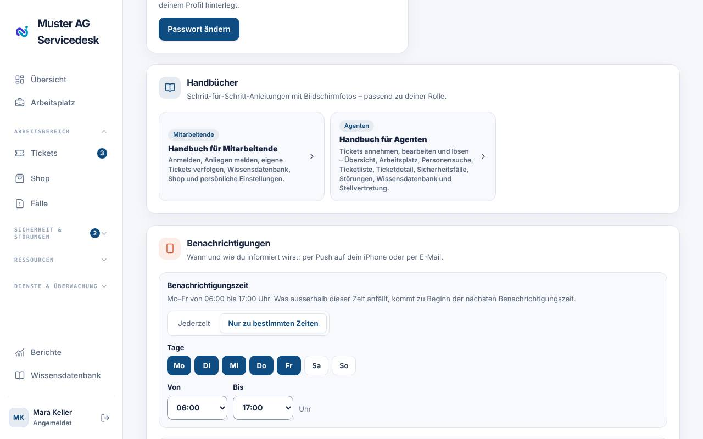

## Gute Praxis

- Neue Tickets zeitnah **zuweisen** – auch wenn Sie sie nicht sofort lösen.
- Für Rückfragen einen wartenden Status (z. B. «wartet») setzen, damit die SLA
  pausiert und die Person erinnert wird.
- Interne Informationen immer als **Interne Notiz**, nie als externe Antwort.
- Lösungen, die mehr als einmal gebraucht werden, als **Wissensartikel**
  festhalten.
