# Handbuch für Agenten

Dieses Handbuch richtet sich an alle, die in nextDesk Tickets bearbeiten.
Grundlagen wie Anmeldung, persönliche Einstellungen und die Mobile-App
beschreibt das _Handbuch für Mitarbeitende_, das dir ebenfalls zur
Verfügung steht.

## Wie mache ich …?

Hier findest du zu jeder Aufgabe eine kurze Anleitung. Ausführliche Erklärungen stehen in den weiteren Abschnitten.

### Wie finde ich meine offenen Tickets?

1. Öffne die **Übersicht** oder **Tickets**.
2. Klicke auf die Kachel **Meine offenen Tickets**.
3. Die Liste zeigt die offenen Tickets, die dir zugewiesen sind oder die du angefragt hast.

Mehr dazu unter «Ticketliste».

### Wie finde ich gelöste oder geschlossene Tickets?

1. Öffne in der Navigation **Tickets**.
2. Klicke auf die Kachel **Gelöste Tickets** oder wähle unter **Filter & Sortierung** den Filter _Status_.

Mehr dazu unter «Ticketliste».

### Wie sehe ich die Tickets meines Teams?

1. Öffne den **Arbeitsplatz** und das Register **Team**.
2. Deine eigenen Teams stehen zuoberst (markiert mit _Mein Team_); daneben steht, wie viele Tickets noch **ohne Bearbeiter** sind.
3. Klicke auf die Warteschlange des Teams.
4. Die Ticketliste zeigt genau diese Tickets mit dem Filter «Warteschlange: …»; mit × entfernst du den Filter wieder.

Mehr dazu unter «Arbeitsplatz».

### Wie finde ich Tickets ohne Teamzuordnung?

1. Öffne den **Arbeitsplatz** und das Register **Team**.
2. Klicke auf **Ohne Teamzuordnung**.
3. Die Ticketliste zeigt die offenen Tickets, die noch keinem Team zugeteilt sind.

Mehr dazu unter «Arbeitsplatz».

### Wie zeige ich nur eine Supportstufe an?

1. Öffne in der Navigation **Tickets**.
2. Wähle das Register _1st Level_, _2nd Level_ oder _3rd Level_ (_Alle Stufen_ zeigt alles). Die Register erscheinen, wenn du in Teams mehrerer Supportstufen arbeitest.
3. Die Kacheln oben zeigen dann nur die Zahlen dieser Stufe.

Mehr dazu unter «Ticketliste».

### Wie sortiere ich die Ticketliste?

1. Öffne in der Navigation **Tickets**.
2. Wähle rechts in der Leiste über der Liste unter **Sortieren nach:** Letzte Änderung, Agent, Status, Abteilung oder Priorität.
3. Der Pfeil daneben wechselt zwischen absteigend und aufsteigend.

Mehr dazu unter «Ticketliste».

### Wie filtere ich die Ticketliste?

1. Öffne in der Navigation **Tickets**.
2. Öffne **Filter & Sortierung**.
3. Gib einen Suchbegriff ein oder wähle Status (mehrere gleichzeitig möglich), Priorität, Agent (_Mir zugewiesen_, _Nicht zugewiesen_) oder Abteilung.
4. Mit **Filter zurücksetzen** stellst du alles zurück.

Mehr dazu unter «Ticketliste».

### Wie suche ich mit Suchfiltern im Suchfeld?

1. Tippe im Suchfeld der Ticketliste einen Suchfilter, zum Beispiel `status:offen`, `prio:hoch`, `queue:ict` oder `agent:mir`.
2. Für die Lösungsfrist gibt es `sla:kritisch`, `sla:warnung`, `sla:ok` und `sla:pausiert`.

Mehr dazu unter «Ticketliste».

### Wie finde ich Tickets mit knapper oder pausierter SLA?

1. Tippe im Suchfeld der Ticketliste `sla:kritisch` ein (Lösungsfrist in weniger als 1 Stunde oder überschritten) oder `sla:warnung` (1 bis 4 Stunden).
2. Für Tickets in einem wartenden Status tippst du `sla:pausiert` ein. Pausierte Tickets erscheinen nur dort.

Mehr dazu unter «Ticketliste».

### Wie speichere ich eine Ansicht?

1. Stelle in der Ticketliste die gewünschten Filter ein.
2. Speichere sie als **Neue Ansicht**.
3. Wenn du die Ansicht mit der Abteilung teilen möchtest, wähle bei «Teilen mit» die Abteilung.

Mehr dazu unter «Ticketliste».

### Wie wähle ich eine gespeicherte Ansicht?

1. Öffne in der Navigation **Tickets**.
2. Wähle in der Leiste über der Liste unter **Ansicht:** die gewünschte Ansicht (auch geteilte).
3. Mit **Filter zurücksetzen** im selben Feld hebst du die Ansicht wieder auf.

Mehr dazu unter «Ticketliste».

### Wie ändere ich die Darstellung der Ticketliste?

1. Öffne in der Navigation **Tickets**.
2. Wähle unter **Ansicht** die Listendichte _Kompakt_, _Standard_ oder _Komfortabel_.
3. Auf Wunsch schaltest du die Listen-Detail-Ansicht ein (Liste links, Ticket rechts).

Mehr dazu unter «Ticketliste».

### Wie wechsle ich zwischen Liste und Kanban?

1. Öffne in der Navigation **Tickets**.
2. Klicke auf den Umschalter **Liste / Kanban**.
3. Im Kanban stehen die Tickets als Spalten nach Status.

Mehr dazu unter «Kanban».

### Wie ändere ich den Status im Kanban?

1. Wechsle mit dem Umschalter **Liste / Kanban** zum Kanban.
2. Ziehe die Karte in die Spalte des neuen Status.

Mehr dazu unter «Kanban».

### Wie ändere ich den Status mehrerer Tickets gleichzeitig?

1. Markiere in der Ticketliste die gewünschten Tickets.
2. Wähle den **Neuen Status**.
3. Klicke auf **Status für Auswahl setzen**.
4. Bei dieser Sammelaktion wirst du nicht automatisch als zugewiesene Person eingetragen.

Mehr dazu unter «Ticketliste».

### Wie filtere ich die Ticketliste in der App?

1. Öffne in der App die Ticketliste.
2. Wähle unter **Status** einen oder mehrere Status; **Zurücksetzen** hebt die Auswahl auf.
3. Das Filtersymbol in der Suchleiste öffnet weitere Filter: Bereich, Agent, Abteilung, Priorität, Sortierung und Reihenfolge.
4. Ohne Auswahl zeigt die Liste **Meine** Tickets.

Mehr dazu unter «Ticketliste».

### Wie bediene ich die Ticketliste mit Tastenkürzeln?

1. Drücke `?`, um die Hilfe mit allen Kürzeln zu öffnen.
2. Mit `J` und `K` springst du zum nächsten bzw. vorherigen Ticket.
3. `Enter` öffnet das Ticket, `Esc` schliesst es.

Mehr dazu unter «Ticketliste».

### Wie lösche ich Tickets?

1. Markiere die Tickets in der Ticketliste. Dafür braucht es die Berechtigung zum Löschen.
2. Klicke auf **Löschen**.
3. Die Tickets kommen in den **Papierkorb** und lassen sich 90 Tage lang wiederherstellen.

Mehr dazu unter «Gelöschte Tickets (Papierkorb)».

### Wie stelle ich ein gelöschtes Ticket wieder her?

1. Öffne in der Ticketliste **Filter & Sortierung → Gelöschte Tickets anzeigen**.
2. Klicke auf das Ticket.
3. Klicke auf **Wiederherstellen**. Das Ticket kommt unverändert zurück.

Mehr dazu unter «Gelöschte Tickets (Papierkorb)».

### Wie markiere ich ein Ticket als Spam?

1. Im Web: Markiere die Tickets in der Liste und wähle **Als Spam markieren**. Auf dem iPhone und in der Android-App: Wische das Ticket nach links und tippe auf **Spam**.
2. Bestätige die Rückfrage: Alle künftigen Tickets dieses Absenders gehen automatisch in den Spam. Dafür braucht es die Berechtigung zum Löschen.

Mehr dazu unter «Spam».

### Wie hole ich ein Ticket aus dem Spam zurück?

1. Öffne in der Ticketliste **Filter & Sortierung → Spam anzeigen**.
2. Wähle das Ticket und klicke auf **Kein Spam**.
3. Das Ticket kommt zurück und der Absender ist wieder freigegeben.

Mehr dazu unter «Spam».

### Wie gebe ich einen gesperrten Absender frei?

1. Öffne in der Ticketliste **Filter & Sortierung → Spam anzeigen**.
2. Öffne **Gesperrte Absender**.
3. Gib den gewünschten Absender einzeln frei.

Mehr dazu unter «Spam».

### Wie sehe ich die Spam-Auswertung?

1. Öffne **Berichte → Spam**.
2. Dort stehen der Verlauf pro Tag, die häufigsten Absender, die Abteilungen und ob der Spam automatisch abgefangen oder von Hand markiert wurde.

Mehr dazu unter «Spam».

### Wie nehme ich ein Ticket an?

1. Öffne das Ticket mit einem Klick.
2. Ändere den **Status**, zum Beispiel auf **In Bearbeitung**. Auch bei einem neuen, noch nicht zugewiesenen Ticket geht das direkt.
3. Du wirst damit automatisch als **zugewiesene Person** eingetragen, sofern du das Ticket bearbeiten darfst.

Mehr dazu unter «Ein Ticket bearbeiten».

### Wie weise ich ein Ticket einer Person zu?

1. Öffne das Ticket.
2. Wähle im Kopf- oder Infobereich die **zugewiesene Person**.
3. Wenn du im selben Schritt den Status änderst, gilt die gewählte Person und nicht du selbst.

Mehr dazu unter «Ein Ticket bearbeiten».

### Wie ändere ich den Status eines Tickets?

1. Öffne das Ticket.
2. Wähle im Kopf- oder Infobereich den neuen **Status**.
3. Alternativ änderst du ihn auf der Kachel in Liste und Kanban oder in der App.
4. Wer den Status ändert, wird automatisch zugewiesene Person (siehe «Wie nehme ich ein Ticket an?»).

Mehr dazu unter «Ein Ticket bearbeiten».

### Wie ändere ich die Priorität eines Tickets?

1. Öffne das Ticket.
2. Wähle im Kopf- oder Infobereich die neue **Priorität**.

Mehr dazu unter «Ein Ticket bearbeiten».

### Wie ändere ich Kategorie oder Team eines Tickets?

1. Öffne das Ticket.
2. Wähle im Kopf- oder Infobereich die **Kategorie** bzw. das **Team**.
3. In der App tippst du in der Karte **Details** auf **Kategorie** bzw. **Team** (unter «Zugewiesen an») und wählst den neuen Wert. Zur Auswahl stehen die aktiven Teams der Abteilung des Tickets.

Mehr dazu unter «Ein Ticket bearbeiten».

### Wie ändere ich Betreff und Beschreibung eines Tickets?

1. Öffne das Ticket.
2. Klicke in der Karte **Beschreibung** auf den **Stift**.
3. Ändere Betreff und Beschreibung direkt dort.
4. Klicke auf **Beschreibung speichern** (oder drücke Strg/⌘ + Enter).

Mehr dazu unter «Ein Ticket bearbeiten».

### Wie sehe ich, wer ein Ticket gerade ansieht?

1. Öffne das Ticket.
2. Oben rechts im Ticketkopf stehen runde Profilbilder (ohne Foto: Kürzel) aller, die das Ticket gerade geöffnet haben.
3. Bewege die Maus über ein Bild, um den Namen zu sehen. Ein grüner Rand bedeutet, dass die Person gerade etwas ändert.

Mehr dazu unter «Ein Ticket bearbeiten».

### Wie sehe ich den Verlauf und die Fristen eines Tickets?

1. Öffne das Ticket.
2. Über der Beschreibung zeigt die **Ticket-Zeitachse** alle Ereignisse sowie Reaktions- und Lösungsfrist.
3. Darunter folgt die **Unterhaltung** mit allen Nachrichten und Notizen.

Mehr dazu unter «Ein Ticket bearbeiten».

### Wie öffne ich die Personenübersicht der anfragenden Person?

1. Öffne das Ticket.
2. Klicke unter **Anfragende Person** auf den Namen. In der App tippst du auf **Personenübersicht** unter der anfragenden Person.

Mehr dazu unter «Personen suchen und Personenübersicht».

### Wie erreiche ich eine externe anfragende Person?

1. Öffne das Ticket einer Person, die von ausserhalb deiner Organisation geschrieben hat.
2. Unter **Anfragende Person** stehen die E-Mail-Adresse und alle Telefonnummern aus der Signatur.
3. Ein Klick startet Anruf oder E-Mail.

Mehr dazu unter «Ein Ticket bearbeiten».

### Wie antworte ich der anfragenden Person?

1. Öffne das Ticket.
2. Wähle im Antwortbereich den Modus **Antwort an anfragende Person**.
3. Schreibe deinen Text unter die vorgegebene Begrüssung. Du kannst sie ändern oder löschen.
4. Klicke auf **Externe Antwort senden**.
5. Die Person sieht die Antwort im Portal und per E-Mail. Ist das Ticket noch niemandem zugewiesen, wirst du mit dem Senden zugewiesen, und ein neues Ticket wechselt auf **In Bearbeitung**.

Mehr dazu unter «Antworten und interne Notizen».

### Wie antworte ich und löse das Ticket in einem Schritt?

1. Öffne das Ticket und schreibe deine Antwort im Modus **Antwort an anfragende Person**.
2. Klicke auf **Antwort senden und als gelöst markieren**.
3. Pflichtfelder wie die Kategorie gelten erst beim Lösen oder Schliessen.

Mehr dazu unter «Antworten und interne Notizen».

### Wie antworte ich auch Personen im CC der Anfrage?

1. Öffne das Ticket. Personen, die bei der E-Mail im **Cc** waren, stehen unter **In Kopie (CC)**.
2. Wähle den Modus **Antwort an anfragende Person**.
3. Kreuze unter **Auch antworten an (im CC der Anfrage)** die gewünschten Personen an. Standardmässig ist niemand angekreuzt.
4. Klicke auf **Externe Antwort senden**. Die angekreuzten Personen erhalten die Nachricht per E-Mail als Kopie.

Mehr dazu unter «Ein Ticket bearbeiten».

### Wie sende ich eine Kopie einer Antwort an weitere Personen?

1. Öffne das Ticket und schreibe deine Antwort im Modus **Antwort an anfragende Person**.
2. Füge mit **Kopie per E-Mail senden** weitere Personen hinzu.
3. Klicke auf **Externe Antwort senden**.

Mehr dazu unter «Ein Ticket bearbeiten».

### Wie schreibe ich eine interne Notiz?

1. Öffne das Ticket.
2. Wähle im Antwortbereich den Modus **Interne Notiz**.
3. Schreibe die Notiz.
4. Klicke auf **Interne Notiz speichern**. Die Notiz ist nur für berechtigte Mitarbeitende sichtbar.

Mehr dazu unter «Antworten und interne Notizen».

### Wie erwähne ich Kolleginnen und Kollegen in einer Nachricht?

1. Öffne das Ticket und wähle im Antwortbereich den gewünschten Modus.
2. Tippe im Text `@` und den Namen der Person.
3. Sende die Nachricht oder speichere die Notiz. Die Erwähnung erscheint bei der Person im Arbeitsplatz unter **Erwähnungen**.

Mehr dazu unter «Antworten und interne Notizen».

### Wie lasse ich die KI meinen Text umformulieren?

1. Schreibe im Antwortbereich deinen Text. Die Funktion ist da, wenn die KI-Assistenz aktiv ist.
2. Klicke unter dem Antwortfeld bei **Mit KI umformulieren** auf **Kurz** (knapp) oder **Ausführlich** (Schritte vollständig erklärt). In der iPhone- und Android-App heissen die Knöpfe **KI kurz** und **KI ausführlich**.
3. Prüfe das Ergebnis. Mit **Original wiederherstellen** (in der App **Original**) holst du deinen Text zurück.

Mehr dazu unter «Antworten und interne Notizen».

### Wie erstelle ich einen KI-Entwurf für eine Antwort?

1. Öffne das Ticket und den Antwortbereich.
2. Klicke auf **KI-Entwurf erstellen** (nur sichtbar, wenn die KI-Assistenz aktiv ist).
3. Prüfe den Entwurf und sende ihn erst, wenn er stimmt.

Mehr dazu unter «Antworten und interne Notizen».

### Wie wende ich ein Makro an?

1. Öffne das Ticket und den Antwortbereich.
2. Klicke auf **Makro anwenden**.
3. Wähle das gewünschte Makro.

Mehr dazu unter «Antworten und interne Notizen».

### Wie hänge ich Dateien an eine Nachricht an?

1. Öffne das Ticket und den Antwortbereich.
2. Klicke auf **Dateien anhängen** und wähle die Dateien (Bilder, PDF, Word, Excel, TXT, CSV; bis 5 Dateien pro Nachricht).
3. Sende die Nachricht.

Mehr dazu unter «Antworten und interne Notizen».

### Wie füge ich einem Ticket einen Anhang hinzu?

1. Öffne das Ticket.
2. Klicke in der Zeile unter der **Beschreibung** auf **+ Anhang** und wähle eine oder mehrere Dateien.
3. Alternativ ziehst du die Dateien direkt auf die Zeile (maximal 25 MiB pro Datei).

Mehr dazu unter «Anhänge».

### Wie lade ich einen Anhang herunter oder lösche ihn?

1. Öffne das Ticket. Die **Anhänge** stehen als Chips unter der **Beschreibung**; ab fünf Dateien zeigt **+n weitere** den Rest.
2. Ein Klick auf den Chip lädt die Datei herunter.
3. Das **×** löscht sie nach einer Rückfrage.

Mehr dazu unter «Anhänge».

### Wie melde ich einen Spam- oder Phishing-Verdacht der anfragenden Person?

1. Öffne das offene Ticket, in dem die Person eine Mail weitergeleitet hat.
2. Klicke oben im Ticket auf **Spam-/Phishing-Verdacht** (in der App über der Karte zur Supportstufe).
3. Bestätige die Rückfrage **Wirklich als Spam/Phishing markieren?**.
4. Die Person erhält die Standardantwort, und das Ticket geht an das 2nd-Level-Team der Abteilung. Der Knopf erscheint nur mit den Rechten «Tickets bearbeiten» und «Tickets zuweisen».

Mehr dazu unter «Spam-/Phishing-Verdacht der anfragenden Person».

### Wie verknüpfe ich ein Gerät der anfragenden Person mit dem Ticket?

1. Öffne das Ticket. Hat die Person genau ein Gerät, ist es schon automatisch verknüpft.
2. Bei mehreren Geräten öffne **Asset / Katalogeintrag verknüpfen**.
3. Klicke unter **Geräte der anfragenden Person** auf das passende Gerät.

Mehr dazu unter «Ein Ticket bearbeiten».

### Wie hänge ich ein Gerät oder einen Dienst aus dem Netzwerk-Feld ans Ticket?

1. Öffne ein Ticket, in dem eine IP-Adresse, ein Subnetz, eine MAC-Adresse oder ein dokumentierter Hostname vorkommt. Rechts erscheint die Box **Netzwerk**.
2. Klicke auf **Gerät … ans Ticket hängen** bzw. **Dienst … ans Ticket hängen**. Dafür musst du das Ticket bearbeiten dürfen.
3. Bereits verknüpfte Einträge erscheinen als «am Ticket».

Mehr dazu unter «IP-Adressen».

### Wie springe ich vom Ticket zur IP-Adresse?

1. Öffne ein Ticket, das eine bekannte IP-Adresse nennt. Rechts erscheint die Box **Netzwerk**.
2. Klicke auf **In der IP-Adressverwaltung öffnen**.

Mehr dazu unter «IP-Adressen».

### Wie reserviere ich eine im Ticket erkannte IP-Adresse?

1. Öffne ein Ticket mit einer erkannten, noch nicht dokumentierten IP-Adresse in einem bekannten Subnetz.
2. Klicke in der Box **Netzwerk** auf **IP reservieren**.
3. Bestätige die Rückfrage. Dafür braucht es das Recht, IP-Adressen zu verwalten.

Mehr dazu unter «IP-Adressen».

### Wie füge ich Beobachtende zu einem Ticket hinzu?

1. Öffne das Ticket.
2. Wähle in den weiteren Aktionen **Beobachtende hinzufügen**.
3. Wähle die Personen, die informiert werden sollen.

Mehr dazu unter «Weitere Aktionen im Ticket».

### Wie führe ich doppelte Tickets zusammen?

1. Öffne das Ticket, das ein Duplikat ist.
2. Öffne **Ticket steuern** und wähle **Tickets zusammenführen**.
3. Suche unter **Hauptticket suchen** das Hauptticket.
4. Klicke beim richtigen Treffer auf **In dieses Ticket zusammenführen**.
5. Bestätige mit **Zusammenführen bestätigen**. Das aktuelle Ticket wird als Duplikat geschlossen und im Hauptticket referenziert.

Mehr dazu unter «Weitere Aktionen im Ticket».

### Wie eröffne ich aus einem Ticket einen Fall?

1. Öffne das Ticket.
2. Öffne **Ticket steuern** und wähle **Fall eröffnen**.
3. Folge dem Formular, um aus dem Ticket einen Fall (Problem) anzulegen und zu verknüpfen.

Mehr dazu unter «Ein Ticket bearbeiten».

### Wie teile ich ein Ticket in mehrere Aufgaben auf?

1. Öffne das Ticket.
2. Klicke in der Karte **Koordination** auf **Aufteilen**.
3. Folge dem Formular, um Teil-Tickets anzulegen.

Mehr dazu unter «Ein Ticket bearbeiten».

### Wie übergebe ich ein Ticket an die nächste Supportstufe?

1. Öffne das Ticket.
2. Klicke in der Karte **Koordination** auf **An nächste Stufe übergeben**.
3. Schreibe die Übergabenotiz. Die Notiz ist Pflicht.
4. Bestätige die Übergabe. Unter **Verlauf der Stufen** siehst du die bisherigen Übergaben.

Mehr dazu unter «Ein Ticket bearbeiten».

### Wie übergebe ich ein Ticket an einen Drittanbieter?

1. Öffne das Ticket und klicke auf **An Drittanbieter übergeben**.
2. Wähle den **Drittanbieter**.
3. Trage bei Bedarf die **externe Fallnummer** des Anbieters und eine **Notiz** ein.
4. Bestätige die Übergabe. Das Ticket wechselt auf **Wartend auf Drittanbieter**; antwortet der Anbieter nicht rechtzeitig, wirst du erinnert.

Mehr dazu unter «An Drittanbieter übergeben».

### Wie frage ich die vorgesetzte Person?

1. Öffne das Ticket.
2. Öffne **Ticket steuern** und wähle **Vorgesetzte Person fragen**.
3. Wähle die **Person** und schreibe die **Frage**.
4. Klicke auf **Anfrage senden**. Frage und Antwort stehen als interne Notizen im Ticket.

Mehr dazu unter «Weitere Aktionen im Ticket».

### Wie fordere ich eine Freigabe an?

1. Öffne das Ticket.
2. Wähle in den weiteren Aktionen **Freigabe anfordern**, zum Beispiel für Kosten oder Berechtigungen.
3. Fülle das Formular aus und sende die Anfrage ab.

Mehr dazu unter «Weitere Aktionen im Ticket».

### Wie setze ich eine Erinnerung (Wiedervorlage) auf ein Ticket?

1. Öffne das Ticket.
2. Klicke auf **Erinnerung setzen**.
3. Wähle den **Termin** und schreibe auf Wunsch eine **Notiz**.
4. Klicke auf **Erinnerung speichern**.
5. Das Ticket erscheint am Datum im **Arbeitsplatz** unter **Erinnerungen**.

Mehr dazu unter «Arbeitsplatz».

### Wie erfasse ich Arbeitszeit auf einem Ticket?

1. Öffne das Ticket.
2. Klicke auf **Arbeitszeit erfassen**.
3. Trage den Aufwand ein und speichere.

Mehr dazu unter «Weitere Aktionen im Ticket».

### Wie fasse ich ein langes Ticket mit KI zusammen?

1. Öffne das Ticket mit dem langen Verlauf.
2. Wähle in den weiteren Aktionen **Zusammenfassen**.
3. Die KI zeigt eine Kurzfassung (nur wenn die KI-Assistenz aktiv ist).

Mehr dazu unter «Weitere Aktionen im Ticket».

### Wie drucke ich die Ticketakte als PDF?

1. Öffne das Ticket.
2. Wähle **Ticketakte als PDF**.
3. Drucke die Akte oder lege sie ab.

Mehr dazu unter «Weitere Aktionen im Ticket».

### Wie erfasse ich die Ursache einer SLA-Verletzung?

1. Öffne das Ticket, dessen SLA verletzt wurde.
2. Trage die **Ursache der SLA-Verletzung** ein. Beim Abschluss geht das auch direkt im Bestätigungsfeld.
3. Erst danach lässt sich das Ticket lösen oder schliessen (auch bei der Sammelaktion).

Mehr dazu unter «An Drittanbieter übergeben».

### Wie pausiere ich die SLA eines Tickets?

1. Öffne das Ticket.
2. Setze den Status auf **Wartend**, **Wartend auf Kunde** oder **Wartend auf Drittanbieter**.
3. Die Liste zeigt dann «SLA pausiert seit …». Die Mandantenadministration kann das pro Status ändern.

Mehr dazu unter «SLA-Pause in wartenden Status».

### Wie lasse ich die SLA eines wartenden Tickets weiterlaufen?

1. Öffne das Ticket.
2. Setze den Status auf einen bearbeitenden Status, zum Beispiel **In Bearbeitung**.
3. Die Fristen werden um die pausierte Servicezeit verschoben.

Mehr dazu unter «SLA-Pause in wartenden Status».

### Wie sehe ich die Bewertung der anfragenden Person?

1. Öffne ein gelöstes Ticket.
2. Eine abgegebene Bewertung steht unter «Bewertung der anfragenden Person».
3. Die Auswertung über alle Tickets findest du unter **Berichte → Feedback-Themen**.

Mehr dazu unter «Bewertung der anfragenden Person».

### Wie erfasse ich ein Ticket für jemanden?

1. Klicke oben rechts auf **+** und wähle **Ticket erfassen**.
2. Wähle die **anfragende Person** (Suche, «Mich auswählen» oder neue Person).
3. Fülle Betreff, Einordnung, Priorität und Beschreibung aus. Pflichtfelder sind mit **\*** markiert.
4. Setze auf Wunsch direkt einen **zugewiesenen Agenten**.
5. Klicke auf **Ticket erstellen**.

Mehr dazu unter «Ticket für jemanden erfassen».

### Wie erfasse ich ein Ticket in der App?

1. Halte in der App den Home-Knopf lange gedrückt.
2. Tippe im Halbkreis unter **Erfassen** auf **Ticket**.
3. Auf demselben Weg legst du auch eine **Erinnerung**, eine **Serviceaufgabe** oder einen **Lagerartikel** an.

Mehr dazu unter «Ticket für jemanden erfassen».

### Wie erfasse ich eine Erinnerung, einen Fall oder einen Wissensartikel?

1. Klicke oben rechts auf **+**.
2. Wähle im Menü, was du erfassen möchtest: je nach Freischaltung Erinnerungen, Fälle, Serviceaufgaben, Wissensartikel, Lagerartikel, Verträge oder Lizenzen.

Mehr dazu unter «Ticket für jemanden erfassen».

### Wie beende ich die Einführungstour?

1. Die Einführung startet beim ersten Login.
2. Klicke während der Tour auf **Einführung beenden**.

Mehr dazu unter «Einführungstour».

### Wie starte ich die Einführungstour erneut?

1. Öffne _Persönliche Einstellungen → Darstellung anpassen_.
2. Wähle _Einführung erneut starten_.

Mehr dazu unter «Einführungstour».

### Wie erfasse ich ein Rack?

1. Öffne in der Infrastruktur die Ansicht **Racks**.
2. Klicke auf **Rack erfassen**.
3. Trage Name, Standort, Höhe in HE und Notizen ein. Einen fehlenden Standort legst du mit **+ Neuer Standort …** an.
4. Speichere. Später änderst du das Rack über den **Stift** am Rack.

Mehr dazu unter «Navigation».

### Wie wähle ich Standort und Rack für ein Gerät?

1. Öffne das Gerät in der Infrastruktur und klicke auf **Bearbeiten**.
2. Wähle **Standort** und **Rack** aus den vorhandenen Einträgen.
3. Fehlt einer, legst du ihn direkt unter der Liste mit **Hinzufügen** an (ein neues Rack entsteht mit 42 HE).

Mehr dazu unter «Navigation».

### Wie lege ich die Dienste eines Geräts für den Systemstatus fest?

1. Öffne das Gerät in der Infrastruktur und klicke auf **Bearbeiten**.
2. Wähle die **Dienste (für Systemstatus)**. Diese Dienste ändern ihren Status bei einer Überwachungsstörung.
3. Die **Übersicht** des Geräts zeigt sie danach unter **Betroffene Dienste**.

Mehr dazu unter «Navigation».

### Wie plane ich ein Wartungsfenster im Gerät?

1. Öffne das Gerät in der Infrastruktur und das Register **Wartung**.
2. Plane das Wartungsfenster. Die Dienste des Geräts werden automatisch übernommen.
3. Mit **Andere Dienste wählen** passt du sie für ein einzelnes Fenster an.

Mehr dazu unter «Navigation».

### Wie erfasse ich eine Wartungscheckliste?

1. Öffne das Gerät in der Infrastruktur, klicke auf **Bearbeiten** und öffne die Karte **Wartungscheckliste und Notizen**.
2. Erfasse jeden Punkt in einer eigenen Zeile mit einem eigenen **Datum**.
3. **Punkt hinzufügen** ergänzt eine Zeile, × entfernt sie.

Mehr dazu unter «Navigation».

### Wie suche ich eine Person?

1. Öffne oben rechts die **globale Suche**.
2. Suche nach Name, E-Mail-Adresse, Funktion oder Abteilung.
3. Mit den Reitern _Alle / Personen / Tickets …_ filterst du die Treffer.
4. Klicke auf die Person, um die Personenübersicht zu öffnen.

Mehr dazu unter «Personen suchen und Personenübersicht».

### Wie suche ich eine Störung oder einen Phishing-/Junk-Fall?

1. Öffne oben rechts die **globale Suche**.
2. Suche bei Störungen nach Nummer, Titel oder Gerät, bei Fällen nach Fallnummer, Betreff, Absender oder meldender Person.
3. Ein Klick auf den Treffer öffnet die Störung bzw. den Fall. Du findest sie nur, wenn du zum zuständigen Team gehörst.

Mehr dazu unter «Personen suchen und Personenübersicht».

### Wie sehe ich die Tickets einer Person?

1. Öffne die Personenübersicht der Person.
2. Wähle das Register **Tickets**.
3. Filtere nach _Alle_, _Offen_ oder _Geschlossen_.

Mehr dazu unter «Personen suchen und Personenübersicht».

### Wie sehe ich Geräte, Lizenzen und Bestellungen einer Person?

1. Öffne die Personenübersicht der Person.
2. Wähle das Register **Geräte**, **Lizenzen** oder **Bestellungen**. Die Register erscheinen nur, wenn das Modul aktiv ist und du die Berechtigung hast.
3. Ein Klick auf ein Gerät öffnet es.

Mehr dazu unter «Personen suchen und Personenübersicht».

### Wie erfasse ich ein Ticket aus der Personenübersicht?

1. Öffne die Personenübersicht der Person.
2. Klicke im Kopf auf **Ticket für … erfassen**.
3. Das Ticketformular öffnet sich mit der Person als anfragender Person.

Mehr dazu unter «Personen suchen und Personenübersicht».

### Wie wechsle ich den Zeitraum der Übersicht?

1. Öffne die **Übersicht**.
2. Wähle _Heute_, _7 Tage_ oder _30 Tage_.
3. Ein Klick auf eine Kachel öffnet die passende gefilterte Liste.

Mehr dazu unter «Übersicht».

### Wie passe ich meine Prioritäten an?

1. Öffne die **Übersicht** und suche **Priorisierte Tickets** bzw. **Meine Prioritäten**.
2. Ziehe die Tickets in die gewünschte Reihenfolge.
3. **Neu priorisieren** holt einen neuen Vorschlag der KI, **Eigene Reihenfolge verwerfen** setzt auf den Vorschlag zurück.

Mehr dazu unter «Übersicht».

### Wie blende ich Blöcke der Startseite ein oder aus?

1. Öffne die **Übersicht**.
2. Klicke auf **Startseite anpassen**.
3. Blende die gewünschten Blöcke ein oder aus.

Mehr dazu unter «Übersicht».

### Wie sehe ich, wo ich erwähnt wurde?

1. Öffne den **Arbeitsplatz**.
2. Wähle das Register **Erwähnungen**.

Mehr dazu unter «Arbeitsplatz».

### Wie sehe ich die Tickets abwesender Kolleginnen und Kollegen?

1. Öffne den **Arbeitsplatz**.
2. Wähle das Register **Stellvertretung**.

Mehr dazu unter «Arbeitsplatz».

### Wie sehe ich meine Erinnerungen?

1. Öffne den **Arbeitsplatz**.
2. Wähle das Register **Erinnerungen**. Dort stehen Tickets, die du dir zu einem Datum vorgemerkt hast.

Mehr dazu unter «Arbeitsplatz».

### Wie sehe ich meine eigenen Tickets, Geräte und Freigaben?

1. Öffne den **Arbeitsplatz**.
2. Wähle das Register **Mein Bereich**.

Mehr dazu unter «Arbeitsplatz».

### Wie lege ich eine Stellvertretung an?

1. Öffne **Arbeitsplatz → Stellvertretung**.
2. Klicke auf **Stellvertretung anlegen**.
3. Wähle die stellvertretende Person, Beginn und Ende und schreibe eine Notiz.
4. Klicke auf **Stellvertretung speichern**. Deine Tickets erscheinen in dieser Zeit bei der Stellvertretung.

Mehr dazu unter «Abwesenheit und Stellvertretung».

### Wie melde ich eine verdächtige E-Mail?

1. Öffne den **Arbeitsplatz** und das Register **Mein Bereich**.
2. Klicke auf **Phishing melden**.
3. Lade die E-Mail als .eml oder .msg hoch oder füge die Kopfzeilen ein.
4. Klicke auf **Melden**. In Outlook geht es auch mit **Melden → Phishing melden**.

Mehr dazu unter «Phishing melden».

### Wie sehe ich, welche Phishing-/Junk-Fälle zu beurteilen sind?

1. Öffne in der Navigation **Phishing / Junk**. Der Bereich ist nur für das Sicherheitsteam sichtbar.
2. Die Liste zeigt die zu beurteilenden Fälle.
3. Mit **Filter aufheben** kehrst du nach einem Kachelklick dorthin zurück.

Mehr dazu unter «Phishing / Junk».

### Wie filtere ich Phishing-/Junk-Fälle über die Kacheln?

1. Öffne **Phishing / Junk**.
2. Klicke auf eine Kachel: _Meldungen heute_, _Zeit bis Urteil_ (in den letzten 30 Tagen beurteilt) oder _Geklickt_.
3. Darunter erscheinen die passenden Fälle. **Filter aufheben** führt zurück zu den Fällen, die zu beurteilen sind.

Mehr dazu unter «Phishing / Junk».

### Wie sehe ich eine gemeldete E-Mail sicher an?

1. Öffne den Fall in **Phishing / Junk**.
2. Wähle **Darstellung** (Mail mit Layout im abgeschotteten Rahmen), **Text** (Textfassung) oder **Kopfzeilen** (alle Header für die technische Beurteilung).
3. Skripte laufen nicht, externe Inhalte werden nicht geladen und Links haben kein Ziel.

Mehr dazu unter «Phishing / Junk».

### Wie weise ich einen Phishing-/Junk-Fall zu?

1. Öffne den Fall.
2. Wähle unter **Zuständig** eine Person oder klicke auf **Mir zuweisen**.
3. Zur Auswahl stehen die Agenten, die den Fall bearbeiten dürfen, bei einem Team die Mitglieder dieses Teams.

Mehr dazu unter «Phishing / Junk».

### Wie fälle ich ein Urteil zu einem Phishing-/Junk-Fall?

1. Öffne den Fall.
2. Wähle das Urteil _Harmlos_, _Spam_, _Phishing_ oder _Gezielter Angriff_ und bestätige es.
3. Alle Melder erhalten automatisch eine E-Mail mit dem Ergebnis.
4. Bei hohem Risiko soll das Urteil innerhalb von 30 Minuten fallen, bei mittlerem innerhalb von 4 Stunden, sonst innerhalb eines Tages.

Mehr dazu unter «Phishing / Junk».

### Wie arbeite ich die Massnahmen eines Falls ab?

1. Öffne den Fall nach dem Urteil.
2. Gehe die Checkliste durch, zum Beispiel Absender sperren oder Mail aus allen Postfächern entfernen.
3. Hake erledigte Schritte ab.

Mehr dazu unter «Phishing / Junk».

### Wie frage ich die Melder, ob sie geklickt haben?

1. Öffne den Fall.
2. Klicke auf **Melder fragen: geklickt?**.
3. Die Antwort (_Geklickt_ / _Nicht geklickt_) erscheint bei der Person. Wer geklickt hat, löst eine Benachrichtigung an das Sicherheitsteam aus.

Mehr dazu unter «Phishing / Junk».

### Wie schliesse ich einen Phishing-/Junk-Fall ab?

1. Prüfe im Fall, ob alle Massnahmen erledigt sind.
2. Klicke auf **Fall abschliessen**.
3. Bei _Harmlos_ ohne Massnahmen schliesst sich der Fall direkt nach dem Urteil.

Mehr dazu unter «Phishing / Junk».

### Wie sehe ich Kontext und Geräte der meldenden Person?

1. Öffne den Fall.
2. Lies die Karte **Kontext und Massnahmen**: Funktion, Abteilung, vorgesetzte Person, letzte Anmeldung, Geräte mit Intune-Status und IP-Adressen.
3. Der Hinweis **Interne Adresse!** warnt vor einem möglicherweise kompromittierten internen Gerät oder Konto.

Mehr dazu unter «Kontext und Massnahmen».

### Wie reagiere ich, wenn jemand auf einen Phishing-Link geklickt hat?

1. Öffne den Fall. Hat die Person mit **«Ja, ich habe geklickt»** geantwortet, stehen bei ihr Massnahmen bereit.
2. Wähle je nach Bedarf **Gerät synchronisieren**, **Defender-Schnellscan** (Windows), **Sitzungen widerrufen** oder **Passwort-Reset erzwingen**.
3. Bestätige den Dialog. Jede Massnahme steht danach mit Ergebnis unter **Ausgeführte Massnahmen**.

Mehr dazu unter «Kontext und Massnahmen».

### Wie bestelle ich ein Ersatzgerät für eine betroffene Person?

1. Öffne den Fall und die Massnahmen bei der Person.
2. Klicke auf **Ersatzgerät bestellen** und wähle den Shop-Artikel.
3. Bestätige den Dialog. Die Bestellung braucht keine Freigabe.

Mehr dazu unter «Lager-Automatik, Rücknahmen und Austritt».

### Wie sehe ich Kampagnen und die IOC-Liste?

1. Öffne in **Phishing / Junk** den Bereich **Kampagnen & IOC**.
2. Du siehst die erkannten Kampagnen mit allen Fällen und die **IOC-Liste** (Domains, URLs, sendende IPs und Absender).

Mehr dazu unter «Kampagnen und IOC-Liste».

### Wie markiere ich einen IOC-Eintrag als harmlos?

1. Öffne **Kampagnen & IOC**.
2. Suche den Eintrag in der IOC-Liste.
3. Markiere ihn **als harmlos**. Er löst dann keine Treffer mehr aus.

Mehr dazu unter «Kampagnen und IOC-Liste».

### Wie bearbeite ich Phishing-/Junk-Fälle in der App?

1. Öffne in der unteren Leiste **Phishing / Junk**.
2. Lies zuerst die **Einschätzung**. Dort steht in Klartext, was für oder gegen Phishing spricht, und welches Urteil vorgeschlagen wird.
3. Darunter stehen die **gemeldete Mail** (Betreff, Absender, Empfänger und Text mit entschärften Links, auf Wunsch die Kopfzeilen) und die **Analyse**.
4. Fälle das Urteil (der Vorschlag ist markiert), weise den Fall zu, hake Massnahmen ab, frage die Melder nach einem Klick und schliesse den Fall ab.
5. Die Massnahmen selbst (zum Beispiel Sitzungen widerrufen) löst du im Web aus.

Mehr dazu unter «Eskalation».

### Wie finde ich eine Störung?

1. Öffne in der Navigation **Störungen**.
2. Wähle das Register _Aktiv_, _Abgeschlossen_ oder _Alle_.
3. Im Suchfeld findest du Störungen nach Nummer, Gerät oder Titel. Ältere lädt **Weitere Störungen laden** nach.

Mehr dazu unter «Störungen».

### Wie filtere ich Störungen über die Kacheln?

1. Öffne **Störungen**.
2. Klicke auf eine Kachel: _Aktiv_, _Unbestätigt_, _Betroffene Dienste_, _Behebungszeit_ oder _Verfügbarkeit_.
3. **Filter aufheben** führt zurück zu den aktiven Störungen.

Mehr dazu unter «Störungen».

### Wie bestätige ich eine Störung?

1. Öffne die Störung mit einem Klick.
2. Klicke auf **Bestätigen: ich kümmere mich**.
3. Die erneute Alarmierung stoppt und du wirst die zuständige Person.

Mehr dazu unter «Störungen».

### Wie weise ich eine Störung zu?

1. Öffne die Störung.
2. Wähle unter **Zuständig** eine Person oder klicke auf **Mir zuweisen**.
3. Wer einer noch unbestätigten Störung zugewiesen wird, bestätigt sie damit automatisch.

Mehr dazu unter «Störungen».

### Wie halte ich in einer Störung fest, was ich geprüft habe?

1. Öffne die Störung.
2. Klicke beim **Verlauf** auf **Notiz zum Verlauf hinzufügen**.
3. Schreibe auf, was du geprüft oder veranlasst hast, und speichere.

Mehr dazu unter «Störungen».

### Wie ordne ich einer Störung ein Ticket zu?

1. Öffne die Störung und suche den Abschnitt **Tickets**.
2. Gib die Nummer unter **Ticketnummer zuordnen** ein.
3. Mit **×** löst du ein Ticket wieder; ein gelöstes Ticket wird nicht erneut automatisch zugeordnet.

Mehr dazu unter «Störungen».

### Wie veröffentliche ich eine Meldung auf der Statusseite?

1. Öffne die Störung und suche den Abschnitt **Statusseite**.
2. Klicke auf **Öffentliche Meldung**.
3. Wähle den Zustand und schreibe Titel und Text.
4. Veröffentliche die Meldung.

Mehr dazu unter «Störungen».

### Wie ergänze ich eine öffentliche Meldung mit einem Update?

1. Öffne die Störung und den Abschnitt **Statusseite**.
2. Klicke auf **Update veröffentlichen**. nextDesk schlägt den passenden Zustand vor.
3. Ergänze den Text und veröffentliche.

Mehr dazu unter «Störungen».

### Wie korrigiere ich eine veröffentlichte Meldung?

1. Öffne die Störung und den Abschnitt **Statusseite**.
2. Klicke auf **Bearbeiten**.
3. Ändere Zustand, Titel, Text oder Dienste.
4. Klicke auf **Änderungen speichern**.

Mehr dazu unter «Störungen».

### Wie ändere ich den Betriebszustand eines Dienstes in einer Störung?

1. Öffne die Störung und suche **Betroffene Dienste und Betriebszustand**.
2. Weitere Dienste fügst du mit **Dienst hinzufügen** hinzu (Suche nach Name oder Kategorie).
3. Stelle pro Dienst den Betriebszustand ein: Betriebsbereit, Beeinträchtigte Leistung, Teilweiser Ausfall, Schwerwiegender Ausfall oder Wird gewartet.

Mehr dazu unter «Störungen».

### Wie schliesse ich eine Störung ab?

1. Öffne die Störung und klicke auf **Abschliessen**.
2. Wähle die **Ursache** (Strom, Netzwerk, Hardware, Software, Wartung, Extern, Unbekannt) und halte die Lösung fest.
3. Sind Tickets zugeordnet, informiert **Tickets informieren und auf «Gelöst» setzen** sie mit der Ursache und löst sie. Schalte es bei Bedarf aus.
4. Mit **Fall eröffnen** legst du gleichzeitig einen Fall (Problem-Management) an.
5. Bestätige den Abschluss. Auch Störungen mit dem Stand **Wieder OK – offen** schliessen sich nur so.

Mehr dazu unter «Störungen».

### Wie trage ich die Ursache nachträglich nach?

1. Öffne die abgeschlossene Störung.
2. Wähle die **Ursache** und halte die Lösung fest.

Mehr dazu unter «Störungen».

### Wie schlage ich einen Fall zu einer Störung vor?

1. Öffne eine Störung, deren Gerät in 30 Tagen mindestens dreimal gestört war.
2. Klicke in der Karte **Fall** auf **Fall vorschlagen**.
3. Frühere Störungen des Geräts werden auf Wunsch verknüpft.

Mehr dazu unter «Störungen».

### Wie erstelle ich aus einer Störung einen Wissensartikel-Entwurf?

1. Öffne eine abgeschlossene Störung mit Ursache.
2. Wähle **Wissen → Wissensartikel-Entwurf erstellen**.
3. Prüfe den internen Entwurf und veröffentliche ihn in der Wissensdatenbank.

Mehr dazu unter «Störungen».

### Wie bearbeite ich eine externe Störung eines Anbieters?

1. Öffne die Störung mit der Kennzeichnung **Extern · Anbieter**.
2. Bestätige sie mit **Bestätigen: ich kümmere mich** oder weise sie unter **Zuständig** einer Person zu.
3. **Statusseite des Anbieters öffnen** führt zu den Details.
4. Meldet der Anbieter die Störung als behoben, schliesst sie sich automatisch. Von Hand schliesst du sie nur, wenn die Meldung beim Anbieter hängen bleibt.

Mehr dazu unter «Störungen».

### Wie sehe ich die Auswertung der Störungen?

1. Öffne **Störungen** und klicke auf **Auswertung**.
2. Wähle 30 oder 90 Tage.
3. Du siehst Anzahl, mittlere Behebungszeit, Verfügbarkeit, häufigste Ursachen und die Geräte mit den meisten Störungen.

Mehr dazu unter «Störungen».

### Wie bearbeite ich Störungen in der App?

1. Öffne in der unteren Leiste **Störungen**.
2. Bestätige die Störung, weise sie zu oder ergänze Notizen.
3. Schliesse sie mit Ursache ab, auf Wunsch mit Antwort an die zugeordneten Tickets.

Mehr dazu unter «Störungen».

### Wie sehe ich den Zustand der überwachten Geräte?

1. Öffne **Dienste und Überwachung → Überwachung**.
2. Lies die Kacheln **Ausfall**, **Warnung**, **OK**, **Unbekannt** und **Pausiert**.
3. Ein Klick auf eine Kachel filtert die Geräteliste.

Mehr dazu unter «Überwachung».

### Wie sehe ich die letzten Ereignisse der Überwachung?

1. Öffne die **Überwachung** und suche **Letzte Ereignisse**.
2. Wähle 24 Stunden oder 7 Tage.
3. Klicke auf **Ereignisse anzeigen**, um die Liste aufzuklappen.

Mehr dazu unter «Überwachung».

### Wie prüfe ich die Verfügbarkeit der Geräte?

1. Öffne die **Überwachung** und suche **Verfügbarkeit**.
2. Wähle 7 Tage, 30 Tage oder 1 Jahr.
3. Ein Klick auf **Am häufigsten ausgefallen** klappt die Geräte mit der schlechtesten Verfügbarkeit auf; ein Klick auf ein Gerät öffnet es.

Mehr dazu unter «Überwachung».

### Wie sortiere und durchsuche ich die Geräteliste der Überwachung?

1. Öffne die **Überwachung**.
2. Gib im Suchfeld Name, IP-Adresse, Hostname oder den gestörten Sensor ein.
3. Ein Klick auf einen Spaltenkopf sortiert, ein zweiter kehrt die Reihenfolge um.

Mehr dazu unter «Überwachung».

### Wie ordne ich überwachte Geräte in Kategorien?

1. Öffne die **Überwachung**. Dafür braucht es das Recht «Assets verwalten».
2. Klicke auf **Kategorien** und lege mit **Kategorie hinzufügen** Kategorien an, zum Beispiel pro Standort. Das Plus neben einer Kategorie fügt eine Unterkategorie hinzu (bis zu vier Ebenen), der Stift benennt um, der Papierkorb löscht.
3. Wähle in der Geräteliste über die Kästchen die Geräte aus und klicke auf **Kategorie zuweisen**.
4. Wähle die **Kategorie** und bei Bedarf die **Unterkategorie**. Mit **Neue Kategorie erstellen …** bzw. **Neue Unterkategorie erstellen …** legst du sie direkt an; nach jeder Wahl erscheint die nächste Ebene. Klicke auf **Zuweisen**.

Mehr dazu unter «Überwachung».

### Wie nehme ich Geräte wieder aus einer Kategorie?

1. Öffne die **Überwachung** und wähle die Geräte über die Kästchen aus.
2. Klicke auf **Kategorie zuweisen** und wähle **Ohne Kategorie**.
3. Klicke auf **Zuweisen**. Die Geräte bleiben überwacht.

Mehr dazu unter «Überwachung».

### Wie erstelle ich ein Ticket zu einem Alarm?

1. Öffne die **Überwachung** und suche unter **Aktive Alarme** das Gerät.
2. Klicke auf **Ticket erstellen**. Dasselbe gibt es im Gerätedetail unter **Verknüpft in nextDesk**.
3. Das Ticket nennt die gestörten Sensoren, ist mit dem Gerät und der Störung verknüpft und öffnet sich danach.

Mehr dazu unter «Überwachung».

### Wie öffne ich das Gerätedetail?

1. Öffne die **Überwachung**.
2. Klicke auf das Gerät.
3. Das Detail zeigt die **Grafik**, die **Sensoren**, die **Verbindungen** und **Verknüpft in nextDesk**.

Mehr dazu unter «Überwachung».

### Wie sehe ich den Verlauf eines Sensors?

1. Öffne das Gerätedetail.
2. Klicke in der Liste der **Sensoren** auf den Namen des Sensors.
3. Wähle über der Grafik 24 Stunden, 7 Tage, 30 Tage oder 1 Jahr.

Mehr dazu unter «Überwachung».

### Wie sehe ich, womit ein Switch-Port verbunden ist?

1. Öffne das Gerätedetail eines Switches, einer Firewall oder eines Routers.
2. Öffne **Verbindungen**. **Verbunden mit** nennt die Gegenstelle.
3. Wechsle mit **Liste** und **Matrix** die Darstellung; in der Matrix nennt ein Klick auf einen Port darunter die Gegenstelle.
4. **Alle … Ports zeigen** blendet die übrigen Ports ein.

Mehr dazu unter «Überwachung».

### Wie lese ich die Verbindungen eines Geräts sofort neu aus?

1. Öffne das Gerätedetail und **Verbindungen**.
2. Klicke auf **Jetzt auslesen**. Dafür braucht es das Recht «Assets verwalten».
3. Die Antwort kommt innert etwa einer Minute.

Mehr dazu unter «Überwachung».

### Wie pausiere ich ein Gerät oder einen Sensor?

1. Öffne die **Überwachung**. Dafür braucht es das Recht «Assets verwalten».
2. Klicke rechts beim Gerät oder in der aufgeklappten Liste beim Sensor auf **Pausieren**.
3. Gib einen **Grund** an (3 bis 300 Zeichen) und bestätige.
4. Mehrere Geräte und Sensoren wählst du über die Kästchen links aus und pausierst sie gemeinsam in der Leiste über der Liste.

Mehr dazu unter «Überwachung».

### Wie setze ich ein pausiertes Gerät oder einen Sensor fort?

1. Öffne die **Überwachung**.
2. Klicke beim pausierten Gerät oder Sensor auf **Fortsetzen**.

Mehr dazu unter «Überwachung».

### Wie simuliere ich einen Ausfall?

1. Öffne das Gerätedetail. Dafür braucht es das Recht «Assets verwalten».
2. Klicke auf **Ausfall simulieren**.
3. Wähle das ganze Gerät oder einen Sensor und die Dauer (5 bis 60 Minuten).
4. Informiere vorher am besten das Team: nextDesk öffnet echt eine Störung und alarmiert.
5. Mit **Simulation beenden** beendest du den Test früher.

Mehr dazu unter «Überwachung».

### Wie füge ich Geräte zur Überwachung hinzu?

1. Öffne die **Überwachung** und klicke auf **Geräte hinzufügen**. Dafür braucht es das Recht «Assets verwalten».
2. Suche nach Geräten der Infrastruktur oder Einträgen der IP-Adressverwaltung. Mehrere Treffer kreuzt du an; **Alle … angezeigten auswählen** wählt alle Treffer.
3. Wenn das Gerät nirgends steht, wähle **Neues Gerät erfassen** und gib Name, Art und IP-Adresse oder Hostname an.
4. Wähle die Sonde. Jedes Gerät erhält einen Ping-Sensor.

Mehr dazu unter «Überwachung».

### Wie lege ich eine neue Geräteart an?

1. Öffne beim Hinzufügen oder unter **Bearbeiten** die Auswahl der Art.
2. Wähle zuunterst **Neue Art erstellen …** und vergib einen Namen, zum Beispiel «iLO», «Drucker» oder «Kamera».

Mehr dazu unter «Überwachung».

### Wie füge ich einem Gerät einen Sensor hinzu?

1. Öffne das Gerätedetail. Dafür braucht es das Recht «Assets verwalten».
2. Klicke auf **Sensor hinzufügen** und wähle die Art: Ping, TCP-Port, HTTP, Zertifikat, DNS, SNMP Laufzeit, SNMP Wert (eigene OID) oder SNMP Port-Traffic.
3. Lege Intervall (30 Sekunden bis 1 Stunde) und die Anzahl Fehlversuche bis zum Ausfall fest. Bei Ping, Port und HTTP gibst du optional eine Warnschwelle an.
4. Unter **Betroffene Dienste** wählst du bei Bedarf, welche Dienste der Sensor betrifft.
5. Speichere den Sensor.

Mehr dazu unter «Überwachung».

### Wie lasse ich HTTP-, Zertifikat- oder DNS-Sensoren von der Cloud messen?

1. Öffne beim Anlegen des Sensors **Gemessen von**.
2. Wähle statt einer Sonde die **nextDesk Cloud**. Das passt nur für Ziele, die aus dem Internet erreichbar sind; interne Adressen lehnt die Cloud ab.

Mehr dazu unter «Überwachung».

### Wie füge ich Switch-Ports als Sensoren hinzu?

1. Öffne das Gerätedetail eines Switches oder einer Firewall und klicke auf **Ports hinzufügen**.
2. Wähle die Sonde und klicke auf **Ports auslesen**. Das dauert bis zu einer Minute.
3. Kreuze die gewünschten Ports an, wähle das Intervall und lege die Sensoren an.

Mehr dazu unter «Überwachung».

### Wie bearbeite oder lösche ich einen Sensor?

1. Öffne das Gerätedetail.
2. Klicke in der Sensorzeile auf das Symbol zum Bearbeiten oder zum Löschen.
3. Beim Löschen endet ein offener Alarm.

Mehr dazu unter «Überwachung».

### Wie bearbeite ich ein überwachtes Gerät?

1. Öffne das Gerätedetail.
2. Klicke im Kopf auf **Bearbeiten**.
3. Ändere Name, Art, IP-Adresse oder Hostname. Die Änderung gilt auch in der Infrastruktur.

Mehr dazu unter «Überwachung».

### Wie entferne ich ein Gerät aus der Überwachung?

1. Öffne das Gerätedetail.
2. Klicke im Kopf auf **Entfernen**. Alle Sensoren und ihr Verlauf werden gelöscht.
3. Das Gerät selbst bleibt in der Infrastruktur.

Mehr dazu unter «Überwachung».

### Wie öffne ich das Gerät in der Infrastruktur?

1. Öffne das Gerätedetail in der Überwachung.
2. Klicke unter **Verknüpft in nextDesk** auf **In Infrastruktur öffnen** (in der App auf die gleichnamige Zeile).

Mehr dazu unter «Überwachung».

### Wie nutze ich die Überwachung in der App?

1. Öffne in der App **Dienste → Überwachung**.
2. Tippe auf ein Gerät, um die Sensoren mit Verlaufsgrafik zu sehen.
3. Von dort führt ein Tipp zur offenen Störung. Mit dem Recht «Assets verwalten» pausierst du dort auch Geräte.

Mehr dazu unter «Überwachung».

### Wie lege ich fest, ob ein Dienst intern oder extern ist?

1. Öffne **Dienste** und bearbeite den Dienst.
2. Schalte **Interner Dienst** ein, wenn der Dienst nur die IT betrifft. Ausgeschaltet gilt er als extern.
3. Speichere den Dienst.

Bei Störungsmeldungen, die nur interne Dienste betreffen, erhalten Mitarbeitende weder Banner noch Push-Mitteilung. Mehr dazu unter «Dienste und Systemstatus».

### Wie sehe ich die Verfügbarkeit eines Dienstes?

1. Öffne **Dienste**.
2. Klicke beim Dienst auf **Details**.
3. Du siehst die Verfügbarkeit der letzten 30 und 90 Tage, die Geräte des Dienstes und seine Subnetze.

Mehr dazu unter «Dienste und Systemstatus».

### Wie plane ich ein Wartungsfenster aus einer Serviceaufgabe?

1. Öffne die Serviceaufgabe, deren Gerät Dienste hat.
2. Klicke auf **Wartungsfenster planen**.
3. Lege Beginn und Ende fest, auf Wunsch öffentlich.
4. Während des Fensters stehen die Dienste auf Wartung und werden danach automatisch zurückgesetzt.

Mehr dazu unter «Dienste und Systemstatus».

### Wie lade ich weitere Assets nach?

1. Öffne die **Assets**. Suche und Filter wirken auf alle Assets.
2. Klicke auf **Weitere Assets laden**.

Mehr dazu unter «Dienste und Systemstatus».

### Wie suche ich in der Wissensdatenbank?

1. Öffne die **Wissensdatenbank**.
2. Tippe ein Stichwort ins Suchfeld (die Taste `/` springt hinein). Die Treffer erscheinen beim Tippen.
3. Grenze die Liste mit der Themenreihe und dem Umschalter **Alle Artikel / Intern / Extern / Entwurf** ein.

Mehr dazu unter «Wissensdatenbank pflegen».

### Wie schreibe ich einen Wissensartikel?

1. Öffne die **Wissensdatenbank** und klicke auf **Neuer Artikel**.
2. Gib den Titel, optional eine **Kurzfassung** (ein bis zwei Sätze), den Inhalt, die Kategorie und die Sichtbarkeit (_Intern_ oder _Extern_) ein.
3. Die **Live-Vorschau** zeigt den Artikel im späteren Design.
4. Klicke auf **Speichern**. Der Artikel ist sofort veröffentlicht; eine Freigabe braucht es nicht.

Mehr dazu unter «Wissensdatenbank pflegen».

### Wie lasse ich einen Artikel mit KI aufbereiten?

1. Öffne den Artikel im Bearbeiten-Modus.
2. Klicke auf **Mit KI aufbereiten**.
3. Prüfe das Ergebnis und speichere.

Mehr dazu unter «Wissensdatenbank pflegen».

### Wie erstelle ich aus einem gelösten Ticket einen Artikel?

1. Öffne das gelöste Ticket.
2. Klicke im Bereich **Wissen** auf **Entwurf mit KI erstellen**.
3. Der Entwurf erscheint zuerst als _Entwurf_. Mit **Speichern** oder **Veröffentlichen** geht er live.

Mehr dazu unter «Wissensdatenbank pflegen».

### Wie bearbeite ich einen Wissensartikel?

1. Öffne den Artikel mit einem Klick.
2. Klicke auf **Bearbeiten**.
3. Ändere den Text und speichere. Frühere Fassungen bleiben im Verlauf erhalten.

Mehr dazu unter «Wissensdatenbank pflegen».

### Wie veröffentliche ich einen Entwurf?

1. Öffne den Artikel mit dem Status _Entwurf_.
2. Klicke auf **Veröffentlichen**.

Mehr dazu unter «Wissensdatenbank pflegen».

### Wie archiviere oder lösche ich einen Artikel?

1. Öffne den Artikel.
2. Klicke auf **Archivieren** für veraltete Artikel oder auf **Löschen**.

Mehr dazu unter «Wissensdatenbank pflegen».

### Wie klappe ich alle Abschnitte eines Artikels auf?

1. Öffne einen Artikel mit mindestens drei Abschnitten.
2. Klicke auf **Alle aufklappen**.

Mehr dazu unter «Wissensdatenbank pflegen».

### Wie erfasse ich einen Lagerartikel?

1. Öffne **Lager → Artikel** und klicke auf **Artikel erfassen**.
2. Fülle Bezeichnung, Fotos, Kategorien, Artikelnummer, Beschreibung und technische Angaben aus. Dazu kommen **Einheit** und **Mindest-/Zielbestand**.
3. Unter **Zuständige Abteilung** wählst du die Abteilung, die den Artikel betreut.
4. Speichere den Artikel.

Software (Kategorie «Software») hat keinen Lagerbestand: Ist diese Kategorie gewählt, entfallen **Mindest- und Zielbestand**, und der Artikel erscheint nie unter «Unter Mindestbestand». Dasselbe gilt für Artikel ohne Mindestbestand (0), z. B. zum Ausleihen.

Mehr dazu unter «Lager: Artikel erfassen und ausleihen».

### Wie übernehme ich Artikeldaten von Brack?

1. Öffne das Artikelformular.
2. Füge im Feld **Von Brack importieren** den Link der Brack-Produktseite ein.
3. Wähle **Daten übernehmen**. Bereits ausgefüllte Felder bleiben unverändert.
4. Prüfe die Angaben und ergänze Genehmigung, Maximalmenge und Kategorie selbst.

Mehr dazu unter «Lager: Artikel erfassen und ausleihen».

### Wie biete ich einen Artikel zum Bestellen oder Ausleihen an?

1. Öffne das Artikelformular.
2. Schalte **Zum Bestellen anbieten** und/oder **Zum Ausleihen anbieten** ein.
3. Beim Ausleihen gibst du **Bestand** und **Lagerort** an; beim Bestellen den **Mindest- und Zielbestand**.
4. Speichere.

Mehr dazu unter «Lager: Artikel erfassen und ausleihen».

### Wie suche ich einen Lagerartikel?

1. Öffne **Lager → Artikel**.
2. Tippe Name, Artikelnummer oder Lagerort ins **Suchfeld**, auch mit mehreren Wörtern (zum Beispiel «logitech ergo»).

Mehr dazu unter «Lager: Artikel erfassen und ausleihen».

### Wie drucke ich Etiketten für Lagerartikel?

1. Wähle in der Artikelliste die Artikel mit **Für Etikett auswählen**, oder klicke auf **Alle sichtbaren**.
2. Klicke auf **Etiketten drucken**.
3. Lege im Druckdialog unter **Anzahl Etiketten** fest, wie viele pro Artikel gedruckt werden.

Mehr dazu unter «Lager: Artikel erfassen und ausleihen».

### Wie buche ich Ware ein?

1. Öffne **Lager → Artikel**.
2. Klicke beim Artikel auf **Einbuchen**. In der App tippst du in der Bestandsliste auf den Artikel.
3. Wähle Menge und Lagerort und bestätige.

Mehr dazu unter «Lager: Artikel erfassen und ausleihen».

### Wie buche ich Ware auf mehrere Lagerplätze ein?

1. Öffne **Lager → Artikel** und klicke beim Artikel auf **Einbuchen**.
2. Gib die Menge ein und wähle den ersten **Lagerort**, zum Beispiel «G10.2.1».
3. Wähle unter **Bis Lagerplatz (Bereich, optional)** den letzten Platz, zum Beispiel «G10.2.4». Das Feld erscheint, sobald es passende Plätze gibt.
4. Bestätige die Buchung. Die Menge wird **einmal** gebucht: 5 Stück auf G10.2.1 bis G10.2.4 sind insgesamt 5 Stück, nicht je Platz.

In der App tippst du in der Bestandsliste auf den Artikel, wählst den ersten Lagerort und danach unter **Bis Lagerplatz** den letzten Platz.

Dabei gilt:

- Nur die letzte Zahl darf sich unterscheiden. G10.2.1 bis G10.2.4 geht, G10.2.1 bis G11.2.4 nicht.
- Alle Plätze dazwischen müssen als aktive Lagerorte existieren. Fehlt einer, wird nichts gebucht und die fehlenden Plätze werden genannt.
- Der Bereich gilt als ein Lagerplatz. Solange dort Bestand liegt, kann auf keinem der Plätze etwas anderes gebucht werden, und ein neuer Bereich ist nur auf vollständig freien Plätzen möglich. Sobald der Bestand ausgebucht ist, sind alle Plätze wieder frei.
- Mehr vom selben Artikel kannst du auf denselben Bereich einbuchen. Ausbuchen und Umlagern wählst du beim ersten Platz des Bereichs (hier G10.2.1).

Mehr dazu unter «Lager: Artikel erfassen und ausleihen».

### Wie buche ich Ware aus?

1. Öffne **Lager → Artikel**. **Ausbuchen** sehen nur Personen mit der Rolle **Lagerverwaltung** (oder dem Recht «Bestände von Hand ausbuchen»).
2. Klicke beim Artikel auf **Ausbuchen**.
3. Wähle Menge und Lagerort. Möglich ist höchstens der verfügbare Bestand.
4. Bestätige die Rückfrage.

Mehr dazu unter «Lager: Artikel erfassen und ausleihen».

### Wie lösche oder archiviere ich einen Lagerartikel?

1. Öffne den Artikel im Formular.
2. Klicke auf **Löschen**. Der Artikel verschwindet endgültig, auch aus dem Shop.
3. Hat er schon Bewegungen oder Reservationen, bietet nextDesk an, ihn zu **archivieren**.

Mehr dazu unter «Lager: Artikel erfassen und ausleihen».

### Wie öffne ich einen Artikel direkt aus der Lager-Übersicht?

1. Öffne **Lager → Übersicht**.
2. Klicke unter **Unter Mindestbestand** oder in **Letzte Bewegungen** auf den Namen des Artikels. Dasselbe gilt für die Liste unter **Bewegungen**.
3. Die Artikelliste zeigt nur diesen Artikel. Mit **Alle Artikel anzeigen** siehst du wieder alle.

Die Kacheln oben führen ebenfalls direkt weiter: **Unterbestand** öffnet die Artikel, **Laufende Inventuren** die Inventur.

Mehr dazu unter «Lager: Artikel erfassen und ausleihen».

### Wie lege ich ein Lager mit Standort an?

1. Öffne **Lager → Lagerorte**.
2. Klicke oben rechts auf **Lager erfassen** und gib den Namen des **Lagers** ein, z. B. «Hauptlager Bern».
3. Trage bei Bedarf den **Standort** ein, z. B. «Bern, Hauptstrasse 1».
4. Klicke auf **Lager erfassen**.

Jedes Lager erscheint als eigene Karte mit Standort und Anzahl Lagerplätze. Die Karten sind zugeklappt: Ein Klick auf den Namen oder den Pfeil klappt ein Lager auf und wieder zu. Mit dem Stift im Kopf der Karte änderst du Name und Standort, mit dem Papierkorb archivierst du ein Lager. Die Lagerplätze und ihr Bestand bleiben dabei erhalten.

Mehr dazu unter «Lager: Artikel erfassen und ausleihen».

### Wie erfasse ich einen Lagerplatz in einem Lager?

1. Öffne **Lager → Lagerorte**.
2. Klicke in der Karte des Lagers auf **Lagerplatz**.
3. Gib den **Lagerplatz** ein, z. B. «WSICT.01.02». Er steht später auf der Etikette.
4. Trage bei Bedarf eine **Bemerkung** ein. Die Bemerkung dient nur als Notiz und erscheint weder auf Etiketten noch in Auswahllisten.
5. Klicke auf **Lagerplatz erfassen**. Das Formular bleibt offen, damit du weitere Plätze erfassen kannst; mit **Fertig** schliesst du es.

Die Lagerplätze stehen als Liste in der Karte ihres Lagers, sortiert nach Code. Mit **Bestand** siehst du die Artikel an einem Lagerplatz. Plätze ohne Lager stehen in der Karte «Ohne Lager»; mit dem Stift ordnest du sie einem Lager zu.

Mehr dazu unter «Lager: Artikel erfassen und ausleihen».

### Wie drucke ich Etiketten für Lagerorte?

1. Öffne **Lager → Lagerorte**.
2. Wähle die Lagerorte mit dem Kästchen vor dem Lagerplatz aus. **Alle für Etiketten** in der Karte wählt alle Plätze eines Lagers, **Alle sichtbaren** alle Plätze.
3. Klicke auf **Etiketten drucken**.
4. Wähle im Druckdialog Format, QR-Inhalt (**App** oder **Web**) und **Anzahl Etiketten** und drucke.

Auf dem Etikett stehen der Lagerort in grosser, fetter Schrift und sein QR-Code, auf Wunsch auch das Lager. Die Bemerkung steht nicht auf dem Etikett. Wer den Code scannt, sieht in der App unter **Lager** die Artikel an diesem Lagerort, im Web die gefilterte Artikelliste.

Mehr dazu unter «Lager: Artikel erfassen und ausleihen».

### Wie ändere ich einen Lagerort?

1. Öffne **Lager → Lagerorte**.
2. Klicke in der Zeile des Lagerplatzes auf den Stift (**Bearbeiten**).
3. Ändere **Lagerort**, **Lager** und **Bemerkung** und speichere. Der Lagerort darf Buchstaben, Ziffern, Punkte, Binde- und Unterstriche enthalten (z. B. «WSICT.01.01»).

Mehr dazu unter «Lager: Artikel erfassen und ausleihen».

### Wie lösche ich einen Lagerort oder aktiviere ihn wieder?

1. Buche vorhandenen Bestand zuerst an einen anderen Ort um.
2. Klicke unter **Lagerorte** auf den Papierkorb (**Löschen**). Bisherige Buchungen bleiben erhalten.
3. Gelöschte Lagerorte erscheinen blass; **Wieder aktivieren** holt sie zurück.

Mehr dazu unter «Lager: Artikel erfassen und ausleihen».

### Wie starte ich eine Inventur?

1. Öffne **Lager → Inventur**.
2. Starte die Inventur für einen Lagerort.
3. Erfasse die gezählten Mengen.
4. Schliesse die Inventur ab. Erst der Abschluss bucht die Differenzen.

Mehr dazu unter «Lager: Artikel erfassen und ausleihen».

### Wie lösche ich eine laufende Inventur?

1. Öffne **Lager → Inventur**.
2. Klicke in der Liste bei der laufenden Inventur auf **Löschen** und bestätige die Rückfrage.
3. Die gezählten Mengen werden verworfen, der Bestand bleibt unverändert. Abgeschlossene Inventuren lassen sich nicht löschen.

Mehr dazu unter «Lager: Artikel erfassen und ausleihen».

### Wie stelle ich die Lager-Automatik ein?

1. Öffne **Lager → Automatik** (nur mit dem Recht, das Lager zu verwalten).
2. Stelle in den vier Karten die Regeln für Rücknahmen, Mindestbestand, Reservationen und Inventur ein.

Mehr dazu unter «Lager-Automatik, Rücknahmen und Austritt».

### Wie lege ich den Lagerort für Rücknahmen fest?

1. Öffne **Lager → Automatik** und die Karte für Rücknahmen.
2. Wähle den **Standard-Lagerort**, auf Wunsch pro **Abteilung** einen eigenen.

Mehr dazu unter «Lager-Automatik, Rücknahmen und Austritt».

### Wie stelle ich Mitteilungen zum Mindestbestand ein?

1. Öffne **Lager → Automatik** und die Karte **Mindestbestand**.
2. Schalte **Lagerverwaltung benachrichtigen** und/oder **Nachbestell-Aufgabe anlegen** ein.

Mehr dazu unter «Lager-Automatik, Rücknahmen und Austritt».

### Wie bearbeite ich offene Nachbestellungen?

1. Öffne **Lager → Automatik**. Offene Nachbestellungen stehen oben in diesem Register.
2. Klicke auf **Bestellt**, **Erledigt** oder **Verwerfen**.

Mehr dazu unter «Lager-Automatik, Rücknahmen und Austritt».

### Wie stelle ich die automatische Freigabe von Reservationen ein?

1. Öffne **Lager → Automatik** und die Karte **Reservationen**.
2. Lege die Zahl Tage fest, nach denen offene Reservationen automatisch freigegeben werden.

Mehr dazu unter «Lager-Automatik, Rücknahmen und Austritt».

### Wie stelle ich das Intervall der Inventur ein?

1. Öffne **Lager → Automatik** und die Karte **Inventur**.
2. Lege pro **Lager** ein Intervall in Tagen fest. Ist es abgelaufen, erhält die Lagerverwaltung «Inventur fällig». Ein Lager gilt als fällig, sobald sein am längsten nicht gezählter Lagerplatz überfällig ist; läuft an einem Platz des Lagers gerade eine Inventur, gibt es keine Erinnerung.

Mehr dazu unter «Lager-Automatik, Rücknahmen und Austritt».

### Wie übergebe ich eine Shop-Bestellung mit Seriennummer?

1. Öffne im Shop die Bestellung.
2. Wähle beim Übergeben Lagerort und Seriennummer.
3. Ist die Serieneinheit mit einem Asset verknüpft, weist nextDesk das Gerät automatisch der bestellenden Person zu.

Mehr dazu unter «Lager-Automatik, Rücknahmen und Austritt».

### Wie erstelle ich Aufgaben für Rückgaben beim Austritt?

1. Öffne den Austritt und klicke auf **Rückgaben und Lizenzen**.
2. Wähle die Geräte, **Shop-Ausleihen** und **Lizenzen** und den Lagerort für die Rücknahme (vorausgewählt ist der Standard-Lagerort).
3. Klicke auf **Aufgaben erstellen**.
4. Die Lizenz in Microsoft 365 entfernst du bei Bedarf weiterhin unter **Lizenzen**.

Mehr dazu unter «Lager-Automatik, Rücknahmen und Austritt».

### Wie hake ich Aufgaben eines Eintritts ab?

1. Öffne unter **Planung und Betrieb** die **Eintritte**.
2. Die Aufgaben stehen nach Fälligkeit gruppiert: **Überfällig**, **Nächste 7 Tage** und **Später**.
3. Klicke auf das Kästchen vor einer Aufgabe, um sie als erledigt zu markieren. Ein zweiter Klick öffnet sie wieder.
4. «In Arbeit» oder «Blockiert» wählst du im Feld rechts. Erledigte Aufgaben klappst du unter **Erledigt** auf.

Mehr dazu unter «Eintritte und Austritte».

### Wie verknüpfe ich eine Lizenz mit einem Vertrag?

1. Öffne den Vertrag unter **Ressourcen → Verträge**.
2. Wähle unter **Dokumente und Verknüpfungen → Verknüpfte Lizenzen** mit **Lizenz hinzufügen …** die Lizenz.
3. Speichere. Gehörte die Lizenz zu einem anderen Vertrag, wechselt sie zu diesem.
4. Mit × entfernst du eine Verknüpfung.

Mehr dazu unter «Verträge und Lizenzen».

### Wie ordne ich einer Lizenz einen Vertrag zu?

1. Öffne die Lizenz unter **Ressourcen → Lizenzen**.
2. Wähle unter **Dokumente und Verknüpfungen → Vertrag** den Vertrag.
3. Speichere.

Mehr dazu unter «Verträge und Lizenzen».

### Wie lege ich einen fehlenden Vertrag oder eine fehlende Lizenz direkt an?

1. Gib unter der Liste im Vertrag bei **Neue Lizenz** bzw. in der Lizenz bei **Neuer Vertrag** den Namen ein.
2. Klicke auf **Hinzufügen**.
3. Laufzeit, Anzahl oder Kosten ergänzt du danach im neuen Eintrag.

Mehr dazu unter «Verträge und Lizenzen».

### Wie schränke ich einen Shop-Artikel auf Kaderstufen ein?

1. Öffne den Artikel beim Erfassen im Lager (**Zum Bestellen anbieten**) oder mit **Bearbeiten** im Shop.
2. Wähle unter **Sichtbar für** **Alle Mitarbeitenden** oder kreuze **Kaderstufe 1**, **2** und/oder **3** an.
3. Speichere. Eine höhere Stufe sieht die Artikel tieferer Stufen nicht automatisch.

Mehr dazu unter «Shop: Artikel nur für Kaderstufen».

### Wie ordne ich Personen einer Kaderstufe zu?

1. Öffne im Shop **Kaderstufen**.
2. Pflege die Zuordnung der Funktionen aus Entra zu den Stufen.
3. Für einzelne Personen legst du eine Stufe von Hand fest oder setzt «Kein Kader».

Mehr dazu unter «Shop: Artikel nur für Kaderstufen».

### Wie finde ich Teams mit Handlungsbedarf?

1. Öffne **Teams** im Arbeitsbereich.
2. Klicke auf eine Kachel: _Brauchen einen Owner_, _Laufen in 30 Tagen ab_, _Teams mit Gästen_ oder _Teams gesamt_.
3. Ein zweiter Klick hebt den Filter auf.

Mehr dazu unter «Teams: alle Microsoft-Teams-Teams verwalten».

### Wie filtere und sortiere ich die Teams-Liste?

1. Öffne **Teams**.
2. Wähle einen Filter: _Über nextDesk bestellt_, _Bestehend_, _Läuft bald ab_, _Ohne Owner_, _Mit Gästen_, _Ohne Ende_ oder _Archiviert_.
3. Sortiere nach Name, Neueste, Ende oder Mitgliedern.

Mehr dazu unter «Teams: alle Microsoft-Teams-Teams verwalten».

### Wie gleiche ich die Teams mit Microsoft ab?

1. Öffne **Teams**.
2. Klicke auf **Mit Microsoft abgleichen**. Beim Öffnen läuft der Abgleich automatisch, wenn der Stand älter als ein Tag ist.

Mehr dazu unter «Teams: alle Microsoft-Teams-Teams verwalten».

### Wie ändere ich mehrere Teams auf einmal?

1. Öffne **Teams** und kreuze die Teams an.
2. Wähle in der blauen Leiste **Ende setzen**, **Owner hinzufügen**, **Archivieren** oder **Löschen**.
3. Bestätige. Zum Löschen gibst du das Wort _LÖSCHEN_ ein.

Mehr dazu unter «Teams: alle Microsoft-Teams-Teams verwalten».

### Wie verlängere ich die Laufzeit eines Teams oder setze ein Ende?

1. Klicke in **Teams** auf das Team und öffne den Reiter **Übersicht**.
2. Wähle +1, +3, +6 Monate, +1 Jahr oder setze ein Ende.
3. Bei einem Team ohne Owner legst du zuerst einen Owner fest. Ab dem Ende erinnert nextDesk die Owner 14, 7 und 1 Tag vorher und archiviert das Team.

Mehr dazu unter «Teams: alle Microsoft-Teams-Teams verwalten».

### Wie öffne ich ein Team in Microsoft Teams?

1. Klicke in **Teams** auf das Team und öffne den Reiter **Übersicht**.
2. Klicke auf **In Teams öffnen**.

Mehr dazu unter «Teams: alle Microsoft-Teams-Teams verwalten».

### Wie verwalte ich Owner, Mitglieder und Gäste eines Teams?

1. Klicke in **Teams** auf das Team und öffne den Reiter **Personen**.
2. Füge Personen hinzu oder entferne sie.
3. Mache Personen zum Owner oder entziehe die Owner-Rolle. Der letzte Owner bleibt immer.

Mehr dazu unter «Teams: alle Microsoft-Teams-Teams verwalten».

### Wie archiviere ich ein Team oder stelle es wieder her?

1. Klicke in **Teams** auf das Team und öffne den Reiter **Übersicht**.
2. Klicke auf **Archivieren** bzw. **Wiederherstellen**.

Mehr dazu unter «Teams: alle Microsoft-Teams-Teams verwalten».

### Wie lösche ich ein Team?

1. Klicke in **Teams** auf das Team und öffne den Reiter **Übersicht**.
2. Klicke auf **Team löschen**.
3. Gib zur Bestätigung den Namen des Teams ein. Das Team wird bei Microsoft mit Dateien, Chats und Kanälen entfernt und liegt dort noch 30 Tage im Papierkorb von Entra.

Mehr dazu unter «Teams: alle Microsoft-Teams-Teams verwalten».

### Wie sehe ich den Verlauf eines Teams?

1. Klicke in **Teams** auf das Team.
2. Öffne den Reiter **Verlauf**. Er zeigt bestellt, angelegt, verlängert, Erinnerungen und Änderungen.

Mehr dazu unter «Teams: alle Microsoft-Teams-Teams verwalten».

### Wie suche ich eine IP-Adresse, ein Netz oder ein VLAN?

1. Öffne **Dienste und Überwachung → IP-Adressen** und das Register **Übersicht**.
2. Tippe IP-Adresse, MAC-Adresse, Hostname, Subnetz oder VLAN ins Suchfeld (zum Beispiel «10.20.30» oder «SW016»).
3. Wähle einen Treffer mit Klick oder mit ↑/↓ und Eingabetaste. Ausserhalb der Übersicht springt die Taste **/** ins Suchfeld oben rechts.

Mehr dazu unter «IP-Adressen».

### Wie finde ich ein Netz im Baum?

1. Öffne das Register **Netze**.
2. Gib im Feld **Netz, Name oder VLAN filtern** einen Teil des Netzes ein.
3. Mit **Hierarchie** oder **Nach Standort** wechselst du die Darstellung, mit **Filter** wählst du Standort, Zone und Status.

Mehr dazu unter «IP-Adressen».

### Wie lege ich ein Subnetz an?

1. Öffne das Register **Netze** und klicke auf **+ Subnetz**.
2. Gib das Netz in CIDR-Schreibweise ein (zum Beispiel 10.20.30.0/24).
3. Ergänze Gateway und DHCP-Pool; sie müssen im Subnetz liegen.
4. Speichere. Dasselbe Subnetz darf im selben VRF nur einmal vorkommen.

Mehr dazu unter «IP-Adressen».

### Wie bearbeite ich ein Netz?

1. Wähle das Netz im Baum.
2. Klicke auf **Bearbeiten**. Dort gibt es auch eine **Notiz** für interne Hinweise.
3. Speichere.

Mehr dazu unter «IP-Adressen».

### Wie teile ich ein Subnetz auf?

1. Wähle das Subnetz im Baum.
2. Klicke auf das Scheren-Symbol (**Aufteilen**).
3. Wähle die Grösse der gleich grossen Teilnetze und bestätige.

Mehr dazu unter «IP-Adressen».

### Wie markiere ich ein Netz als veraltet?

1. Wähle das Netz im Baum.
2. Klicke auf das Archiv-Symbol. Adressen und Verlauf bleiben erhalten.
3. **Rückgängig** in der Meldung stellt den vorherigen Status wieder her.

Mehr dazu unter «IP-Adressen».

### Wie ändere ich mehrere Netze gleichzeitig?

1. Klicke im Register **Netze** auf **Mehrere auswählen**.
2. Kreuze die Netze an (bis 200).
3. Setze in der Leiste Status, Abteilung, Zone oder Standort und bestätige mit **Übernehmen**.
4. **Rückgängig** in der Meldung stellt die vorherigen Werte wieder her.

Mehr dazu unter «IP-Adressen».

### Wie finde ich die nächste freie IP-Adresse und reserviere sie?

1. Wähle das Subnetz im Baum.
2. Klicke auf **Nächste freie IP**. Der Dialog **Adresse reservieren** öffnet sich.
3. Gib Hostname, Zweck und verantwortliche Person oder Team an, auf Wunsch «Befristet bis».
4. Bestätige. **Rückgängig** in der Meldung gibt die Adresse gleich wieder frei.

Mehr dazu unter «IP-Adressen».

### Wie reserviere ich mehrere Adressen auf einmal?

1. Öffne im Subnetz das Register **Belegung**.
2. Halte die Umschalttaste und klicke auf die erste und die letzte Adresse, oder wähle **Bereich wählen** und tippe die Felder an.
3. Klicke unten in der Leiste auf **… Adressen reservieren**. Belegte Adressen werden übersprungen, Hostnamen nummeriert.

Mehr dazu unter «IP-Adressen».

### Wie sehe ich die Belegung eines Subnetzes?

1. Wähle das Subnetz im Baum und das Register **Belegung**.
2. Jedes Feld ist eine Adresse; die Legende erklärt die Farben, ein Klick auf einen Legendeneintrag hebt nur diese Adressen hervor.
3. Zeige auf ein Feld für Details; ein Klick öffnet die Adresse rechts.

Mehr dazu unter «IP-Adressen».

### Wie filtere ich die Adressliste eines Subnetzes?

1. Wähle das Subnetz im Baum und das Register **Adressen**.
2. Filtere mit dem Suchfeld und den Knöpfen **Alle**, **Aktiv**, **Reserviert**, **DHCP**, **Veraltet** und **Mit Fund**.
3. **Freie Bereiche zeigen** fasst freie Adressen zu einer Zeile zusammen; **Erste reservieren** reserviert die erste davon.

Mehr dazu unter «IP-Adressen».

### Wie sehe ich Verlauf und Prognose der Auslastung?

1. Wähle das Subnetz im Baum und das Register **Verlauf & Prognose**.
2. Zeige auf das Diagramm, um alle Werte des jeweiligen Tages zu sehen.

Mehr dazu unter «IP-Adressen».

### Wie lege ich ein Subnetz im freien Adressraum eines Supernetzes an?

1. Wähle das Supernetz im Baum.
2. Klicke im **Adressraum** auf ein freies Feld.
3. Klicke auf **Subnetz anlegen …**. Das Formular öffnet sich mit Netz, VRF, Standort und Abteilung vorausgefüllt.

Mehr dazu unter «IP-Adressen».

### Wie bereinige ich Altlasten nach einem Import?

1. Öffne **Bereinigen** im Register **Netze** oder **Verwaltung → Bereinigungs-Assistent**.
2. Wähle die gewünschten Vorschläge.
3. Übernimm sie in einem Schritt. Jede Änderung steht danach im Änderungsprotokoll und lässt sich dort zurücknehmen.

Mehr dazu unter «IP-Adressen».

### Wie plane ich Teilnetze mit dem Subnetz-Planer?

1. Öffne **Subnetz-Planer** und wähle ein Supernetz.
2. Erfasse die gewünschten Teilnetze mit Name, Grösse, VLAN-ID und Zone.
3. Prüfe Balken und Tabelle; passt ein Teilnetz nicht, steht dort der Grund.
4. Klicke auf **Geplante Teilnetze anlegen**.

Mehr dazu unter «IP-Adressen».

### Wie rechne ich mit dem IP-Rechner?

1. Öffne **Subnetz-Planer**.
2. Gib im IP-Rechner zum Beispiel «172.16.68.0/22» oder «10.0.0.5 255.255.255.0» ein.
3. Du siehst Netz, Maske, Wildcard, erste und letzte nutzbare Adresse, Broadcast und Anzahl Hosts. «In nextDesk» zeigt, ob das Netz erfasst ist.

Mehr dazu unter «IP-Adressen».

### Wie vergleiche ich die VLANs der Standorte mit der Vorlage?

1. Öffne das Register **VLANs** und die **Matrix**.
2. Grün heisst «wie Vorlage», gelb «Name oder Grösse weicht ab», gestrichelt «fehlt».
3. Mit **+ anlegen** erstellst du ein fehlendes VLAN samt Subnetz.

Mehr dazu unter «IP-Adressen».

### Wie bearbeite oder entferne ich ein VLAN?

1. Öffne das Register **VLANs** und die **Liste**.
2. Bearbeite oder entferne das VLAN. Einträge, die noch von Subnetzen verwendet werden, lassen sich nicht entfernen.
3. Das endgültige Entfernen bestätigst du in der Rückfrage.

Mehr dazu unter «IP-Adressen».

### Wie lege ich einen Standort aus der Vorlage an?

1. Öffne das Register **VLANs** und klicke auf **+ Standort aus Vorlage**.
2. Gib Name, Supernetz, VLAN-Basis und Asset-Standort an.
3. Prüfe die Vorschau mit VLAN, Subnetz und Gateway je Funktion; einzelne Funktionen wählst du ab.
4. Bestätige.

Mehr dazu unter «IP-Adressen».

### Wie passe ich die Standort-Vorlage an?

1. Öffne das Register **VLANs** und die **Standort-Vorlage**.
2. Lege je Funktion VLAN-Versatz, Versatz im Standort-Supernetz, Grösse, Zone und DHCP fest.

Mehr dazu unter «IP-Adressen».

### Wie sehe ich einen Standort mit seinen Geräten?

1. Öffne das Register **Standorte** und klicke auf die Kachel.
2. Wähle im Detail das Register **VLANs & Netze**, **Geräte** oder **Netzwerkkarte**.
3. Den Asset-Standort wählst du direkt in der Auswahl oben; **Bearbeiten** öffnet auch Supernetz, VLAN-Basis und Vorlage.

Mehr dazu unter «IP-Adressen».

### Wie erstelle ich eine Standort-Dokumentation als PDF?

1. Öffne den Standort und klicke auf **Dokumentation (PDF)**.
2. Klicke in der Druckansicht auf **Drucken / als PDF speichern** und wähle im Druckdialog «Als PDF speichern».

Mehr dazu unter «IP-Adressen».

### Wie bearbeite ich einen Fund?

1. Öffne das Register **Funde**.
2. Ghost-IPs übernimmst du mit **Übernehmen** als dokumentierte Adresse; **Ticket** legt ein Ticket an.
3. Mit **Erledigt** oder **Ignorieren** schliesst du den Fund. Ignorierte Funde kommen nicht wieder.

Mehr dazu unter «IP-Adressen».

### Wie vergleiche ich Soll und Ist?

1. Öffne das Register **Funde** und schalte auf **Soll / Ist**.
2. Du siehst je Subnetz die Übereinstimmung in Prozent sowie «Nur gesehen» und «Nur dokumentiert».

Mehr dazu unter «IP-Adressen».

### Wie sehe ich das Änderungsprotokoll und nehme eine Änderung zurück?

1. Öffne das Register **Funde** und schalte auf das **Änderungsprotokoll** (auch über **Protokoll** in der Übersicht).
2. Filtere nach Objekt, Herkunft und Zeitraum.
3. Klicke beim Eintrag auf **Rückgängig**. Das geht, solange der Eintrag seither nicht erneut geändert wurde.

Mehr dazu unter «IP-Adressen».

### Wie öffne ich eine IP-Adresse und gebe sie frei?

1. Klicke auf die Adresse in einer Liste oder im Raster.
2. Rechts stehen Status, Hostname, MAC, Switch-Port, VLAN, Verantwortung, Verknüpfungen und Verlauf.
3. Klicke auf **Freigeben**: Die Adresse wird «Veraltet» und wieder als frei vorgeschlagen. **Rückgängig** in der Meldung stellt sie wieder her. **Esc** schliesst die Ansicht.

Mehr dazu unter «IP-Adressen».

### Wie erstelle ich ein Ticket zu einer IP-Adresse?

1. Öffne die Adresse.
2. Klicke auf **Ticket erstellen**. Das Ticket enthält die Angaben zur Adresse.

Mehr dazu unter «IP-Adressen».

### Wie bearbeite ich eine IP-Adresse?

1. Öffne die Adresse.
2. Klicke auf **Bearbeiten**.
3. Ändere die Felder und speichere.

Mehr dazu unter «IP-Adressen».

### Wie exportiere ich Subnetze, Adressen und VLANs?

1. Öffne **Verwaltung → Export & Sophos-Objekte**.
2. Lade Subnetze, Adressen und VLANs als CSV oder JSON herunter.

Mehr dazu unter «IP-Adressen».

### Wie erzeuge ich Firewall-Objekte für Sophos?

1. Öffne **Verwaltung → Export & Sophos-Objekte**.
2. Wähle unter **Firewall-Objekte (Sophos)** die Import-Datei (XML) oder die Objektliste (CSV).

Mehr dazu unter «IP-Adressen».

### Wie starte ich einen Scan und sehe die Netzwerkagenten?

1. Öffne **Verwaltung → Discovery & Agenten**.
2. Du siehst die Netzwerkagenten mit Status und letzter Meldung sowie die letzten **Scans**.
3. Klicke auf **Jetzt scannen**, um einen Scan anzustossen.

Mehr dazu unter «IP-Adressen».

### Wie beauftrage ich eine DHCP-Reservierung oder einen DNS-Eintrag?

1. Öffne **Verwaltung → Discovery & Agenten** und **DHCP & DNS**.
2. Beauftrage die DHCP-Reservierung oder den fehlenden bzw. abweichenden DNS-Eintrag.
3. Der Agent führt den Auftrag aus, sobald eine Person mit Verwaltungsrecht ihn freigegeben hat.

Mehr dazu unter «IP-Adressen».

### Wie importiere ich bestehende Listen in die IP-Adressverwaltung?

1. Öffne **Verwaltung → Import**.
2. Wähle die Datei (Excel, CSV, phpIPAM oder NetBox).
3. Prüfe die Zuordnung der Spalten und die Vorschau.
4. Klicke auf **Übernehmen**. Bestehende Einträge werden nur ergänzt, nicht überschrieben.

Mehr dazu unter «IP-Adressen».

### Wie lege ich ein VRF an?

1. Öffne das Menü **Verwaltung**.
2. Wähle **VRF anlegen** und folge dem Formular.

Mehr dazu unter «IP-Adressen».

### Wie hebe ich die Geräte eines VLAN in der Netzwerkkarte hervor?

1. Öffne **Infrastruktur → Netzwerkkarte**.
2. Wähle über der Karte in der Legende das VLAN.

Mehr dazu unter «IP-Adressen».

### Wie nutze ich die IP-Adressverwaltung in der App?

1. Halte in der App den Home-Knopf lange gedrückt (Mitglieder des Teams **System Engineer**) und wähle unter **Öffnen** **IP-Adressen**.
2. Du siehst die Subnetze nach Standort mit ihrer Auslastung und eine Suche nach IP-Adresse, Hostname oder MAC.
3. Ein Subnetz öffnet seine Adressen, eine Adresse ihre Details.

Mehr dazu unter «Ticket für jemanden erfassen».

### Wie sehe ich die Netzwerkdaten eines Geräts vor Ort in der App?

1. Scanne mit der iPhone-App den QR-Code am Gerät.
2. Die Karte **Netzwerk** zeigt IP, Subnetz, VLAN, Gateway und Switch-Port.

Mehr dazu unter «IP-Adressen».

### Wie öffne ich eine Benachrichtigung?

1. Klicke oben auf die **Glocke**.
2. Klicke auf den Eintrag. Er öffnet genau das auslösende Objekt, zum Beispiel das Ticket, die Störung oder den Phishing-/Junk-Fall.

Mehr dazu unter «Benachrichtigungen und Erreichbarkeit».

### Wie lese ich die Mitteilungen in der App?

1. Tippe auf der Startseite der App auf die **Glocke** (mit der Anzahl ungelesener Einträge).
2. Tippe auf einen Eintrag, um ihn zu öffnen und als gelesen zu markieren.
3. **Alle gelesen** leert die Liste.

Ein Eintrag **Wiederkehrende Ausfälle** nennt das Gerät und die Zahl der Ausfälle in 30 Tagen und öffnet das Gerät in der Überwachung; den dazu eröffneten Fall findest du in der Web-App unter «Fälle».

Mehr dazu unter «Benachrichtigungen und Erreichbarkeit».

### Wie lege ich meine Benachrichtigungszeit fest?

1. Öffne _Persönliche Einstellungen → Benachrichtigungen → Benachrichtigungszeit_.
2. Wähle die **Tage** und **Zeiten** (zum Beispiel Mo–Fr, 06:00–17:00) oder **Jederzeit**.
3. Was ausserhalb dieser Zeit anfällt, kommt zu Beginn der nächsten Benachrichtigungszeit.

Mehr dazu unter «Benachrichtigungen und Erreichbarkeit».

### Wie schalte ich Push und E-Mail für einzelne Benachrichtigungen ein oder aus?

1. Öffne _Persönliche Einstellungen → Benachrichtigungen_.
2. Schalte in der Tabelle **Benachrichtigungen** pro Zeile **Push** und **E-Mail** ein oder aus.
3. **Phishing-Meldungen** und **Phishing / Junk** sind zu Beginn ausgeschaltet; wer sie erhalten möchte, schaltet sie selbst ein.

Mehr dazu unter «Benachrichtigungen und Erreichbarkeit».

### Wie schalte ich Benachrichtigungen zu Störungen ein oder aus?

1. Öffne _Persönliche Einstellungen → Benachrichtigungen → Störungen_.
2. Schalte Push und E-Mail ein oder aus.

Mehr dazu unter «Störungen».

### Wie halte ich das iPhone-Widget aktuell?

1. Öffne die App einmal.
2. Das Widget **Meine Prioritäten** zeigt danach deine wichtigsten Tickets.

Mehr dazu unter «Benachrichtigungen und Erreichbarkeit».

### Wie setze oder ändere ich das Passwort?

1. Öffne die _Persönlichen Einstellungen_.
2. Wähle die Karte zum **Passwort setzen oder ändern**. Die Karte ist nur ohne SSO sichtbar.

Mehr dazu unter «Persönliche Einstellungen».

### Wie öffne ich die Handbücher?

1. Öffne die _Persönlichen Einstellungen_.
2. Wähle **Handbücher** und das gewünschte Handbuch (für Mitarbeitende oder für Agenten). In der iOS-App steht es unter **Profil → Hilfe und Rechtliches**.

Mehr dazu unter «Persönliche Einstellungen».

### Wie lege ich ein Projekt an?

1. Öffne in der Navigation **Projekte**.
2. Klicke auf **Neues Projekt**.
3. Trage den Titel ein und wähle bei Bedarf Projektleitung, Kunde, Standort, Start, Ende, Stundenbudget, Budget und Stundensatz.
4. Klicke auf **Projekt anlegen**. Das Projekt öffnet sich und erhält eine Nummer wie «P-2026-0001».

Mehr dazu unter «Projekte».

### Wie lege ich ein Projekt aus einer Vorlage an?

1. Öffne **Projekte** und das Register **Vorlagen**.
2. Klicke bei der Vorlage auf **Projekt daraus anlegen**.
3. Trage Titel und **Start** ein. Phasen, Aufgaben, Checklisten, Abhängigkeiten und Termine werden ab diesem Startdatum übernommen.
4. Klicke auf **Projekt anlegen**.

Mehr dazu unter «Projekte».

### Wie speichere ich ein Projekt als Vorlage?

1. Öffne das Projekt.
2. Klicke oben rechts auf **Mehr** und wähle **Als Vorlage speichern**.
3. Gib der Vorlage einen Namen und bestätige mit **Vorlage speichern**.

Der Punkt erscheint nur mit dem Recht «Alle Projekte und Projektvorlagen verwalten». Mehr dazu unter «Projekte».

### Wie füge ich Phasen, Meilensteine und Aufgaben hinzu?

1. Öffne das Projekt und das Register **Zeitplan** oder **Liste**.
2. Klicke auf **Element hinzufügen**.
3. Wähle die Art (Aufgabe, Meilenstein oder Phase), trage den Titel ein und wähle unter «Einordnen unter», wo das Element stehen soll.
4. Klicke auf **Hinzufügen**. Für Start, Termin, Schätzung und Zuständigkeit öffne das Element mit einem Klick auf seinen Titel.

Eine Aufgabe unter einer Aufgabe ist eine Unteraufgabe. Mehr dazu unter «Projekte».

### Wie verschiebe ich Termine im Zeitplan?

1. Öffne das Projekt und das Register **Zeitplan**.
2. Ziehe den Balken einer Aufgabe nach links oder rechts, um sie zu verschieben.
3. Ziehe den rechten Rand des Balkens, um nur das Ende zu ändern.
4. Hängen andere Elemente davon ab, rücken sie nach; ein Hinweis nennt die Zahl der nachgeführten Termine.

Mehr dazu unter «Projekte».

### Wie verknüpfe ich Aufgaben mit einer Abhängigkeit?

1. Öffne die Aufgabe, die warten soll, mit einem Klick auf ihren Titel.
2. Wähle im Abschnitt **Abhängigkeiten** unter «Wartet auf …» den Vorgänger.
3. Wähle die Art (in der Regel «Ende → Anfang») und bei Bedarf einen Abstand in Arbeitstagen.
4. Klicke auf **Hinzufügen**. Im Zeitplan verbindet ein Pfeil die beiden Elemente.

Mehr dazu unter «Projekte».

### Wie arbeite ich mit dem Board eines Projekts?

1. Öffne das Projekt und das Register **Board**.
2. Ziehe eine Karte in die Spalte **Offen**, **In Arbeit**, **Blockiert** oder **Erledigt**.
3. Ein Klick auf den Titel öffnet die Aufgabe mit Checkliste, Zeit und Kommentaren.

Mehr dazu unter «Projekte».

### Wie ändere ich mehrere Projektaufgaben gleichzeitig?

1. Öffne das Projekt und das Register **Liste**.
2. Setze das Häkchen bei den gewünschten Elementen; mit den Filtern oben grenzt du die Liste vorher ein.
3. Wähle in der Leiste über der Liste Status, Zuweisung oder Priorität oder trage bei «± Tage» ein, um wie viele Tage die Termine wandern sollen.
4. Klicke auf **Anwenden**.

Mehr dazu unter «Projekte».

### Wie buche ich Zeit auf eine Projektaufgabe?

1. Öffne die Aufgabe mit einem Klick auf ihren Titel.
2. Trage im Abschnitt **Zeit** die Stunden ein (z. B. «1.5»), dazu eine kurze Notiz und die Verrechnung.
3. Klicke auf **Zeit buchen**.

Mehr dazu unter «Projekte».

### Wie vergleiche ich Soll und Ist eines Projekts?

1. Öffne das Projekt und das Register **Zeiten & Budget**.
2. Oben siehst du gebuchte Stunden, geplante Stunden, Ist-Kosten und Fortschritt.
3. Die Tabelle zeigt je Phase und Aufgabe Soll, Ist, Abweichung und Verbrauch; verknüpfte Tickets zählen mit ihrer gebuchten Zeit mit.

Mehr dazu unter «Projekte».

### Wie sehe ich alle Projekte auf einer Zeitleiste?

1. Öffne **Projekte** und das Register **Zeitplan**.
2. Jede Zeile zeigt ein Projekt als Balken vom Start bis zum Ende, in der Farbe seiner Ampel; die Rauten sind seine Meilensteine.
3. Wähle oben rechts **Wochen**, **Monate** oder **Quartale** und links, ob laufende, abgeschlossene oder alle Projekte erscheinen.
4. Ein Klick auf einen Balken oder Titel öffnet das Projekt.

Mehr dazu unter «Projekte».

### Wie setze ich Status und Ampel eines Projekts?

1. Öffne das Projekt.
2. Wähle oben rechts den **Status** (Planung, Aktiv, Pausiert, Abgeschlossen).
3. Wähle die **Ampel** (Grün, Gelb, Rot). Sprechen die Zahlen für eine andere Farbe, erscheint ein Vorschlag mit Begründung, den du mit einem Klick übernimmst.

Mehr dazu unter «Projekte».

### Wie sehe ich die Auslastung der Mitarbeitenden?

1. Öffne **Projekte** und das Register **Auslastung**.
2. Wähle bei Bedarf ein Team und blättere mit den Pfeilen um vier Wochen.
3. Jede Zeile zeigt eine Person mit den geplanten Stunden je Arbeitstag aus Projektaufgaben, Serviceaufgaben und offenen Tickets.
4. Ein Klick auf den Namen zeigt, was der Person zugewiesen ist.

Mehr dazu unter «Projekte».

### Wie wandle ich ein Ticket in ein Projekt um?

1. Öffne das Ticket.
2. Klappe rechts den Abschnitt **Projekt** auf.
3. Klicke auf **In Projekt umwandeln** und bestätige.
4. Das neue Projekt öffnet sich. Das Ticket bleibt bestehen und ist verknüpft; seine Checklistenpunkte sind Aufgaben geworden.

Mehr dazu unter «Projekte».

### Wie verknüpfe ich ein Ticket mit einem Projekt?

1. Öffne das Ticket und klappe rechts den Abschnitt **Projekt** auf.
2. Klicke auf **Mit Projekt verknüpfen**.
3. Wähle das Projekt und klicke auf **Verknüpfen**.

Ein Ticket gehört höchstens zu einem Projekt. Mehr dazu unter «Projekte».

### Wie wandle ich eine Shop-Bestellung in ein Projekt um?

1. Öffne im **Shop** die Bestellung.
2. Klicke auf **In Projekt umwandeln** und bestätige.
3. Das neue Projekt öffnet sich; jede Position der Bestellung ist eine Aufgabe.

Mehr dazu unter «Projekte».

### Wie verknüpfe ich ein IP-Netz, ein VLAN, eine IP-Adresse, einen Sensor oder ein Gerät mit einem Projekt?

1. Öffne das Projekt und das Register **Verknüpfungen**.
2. Wähle rechts die Art und suche nach Nummer, Name oder Adresse.
3. Klicke beim Treffer auf **Verknüpfen**.
4. Soll die Verknüpfung an einer einzelnen Aufgabe hängen, öffne die Aufgabe und nutze dort den Abschnitt **Verknüpfungen**.

Mehr dazu unter «Projekte».

### Wie dokumentiere ich ein Projekt?

1. Öffne das Projekt und das Register **Dokumentation**.
2. Klicke auf **Neues Dokument**, gib einen Titel ein und schreibe den Inhalt in Markdown; rechts siehst du die Vorschau.
3. Setze das Häkchen **Für Gäste sichtbar**, wenn eingeladene Gäste das Dokument lesen sollen.
4. Klicke auf **Speichern**. Dateien hängst du links unter «Dateien zum Projekt» an.

Mehr dazu unter «Projekte».

### Wie lade ich einen externen Gast in ein Projekt ein?

1. Öffne das Projekt und das Register **Team & Gäste**.
2. Trage unter **Externen Gast einladen** die E-Mail-Adresse ein.
3. Wähle **Lesend** oder **Kommentierend** und klicke auf **Einladen**.
4. Die Person erhält einen Anmeldelink und sieht danach nur dieses Projekt.

Mehr dazu unter «Projekte».

### Wie archiviere oder lösche ich ein Projekt?

1. Öffne das Projekt und klicke oben rechts auf **Mehr**.
2. Wähle **Archivieren**, um das Projekt aus der Übersicht zu nehmen; mit **Archiv anzeigen** findest du es wieder.
3. Wähle **Projekt löschen**, um es mit Plan, Zeiten, Dokumenten und Anhängen endgültig zu entfernen.

Mehr dazu unter «Projekte».

## Einführungstour

Beim ersten Login startet eine kurze **Einführung** (Startseite, Tickets,
Im Ticket, Benachrichtigungen, Darstellung). Du kannst sie mit **Einführung
beenden** abbrechen und später über _Persönliche Einstellungen → Darstellung
anpassen → Einführung erneut starten_ wiederholen.

## Navigation

Die linke Navigation ist gegliedert in:

- **Übersicht** – deine Startseite mit Kennzahlen
- **Arbeitsplatz** – Team-Queues, Erwähnungen, Stellvertretung, Erinnerungen
- **Teamführung** – nur für Leitungen von Abteilungen
- **Arbeitsbereich**: Tickets, Projekte (falls eingeschaltet), Shop, Teams
  (nur mit Recht zur Shop-Verwaltung),
  Fälle
- **Sicherheit und Störungen**: Phishing-/Junk-Fälle, Störungen
  (nur für das zuständige Team, siehe unten)
- **Planung und Betrieb**: Raumplanung, Eintritte, Serviceaufgaben
- **Ressourcen**: Assets, Lager, Verträge, Lizenzen
- **Dienste und Überwachung**: Dienste, Infrastruktur, IP-Adressen,
  Überwachung, Systemstatus
- **Berichte**
- **Wissensdatenbank**

Welche Einträge du siehst, hängt von den freigeschalteten Funktionen und
deinen Berechtigungen ab.

Zahlen neben den Einträgen zeigen, was auf dich wartet: bei **Tickets** die
offenen Tickets, die noch keinem Agenten zugewiesen sind (auch wenn schon ein
Team gesetzt ist) – dieselbe Zahl wie in der Kachel «Nicht zugewiesene
Tickets» –, bei
**Phishing / Junk** alle offenen Fälle und bei **Störungen** alle aktiven
Störungen – rot, solange davon ein Fall niemandem zugewiesen bzw. eine
Störung nicht bestätigt ist, sonst grau –, bei **Raumplanung**, **Shop** und
**Eintritte** die offenen Anfragen. Ist eine Kategorie zugeklappt, steht die
Summe neben ihrem Namen. Die Zahlen aktualisieren sich alle 30 Sekunden.

In der **iOS- und Android-App** zeigt die untere Leiste dieselben Zahlen als
kleines Abzeichen am Symbol: bei **Tickets**, **Störungen** und **Phishing / Junk** sowie beim **Shop** die neuen Bestellungen, falls du
Bestellungen bearbeitest. Wie im Web zählen **Störungen** alle aktiven
Störungen und **Phishing / Junk** alle offenen Fälle – rot, solange etwas nicht
bestätigt bzw. zugewiesen ist, sonst grau. Raumplanung und Eintritte gibt es
in der App nicht. Die Zahlen aktualisieren sich alle 30 Sekunden, beim
Zurückkehren in die App und beim Wechsel des Tabs.

Das **Systemstatus-Badge** oben in der Navigation und die Seite
**Systemstatus** aktualisieren sich selbst (alle 30 Sekunden und beim
Zurückkehren in den Tab). In der **Infrastruktur** hat ein Gerät einen oder
mehrere **Dienste (für Systemstatus)**, die bei einer Überwachungsstörung
(PRTG) ihren Status ändern; du legst sie unter **Bearbeiten** fest, und die
**Übersicht** des Geräts zeigt sie unter **Betroffene Dienste**. Beim Planen
eines **Wartungsfensters** (Register **Wartung**) werden diese Dienste
automatisch übernommen; mit **Andere Dienste wählen** passt du sie für ein
einzelnes Fenster an. **Standort** und **Rack** wählst du aus den
vorhandenen Einträgen (fehlt einer, legst du ihn direkt unter der Liste mit
**Hinzufügen** an; ein neues Rack entsteht am gewählten Standort mit 42 HE).
Ferner gibt es die **Höheneinheit** als «von … bis» und
Wartungseinträge mit Datum und optionaler **Uhrzeit**. In der
**Wartungscheckliste** erfasst du jeden Punkt in einer eigenen Zeile mit
einem eigenen **Datum** (z. B. wann er erledigt wurde oder wann er dran ist);
**Punkt hinzufügen** ergänzt eine Zeile, × entfernt sie. In der Ansicht **Racks**
erfasst du mit **Rack erfassen** ein Rack (Name, Standort, Höhe in HE,
Notizen; einen fehlenden Standort legst du dort mit **+ Neuer Standort …**
an) und änderst es über den **Stift** am Rack. Ein neuer Name oder
Standort gilt auch für die Geräte im Rack; die Höhe muss mindestens bis zum
obersten Gerät reichen. Leere Racks lassen sich löschen. Geräte mit einer
aktiven Störung aus PRTG erscheinen im Rack rot mit blinkender Leuchte.

Oben rechts stehen **+ (Erfassen)**, die **globale Suche** und die
**Benachrichtigungen**.

## Personen suchen und Personenübersicht

In der **globalen Suche** findest du als Agent auch **Personen**: alle
Mitarbeitenden aus Microsoft Entra sowie Ticketkontakte, die nicht im
Verzeichnis stehen. Suche nach Name, E-Mail-Adresse, Funktion oder
Abteilung. Die Reiter _Alle / Personen / Tickets …_ filtern die Treffer. Neben
dem Namen siehst du die Anzahl offener Tickets; gesperrte Konten sind als
**Deaktiviert** markiert. Mitarbeitende ohne Agentenrolle sehen keine Personen.

Die Suche findet ausserdem **Störungen** (Nummer, Titel, Gerät) und
**Phishing / Junk** (Fallnummer, Betreff, Absender, meldende Person) – aber
nur für das jeweils zuständige Team (siehe unten). Ein Klick öffnet die
Störung bzw. den Fall direkt.

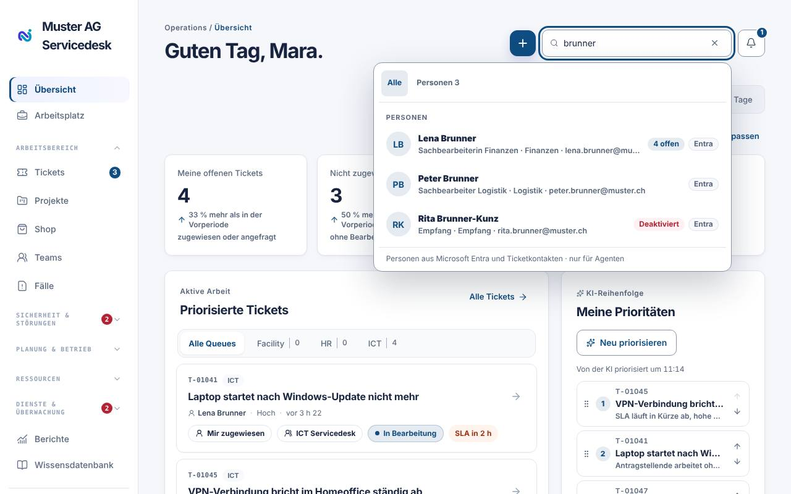

Ein Klick auf eine Person öffnet die **Personenübersicht**. Du erreichst sie
auch im Ticket über den Namen unter **Anfragende Person** (in der App:
**Personenübersicht** unter der anfragenden Person).

- **Kopf**: Foto (aus Microsoft Entra, sonst die Initialen), Funktion,
  Abteilung, E-Mail, vorgesetzte Person, letzte Anmeldung und Kontostatus aus
  Entra. Mit **Ticket für … erfassen** öffnet sich das
  Ticketformular mit der Person als anfragender Person.
- **Kennzahlen**: offene Tickets (davon wartend auf die Person), Tickets der
  letzten 12 Monate, durchschnittliche Lösungszeit im Vergleich zum Mandanten
  und die **Zufriedenheit**.
- **Reiter**: **Tickets** (alle, auch geschlossene; filterbar nach _Alle /
  Offen / Geschlossen_), **Geräte** aus Intune und Assets (ein Klick öffnet das Gerät), **Lizenzen**,
  **Bestellungen** aus dem Shop und der **Verlauf** als Zeitleiste. Geräte,
  Lizenzen und Bestellungen erscheinen nur, wenn das Modul aktiv ist und du
  die Berechtigung dafür hast. Für das Sicherheitsteam kommt der Reiter
  **Phishing / Junk** dazu (von der Person gemeldete Phishing-Mails, mit
  Kennzeichen _Geklickt_), für das Störungsteam der Reiter **Störungen**
  (Störungen ihrer Geräte in den letzten 12 Monaten).
- **Häufige Themen**: die Kategorien, zu denen die Person am häufigsten
  Tickets erfasst.

Du siehst nur Tickets, die du auch sonst öffnen darfst.

> **Datenschutz:** Einzelne Bewertungen und Kommentare der Person werden nie
> angezeigt. nextDesk zeigt nur den **Durchschnitt** (mit Anteil zufriedener
> Bewertungen, Mandantenvergleich und Tendenz), schon ab der ersten Bewertung.

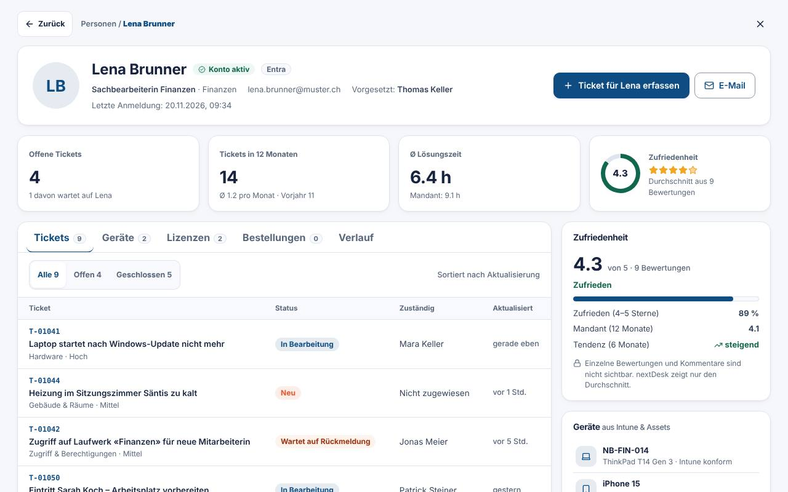

## Übersicht

Die **Übersicht** begrüsst dich und zeigt für den gewählten Zeitraum
(_Heute / 7 Tage / 30 Tage_) die Kennzahlen **Offene Tickets**, **Meine offenen
Tickets**, **Nicht zugewiesene Tickets** und **Gelöste Tickets**. Ein Klick
auf eine Kachel öffnet die passende gefilterte Liste.

Weitere Blöcke:

- **Priorisierte Tickets** und **Meine Prioritäten** – von der KI
  vorgeschlagene Reihenfolge; per Ziehen anpassen, **Neu priorisieren** oder
  **Eigene Reihenfolge verwerfen**. Über den Tickets stehen dir zugewiesene
  offene **Störungen** und **Phishing / Junk** (dringende rot markiert, z. B.
  Ausfall unbestätigt, Urteil überfällig oder «Melder hat geklickt»);
  Phishing-/Junk-Fälle erscheinen nicht mehr als Ticket.
- **Freigaben** – Entscheidungen, die auf dich warten
- **Meine Kennzahlen** – z. B. heute gelöst, Median der ersten Antwort
- **Gerade passiert** – die neuesten Ereignisse

Mit **Startseite anpassen** blendest du Blöcke ein oder aus.

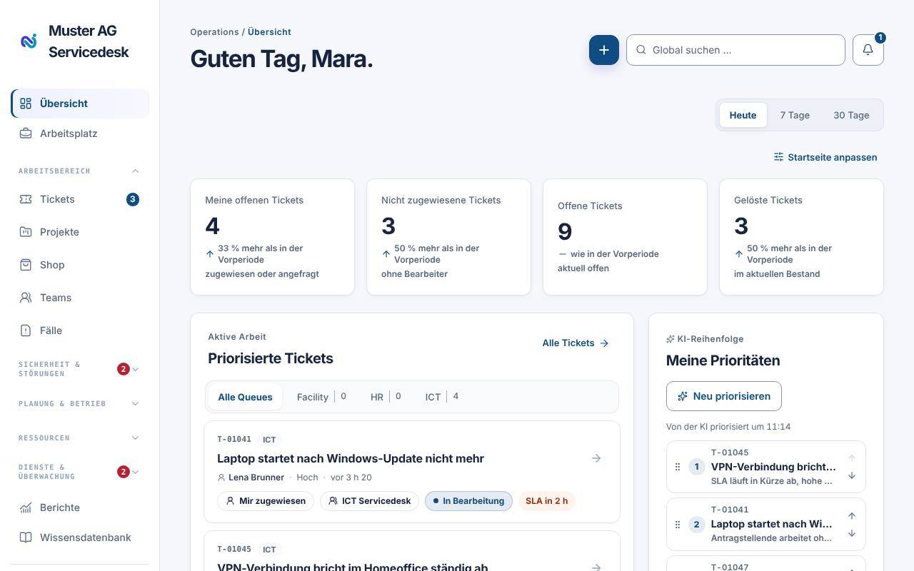

## Arbeitsplatz

Der **Arbeitsplatz** bündelt deine persönliche Arbeit in Registern:

- **Team** – die **Team-Warteschlangen**: offene Tickets pro Team, deine
  eigenen Teams zuoberst (markiert mit _Mein Team_). Daneben steht, wie viele
  davon noch **ohne Bearbeiter** sind. **Ohne Teamzuordnung** sammelt offene
  Tickets, die noch keinem Team zugeteilt sind. Ein Klick zeigt genau diese
  Tickets in der Ticketliste (Filter «Warteschlange: …», mit × entfernen).
- **Erwähnungen** – wo du mit @ erwähnt wurdest
- **Stellvertretung** – Tickets abwesender Kolleginnen und Kollegen
- **Störungen** – aktive Störungen
- **Erinnerungen** – Tickets, die du dir zu einem Datum vorgemerkt hast
- **Mein Bereich** – eigene Tickets, Geräte, Freigaben und **Phishing melden**

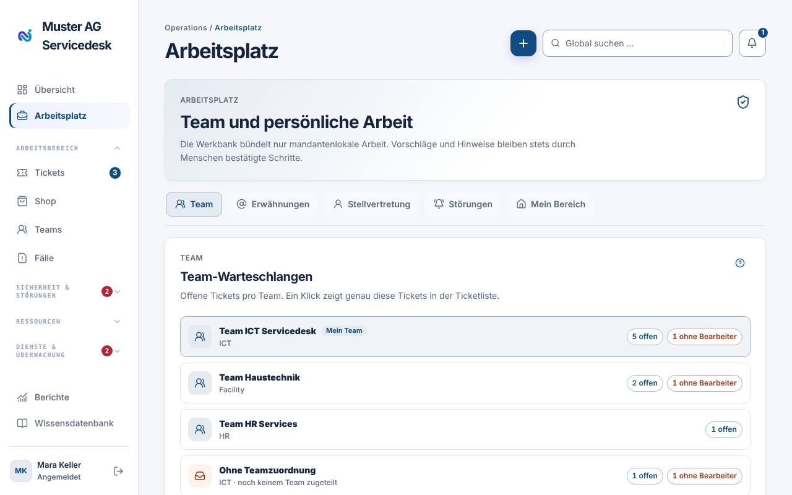

### Abwesenheit und Stellvertretung

Unter **Arbeitsplatz → Stellvertretung → Stellvertretung anlegen** wählst du
die stellvertretende Person, Beginn, Ende und eine Notiz und speicherst mit
**Stellvertretung speichern**. Deine Tickets erscheinen in dieser Zeit bei der
Stellvertretung.

### Phishing melden

Unter **Mein Bereich → Phishing melden** lädst du eine verdächtige E-Mail
(.eml oder .msg) hoch oder fügst die Kopfzeilen ein und klickst auf
**Melden**. In Outlook geht es auch mit **Melden → Phishing melden**. Daraus
entsteht ein Phishing-/Junk-Fall (siehe unten).

## Phishing / Junk

**Phishing / Junk** (im Web und in der App) sehen nur die Mitglieder des
Sicherheitsteams, das in den Phishing-Einstellungen gewählt ist. Ohne gewähltes
Team sehen sie alle Agenten.

Gemeldete Phishing-Mails erscheinen nicht in der Ticketliste (weder im Web
noch in der App), sondern unter **Phishing / Junk**. Meldet mehr als eine Person dieselbe E-Mail, entsteht
nur ein Fall; alle Melder hängen daran (Kennzeichen **Kampagne**). Ähnliche
Mails (gleiche Absenderdomain mit ähnlichem Betreff oder gleichen
Link-Domains) fasst nextDesk zusätzlich zu einer **Kampagne** über mehrere
Fälle zusammen; ab drei meldenden Personen erhält das Sicherheitsteam eine
Benachrichtigung. Die Kacheln
zeigen, was zu beurteilen ist, wie viele Fälle noch Massnahmen haben, die
Meldungen von heute, die mittlere Zeit bis zum Urteil und wie oft Melder
angegeben haben, geklickt zu haben.

Ein Klick auf eine Kachel zeigt darunter die passenden Fälle: _Meldungen
heute_ die heute gemeldeten, _Zeit bis Urteil_ die in den letzten 30 Tagen
beurteilten, _Geklickt_ die Fälle, bei denen jemand angegeben hat, geklickt zu
haben. **Filter aufheben** führt zurück zu den Fällen, die zu beurteilen sind.

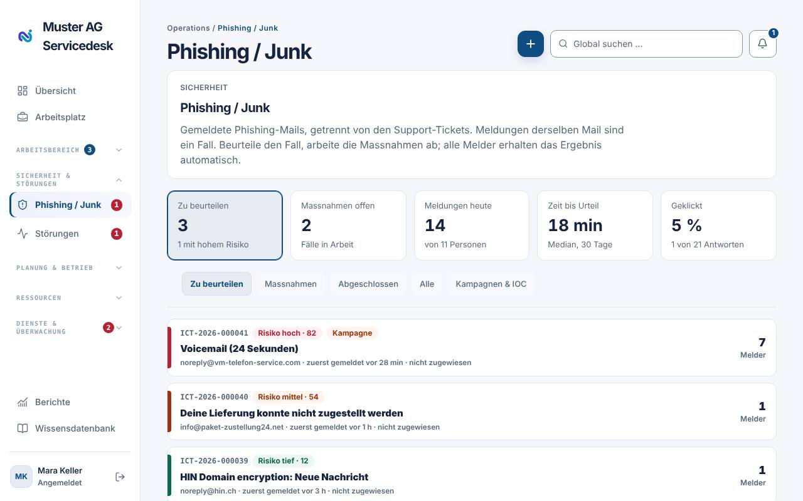

Ein Klick öffnet den Fall. Die gemeldete E-Mail steht so, wie sie beim
Empfänger ankam, in einer **sicheren Ansicht** (Betreff, An, Cc):
**Darstellung** zeigt die Mail mit Layout in einem abgeschotteten Rahmen,
**Text** die Textfassung und **Kopfzeilen** alle Header (Received, Return-Path,
Authentication-Results usw.) für die technische Beurteilung. Skripte laufen
nicht, externe Bilder und Inhalte werden nicht geladen, Links sind ohne Ziel
(beim Darüberfahren erscheint die entschärfte Adresse, z. B. `hxxps`, `[.]`),
und Anhänge erscheinen nur mit Name und Grösse. Bei älteren Meldungen ist nur
der Text gespeichert. Daneben
stehen die Befunde der automatischen Analyse (SPF, DKIM, DMARC, Absender,
Links, Anhänge) und die Risikoeinschätzung. Die Analyse erkennt unter anderem
Absender, die sich als interne Stelle ausgeben (z. B. «HR-Abteilung»), aber von
einer fremden Domain kommen, und Links, die eine «.ch»-Adresse nur vortäuschen
(z. B. `hr-abteilung.ch-secure.com`). Bei hohem Risiko soll das Urteil
innerhalb von 30 Minuten fallen, bei mittlerem innerhalb von 4 Stunden,
sonst innerhalb eines Tages.

**Phishing-Simulationen** (vereinbartes Awareness-Training, z. B. von
Hornetsecurity) erkennt nextDesk an den Kopfzeilen des Anbieters zusammen mit
dessen Mailserver. Solche Fälle tragen das Kennzeichen **Phishing-Simulation ·
Anbieter**, werden automatisch als **Phishing** beurteilt und abgeschlossen,
ohne das Team zu alarmieren; die meldende Person erhält trotzdem den Dank.
Sperre bei Simulationen keine Absender oder Adressen, sonst stört das das
Training.

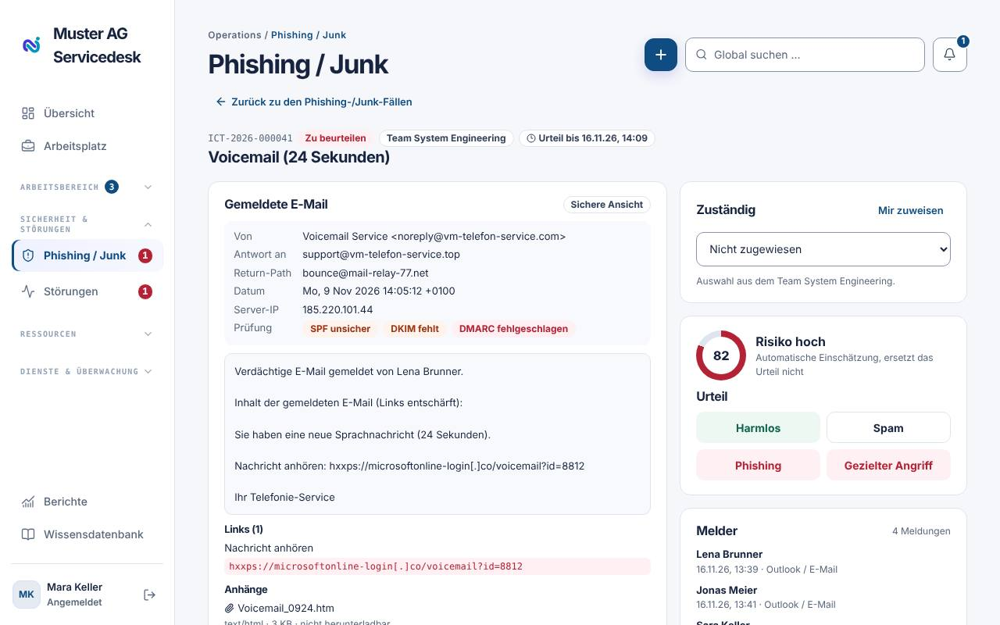

Unter **Zuständig** weist du den Fall einer Person zu (oder mit **Mir
zuweisen** sich selbst). Zur Auswahl stehen die Agenten, die den Fall
bearbeiten dürfen, bei einem Team die Mitglieder dieses Teams. In der Liste
steht bei jedem Fall, wer zuständig ist.

So bearbeitest du einen Fall:

1. **Urteil fällen**: _Harmlos_, _Spam_, _Phishing_ oder _Gezielter Angriff_
   wählen und bestätigen. Alle Melder erhalten danach automatisch eine E-Mail
   mit dem Ergebnis.
2. **Massnahmen abarbeiten**: Je nach Urteil erscheint eine Checkliste (z. B.
   Absender sperren, Mail aus allen Postfächern entfernen). Hake erledigte
   Schritte ab.
3. **Melder fragen: geklickt?** schickt allen Meldern eine kurze Rückfrage.
   Die Antwort (_Geklickt_ / _Nicht geklickt_) erscheint bei der Person; wer
   geklickt hat, löst eine Benachrichtigung an das Sicherheitsteam aus.
4. **Fall abschliessen**, sobald alles erledigt ist. Bei _Harmlos_ ohne
   Massnahmen schliesst sich der Fall direkt nach dem Urteil.

### Kontext und Massnahmen

Im Fall zeigt die Karte **Kontext und Massnahmen** zu jeder meldenden Person
Funktion, Abteilung, vorgesetzte Person, die letzte Anmeldung aus Microsoft
Entra (falls synchronisiert) und ihre Geräte mit Intune-Status (Compliance,
letzte Synchronisation) und IP-Adressen aus der IP-Verwaltung (Subnetz, VLAN,
Standort, Switch-Port). Nennt die gemeldete Mail eine IP-Adresse oder einen
Host aus dem eigenen Netz (bekanntes Subnetz, bekannte Adresse oder private
Adresse), erscheint der Hinweis **Interne Adresse!** – das kann auf ein
kompromittiertes internes Gerät oder Konto hindeuten.

Antwortet eine Person auf die Rückfrage mit **«Ja, ich habe geklickt»**,
erhält das Sicherheitsteam sofort eine Benachrichtigung und der Fall bekommt
die Priorität _hoch_. Bei der Person stehen dann diese Massnahmen bereit
(jede mit Bestätigungsdialog):

- **Gerät synchronisieren** und **Defender-Schnellscan** (Windows) über Intune
  – nur, was Intune für das Gerät anbietet. Ein Gerät **isolieren** ist nur
  direkt in Microsoft Defender möglich.
- **Sitzungen widerrufen** und **Passwort-Reset erzwingen** in Microsoft
  Entra. Fehlt der nextDesk-App dafür die Berechtigung, erscheint eine klare
  Meldung; die Checkliste bleibt, und du erledigst den Schritt im Entra Admin
  Center.
- **Ersatzgerät bestellen**: bestellt einen Shop-Artikel im Namen der Person
  mit dem Hinweis «Ersatzgerät aus Phishing-/Junk-Fall …». Verlangt der Artikel
  eine Genehmigung, wird diese wie üblich angefordert.

Jede Massnahme steht mit Ergebnis unter **Ausgeführte Massnahmen** und im
Verlauf des Falls.

### Kampagnen und IOC-Liste

Unter **Kampagnen & IOC** siehst du die erkannten Kampagnen mit allen
zugehörigen Fällen und die **IOC-Liste**: Domains, URLs, sendende IPs und
Absender aus allen Fällen mit dem Urteil _Spam_, _Phishing_ oder _Gezielter
Angriff_. Jede neue Meldung wird dagegen geprüft; Treffer stehen im Fall unter
**Bekannte Indikatoren** und als interne Notiz. Ist ein Eintrag unbedenklich
(z. B. ein missbrauchter, aber seriöser Dienst), markiere ihn **als
harmlos** – er löst dann keine Treffer mehr aus.

### Eskalation

Ist das Urteil überfällig, erhält das Sicherheitsteam eine Benachrichtigung;
nach weiteren 24 Stunden ohne Urteil gehen sie an die Vorgesetzten der
Abteilung (Rolle «Vorgesetzter Agent»). Mitglieder des Sicherheitsteams
erhalten neue Meldungen, Klicks, Kampagnen und Eskalationen immer – auch wenn
sie die Phishing-Meldungen in den Benachrichtigungen nicht eingeschaltet
haben.

Melder bekommen für Phishing-Meldungen keine Eingangsbestätigung, nur eine
Dankesnachricht und später das Ergebnis.

In der **iOS- und Android-App** heisst der Bereich ebenfalls **Phishing / Junk** (untere
Leiste, links vom Home-Knopf). Ein Fall beginnt mit der **Einschätzung**: In
Klartext steht, was für oder gegen Phishing spricht, zum Beispiel «Gibt sich
als interne Stelle aus, kommt aber von einer fremden Domain», «Link täuscht
eine .ch-Adresse vor», «Indikator aus früheren Fällen» oder «SPF, DKIM und
DMARC bestanden». Die eigene Organisation erkennt die App an den Adressen der
Melder. Darunter folgen die **gemeldete Mail** als Text (Links entschärft und
nicht antippbar, Kopfzeilen auf Wunsch) und die **Analyse**; erst dann das
Urteil, bei dem der Vorschlag markiert ist. Dort fällst du das Urteil, weist den Fall zu,
hakst Massnahmen ab, fragst die Melder nach einem Klick und schliesst den
Fall ab. Ein Tipp auf eine Phishing-Mitteilung öffnet den Fall direkt. Die
App zeigt auch Kampagne, bekannte Indikatoren und ausgeführte Massnahmen; die
Massnahmen selbst löst du im Web aus.

## Störungen

**Störungen** sehen nur die Mitglieder des Teams für die Alarmierung aus den
PRTG-Einstellungen. Ohne gewähltes Team sehen sie alle Agenten.

Meldungen aus PRTG landen nicht in der Ticketliste, sondern unter
**Störungen** im Arbeitsbereich. Ein Ticket braucht es dafür nicht: du
bearbeitest die Störung vollständig dort.

**Externe Störungen**: Zusätzlich erscheinen Störungen, die Anbieter auf ihren
offiziellen Statusseiten melden (z. B. Microsoft 365 mit Teams, Outlook,
OneDrive und SharePoint, GitHub, Claude, Gemini, App Store, Google Play,
Init7, Swisscom, Salt), gekennzeichnet mit **Extern · Anbieter**. Diese zeigen, dass die Ursache
beim Anbieter liegt und nicht in deinem Netz, z. B. wenn mehrere Personen
melden, dass Teams nicht geht. Das Team wird beim Auftreten benachrichtigt (ohne Wiederholungsalarm); meldet der Anbieter die Störung als
behoben, schliesst sie sich automatisch. **Statusseite des Anbieters öffnen**
führt zu den Details beim Anbieter. Titel und Texte der Anbieter zeigt nextDesk
als kurze deutsche Fassung ohne Floskeln (mit der KI übersetzt); den
Originaltext findest du auf der Statusseite des Anbieters. Neue Texte des
Anbieters erscheinen im Verlauf als «Update vom Anbieter»; das Team erhält dazu eine Benachrichtigung
(«Update: Anbieter» mit dem neuen Text) und eine weitere, sobald der Anbieter
die Störung als behoben meldet («Behoben: Anbieter»). Sind der Quelle in den Einstellungen Dienste zugeordnet, erscheint die
Störung automatisch als öffentliche Meldung im Banner und auf der
Statusseite. Hat eine externe Störung eine öffentliche Meldung (automatisch oder von
Hand veröffentlicht), übernimmt diese jedes Update des Anbieters. Auch externe Störungen
bestätigst du mit **Bestätigen: ich kümmere mich** (sie werden aber nicht
erneut alarmiert); unter **Zuständig** weist du sie einer Person zu, die sie
verfolgt. Von Hand abschliessen ist nur nötig, wenn die Meldung
beim Anbieter hängen bleibt.

- **Eine Störung pro Gerät**: Weitere Sensoren desselben Geräts (z. B. Ping
  und SNMP) hängen an derselben Störung. Kommt das Gerät innerhalb von
  10 Minuten erneut in Störung, öffnet sich die bisherige Störung wieder.
- **Folgestörungen**: Fällt ein Gerät aus, das hinter einem bereits gestörten
  Gerät hängt (Uplink in der Infrastruktur), erscheint es eingerückt als
  Folgestörung und wird nicht separat alarmiert. Es behebt sich mit der
  Ursache.
- **Alarmierung**: Sobald PRTG eine Störung meldet, erhält das in den
  Monitoring-Einstellungen gewählte Team (ohne Team alle Agenten) sofort eine
  Push-Mitteilung und eine E-Mail. Solange niemand die Störung bestätigt, wird
  in dem eingestellten Abstand (Standard 15 Minuten) erneut alarmiert. Wird
  aus einer Warnung ein Ausfall, kommt ebenfalls ein Alarm. Während einer
  Wartung im Systemstatus wird die Störung erfasst, aber nicht alarmiert.
- **Kacheln**: _Aktiv_ (Ausfälle und Warnungen), _Unbestätigt_ (mit der
  ältesten offenen Zeit), _Betroffene Dienste_, _Behebungszeit_ (Median der
  letzten 30 Tage) und _Verfügbarkeit_ der überwachten Geräte. Ein Klick auf
  eine Kachel zeigt darunter die passenden Störungen; **Filter aufheben** führt
  zurück zu den aktiven.
- **Zeile einer Störung**: Neben der Schwere zeigt jede Störung, wer sie
  gemeldet hat – **nextDesk-Überwachung**, **PRTG** oder bei externen
  Störungen **Extern · Anbieter** (im Detail «Gemeldet von …») –, wer
  zuständig ist (oder «Nicht zugewiesen») und, sobald eine öffentliche Meldung
  besteht, **Statusseite** mit deren Zustand (z. B. «Statusseite · Wird
  untersucht») und «Unbestätigt», solange niemand die Störung bestätigt hat.
- **Register**: _Aktiv_, _Abgeschlossen_ und _Alle_. Die Dauer läuft live mit, und neue
  Meldungen erscheinen ohne Neuladen. Im Suchfeld findest du Störungen nach
  Nummer, Gerät oder Titel; ältere Störungen lädst du mit **Weitere Störungen
  laden** nach.
- **Nur von Hand abgeschlossen**: Meldet die Überwachung (nextDesk oder PRTG)
  für alle Sensoren wieder OK, wird die Störung **nicht** automatisch
  abgeschlossen. Die Störung steht dann auf **Wieder OK – offen**, bleibt unter
  _Aktiv_ und in der Zahl im Menü, und die Alarmierung hört auf. Abgeschlossen
  wird sie immer von dir unter **Abschliessen** mit der **Ursache**; dort
  lassen sich auch zugeordnete Tickets informieren und ein Fall eröffnen
  (siehe unten). Fällt das Gerät erneut aus, solange die Störung offen ist,
  läuft dieselbe Störung weiter.
- **Tickets zur Störung**: Gehen während einer aktiven Störung Tickets zum
  betroffenen Gerät oder Dienst ein (Gerät bzw. Dienst am Ticket verknüpft
  oder Gerätename, Hostname oder IP-Adresse im Text), ordnet nextDesk sie der
  Störung automatisch zu. Im Ticket steht dann «Gehört zur Störung STO-…».

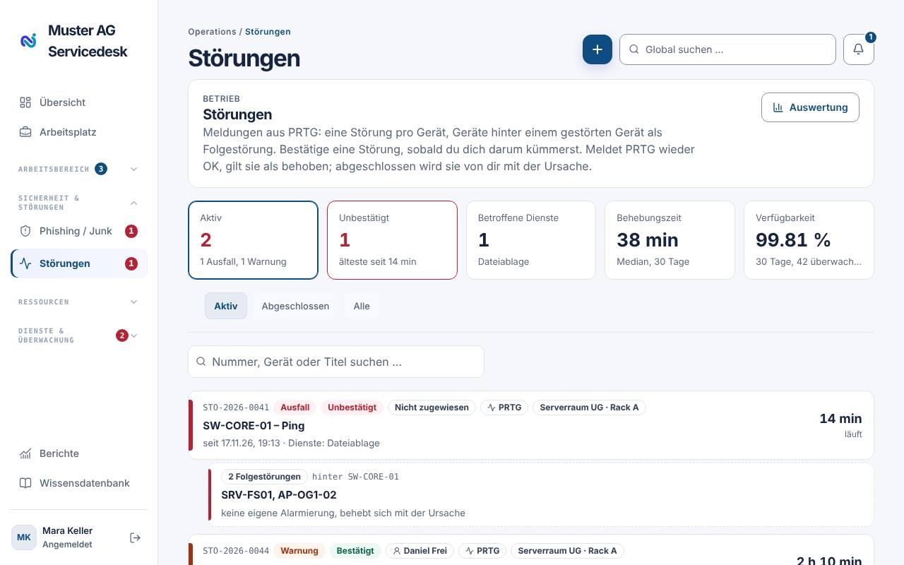

Ein Klick öffnet die Störung:

1. **Bestätigen: ich kümmere mich** stoppt die erneute Alarmierung und macht
   dich zur zuständigen Person. Unter **Zuständig** änderst du die Person
   (oder **Mir zuweisen**); wer einer noch unbestätigten Störung zugewiesen
   wird, bestätigt sie damit automatisch. Zur Auswahl
   stehen alle Agenten mit Zugriff auf das Modul Störungen, also die
   Mitglieder des Alarmierungsteams (ohne festgelegtes Team alle Agenten).
2. Der **Verlauf** zeigt alle PRTG-Meldungen und was in nextDesk geschah
   (geöffnet, alarmiert, bestätigt, Notizen). PRTG-Meldungen erscheinen als
   kurze deutsche Texte, z. B. «Keine Antwort auf Ping (Zeitüberschreitung)»
   statt englischer Texte mit Fehlercodes; im Titel fehlt der Sensortyp in
   Klammern. Mit **Notiz zum Verlauf
   hinzufügen** hältst du fest, was du geprüft oder veranlasst hast.
3. **Letzte 24 Stunden** zeigt, wann das Gerät gestört war, und warnt, wenn
   es in dieser Woche mehrfach ausgefallen ist. Darunter stehen die
   **Sensoren** mit ihrem letzten Stand. Wie beim Ticketstatus zeigt ein
   farbiges Abzeichen den Zustand jedes Sensors: **Fehler** (rot), **Warnung**
   (gelb) oder **OK** (grün).
4. Unter **Tickets** stehen die zugeordneten Tickets mit dem Grund der
   Zuordnung (Gerät, Dienst, im Text, von Hand). Mit **Ticketnummer
   zuordnen** ergänzt du ein Ticket, mit **×** löst du eines wieder; ein
   gelöstes Ticket wird nicht erneut automatisch zugeordnet.
5. Rechts siehst du **Gerät** (Ort, Adresse, PRTG-Objekt), **Netzwerk** (zu
   Beginn eingeklappt, mit IP und Anzahl Nachbarn; ein Klick klappt auf: IP,
   Subnetz, VLAN, Standort und Switch-Port aus der IP-Adressverwaltung sowie
   weitere Geräte im selben Subnetz bzw. am selben Switch mit ihrem aktuellen
   Zustand; im Web wie in der App), die **Abhängigkeiten** (vorgelagerte Geräte und Folgestörungen)
   und die **betroffenen Dienste**. Der Systemstatus wird automatisch gesetzt
   und nach der Behebung zurückgesetzt.
6. Unter **Statusseite** veröffentlichst du mit **Öffentliche Meldung** eine
   Meldung (Zustand, Titel, Text) auf der Statusseite und ergänzt sie später
   mit **Update veröffentlichen**. Unter **Betroffene Dienste und
   Betriebszustand** stehen die verknüpften Dienste und die Dienste der letzten
   Meldung; unter **Dienst hinzufügen** suchst du nach Name oder Kategorie
   und wählst weitere Dienste aus der Statusseite, auch bei externen
   Störungen. Pro Dienst stellst du direkt den
   Betriebszustand ein (Betriebsbereit, Beeinträchtigte Leistung, Teilweiser
   Ausfall, Schwerwiegender Ausfall, Wird gewartet). Mit dem Zustand
   **Behoben** werden die gewählten Dienste auf «Betriebsbereit» gesetzt; du
   kannst das vor dem Veröffentlichen noch ändern. Eine bereits
   veröffentlichte Meldung korrigierst du mit **Bearbeiten** (Zustand, Titel,
   Text, Dienste) und **Änderungen speichern**. Die Meldung folgt der Störung:
   Meldet die Überwachung wieder OK, steht sie auf **Wird beobachtet**; beim
   Abschliessen der Störung wird sie **Behoben** (mit der Ursache), fällt das
   Gerät erneut aus, wieder **Wird untersucht**. Meldet ein Anbieter eine
   externe Störung als behoben, wird ihre Meldung direkt **Behoben**. Behobene
   Meldungen verschwinden aus dem Störungsbanner in Web und App, Abonnenten
   erhalten jedes Update, und die Dienste der Meldung sind wieder
   betriebsbereit (ausser sie stehen noch in einer anderen offenen Meldung).
   Beim nächsten **Update veröffentlichen** schlägt nextDesk den passenden
   Zustand vor (gestört: Ursache bekannt, wieder OK: Wird beobachtet,
   abgeschlossen: Behoben).
7. **Abschliessen bzw. Ursache nachtragen**: Wähle die **Ursache** (Strom, Netzwerk, Hardware,
   Software, Wartung, Extern, Unbekannt) und halte die Lösung fest. Sind
   Tickets zugeordnet, ist **Tickets informieren und auf «Gelöst» setzen**
   eingeschaltet: Jedes offene Ticket erhält eine öffentliche Antwort mit der
   Ursache (Text anpassbar, Versand per Mail wie gewohnt) und wird gelöst.
   Tickets, für die dir die Berechtigung fehlt oder bei denen die Ursache
   einer SLA-Verletzung noch fehlt, werden ausgelassen und nach dem Abschluss
   aufgeführt. Mit **Fall eröffnen** legst du gleichzeitig einen Fall
   (Problem-Management) mit Tickets und Diensten der Störung an. Eine noch
   aktive Störung schliesst du ebenso ab, etwa wenn ein «Up» von PRTG
   verloren ging; Folgestörungen werden mit abgeschlossen.
8. War das Gerät in 30 Tagen mindestens dreimal gestört (oder trat dieselbe
   Ursache dreimal auf), schlägt die Karte **Fall** mit **Fall vorschlagen**
   einen Fall vor; frühere Störungen des Geräts werden auf Wunsch verknüpft.
9. Bei einer abgeschlossenen Störung mit Ursache erstellt **Wissen →
   Wissensartikel-Entwurf erstellen** einen internen Artikelentwurf (Symptom,
   Ursache, Lösung, Vorbeugung) – mit KI, wenn sie für den Mandanten
   freigegeben ist, sonst aus den Angaben der Störung. Prüfe und
   veröffentliche ihn in der Wissensdatenbank.

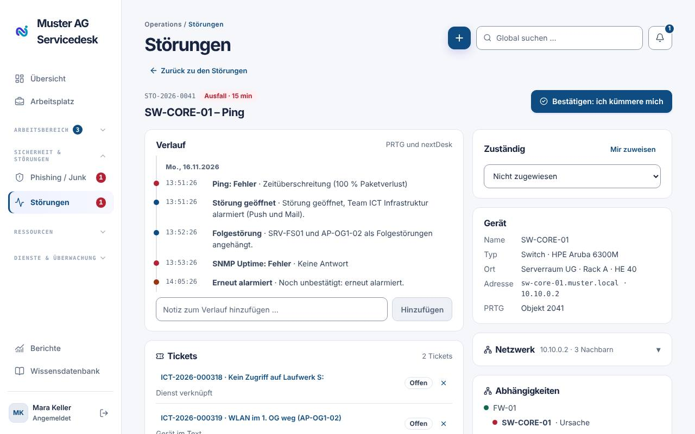

Über **Auswertung** siehst du für 30 oder 90 Tage die Anzahl Störungen, die
mittlere Behebungszeit, die Verfügbarkeit, die häufigsten Ursachen und die
Geräte mit den meisten Störungen.

Die Benachrichtigungen dazu schaltest du unter _Persönliche Einstellungen →
Benachrichtigungen → Störungen_ (Push und E-Mail) ein oder aus.

In der **iOS- und Android-App** findest du **Störungen** in der unteren Leiste
links vom Home-Knopf (Tickets, Störungen, Phishing / Junk). Dort siehst du die aktiven,
unbestätigten, behobenen und abgeschlossenen Störungen samt Folgestörungen,
bestätigen sie, weisen sie zu, ergänzen Notizen und schliessen sie mit Ursache
ab – auf Wunsch mit Antwort an die zugeordneten Tickets. Die Störung zeigt auch
die Tickets und den Netzwerk-Kontext. Ein Tipp auf eine Störungs-Mitteilung
öffnet die Störung direkt.

## Überwachung

Unter **Dienste und Überwachung → Überwachung** siehst du, welche Geräte
nextDesk selbst überwacht und wie es ihnen geht. Der Eintrag erscheint, wenn
das Modul _Überwachung_ eingeschaltet ist und du das Recht «Assets ansehen»
hast. Gemessen wird von einer **Sonde** in eurem Netz; sie meldet die
Resultate laufend an nextDesk.

Wie bei **Störungen** zeigt der Menüeintrag **Überwachung** (und bei
zugeklappter Gruppe **Dienste und Überwachung**) die Anzahl Geräte mit
Ausfall oder Warnung: rot, solange mindestens ein Gerät ausgefallen ist,
sonst grau.

- **Kacheln**: Anzahl Geräte je Zustand. Ein Klick filtert die Liste.
  - **Ausfall** – ein Sensor antwortet nicht mehr (nach zwei Fehlversuchen in
    Folge, einstellbar je Sensor).
  - **Warnung** – der Sensor antwortet, aber langsamer als seine Warnschwelle.
  - **OK** – alle Sensoren des Geräts sind in Ordnung.
  - **Unbekannt** – es kommen keine Messwerte: keine Sonde zugewiesen, oder
    die Sonde meldet sich nicht.
  - **Pausiert** – die Überwachung des Geräts ist angehalten.
- **Letzte Ereignisse**: was sich in den letzten 24 Stunden oder 7 Tagen
  geändert hat. Oben steht die Anzahl (Ausfälle, Warnungen, behoben), darunter
  ein Balken je Stunde bzw. Tag in der Farbe des schwersten Ereignisses.
  **Ereignisse anzeigen** klappt die Liste auf (zunächst eingeklappt): Zeit,
  Gerät und Sensor, Meldung, bei einer Behebung die Dauer des Ausfalls, die
  betroffenen Dienste und der Link zur Störung. Simulierte Ausfälle tragen das
  Etikett «Test».
- **Verfügbarkeit**: wie viel der Zeit die überwachten Geräte erreichbar
  waren, für 7 Tage, 30 Tage oder 1 Jahr. Jeder Balken steht für einen Tag
  (beim Jahr für eine Woche): grün ohne Ausfall, orange bei mindestens 99 %,
  rot darunter. **Am häufigsten ausgefallen** ist zunächst eingeklappt; ein
  Klick klappt die Liste auf. Aufgeführt sind die Geräte mit der
  schlechtesten Verfügbarkeit, mit Anzahl und Dauer der Ausfälle und den
  betroffenen Diensten; ein Klick öffnet das Gerät. Gerechnet wird aus den
  Ausfällen der eigenen Sensoren ab dem Tag, an dem ein Gerät überwacht wird.
  Warnungen und simulierte Ausfälle zählen nicht.
- **Aktive Alarme** (unter den beiden Karten, über die ganze Breite): Geräte mit Ausfall oder Warnung, mit Sensor, Meldung und
  Dauer. Bei einem Ausfall öffnet nextDesk automatisch eine **Störung**; der
  Link führt direkt dorthin. Alarmteam, Wiederalarmierung, Folgestörungen und
  die Ruhe während Wartungsfenstern gelten wie bei allen Störungen.
  Mit **Ticket erstellen** legst du direkt ein Ticket zum Gerät an: Betreff
  und Beschreibung nennen die gestörten Sensoren, das Gerät ist verknüpft,
  das Ticket geht an das Team aus den Überwachungseinstellungen und wird der
  offenen Störung zugeordnet. Danach öffnet sich das Ticket. Dasselbe gibt
  es im Gerätedetail unter **Verknüpft in nextDesk**.
  Neben dem Alarm stehen die betroffenen Dienste.
- **Sonden**: Die Kachel «Sonden online» zeigt, wie viele Sonden sich melden.
  Ein Hinweis erscheint nur, wenn eine Sonde sich nicht meldet oder eine
  neuere Version bereitsteht. Meldet sich eine Sonde länger als drei Minuten
  nicht, gelten ihre Sensoren als «Unbekannt». Nach fünf Minuten öffnet
  nextDesk eine Störung «Sonde … – Verbindung zu nextDesk» und alarmiert das
  Alarmteam; sie gilt als behoben, sobald die Sonde sich wieder meldet.
  Verwaltet werden Sonden unter **Einstellungen → Monitoring**.
- **Geräteliste**: Zustand, Sensoren, Antwortzeit und letzte Prüfung. Die
  Suche findet Name, IP-Adresse, Hostname und den gestörten Sensor.
  Ein Klick auf einen Spaltenkopf sortiert die Liste, ein zweiter kehrt die
  Reihenfolge um. Standard ist der Zustand, das Dringende zuoberst.
- **Kategorien**: Die Geräteliste ist nach Kategorien gegliedert, sobald es
  welche gibt – zum Beispiel pro Standort, mit Unterkategorien über bis zu
  vier Ebenen («Standort Baar → Netzwerk → Switch»). Geräte einer
  Unterkategorie stehen eingerückt unter ihrer Überschrift; die Zahl neben
  einer Kategorie zählt alles darunter mit. Jede Überschrift zeigt die Anzahl
  Geräte und lässt sich ein- und ausklappen. Beim Öffnen der Seite sind alle
  Kategorien eingeklappt; sobald gesucht oder nach Zustand gefiltert wird,
  klappen sie auf, damit kein Treffer verborgen bleibt. Geräte ohne Zuordnung stehen
  unter **Ohne Kategorie**. Mit dem Recht «Assets verwalten» legst du über
  **Kategorien** neue an, benennst sie um oder löschst sie. Beim Löschen
  bleiben die Geräte überwacht und stehen wieder unter «Ohne Kategorie»;
  Unterkategorien werden mitgelöscht. Um Geräte zuzuordnen, wählst du sie
  über die Kästchen aus und klickst auf **Kategorie zuweisen**; dort lässt
  sich auch gleich eine neue Kategorie erstellen oder eine neue
  Unterkategorie erstellen. Die **Art** eines Geräts
  (Server, Switch …) bleibt davon unberührt. In der App erscheint die
  Geräteliste ohne Kategorien.
- **Aufklappen und pausieren**: Der Pfeil vor einem Gerät klappt seine
  Sensoren mit Zustand, Messwert und letzter Prüfung auf. Mit dem Recht
  «Assets verwalten» pausierst du rechts ein ganzes Gerät oder in der
  aufgeklappten Liste einen einzelnen Sensor (**Pausieren** / **Fortsetzen**).
  Über die Kästchen links wählst du mehrere Geräte und Sensoren aus und
  pausierst oder setzt sie in der Leiste über der Liste gemeinsam fort.
  Beim Pausieren gibst du immer einen **Grund** an (3 bis 300 Zeichen). Er
  steht mit Person und Zeitpunkt beim Gerät und beim Sensor («Pausiert von
  … : Grund»), auch im Gerätedetail und in der App. Ein pausierter Sensor
  wird nicht gemessen, löst keinen Alarm aus und schliesst einen offenen
  Alarm.
- **Letzte Ereignisse** zeigen neben Ausfällen und Warnungen auch, wer ein
  Gerät oder einen Sensor pausiert (mit Grund) oder fortgesetzt hat.
- **Wartungsfenster pausieren automatisch**: Beginnt ein Wartungsfenster
  (Systemstatus, Register **Wartung**), pausiert nextDesk innerhalb einer
  Minute alle Sensoren der dort gewählten Geräte. Als Grund steht
  «Wartungsfenster «Titel» (automatisch)», offene Alarme schliessen sich, und
  unter **Letzte Ereignisse** erscheint die Pause. Endet das Fenster (Endzeit
  erreicht, abgeschlossen, abgesagt oder gelöscht), setzt nextDesk genau
  diese Sensoren wieder fort. Sensoren, die du schon vorher pausiert hattest,
  bleiben pausiert; pausierst du einen Sensor während des Fensters mit einem
  anderen Grund neu, bleibt er ebenfalls pausiert.

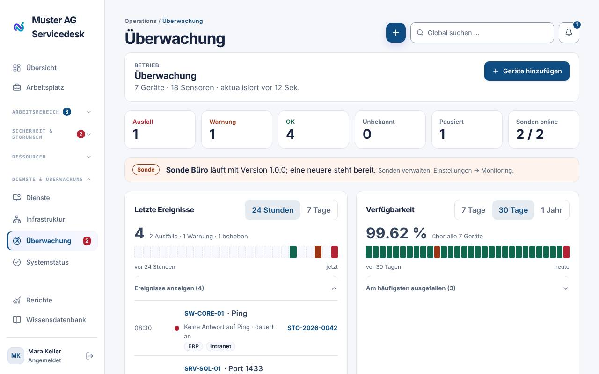

Ein Klick auf ein Gerät öffnet das **Gerätedetail**:

- Die **Grafik** zeigt die Antwortzeit des gewählten Sensors über 24 Stunden,
  7 Tage, 30 Tage oder 1 Jahr. Die helle Fläche ist die Spanne zwischen
  kleinstem und grösstem Wert, die gestrichelte Linie die Warnschwelle, rote
  Balken sind Zeiten mit fehlgeschlagenen Prüfungen. Für 24 Stunden siehst du
  Werte im 5-Minuten-Raster, für längere Zeiträume Stunden- bzw. Tageswerte.
- **Sensoren**: Zustand, Messwert, Intervall und letzte Prüfung. Ein Klick auf
  den Namen zeigt den Verlauf dieses Sensors in der Grafik.
- **Verbindungen**: welcher Port zu welchem Gerät führt. Die Sonde liest das
  bei Switches, Firewalls und Routern alle sechs Stunden per SNMP aus.
  - **Verbunden mit** nennt die Gegenstelle. Quelle **LLDP**: Das
    Nachbargerät hat sich selbst gemeldet, samt seinem Port. Quelle
    **MAC-Tabelle**: Am Port wurde die MAC-Adresse eines Geräts gesehen, das
    in der Infrastruktur oder der IP-Adressverwaltung steht.
  - Ein Klick auf die Gegenstelle öffnet sie – in der Überwachung, wenn sie
    überwacht wird, sonst in der Infrastruktur.
  - Ports mit vielen Geräten dahinter sind Uplinks oder Trunks und werden
    nur gezählt.
  - Bei Servern, Access Points und anderen Endgeräten steht **Hängt an …,
    Port …**, sobald ein überwachter Switch das Gerät an einem Port sieht.
  - Angezeigt werden zuerst nur Ports mit Gegenstelle; **Alle … Ports
    zeigen** blendet die übrigen ein. Mit dem Recht «Assets verwalten»
    kannst du die Verbindungen über **Jetzt auslesen** sofort neu lesen
    lassen (Antwort innert etwa einer Minute).
- **Verknüpft in nextDesk**: das Gerät in der Infrastruktur, offene Störung,
  betroffene Services und der Uplink. Jedes überwachte Gerät ist ein Gerät
  der Infrastruktur; über **In Infrastruktur öffnen** gelangst du direkt
  dorthin (in der App über die gleichnamige Zeile). Services und Uplink
  werden unter **Infrastruktur** gepflegt.

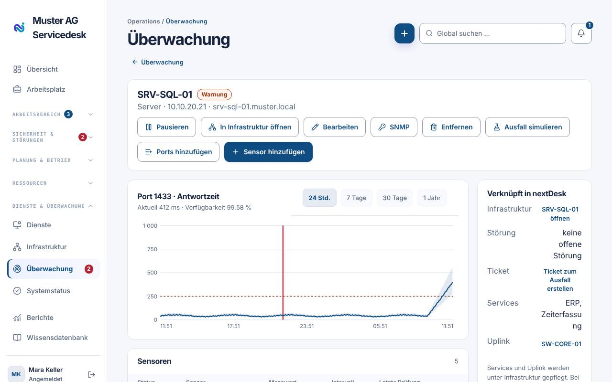

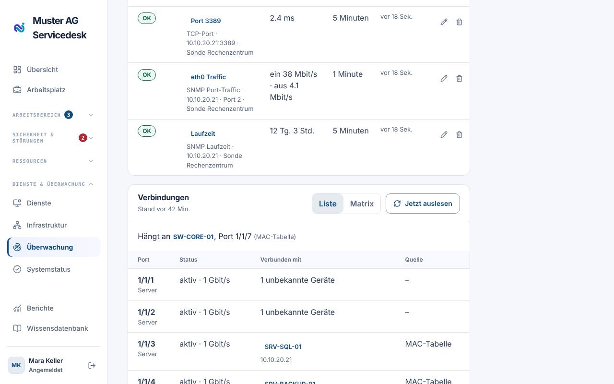

Mit **Liste** und **Matrix** oben in der Karte wechselt die Darstellung. Die
Matrix zeigt die Ports jeder Einheit wie auf der Gerätefront, eingefärbt nach
Zustand (Gegenstelle bekannt, Uplink oder Trunk, aktiv, kein Link). Ein Klick
auf einen Port nennt darunter die Gegenstelle. Das Diagramm «Verbindungen zu
bekannten Geräten» zieht von jedem Port eine Linie zum Gerät, zu dem er führt
(durchgezogen: LLDP, gestrichelt: MAC-Tabelle); Geräte der Infrastruktur sind
anklickbar.

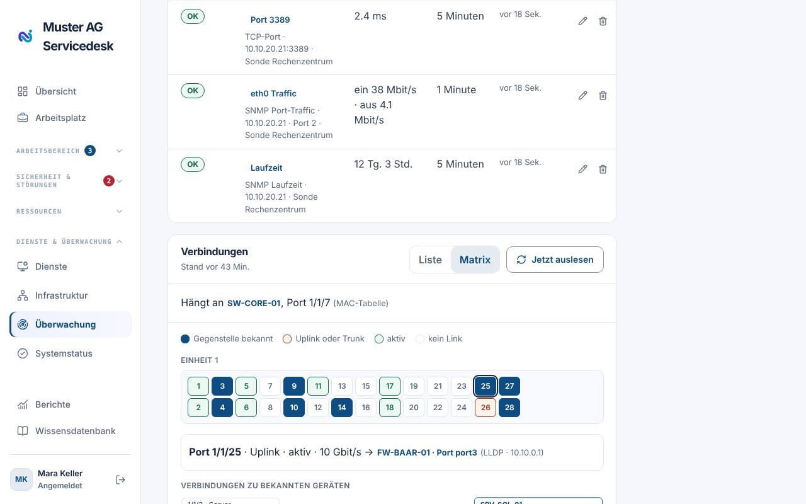

**Ausfall simulieren** (im Gerätedetail, mit dem Recht «Assets verwalten»):
Damit prüfst du die ganze Kette, ohne das Gerät anzufassen. Du wählst das
ganze Gerät oder einen Sensor und die Dauer (5 bis 60 Minuten). Solange die
Simulation läuft, gelten die Messwerte als fehlgeschlagen («Simulierter
Ausfall (Test)»). Alles Weitere ist echt: nextDesk öffnet eine Störung,
alarmiert das Team, ändert den Systemstatus der betroffenen Dienste und
zeigt – falls eingeschaltet – den Banner. Der Ausfall erscheint mit der
nächsten Messung des Sensors (je nach Intervall nach einigen Sekunden bis
Minuten). Die Simulation endet von selbst oder über **Simulation beenden**;
danach meldet der Sensor mit der nächsten Messung wieder den echten Zustand
und die Störung schliesst sich. Pausierte Sensoren und Sensoren ohne
erreichbare Sonde lassen sich nicht simulieren. Das Team am besten vorher
informieren.

Mit dem Recht «Assets verwalten» kannst du zusätzlich:

1. **Geräte hinzufügen** – die Suche findet:

   - **Geräte der Infrastruktur.** Geräte mit Adresse stehen zuoberst,
     bereits überwachte Geräte zuunterst in der Liste.
   - **Einträge der IP-Adressverwaltung**, die noch kein Gerät sind (ab zwei
     Zeichen). Name und Adresse werden übernommen.
   - **Neues Gerät erfassen**, wenn es nirgends steht: Name, Art und
     IP-Adresse oder Hostname genügen.

   Mehrere Treffer lassen sich ankreuzen und zusammen hinzufügen; die Auswahl
   bleibt erhalten, wenn der Suchtext ändert. **Alle … angezeigten
   auswählen** kreuzt alle Treffer der aktuellen Suche an. Für Einträge der
   IP-Adressverwaltung bestimmt nextDesk die Art aus Name und Beschreibung;
   sie lässt sich im Dialog für alle festlegen und später je Gerät ändern.
   Fehlt die passende Art (z. B. «iLO», «Drucker», «Kamera»), legt **Neue Art
   erstellen …** zuunterst in der Auswahl sie mit einem eigenen Namen an;
   danach steht sie auch für weitere Geräte und unter **Bearbeiten** zur
   Wahl. Eigene Arten erscheinen auch in der Infrastruktur.
   Ein Gerät ohne IP-Adresse und Hostname lässt sich nur einzeln hinzufügen,
   der Dialog fragt dann nach der Adresse.

   Aus Einträgen der IP-Adressverwaltung und neu erfassten Geräten legt
   nextDesk Geräte in der Infrastruktur an; Standort, Uplink und Services
   ergänzt du dort. Danach die Sonde wählen. Jedes Gerät erhält einen
   Ping-Sensor.

2. **Sensor hinzufügen** (im Gerätedetail) – Art wählen:

   - **Ping**: Ist das Gerät erreichbar?
   - **TCP-Port**: Antwortet ein Dienst, z. B. 3389 (RDP) oder 1433 (SQL)?
   - **HTTP**: Antwortet eine Webseite ohne Fehler? Fehlercodes ab 400 und
     ungültige Zertifikate gelten als Ausfall.
   - **Zertifikat**: Wie viele Tage ist das TLS-Zertifikat eines Hosts noch
     gültig? Vorgabe: Warnung unter 30 Tagen, Ausfall unter 7 Tagen. Ein
     abgelaufenes Zertifikat gilt sofort als Ausfall.
   - **DNS**: Lässt sich ein Name auflösen, auf Wunsch auf eine bestimmte
     IP-Adresse?
   - **SNMP Laufzeit**: Wie lange läuft das Gerät seit dem letzten Neustart?
   - **SNMP Wert (eigene OID)**: ein beliebiger Zahlenwert des Geräts, z. B.
     Akkuladung einer USV oder Temperatur. Mit **Faktor** und **Einheit**
     wird der Rohwert lesbar (Rohwert 235, Faktor 0.1, Einheit °C ergibt
     23.5 °C). Schwellen gibt es in beide Richtungen: Warnung und Ausfall
     jeweils über oder unter einem Wert.
   - **SNMP Port-Traffic** für einen einzelnen Port von Hand; bequemer geht
     es über **Ports hinzufügen**.

   Dazu Intervall (30 Sekunden bis 1 Stunde), bei Ping, Port und HTTP
   optional eine Warnschwelle für die Antwortzeit, und die Anzahl
   Fehlversuche bis zum Ausfall.

   **Ports hinzufügen** (im Gerätedetail, für Switches und Firewalls): Sonde
   wählen und **Ports auslesen**. Die Sonde fragt das Gerät per SNMP ab; das
   dauert bis zu einer Minute. Danach die gewünschten Ports ankreuzen, das
   Intervall wählen und die Sensoren anlegen. Jeder Port-Sensor misst den
   ein- und ausgehenden Datenverkehr und meldet einen Ausfall, wenn der Port
   die Verbindung verliert. Die Grafik zeigt beide Richtungen. Der erste
   Messwert erscheint nach der zweiten Messung, weil der Datenverkehr aus
   der Differenz zweier Zählerstände berechnet wird.

   Die SNMP-Zugangsdaten stehen in der `config.json` der Sonde, nicht in
   nextDesk.

   **Gemessen von**: HTTP, Zertifikat und DNS kann statt einer Sonde auch
   die **nextDesk Cloud** messen. Das passt für Ziele, die aus dem Internet
   erreichbar sind (Website, Webmail, öffentliche Zertifikate). Interne
   Adressen lehnt die Cloud ab; dafür braucht es eine Sonde. Die Cloud prüft
   einmal pro Minute und folgt keinen Weiterleitungen. Bei öffentlichen
   Zielen gilt ein nicht vertrauenswürdiges Zertifikat als Ausfall; eine
   Sonde wertet bei internen Zertifikaten nur Ablauf und Erreichbarkeit.

   **Betroffene Dienste** (im Sensor-Dialog): Ohne Auswahl gelten bei einem
   Ausfall die Dienste, die am Gerät in der Infrastruktur hinterlegt sind.
   Soll ein Sensor nur bestimmte Dienste betreffen (z. B. «Port 443» nur
   den Dienst «Abacus»), suchst du sie im Suchfeld und kreuzt sie an; die Liste ist nach
   Kategorie gegliedert, und die Suche findet auch Kategorien; die gewählten
   Dienste stehen oben und lassen sich mit × wieder entfernen; dann wirkt dieser Sensor nur
   auf diese Dienste. Die Störung nennt sie, der Systemstatus der Dienste
   wechselt, und – wenn in den Einstellungen eingeschaltet – erscheint der
   Ausfall als Banner und auf der Statusseite, sobald jemand die Störung
   bestätigt oder spätestens nach 10 Minuten. Warnungen bleiben intern.

3. Sensoren **bearbeiten** oder **löschen** (Symbole in der Sensorzeile).
   Im Kopf des Gerätedetails:

   - **Pausieren** hält die Überwachung des ganzen Geräts an.
   - **Bearbeiten** ändert Name, Art, IP-Adresse und Hostname des Geräts. Die
     Änderung gilt auch in der Infrastruktur; Sensoren ohne eigenes Ziel
     messen danach die neue Adresse.
   - **Entfernen** nimmt das Gerät aus der Überwachung: Alle Sensoren und ihr
     Verlauf werden gelöscht. Das Gerät selbst bleibt in der Infrastruktur.

   Beim Pausieren, Löschen und Entfernen endet ein offener Alarm; die
   Störung gilt als behoben, sobald kein Sensor des Geräts mehr gestört ist.

4. **Sonde hinzufügen** – siehe Handbuch für Administratoren.

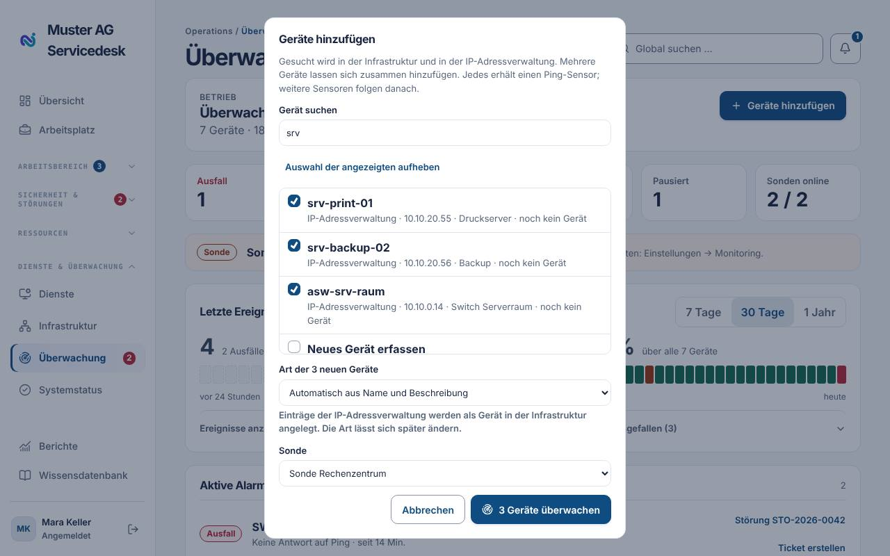

**In der App** findest du die Überwachung unter **Dienste → Überwachung** (wenn
das Modul aktiv ist). Die App zeigt die Kacheln je Zustand, die aktiven
Alarme, die Geräteliste und die Sonden. Ein Tipp auf ein Gerät öffnet dessen
Sensoren mit Verlaufsgrafik (24 Stunden bis 1 Jahr); von dort führt ein Tipp
zur offenen Störung. Mit dem Recht «Assets verwalten» lässt sich die
Überwachung eines Geräts pausieren und fortsetzen. Geräte, Sensoren und
Sonden werden im Web erfasst.

> Sensoren für Windows-Server (Dienste, Datenträger, CPU) folgen.

## Ticketliste

Unter **Tickets** arbeitest du die Warteschlangen ab. Jede Ticketkarte zeigt
neben Nummer und Betreff auch die **anfragende Person** – in der Liste, auf
der Übersicht, im Kanban und in der App.

- **Meine offenen Tickets** (Kachel und Liste) zeigt nur offene Tickets, die dir
  zugewiesen sind oder die du angefragt hast. Gelöste und geschlossene
  Tickets findest du über die Kachel **Gelöste Tickets** oder den Filter
  _Status_.
- **Queues**: Register pro Warteschlange. Arbeitest du in Teams mehrerer
  Supportstufen, erscheinen zusätzlich _Alle Stufen / 1st / 2nd / 3rd Level_.
  Wählst du eine Stufe, zeigen auch die Kacheln oben nur die Zahlen dieser
  Stufe.
- **Sortieren nach:** rechts in der Leiste über der Liste, für alle Agenten:
  Letzte Änderung, Agent, Status, Abteilung oder Priorität. Der Pfeil daneben
  wechselt zwischen absteigend und aufsteigend. Dieselbe Einstellung gibt es
  unter **Filter & Sortierung**.
- **Filter & Sortierung**: Suche, Status (Mehrfachauswahl: mehrere Status
  gleichzeitig ankreuzen), Priorität, Agent (_Mir zugewiesen_,
  _Nicht zugewiesen_), Abteilung, Sortierung. **Filter zurücksetzen** stellt
  alles zurück.
- **Gespeicherte Ansichten**: Filter als **Neue Ansicht** speichern und auf
  Wunsch mit der Abteilung teilen («Teilen mit»).
  Gespeicherte Ansichten (auch geteilte) wählst du direkt in der Leiste über
  der Liste unter **Ansicht:** aus; dort ist die passende Ansicht markiert,
  solange die Filter nicht verändert wurden. **Filter zurücksetzen** im
  selben Feld hebt sie wieder auf.
- In der **iOS- und Android-App** wählst du in der Ticketliste unter **Status**
  einen oder mehrere Status gleichzeitig; **Zurücksetzen** hebt die Auswahl auf.
  Das Filtersymbol in der Suchleiste öffnet dieselben Filter wie im Web:
  Bereich, Agent, Abteilung, Priorität, Sortierung und Reihenfolge. Ohne
  Auswahl zeigt die Liste **Meine** Tickets.
- **Ansicht**: Listendichte (_Kompakt / Standard / Komfortabel_) und
  Listen-Detail-Ansicht (Liste links, Ticket rechts).
- **Mehrfachauswahl**: mehrere Tickets markieren → **Neuer Status** →
  **Status für Auswahl setzen**.
- **SLA-Anzeige**: Jede Karte zeigt die verbleibende Zeit bis zur
  Lösungsfrist; Tickets in einem wartenden Status zeigen stattdessen **«SLA
  pausiert seit …»** (siehe «SLA-Pause in wartenden Status»).
- **Suchfilter im Suchfeld**: `status:offen`, `prio:hoch`, `queue:ict`,
  `agent:mir` sowie `sla:kritisch` (Lösungsfrist in weniger als 1 Stunde oder
  überschritten), `sla:warnung` (1 bis 4 Stunden), `sla:ok` (mehr als
  4 Stunden oder ohne Frist) und `sla:pausiert` (SLA pausiert, Ticket in
  einem wartenden Status). Pausierte Tickets erscheinen nur unter
  `sla:pausiert`, nie unter `sla:kritisch`, `sla:warnung` oder `sla:ok`.

### Gelöschte Tickets (Papierkorb)

Mit der Berechtigung zum Löschen kannst du markierte Tickets über
**Löschen** entfernen. Die Tickets kommen in den **Papierkorb** und sind nirgends mehr
sichtbar (Listen, Suche, Berichte, App), lösen keine Benachrichtigungen oder
Mails mehr aus und lassen sich **90 Tage lang wiederherstellen**. Danach werden
sie automatisch endgültig entfernt, samt Kommentaren und Anhängen.

Den Papierkorb öffnest du in der Ticketliste über **Filter & Sortierung →
Gelöschte Tickets anzeigen**. Dort siehst du, wer ein Ticket wann gelöscht hat
und wie lange es noch wiederherstellbar ist. Ein Klick zeigt das Ticket mit
Beschreibung und Verlauf; **Wiederherstellen** holt es unverändert zurück.

### Spam

Mit der Berechtigung zum Löschen kannst du Tickets als **Spam** einstufen:

- **iPhone und Android:** Wische ein Ticket nach links. Links neben **Löschen**
  steht **Spam**. Eine Rückfrage warnt dich: «Alle zukünftigen Tickets von
  diesem Absender gehen automatisch in den Spam.»
- **Web:** Tickets in der Liste markieren und **Als Spam markieren** wählen
  (mit derselben Rückfrage).

Das Ticket und alle **künftigen** Tickets dieses Absenders landen im Spam. Spam
löst keine Regeln, SLA, KI-Triage, Bestätigungsmail oder Mitteilung aus und
zählt in keiner Statistik. Absender, die selbst Personen deines Arbeitsbereichs
sind, werden nie gesperrt; dann geht nur das einzelne Ticket in den Spam.

Den Spam öffnest du in der Ticketliste über **Filter & Sortierung → Spam
anzeigen**: Dort siehst du Absender und Zeitpunkt, **Kein Spam** holt ein Ticket
zurück und gibt den Absender frei. Unter **Gesperrte Absender** gibst du
Absender auch einzeln frei. Spam bleibt 90 Tage erhalten. Eine Auswertung
(Verlauf pro Tag, häufigste Absender, Abteilungen, automatisch abgefangen oder
von Hand markiert) findest du unter **Berichte → Spam**.

**Tastenkürzel:** `?` zeigt die Hilfe, `J`/`K` springen zum nächsten bzw.
vorherigen Ticket, `Enter` öffnet, `Esc` schliesst.

### Kanban

Über den Umschalter **Liste / Kanban** siehst du die Tickets als Spalten nach
Status. Ziehe eine Karte in eine andere Spalte, um den Status zu ändern.

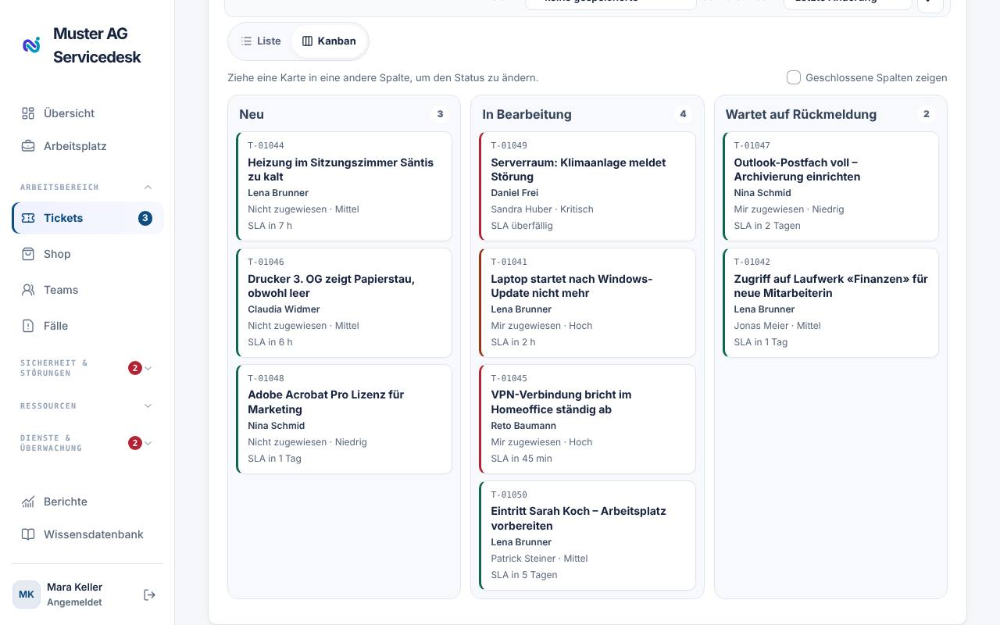

## Ein Ticket bearbeiten

Öffne ein Ticket mit einem Klick. Im Kopf- und Infobereich änderst du
direkt **Status**, **Priorität**, **Kategorie**, **Team** und **zugewiesene
Person**. Ein Klick auf den Namen der **anfragenden Person** öffnet ihre
Personenübersicht. Mit dem **Stift** in der Karte **Beschreibung** bearbeitest
du Betreff und Beschreibung direkt dort (**Beschreibung speichern** oder
Strg/⌘ + Enter).

Oben rechts im Ticketkopf siehst du als runde Profilbilder (ohne Foto: Kürzel)
alle Kolleginnen und Kollegen, die das Ticket gerade geöffnet haben. Bewege die Maus über ein
Bild, siehst du den Namen. Ein grüner Rand bedeutet, dass die Person gerade
etwas ändert; so vermeidest du doppelte Arbeit.

**Status ändern heisst Ticket übernehmen:** Wer den Status eines Tickets ändert
(im Ticketdetail, auf der Kachel in Liste und Kanban oder in der App), wird
automatisch als **zugewiesene Person** eingetragen, sofern er oder sie das
Ticket bearbeiten darf. Das gilt auch für ein neues, noch nicht zugewiesenes
Ticket: der Status «Neu» lässt sich dann direkt ändern. Wählst du im selben
Schritt eine andere Person aus, gilt diese Auswahl. Bei der Mehrfachauswahl
(Sammelaktion) wird nicht automatisch zugewiesen.

Über der Beschreibung zeigt die kompakte **Ticket-Zeitachse** alle
Ereignisse, die Reaktions- und Lösungsfrist sowie längere Lücken. Darunter
folgt die **Unterhaltung** mit allen Nachrichten und Notizen. Dateien
erscheinen direkt bei der Nachricht, zu der sie gehören – auch die Anhänge der
E-Mail, aus der das Ticket entstanden ist (unter der Beschreibung). Bilder
werden als Vorschau gezeigt, andere Dateien öffnest du mit **Öffnen**.

Rechts unter der **Übersicht** liegt die Karte **Koordination**. Die Karte zeigt die
**Supportstufe** mit dem zuständigen Team (**An nächste Stufe übergeben**,
**Verlauf der Stufen**) sowie Teil-Tickets und Drittanbieter (**Aufteilen**,
**An Drittanbieter übergeben**).

### Spam-/Phishing-Verdacht der anfragenden Person

Leitet eine Person eine Mail weiter, weil sie Spam oder Phishing vermutet,
klickst du oben im Ticket auf **Spam-/Phishing-Verdacht** (in der iOS- und
Android-App: **Spam-/Phishing-Verdacht** über der Karte zur Supportstufe). Nach
der Rückfrage **Wirklich als Spam/Phishing markieren?** passiert Folgendes:

- Die anfragende Person erhält per E-Mail dieselbe Standardantwort wie bei
  einer Phishing-Meldung aus Outlook (Vorlagen **Phishing-Meldung: Danke** und
  **Phishing-Meldung: Gestaltung**).
- Das Ticket geht an das Team mit der Supportstufe **2nd Level** der
  Abteilung (z. B. «System Engineer»), das die Mail prüft. Die Zuweisung an
  eine Person wird aufgehoben, im Verlauf stehen eine interne Notiz und die
  Übergabe. Das Ticket bleibt sichtbar.
- Danach zeigt das Ticket den Hinweis **Spam-/Phishing-Verdacht**; ein zweites
  Melden ist nicht möglich.

Das ist etwas anderes als **Spam** (Abschnitt «Spam» weiter oben): Dort ist der Absender des
Tickets selbst Spam, das Ticket verschwindet und der Absender wird gesperrt.
Beim Verdacht ist die anfragende Person eine echte Person, die Hilfe braucht.

Der Knopf erscheint nur mit den Rechten «Tickets bearbeiten» und «Tickets
zuweisen», bei offenen Tickets und wenn die Abteilung genau ein aktives
2nd-Level-Team hat. Fehlt die E-Mail-Adresse der anfragenden Person, ist die
Vorlage ausgeschaltet oder kein Exchange-Postfach verbunden, wird das Ticket
trotzdem übergeben; nextDesk zeigt dann, warum keine Antwort gesendet wurde.

Tickets aus E-Mails enthalten die E-Mail-Signatur nicht mehr. Stammt die Mail
von einer Adresse ausserhalb deiner Organisation, stehen unter **Anfragende
Person** zusätzlich die E-Mail-Adresse und alle Telefonnummern aus der
Signatur; ein Klick startet Anruf oder E-Mail.

War bei der E-Mail jemand im **Cc**, steht diese Person unter **In Kopie (CC)**.
Beim Schreiben einer externen Antwort kannst du sie unter **Auch antworten an
(im CC der Anfrage)** ankreuzen: Die Person erhält die Nachricht dann ebenfalls per
E-Mail, als Kopie. Standardmässig ist niemand angekreuzt. Weitere Personen
fügst du mit **Kopie per E-Mail senden** hinzu.

Hat die anfragende Person genau ein Gerät (zugewiesen oder als primäre Person
in Intune), verknüpft nextDesk es beim Erstellen des Tickets automatisch. Bei
mehreren Geräten erscheinen sie unter **Asset / Katalogeintrag verknüpfen**
als **Geräte der anfragenden Person**; ein Klick verknüpft das passende Gerät.

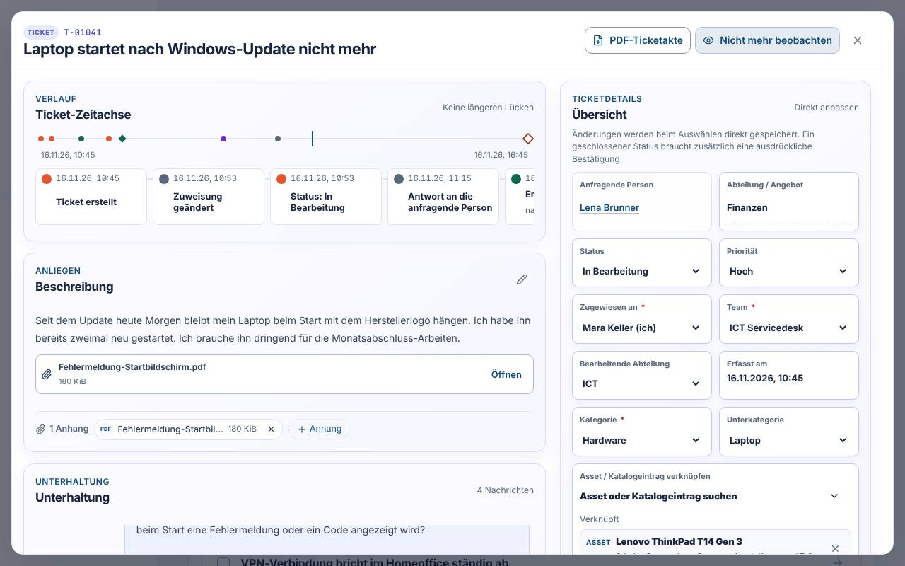

### Antworten und interne Notizen

Wähle im Antwortbereich den Modus:

- **Antwort an anfragende Person** → **Externe Antwort senden**. Die Person
  sieht die Antwort im Portal und per E-Mail.
  Im Antwortfeld steht bereits die Begrüssung «Liebe Vorname» bzw. «Lieber
  Vorname» (nach dem Vornamen; bei nicht eindeutigen Namen «Guten Tag
  Vorname») mit Platz darunter; ein Klick ins Feld setzt den Cursor direkt dahinter. Du kannst die
  Begrüssung ändern oder löschen. Eine Antwort, die nur aus der Begrüssung
  besteht, wird nicht gesendet.
  Eine Antwort ist jederzeit möglich, auch wenn Felder wie die Kategorie noch
  leer sind. Ist das Ticket noch niemandem zugewiesen, wird es mit dem Senden
  der Person zugewiesen, die geantwortet hat (sofern sie für das Ticket
  zuweisbar ist). Ein neues Ticket wechselt dabei automatisch auf **In
  Bearbeitung**. Pflichtfelder gelten erst beim Lösen oder Schliessen.
- **Interne Notiz** → **Interne Notiz speichern**. Nur für berechtigte
  Mitarbeitende sichtbar.

Unter dem Antwortfeld kannst du deinen Text mit **Mit KI umformulieren** von
der KI überarbeiten lassen (falls KI-Assistenz aktiv): **Kurz** macht ihn knapp
und auf den Punkt, **Ausführlich** erklärt die genannten Schritte vollständig.
Die KI schreibt die anfragende Person immer per Du an. Der Ton ist immer professionell, aber persönlich und freundlich; die KI erfindet
keine Fakten, Zusagen oder Termine. Eine vorhandene Begrüssung bleibt
bestehen. Mit **Original wiederherstellen** holst du deinen Text zurück. In der
iPhone- und der Android-App heissen die Knöpfe unter dem Nachrichtenfeld **KI
kurz** und **KI ausführlich** (mit **Original** zum Zurückholen).

Praktische Helfer:

- **Antwort senden und als gelöst markieren** in einem Schritt
- `@Name` erwähnt Kolleginnen und Kollegen
- **Dateien anhängen** (Bilder, PDF, Word, Excel, TXT, CSV; bis 5 Dateien pro
  Nachricht), **Makro anwenden**, **KI-Entwurf erstellen**
  (falls KI-Assistenz aktiv)

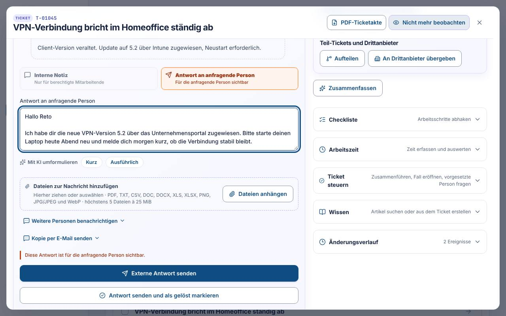

### Anhänge

Unter der **Beschreibung** zeigt eine schlanke Zeile alle **Anhänge** als Chips
(Typ-Symbol oder Bildvorschau, Name, Grösse). Ein Klick lädt die Datei herunter,
das **×** löscht sie nach Rückfrage. Ab fünf Dateien erscheint **+n weitere**.
Mit **+ Anhang** wählst du eine oder mehrere Dateien aus; du kannst sie auch
direkt auf die Zeile ziehen (max. 25 MiB pro Datei).

### Weitere Aktionen im Ticket

| Aktion                                      | Wofür                                                   |
| ------------------------------------------- | ------------------------------------------------------- |
| Anhang hinzufügen                           | Dateien zum Ticket ablegen                              |
| Beobachtende hinzufügen / Personen in Kopie | Weitere Personen informieren                            |
| Tickets zusammenführen                      | Doppelte Meldungen bündeln                              |
| Aufteilen                                   | Ein Ticket in mehrere Aufgaben trennen                  |
| An nächste Stufe übergeben                  | Eskalation an 2nd/3rd Level mit Übergabenotiz (Pflicht) |
| An Drittanbieter übergeben                  | Lieferanten einbeziehen, mit Erinnerung                 |
| Vorgesetzte Person fragen                   | Interne Rückfrage an die Abteilungsleitung              |
| Freigabe anfordern                          | Genehmigung einholen (z. B. Kosten, Berechtigungen)     |
| Erinnerung setzen                           | Ticket zu einem Datum wieder vorlegen                   |
| Arbeitszeit erfassen, Checkliste            | Aufwand und Arbeitsschritte dokumentieren               |
| Zusammenfassen (KI)                         | Kurzfassung langer Verläufe                             |
| Ticketakte als PDF                          | Ticket drucken oder ablegen                             |

### An Drittanbieter übergeben

Mit **An Drittanbieter übergeben** erfasst du einen Lieferantenfall, wenn eine
externe Firma das Problem lösen muss:

1. Wähle den **Drittanbieter**.
2. Trage bei Bedarf die **externe Fallnummer** des Anbieters und eine
   **Notiz** ein.
3. Bestätige die Übergabe.

Das Ticket wechselt auf **Wartend auf Drittanbieter**. Antwortet der Anbieter
nicht innerhalb der beim Drittanbieter eingestellten Zeit (Voreinstellung 48
Stunden), wirst du als zugewiesene Person automatisch erinnert. Ist das
Ticket noch niemandem zugewiesen, wird der Fall erfasst, der Status bleibt
aber **Neu**, bis es zugewiesen ist.

Erscheint stattdessen «Es sind noch keine Drittanbieter erfasst», hat der
Mandant noch keine Anbieter angelegt. Wer die Berechtigung **Automationen
verwalten** hat, erfasst sie in den Mandanteneinstellungen unter
SLA-Automatisierung (siehe Administrationshandbuch); sonst wende dich an
die Mandantenadministration.

Wird eine SLA verletzt, erfasst du die **Ursache der SLA-Verletzung**. Das
ist Pflicht: Ein Ticket mit verletzter SLA lässt sich erst **lösen oder
schliessen**, wenn die Ursache erfasst ist (auch bei der Sammelaktion). Beim
Abschluss kann sie direkt im Bestätigungsfeld eingetragen werden.

### SLA-Pause in wartenden Status

In den Status **Wartend**, **Wartend auf Kunde** und **Wartend auf
Drittanbieter** hält die SLA an (die Mandantenadministration kann das pro
Status ändern, siehe Administrationshandbuch). Solange ein Ticket in einem
dieser Status ist:

- zeigen Ticketliste, Übersicht, Ticketkopf und App **«SLA pausiert seit …»**
  statt der verbleibenden Zeit;
- wird keine SLA-Verletzung ausgelöst und keine Warnung «SLA in Gefahr»
  verschickt; das Ticket zählt nicht als überfällig (Teamführung, Meine
  Prioritäten, Zeitregeln «SLA läuft bald ab») und nicht als «SLA
  überschritten» in den Drilldowns der Berichte;
- findest du es in der Ticketliste mit dem Suchfilter `sla:pausiert`;
- bleibt die Pause bestehen, wenn du zwischen zwei wartenden Status wechselst.

Setze das Ticket wieder auf einen bearbeitenden Status (z. B. **In
Bearbeitung**), läuft die SLA weiter: Die Fristen für Erstantwort (falls noch
offen) und Lösung werden um die pausierte Zeit verschoben. Gezählt wird nur
die **Servicezeit** der SLA-Regel – bei Geschäftszeiten also nur die Stunden
innerhalb der Geschäftszeiten. Schliesse ein pausiertes Ticket direkt ab,
endet die Pause ebenfalls; die Wartezeit zählt auch dann nicht gegen die SLA.
Eine Frist, die **vor** Beginn der Pause schon überschritten war, bleibt
überschritten. Antwortest du der anfragenden Person zum ersten Mal, während
das Ticket noch wartet, wird die Reaktionsfrist um die bis zur Antwort
pausierte Zeit verschoben. Berichte und SLA-Einhaltung messen gelöste
Tickets an den verschobenen Fristen. In der **Ticket-Zeitachse** zeigt eine
pausierte Frist **«SLA pausiert, Restzeit …»**.

Im Verlauf des Tickets siehst du **SLA pausiert («Status»)** und **SLA
fortgesetzt, Fristen um … Servicezeit verschoben**.

### Bewertung der anfragenden Person

Sobald ein Ticket **gelöst** ist, kann die anfragende Person es mit 1 bis 5
Sternen und einem Kommentar bewerten – im Web und in der iPhone-App. Eine
abgegebene Bewertung siehst du im Ticket unter «Bewertung der anfragenden
Person». Die Auswertung über alle Tickets findest du unter **Berichte →
Feedback-Themen** (mit KI-Assistenz zusätzlich nach Themen gruppiert).

## Ticket für jemanden erfassen

Über **+ → Ticket erfassen** öffnest du das Formular. Als Agent wählst du
die **anfragende Person** (Suche, «Mich auswählen» oder neue Person), füllst
Betreff, Einordnung, Priorität und Beschreibung aus (Zusammenfassung links, Abschnitte rechts, Pflichtfelder mit **\***) und kannst direkt einen
**zugewiesenen Agenten** setzen. Abschliessen mit **Ticket erstellen**.

Im selben Menü erfasst du – je nach Freischaltung – auch Erinnerungen,
Fälle, Serviceaufgaben, Wissensartikel, Lagerartikel, Verträge und Lizenzen.

In der **iOS- und Android-App** öffnet ein **langer Druck auf den Home-Knopf**
ein Menü. Im Halbkreis unter **Erfassen** legst du direkt eine **Erinnerung**,
ein **Ticket**, eine **Serviceaufgabe** oder einen **Lagerartikel** an.
Mitglieder des Teams **System Engineer** sehen darüber zusätzlich die Gruppe
**Öffnen** mit **Überwachung**, **Infrastruktur** und **IP-Adressen**. Es
erscheinen nur die Einträge, deren Modul für dich freigeschaltet ist. Die
Seite **IP-Adressen** zeigt die Subnetze nach Standort mit ihrer Auslastung
und eine Suche nach IP-Adresse, Hostname oder MAC; ein Subnetz öffnet seine
Adressen, eine Adresse ihre Details.

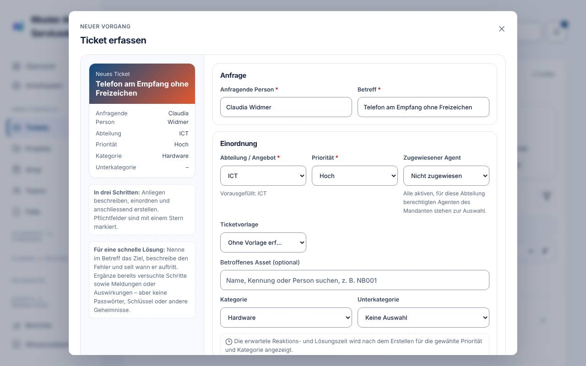

## Projekte

Unter **Projekte** planst und steuerst du Vorhaben, die über ein einzelnes Ticket
hinausgehen: einen Standort neu vernetzen, eine Software einführen, einen
Serverraum umziehen. Der Menüpunkt erscheint, wenn das Modul eingeschaltet ist
und du Projekte sehen darfst oder in einem Projekt mitarbeitest.

Projektaufgaben nutzen dieselbe Basis wie Tickets: Zuweisung an Personen und
Teams, Zeiterfassung, Kommentare und Anhänge. Echte Tickets, Bestellungen,
Netze und Geräte hängst du an ein Projekt, statt sie zu kopieren.

### Übersicht aller Projekte

Die **Übersicht** zeigt alle Projekte, die du sehen darfst, mit Ampel,
Status, Leitung, Fortschritt, Budgetverbrauch, nächstem Meilenstein und Ende.
Projekte mit roter Ampel stehen zuoberst. Die Kacheln darüber zählen laufende
Projekte, überfällige Meilensteine, Projekte mit gelber oder roter Ampel und
die gebuchten Stunden gegenüber dem Budget. Mit **Laufend**, **Abgeschlossen**
und **Alle** sowie dem Suchfeld grenzt du die Liste ein; **Archiv anzeigen**
blendet archivierte Projekte ein.

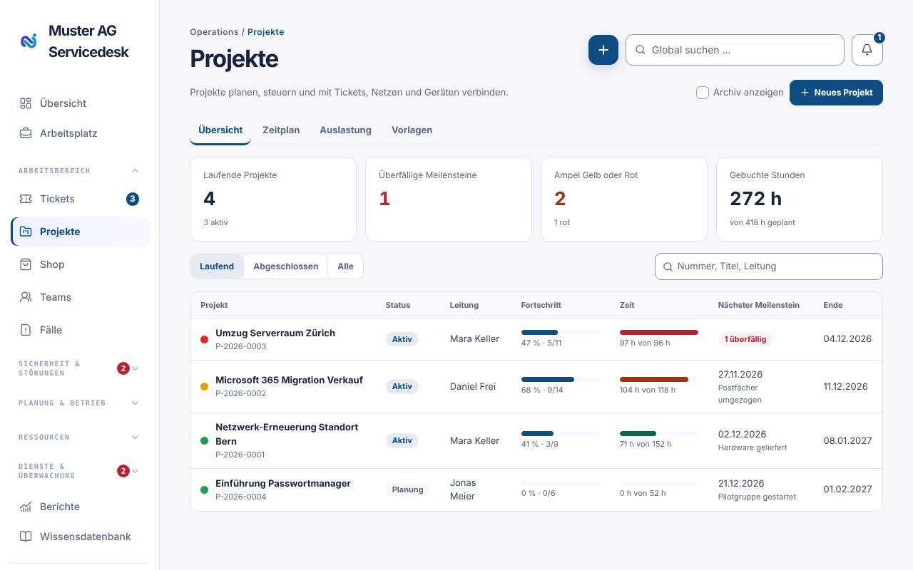

### Zeitleiste aller Projekte

Das Register **Zeitplan** neben der Übersicht zeigt alle Projekte auf einer
gemeinsamen Zeitleiste. Jedes Projekt ist ein Balken vom Start bis zum Ende in
der Farbe seiner Ampel; die dunklere Füllung zeigt den Fortschritt, die Rauten
sind die Meilensteine (grün erreicht, rot überfällig). Fehlt einem Projekt das
Ende, reicht der Balken bis zum spätesten Termin im Plan. Die senkrechte Linie
markiert heute, ein roter Rahmen ein Projekt, dessen Ende überschritten ist.
Mit **Wochen**, **Monate** und **Quartale** wählst du den Massstab; ein Klick
öffnet das Projekt.

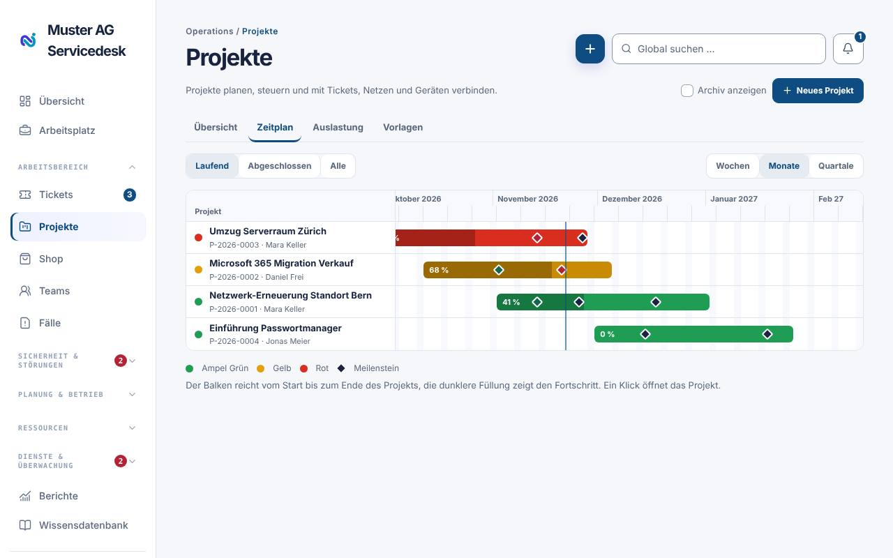

### Ein Projekt anlegen

**Neues Projekt** öffnet das Formular mit Titel, Beschreibung, Projektleitung,
Abteilung, Kunde, Standort, Start, Ende, Stundenbudget, Budget in CHF und
Stundensatz. Mit einer **Vorlage** entsteht das Projekt samt Phasen, Aufgaben,
Checklisten, Abhängigkeiten und Terminen ab dem Startdatum.

Die **Terminplanung** legt fest, was bei Verzögerungen geschieht:

- **Automatisch**: verzögert sich ein Vorgänger, rücken die Nachfolger sofort
  nach.
- **Manuell**: die Verschiebung wird nur vorgeschlagen. Unter **Mehr →
  Termine prüfen** siehst du die Änderungen und wendest sie an.

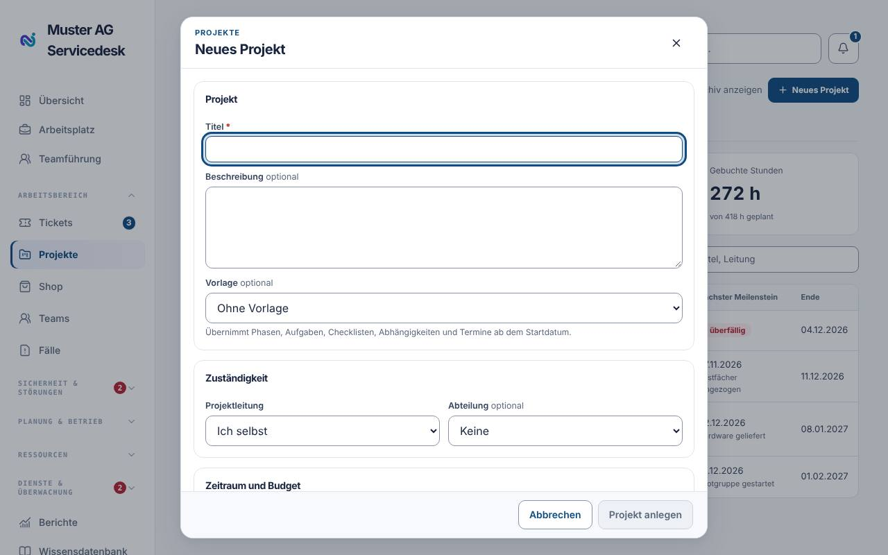

### Überblick eines Projekts

Der Kopf zeigt Nummer, Kunde, Titel, Ampel und Fortschritt. Rechts setzt du
**Status** (Planung, Aktiv, Pausiert, Abgeschlossen) und **Ampel**. Sprechen
überfällige Meilensteine, überfällige Aufgaben oder der Budgetverbrauch für
eine andere Farbe, schlägt nextDesk sie mit Begründung vor. Unter **Mehr**
findest du «Projekt bearbeiten», «Termine prüfen», «Als Vorlage speichern»,
«Archivieren» und «Projekt löschen».

Das Register **Überblick** zeigt Beschreibung, Meilensteine, überfällige
Aufgaben, Kommentare zum Projekt, Eckdaten und den Verlauf.

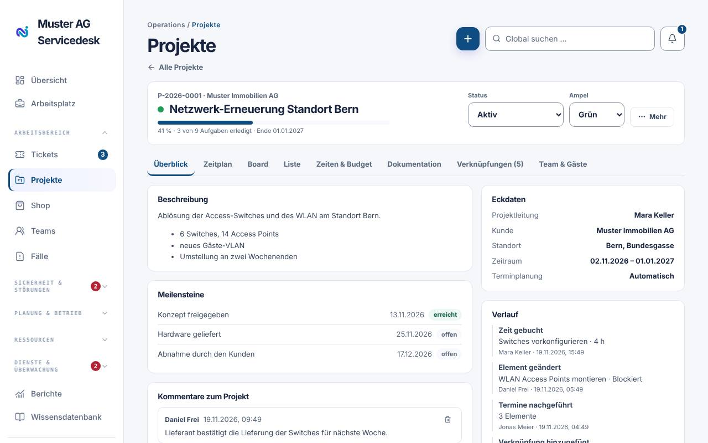

### Zeitplan

Der **Zeitplan** ist eine Zeitleiste mit allen Phasen, Meilensteinen, Aufgaben
und Unteraufgaben. Die senkrechte Linie markiert heute, Wochenenden sind
hinterlegt, und mit **Tage**, **Wochen** und **Monate** wählst du den
Massstab.

- Die Farbe eines Balkens zeigt den Status, die dunklere Füllung den
  Fortschritt. Ein roter Rahmen bedeutet überfällig.
- Phasen und Aufgaben mit Unteraufgaben erscheinen als schmaler Balken über
  den Zeitraum ihrer Unterelemente.
- Meilensteine sind Rauten.
- Pfeile zeigen Abhängigkeiten.

Balken ziehst du mit der Maus: der ganze Balken verschiebt die Aufgabe, der
rechte Rand ändert ihr Ende. Hängen andere Elemente davon ab, werden sie
nachgeführt. Dabei gilt: Nachfolger rücken nur nach hinten, die Dauer in
Arbeitstagen bleibt erhalten, und Erledigtes bleibt stehen.

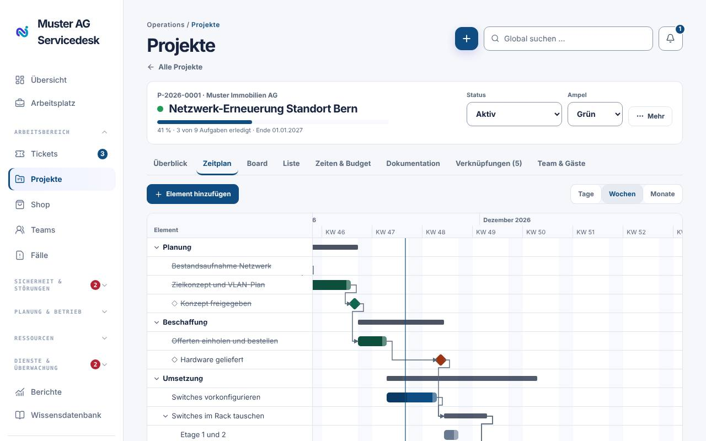

### Board

Das **Board** zeigt die Aufgaben in den Spalten Offen, In Arbeit, Blockiert und
Erledigt. Eine Karte in eine andere Spalte zu ziehen, ändert ihren Status. Auf
der Karte stehen Phase, Termin, Stand der Checkliste, hohe Priorität und die
zuständige Person.

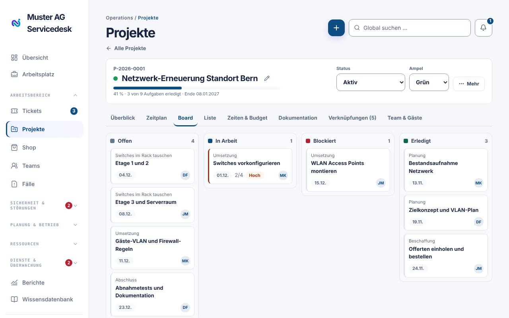

### Liste und Massenbearbeitung

Die **Liste** zeigt alle Elemente als Tabelle mit Status, Zuständigkeit, Start,
Termin, Priorität, Fortschritt, Soll und Ist. Du filterst nach Titel, Status
(auch «Nicht erledigt» und «Überfällig»), Person und Art und sortierst mit einem
Klick auf die Spaltenüberschrift.

Mit den Häkchen wählst du mehrere Elemente aus. Die Leiste darüber setzt
Status, Zuweisung und Priorität, verschiebt die Termine um eine Anzahl Tage
oder löscht die Auswahl.

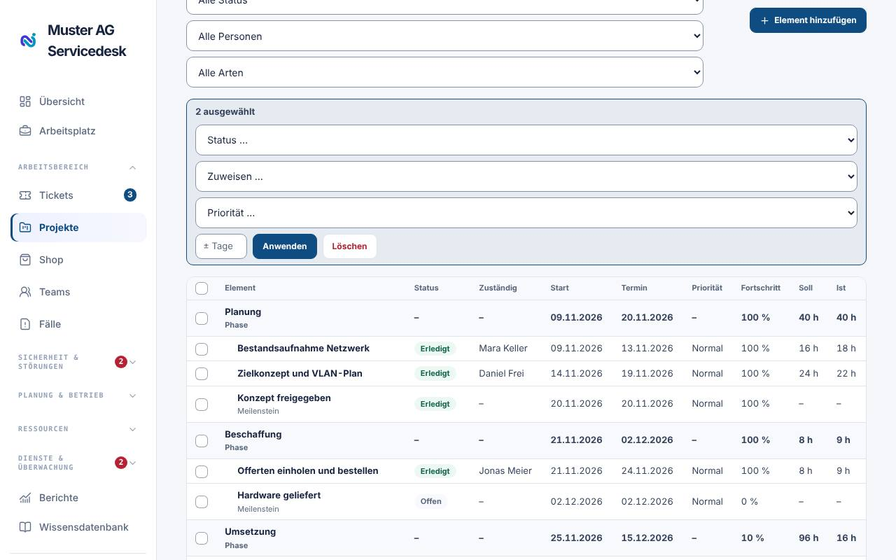

### Ein Element bearbeiten

Ein Klick auf den Titel öffnet die Seitenleiste des Elements. Dort änderst du
Titel, Status, Priorität, Zuständigkeit, Team, Start, Termin, Schätzung,
Fortschritt und die Einordnung im Plan. Darunter stehen Beschreibung,
Checkliste, Abhängigkeiten, Zeit, Verknüpfungen, Anhänge (PDF und Bilder) und
Kommentare.

Bei Elementen mit Unterelementen ergeben sich Zeitraum, Schätzung und
Fortschritt aus den Unterelementen. Wer ein Element löscht, löscht auch seine
Unterelemente und die darauf gebuchten Zeiten.

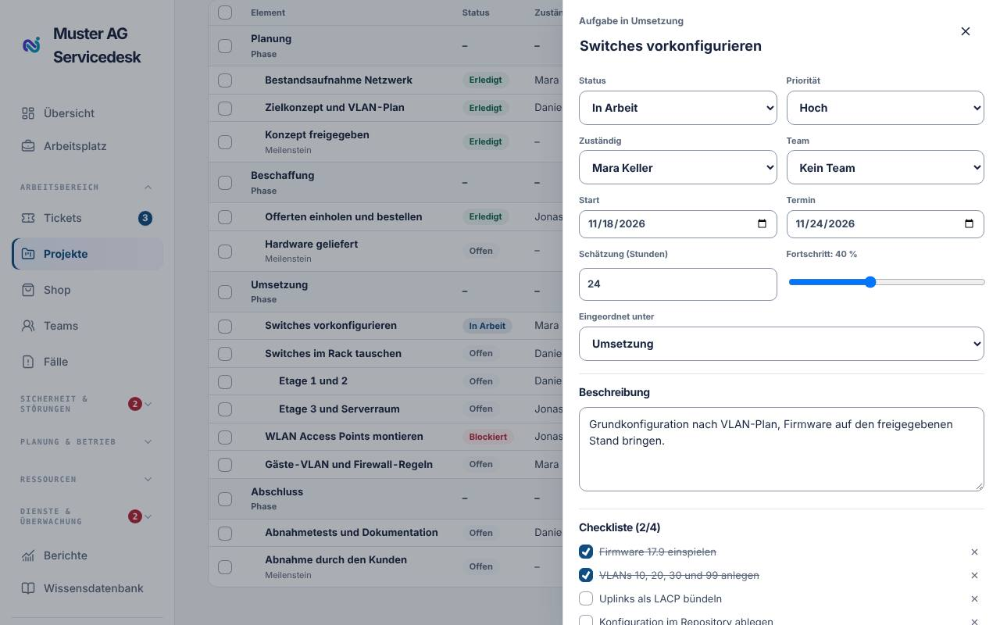

### Zeiten und Budget

**Zeiten & Budget** stellt Soll und Ist gegenüber: je Aufgabe, je Phase und für
das ganze Projekt. Soll ist die Summe der Schätzungen. Ist ist die gebuchte
Zeit des Elements, seiner Unterelemente und der daran verknüpften Tickets. Die
Ist-Kosten ergeben sich aus den gebuchten Stunden und dem Stundensatz des
Projekts.

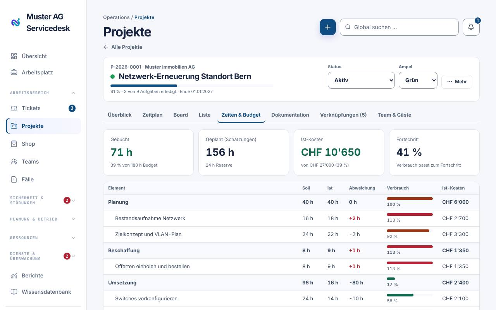

### Dokumentation

Unter **Dokumentation** führst du Konzepte, Netzwerkpläne und Protokolle als
Dokumente in Markdown mit Überschriften, Listen, Tabellen und Codeblöcken.
Dateien zum Projekt (PDF und Bilder bis 25 MB) hängst du links an. Ein
Dokument ist nur dann für Gäste sichtbar, wenn **Für Gäste sichtbar** gesetzt
ist.

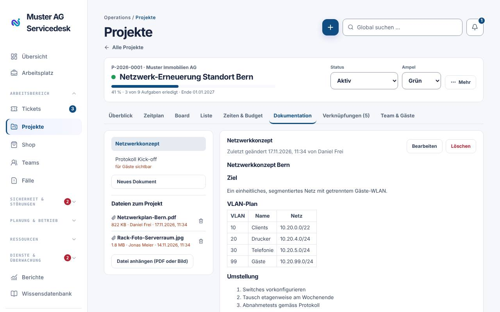

### Verknüpfungen

Unter **Verknüpfungen** hängst du an das Projekt oder an einzelne Elemente:

- **Tickets** – sie erscheinen mit Status und gebuchter Zeit; ein Ticket
  gehört höchstens zu einem Projekt
- **Shop-Bestellungen**
- **IP-Netze**, **VLANs** und **IP-Adressen** aus der IP-Adressverwaltung
- **Monitoring-Sensoren** und **Geräte**
- **Störungen** und fällige **Serviceaufgaben**

Umgekehrt zeigen Ticket, Bestellung, IP-Netz, IP-Adresse und Sensor ihr
Projekt an und führen mit einem Klick dorthin. Im Ticket und in der Bestellung
steht zusätzlich **In Projekt umwandeln**.

Welche Arten du verknüpfen darfst, richtet sich nach deinen Rechten im
jeweiligen Modul.

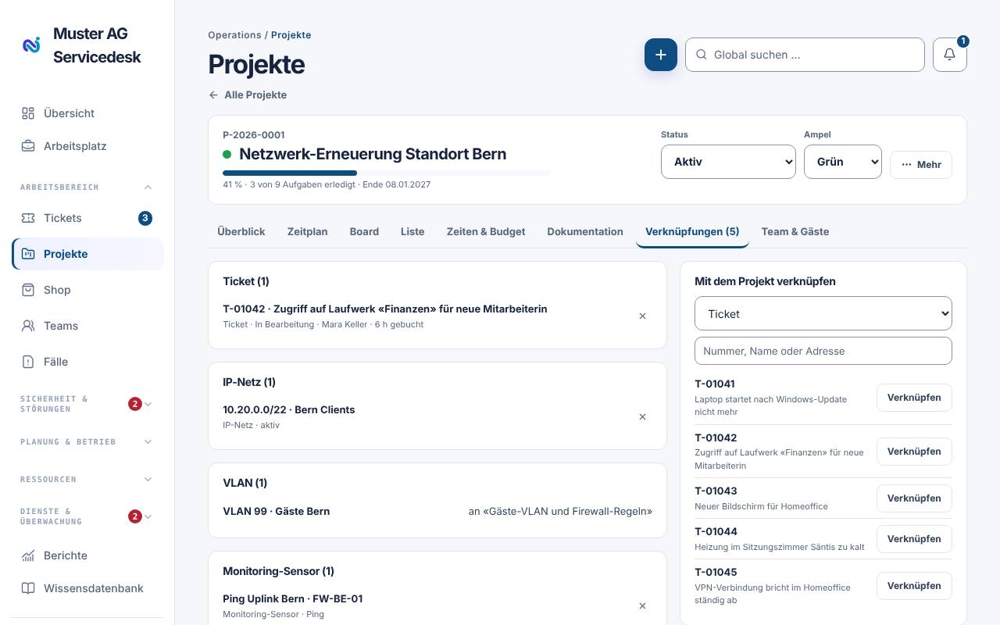

### Team und Gäste

Unter **Team & Gäste** legt die Projektleitung fest, wer mitarbeitet:

| Rolle                | Darf                                                             |
| -------------------- | ---------------------------------------------------------------- |
| Projektleitung       | alles im Projekt, auch Mitglieder, Status, Ampel und Archiv      |
| Mitarbeit            | Plan, Zeiten, Dokumente, Verknüpfungen und Kommentare bearbeiten |
| Gast (kommentierend) | Plan und Freigegebenes lesen, für Gäste sichtbar kommentieren    |
| Gast (lesend)        | Plan und Freigegebenes lesen                                     |

**Externe Gäste** (Dienstleister, Kunden) lädst du mit ihrer E-Mail-Adresse
ein. Gäste sehen ausschliesslich dieses Projekt: Überblick, Zeitplan, Board,
Liste sowie Dokumente und Kommentare, die als «für Gäste sichtbar» markiert
sind. Zeiten, Budget, Schätzungen, Verknüpfungen, Anhänge, der Verlauf und
alle anderen Module bleiben verborgen. Eine offene Einladung gilt 14 Tage und
lässt sich zurückziehen.

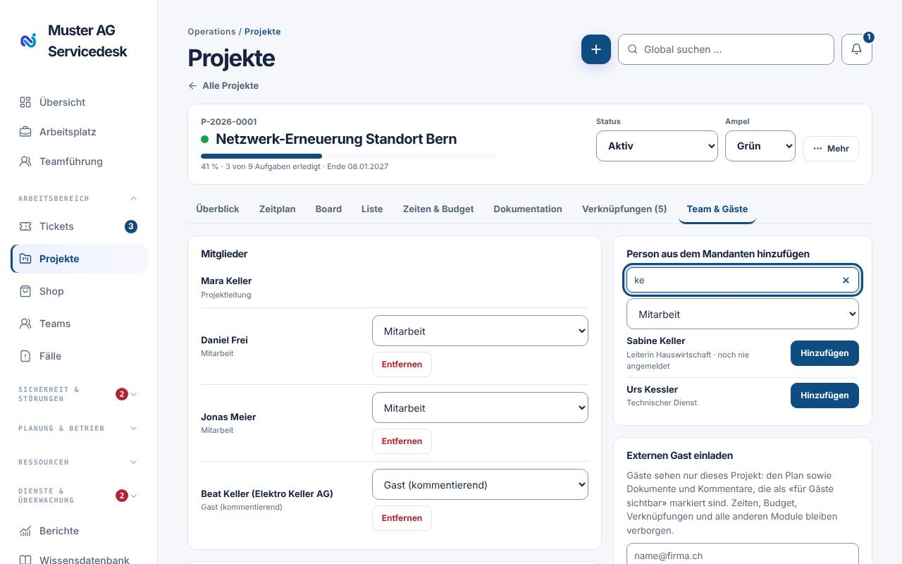

### Auslastung

Das Register **Auslastung** zeigt je Person die geplanten Stunden pro
Arbeitstag für vier Wochen. Eingerechnet sind:

- **Projektaufgaben** mit ihrem Restaufwand (Schätzung abzüglich Fortschritt)
- **Serviceaufgaben** mit ihrer Schätzung
- **offene Tickets** mit einer Pauschale je Ticket

Der Aufwand verteilt sich gleichmässig auf die Arbeitstage bis zum Termin;
Überfälliges fällt auf heute. Die Farbe einer Zelle zeigt, wie voll der Tag
ist; rot bedeutet mehr Arbeit als Arbeitszeit. Aufgaben ohne Schätzung zählen
nicht in die Stunden und werden bei der Person ausgewiesen.

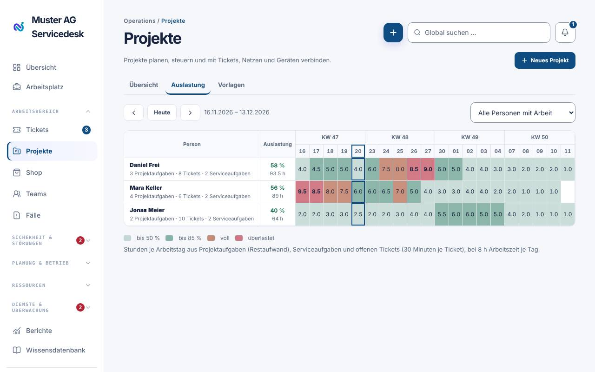

### Vorlagen

Das Register **Vorlagen** listet die gespeicherten Projektvorlagen. Eine
Vorlage entsteht aus einem bestehenden Projekt über **Mehr → Als Vorlage
speichern** und enthält Phasen, Aufgaben, Checklisten, Abhängigkeiten,
Dokumente und die Termine als Abstand zum Projektstart.

## Dienste und Systemstatus

Die Liste unter **Dienste** ist nach Kategorie gegliedert (Ort · Kategorie,
Dienste ohne Zuordnung unter «Ohne Kategorie»). Ein Klick auf eine
Kategorienzeile klappt deren Dienste ein und wieder aus; die Zahl daneben
nennt die Anzahl der Dienste.

**Intern oder extern**: Im Formular eines Dienstes legt der Schalter
**Interner Dienst** fest, wen eine Störung betrifft. Neue und bestehende
Dienste sind extern. Betrifft eine Störungsmeldung nur interne Dienste, sehen
Mitarbeitende keinen Banner und erhalten keine Push-Mitteilung; Agenten sehen
jede Meldung. Nennt eine Meldung interne und externe Dienste, sehen
Mitarbeitende sie mit den externen Diensten. Für externe Dienste können sich
alle unter **Benachrichtigungen → Störungen** eine Push-Mitteilung auf iPhone
und Android bestellen, für alle oder einzelne Dienste; sie kommt innert rund
einer Minute, sobald die Meldung erscheint. Meldungen ohne zugeordneten Dienst
gehen an alle, die «Störungen» eingeschaltet haben.

Unter **Dienste** öffnet **Details** bei einem Dienst die Dienstansicht:

- **Verfügbarkeit** der letzten 30 und 90 Tage, der Anteil geplanter Wartung
  und die Verfügbarkeit ohne Wartung gerechnet
- die **Geräte** des Dienstes mit IP-Adresse, Subnetz, VLAN und Switch-Port
  (aus der IP-Adressverwaltung) und ihrem **Monitoring-Zustand**; fällt ein
  Gerät aus, steht oben «Betroffen durch Ausfall» mit dem Gerät und der
  Störung
- die **Subnetze**, deren Adressen dem Dienst zugeordnet sind

Die Dienste eines Geräts pflegst du in der **Infrastruktur** (mehrere Dienste
möglich); im Asset-Katalog gilt der gewählte Dienst als erster Dienst des
Geräts, weitere bleiben erhalten. Die **Assets** laden seitenweise: Suche und
Filter wirken auf alle Assets, **Weitere Assets laden** zeigt die nächsten.

In einer **Serviceaufgabe**, deren Gerät Dienste hat, plant **Wartungsfenster
planen** ein Fenster im Systemstatus (Beginn und Ende, optional öffentlich).
Während des Fensters stehen die Dienste auf Wartung; danach setzt nextDesk sie
automatisch zurück. Der Abschluss der Aufgabe trägt die Wartung ins
Wartungsprotokoll des Geräts ein.

## Wissensdatenbank pflegen

Die Wissensdatenbank ist eine Suchzentrale: Tippe ein Stichwort ins
Suchfeld (Taste `/` springt hinein), die Treffer erscheinen beim Tippen. Mit
der Themenreihe (seitlich scrollbar, mit Symbol und Artikelzahl) und dem
Umschalter **Alle Artikel / Intern / Extern / Entwurf** grenzt du die Liste ein. Ohne
Suche und Filter zeigt die Startseite die neusten Artikel als Karten. Status, Sichtbarkeit und «Überarbeiten?» sehen nur
Agenten. Ein Klick öffnet den Artikel auf einer eigenen Leseseite mit
**Bearbeiten**, **Veröffentlichen**, **Archivieren** und **Löschen**.

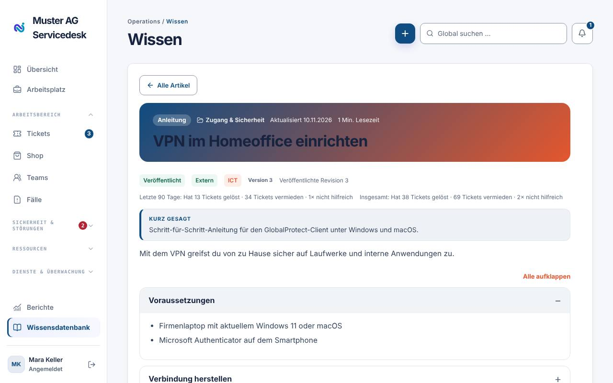

Der Artikel erscheint im Verlauf der Farben aus **Einstellungen → Design**
(Verlauf von der Primärfarbe zur Akzentfarbe). Oben stehen die
Art (z. B. Anleitung, FAQ, Störung, Referenz, Information), Thema, Datum und
Lesezeit, darunter **Kurz gesagt**. Ab drei Abschnitten (Überschriften mit
`##`) klappen die Abschnitte auf und zu; **Alle aufklappen** öffnet alle. Die
Art ergibt sich aus dem Text: nummerierte Listen werden Schritte, Überschriften
mit Fragezeichen werden Fragen und Antworten, «Symptom», «Ursache» und «Lösung»
werden Störung, Tabellen werden Referenz. Absätze, die mit **Hinweis:**,
**Tipp:** oder **Achtung:** beginnen, werden farbige Hinweisboxen.

Als Agent liest du nicht nur Artikel, sondern schreibst sie auch:

1. **Neuer Artikel** – Titel, optional eine **Kurzfassung** (ein bis zwei Sätze,
   erscheint als «Kurz gesagt»; ohne Kurzfassung gilt der erste Absatz),
   Inhalt (Markdown mit Bildern), Kategorie und Sichtbarkeit (_Intern_ oder
   _Extern_ für Mitarbeitende). Die **Live-Vorschau** zeigt den Artikel schon
   im späteren Design.
2. Optional **Mit KI aufbereiten** oder direkt aus einem gelösten Ticket
   **Entwurf mit KI erstellen**.
3. **Speichern** – der Artikel ist sofort **veröffentlicht**, eine Freigabe ist
   nicht nötig. Frühere Fassungen bleiben im Verlauf erhalten. Veraltete
   Artikel **archivieren**.

Die KI schreibt Artikel so, dass sie in diesem Design gut aussehen (kurze
Einleitung, Abschnitte, Schritte, Hinweise). KI-Entwürfe aus Tickets erscheinen zuerst als _Entwurf_; mit **Speichern** oder
**Veröffentlichen** gehen sie live.

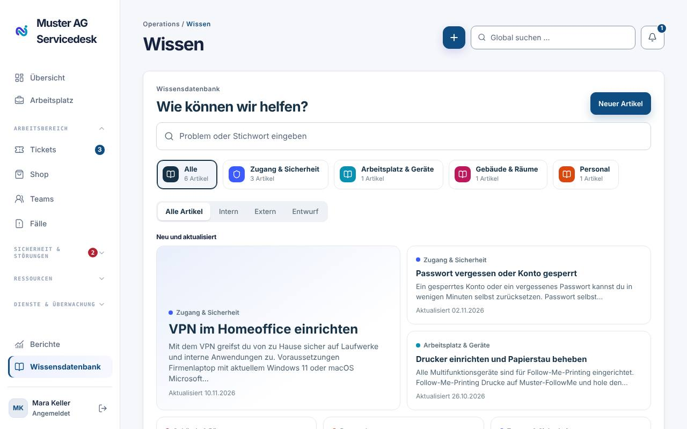

## Lager: Artikel erfassen und ausleihen

Die Bereiche des Lagers sind wie in den Einstellungen in Gruppen geordnet:
**Bestand** (Übersicht, Artikel, Lagerorte), **Buchungen** (Bewegungen,
Inventur) und **Planung** (Beschaffung, Automatik; nur für die
Lagerverwaltung). Eine Meldung oben gilt für den Bereich, in dem sie entstanden
ist, und verschwindet beim Wechsel in einen anderen Bereich.

**Lager → Artikel → Artikel erfassen** (und **Bearbeiten** in der Liste) öffnet
dasselbe Formular wie ein Artikel im Shop: Bezeichnung, Fotos (per Drag and
Drop oder Auswahl), Kategorien, Artikelnummer, Beschreibung, technische Angaben
und alle weiteren Shop-Felder. Dazu kommen die Lagerangaben **Einheit** und
**Mindest-/Zielbestand**.

Neue Artikel erfasst du nur im Lager; der Shop hat keinen Knopf **Artikel
hinzufügen** mehr. Im Shop lassen sich bestehende Artikel weiter bearbeiten.

**Artikel von Brack importieren:** Im Formular (Lager und Shop) steht oben das
Feld **Von Brack importieren**. Füge den Link einer Brack-Produktseite (auch
business.brack.ch) ein und wähle **Daten übernehmen**: nextDesk füllt Name,
Beschreibung, Artikelnummer, Lieferanten-Link, technische Angaben, Kategorie und
bis zu drei Produktfotos vor. Bereits ausgefüllte Felder
bleiben unverändert. Prüfe die Angaben und ergänze Genehmigung, Maximalmenge und
Kategorie selbst. Lässt Brack den Abruf nicht zu, erscheint ein Hinweis und du
erfasst den Artikel von Hand.

Unter **Zuständige Abteilung** legst du fest, welche Abteilung den Artikel
betreut (z. B. ICT oder Infrastruktur). Geht im Shop eine Bestellung zu diesem
Artikel ein, werden nur die Agenten dieser Abteilung benachrichtigt, die
Shop-Bestellungen bearbeiten dürfen. Zur Auswahl stehen deine eigenen
Abteilungen; bist du nur in einer, ist sie fest eingetragen. Hat ein Artikel
keine Abteilung oder ist in der Abteilung niemand für Bestellungen zuständig,
werden wie bisher alle benachrichtigt.

- **Zum Bestellen anbieten** (Schieber): Eingeschaltet kann der Artikel im Shop
  bestellt werden. Er hat **Mindest- und Zielbestand**.
- **Zum Ausleihen anbieten** (Schieber): Der Artikel wird im Shop ausgeliehen
  und zurückgegeben (z. B. Presenter). Er hat dann keinen Mindest- und
  Zielbestand, sondern einen **Bestand** mit **Lagerort**; Änderungen daran
  werden als Lagerbewegung gebucht. Den **Lagerort** kannst du im Formular
  wechseln; der Bestand wird dann beim Speichern umgelagert.
- Du kannst **beides** einschalten: Der Artikel erscheint dann im Shop
  einmal zum Bestellen und einmal zum Ausleihen. Sind beide Schieber aus, bleibt
  der Artikel nur im Lager (nötig sind dann Bezeichnung, ein Bild, Kategorie,
  Artikelnummer und die Lagerangaben). Ausschalten nimmt die jeweilige Art beim
  Speichern aus dem Shop; der Lagerartikel bleibt bestehen.

Über der Artikelliste steht ein **Suchfeld**: Es findet Artikel nach Name,
Artikelnummer oder Lagerort, auch mit mehreren Wörtern (z. B. «logitech ergo»).
**Alle sichtbaren** wählt dann nur die gefundenen Artikel für Etiketten aus. Hat
ein Lagerartikel kein eigenes Bild, zeigt die Liste das Foto des verknüpften
Shop-Artikels. Dasselbe gilt für die Bestandsliste unter **Lager** in der iOS- und
Android-App.

**Etiketten drucken** wie bei den Assets: In der Artikelliste wählst du Artikel
mit **Für Etikett auswählen** (oder **Alle sichtbaren**) und drucken mit
**Etiketten drucken** Etiketten mit QR-Code, Bezeichnung, Artikelnummer und
Lagerort (Bogenformate oder Etikettendrucker). Der QR-Code enthält einen
Web-Link: Er öffnet den Artikel im Lager von nextDesk. Im Druckdialog legst du
unter **Anzahl Etiketten** fest, wie viele Etiketten pro Artikel gedruckt
werden (z. B. 10 gleiche Etiketten für ein Fach). Die Scan-Funktion der
iOS-App erkennt ihn ebenfalls und zeigt nur diesen Artikel im Lager; mit
**Alle Artikel anzeigen** siehst du wieder die ganze Liste. Wer beim Scannen mit
der Kamera noch nicht angemeldet ist, landet nach der Anmeldung direkt beim
Artikel.

**Einbuchen und ausbuchen:** In der Artikelliste stehen unter dem Namen die
Knöpfe **Einbuchen** (Wareneingang) und **Ausbuchen**; in der iOS- und
Android-App tippst du in der Bestandsliste auf einen Artikel. Du wählst die
Menge und den Lagerort. Ausbuchen fragt vorher nach und ist höchstens bis zum
verfügbaren Bestand möglich. **Ausbuchen** sehen nur Personen mit der Rolle
**Lagerverwaltung** (oder dem Recht «Bestände von Hand ausbuchen»); Ausgaben über
Reservationen und den Shop bleiben davon unberührt. Seriengeführte Artikel
buchst du weiterhin unter **Bewegungen**.

Mit **Löschen** im Formular entfernst du einen Artikel endgültig (auch aus dem
Shop). Hat er schon Bewegungen oder Reservationen, lässt er sich nicht löschen;
nextDesk bietet dann an, ihn zu **archivieren**.

Unter **Lagerorte** steht jedes Lager als eigene Karte mit Standort und Anzahl Lagerplätze; darin sind die Lagerplätze als Liste aufgeführt, sortiert nach Code. **Lager erfassen** (oben rechts) legt ein neues Lager an, **Lagerplatz** in der Karte einen neuen Platz in diesem Lager. **Bestand** zeigt die Artikel an einem Lagerplatz.

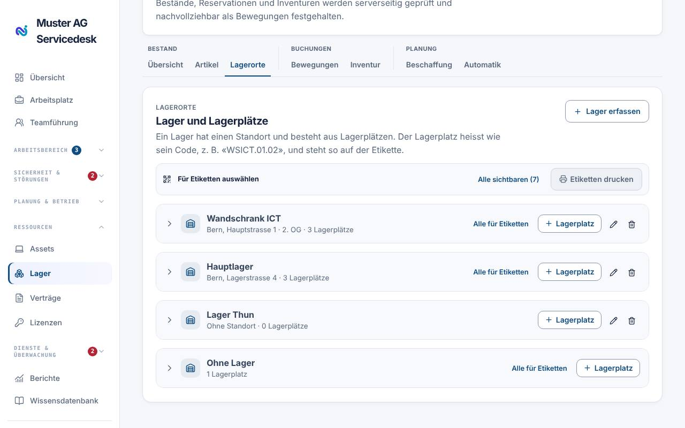

Unter **Lagerorte** änderst du Lagerort, Lager und Bemerkung mit dem Stift
(**Bearbeiten**). Mit dem Papierkorb (**Löschen**) steht ein Lagerort nicht
mehr zur Auswahl; bisherige Buchungen bleiben erhalten. Buche einen
vorhandenen Bestand vorher an einen anderen Ort um. Gelöschte Lagerorte
erscheinen blass und lassen sich mit **Wieder aktivieren** zurückholen.

Unter **Inventur** startest du pro Lagerort eine Inventur, erfasst die gezählten
Mengen und schliesst sie ab; erst der Abschluss bucht die Differenzen. Eine
laufende Inventur, die nicht mehr gebraucht wird, entfernst du in der Liste mit
**Löschen** (nach einer Rückfrage). Die gezählten Mengen werden verworfen, der
Bestand bleibt unverändert, und im Audit-Protokoll steht «Inventur gelöscht».
Abgeschlossene Inventuren lassen sich nicht löschen. Löschen dürfen alle, die
Inventuren starten dürfen (Recht «Lagerorte und Artikelstammdaten verwalten»).

## Eintritte und Austritte

Unter **Planung und Betrieb → Eintritte** steht für jeden Eintritt bzw.
Austritt eine Karte. Oben siehst du Name, Datum mit Countdown (z. B. «in
12 Tagen»), Abteilung, Ort, Führung und ICT-Verantwortung sowie rechts den
Fortschritt («1 / 6 Aufgaben erledigt»). Darunter stehen die Aufgaben nach
Fälligkeit gruppiert: **Überfällig** (rot), **Nächste 7 Tage** und
**Später**; erledigte Aufgaben sind unter **Erledigt** eingeklappt. Jede
Zeile zeigt Fälligkeit («in 3 Tagen», «1 Tag überfällig»), die zuständige
Abteilung bzw. Person (wenn nicht die ICT-Verantwortung) und den Status.
Mit dem **Kästchen** hakst du eine Aufgabe ab, im Feld rechts wählst du «In
Arbeit» oder «Blockiert». Verzögert sich eine Aufgabe, verknüpfst du über den
**Schraubenschlüssel** ein Ausnahmeticket; es erscheint dann unter der
Aufgabe. Bei Eintritten aus einer Mail klappst du unten **Angaben aus der
Eintrittsmeldung** auf.

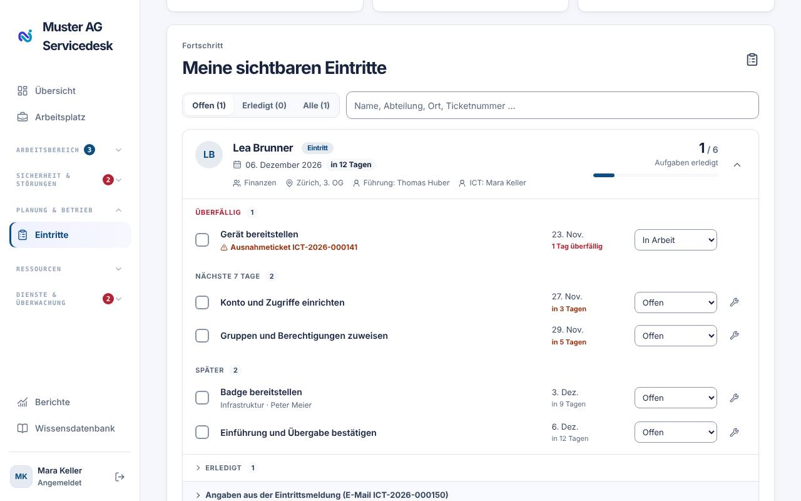

## Lager-Automatik, Rücknahmen und Austritt

**Ausgabe und Rückgabe von Geräten.** Übergib im Shop eine Bestellung
mit Seriennummer (Lagerort und Seriennummer wählen) und ist die Serieneinheit
mit einem Asset verknüpft, weist nextDesk das Gerät automatisch der
bestellenden Person zu; das Asset steht dann auf «In Betrieb». Dasselbe gilt
für die Ausgabe einer Lager-Reservation mit Seriennummer zu einem Ticket (das
Gerät geht an die anfragende Person). Kommt eine Shop-Ausleihe zurück, endet
die Zuweisung, das Asset steht wieder auf «An Lager» und die Serieneinheit ist
wieder an Lager.

**Lager → Automatik** (nur mit dem Recht, das Lager zu verwalten). Die
Regeln stehen in vier Karten: Rücknahmen, Mindestbestand, Reservationen und
Inventur; die beiden Optionen beim Mindestbestand schaltest du mit Schiebern:

- **Standard-Lagerort** für Rücknahmen, auf Wunsch pro **Abteilung** ein
  eigener Lagerort. Zurückgegebene Geräte aus einem Austritt werden dorthin
  gebucht, sofern bei der Rückgabe kein anderer Lagerort gewählt wird.
- **Mindestbestand:** **Lagerverwaltung benachrichtigen** schickt die
  Mitteilung «Nachbestellen», sobald ein Artikel unter den Mindestbestand
  fällt (wer schon den Push «Mindestbestand» erhalten hat, bekommt sie nicht
  doppelt). **Nachbestell-Aufgabe anlegen** erstellt zusätzlich eine Aufgabe
  mit der Menge bis zum Sollbestand. Offene Nachbestellungen erscheinen oben in
  diesem Register: **Bestellt**, **Erledigt** oder **Verwerfen**.
- **Reservationen:** Offene Reservationen werden nach der eingestellten Zahl
  Tage automatisch freigegeben (stündliche Prüfung). Reservationen aus
  Shop-Bestellungen, Eintritten und Raumbuchungen bleiben bestehen.
- **Inventur:** Pro Lager ein Intervall in Tagen. Ist es seit der letzten
  abgeschlossenen Inventur des am längsten nicht gezählten Lagerplatzes
  abgelaufen, erhält die Lagerverwaltung die Mitteilung «Inventur fällig».

**Austritt:** Im Austritt öffnest du **Rückgaben und Lizenzen**. Neben den
zugewiesenen Geräten listet nextDesk die offenen **Shop-Ausleihen** und die
**Lizenzen** der Person. Wähle die Einträge und den Lagerort für die
Rücknahme (vorausgewählt ist der Standard-Lagerort) und klicke
**Aufgaben erstellen**. Ist eine Aufgabe erledigt, wird das Gerät
zurückgenommen und als Serieneinheit an den Lagerort gebucht, die Ausleihe
zurückgebucht bzw. die Lizenz freigegeben (Grund «Austritt»). Die Lizenz in
Microsoft 365 entfernst du bei Bedarf weiterhin unter **Lizenzen**.

**Ersatzgerät ohne Genehmigung:** Aus einem Phishing-/Junk-Fall kann der Support
ein Ersatzgerät im Namen der Person bestellen. Die Bestellung braucht keine
Freigabe; in der Bestellung steht die Herkunft «Phishing-/Junk-Fall …
(ohne Genehmigung)».

## Verträge und Lizenzen

Unter **Ressourcen → Verträge** und **Ressourcen → Lizenzen** verwaltest du
Verträge (z. B. ein Microsoft Enterprise Agreement) und die Software-Lizenzen
dazu. Ein Vertrag kann mehrere Lizenzen umfassen, eine Lizenz gehört zu
höchstens einem Vertrag.

- **Im Vertrag** wählst du unter **Dokumente und Verknüpfungen → Verknüpfte
  Lizenzen** mit **Lizenz hinzufügen …** die Lizenzen aus der Liste; × entfernt
  eine Verknüpfung. Gehört eine Lizenz schon zu einem anderen Vertrag, steht
  das in der Liste («gehört zu …»); beim Speichern wechselt sie zu diesem
  Vertrag.
- **In der Lizenz** wählst du unter **Dokumente und Verknüpfungen → Vertrag**
  den Vertrag, zu dem sie gehört.
- **Fehlt das Gegenstück**, legst du es direkt unter der Liste an: Name bei
  **Neue Lizenz** bzw. **Neuer Vertrag** eingeben und **Hinzufügen** klicken.
  Der Vertragspartner wird als Hersteller/Anbieter übernommen (und
  umgekehrt), ebenso Abteilung, verantwortliche Person und Status (aktiv oder
  Entwurf). Weitere Angaben wie Laufzeit, Anzahl oder Kosten ergänzt du danach
  im neuen Eintrag. Eine im Vertrag neu erstellte Lizenz wird beim Speichern
  des Vertrags verknüpft.

Die Karten zeigen die Verknüpfung ebenfalls: beim Vertrag die **Lizenzen**, bei
der Lizenz den **Vertrag**.

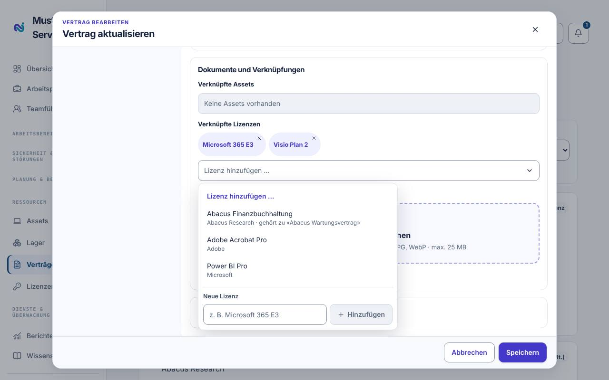

## Shop: Artikel nur für Kaderstufen

Beim Erfassen im Lager (**Zum Bestellen anbieten**) bzw. beim **Bearbeiten**
im Shop legst du unter
**Sichtbar für** fest, wer den Artikel sieht:

- **Alle Mitarbeitenden** (Standard) – keine Einschränkung.
- **Kaderstufe 1**, **2** und/oder **3** – nur Personen genau dieser Stufen
  sehen und bestellen den Artikel. Eine höhere Stufe sieht die Artikel tieferer
  Stufen nicht automatisch; kreuze dafür mehrere Stufen an.

Agenten sehen immer alle Artikel; eingeschränkte Artikel tragen das Etikett
«Nur Kaderstufe …». Bestellst du für eine andere Person, weist der Warenkorb
darauf hin, wenn ein Artikel für deren Kaderstufe nicht freigegeben ist – die
Bestellung ist trotzdem möglich.

Die Stufe einer Person ergibt sich aus ihrer **Funktion in Entra**. Die
Zuordnung pflegst du im Shop über **Kaderstufen** (z. B. Geschäftsleitung →
Kaderstufe 1, Fachbereichsleitung und Angebotsleitung → Kaderstufe 2,
Teamleitung → Kaderstufe 3). Dort kannst du für einzelne Personen eine Stufe
auch von Hand festlegen oder «Kein Kader» setzen. Ändert sich die Funktion in
Entra, gilt die neue Stufe nach dem nächsten Abgleich automatisch.

## Teams: alle Microsoft-Teams-Teams verwalten

Der Menüpunkt **Teams** (Arbeitsbereich) erscheint nur mit dem Recht zur
Shop-Verwaltung, wenn die Funktion **Microsoft Teams im Shop** eingeschaltet
und Microsoft Teams eingerichtet ist (siehe Installationshandbuch). Er zeigt
**alle** Teams der Organisation, auch die bestehenden, nicht nur die über den
Shop bestellten.

- **Kacheln mit Handlungsbedarf**: _Brauchen einen Owner_, _Laufen in 30
  Tagen ab_, _Teams mit Gästen_ und _Teams gesamt_. Ein Klick auf eine Kachel
  filtert die Liste; ein zweiter Klick hebt den Filter auf.
- **Liste**: pro Team Symbol, Name, Beschreibung, Sichtbarkeit, Herkunft
  (_über nextDesk_ oder _bestehend_), Gäste, Owner mit Avataren, Zahl der
  Mitglieder, Erstellt-Datum, Laufzeit mit Fortschrittsbalken und Status
  (_Aktiv_, _Läuft ab_, _Verwaist_, _Archiviert_); fährst du mit der Maus über
  den Status, erklärt ein Hinweis, was er bedeutet (_Verwaist_ = das Team hat
  keinen Owner). Filter: _Über nextDesk
  bestellt_, _Bestehend_, _Läuft bald ab_, _Ohne Owner_, _Mit Gästen_, _Ohne
  Ende_, _Archiviert_. Sortierung nach Name, Neueste, Ende oder Mitgliedern.
- **Mehrfachauswahl**: Teams ankreuzen, dann in der blauen Leiste **Ende
  setzen**, **Owner hinzufügen**, **Archivieren** oder **Löschen** für alle auf
  einmal.
- **Mit Microsoft abgleichen**: liest die Teams neu ein. Beim Öffnen läuft der
  Abgleich automatisch, wenn der Stand älter als ein Tag ist.
- **Details** (Klick auf ein Team), drei Reiter:
  - **Übersicht**: Kennzahlen, Laufzeit verlängern (+1, +3, +6 Monate, +1
    Jahr) oder ein Ende setzen, **In Teams öffnen**, **Archivieren** bzw.
    **Wiederherstellen** und **Team löschen**. Beim Löschen wird das Team bei
    Microsoft entfernt (mit Dateien, Chats und Kanälen); Microsoft hält es noch
    30 Tage im Papierkorb von Entra. Zur Bestätigung gibst du den Namen des
    Teams ein (in der Mehrfachauswahl das Wort _LÖSCHEN_). Dafür braucht die
    Microsoft-App das Recht _Group.ReadWrite.All_ (siehe Installationshandbuch).
  - **Personen**: Owner, Mitglieder und Gäste getrennt, Personen hinzufügen
    oder entfernen, zum Owner machen oder die Owner-Rolle entziehen (der
    letzte Owner bleibt immer). Bei einem Team ohne Owner wird die erste
    hinzugefügte Person Owner.
  - **Verlauf**: Zeitleiste aus dem Protokoll (bestellt, angelegt, verlängert,
    Erinnerungen, Änderungen).
- **Ende setzen**: Auch bei bestehenden Teams möglich. Ab dann erinnert
  nextDesk die Owner 14, 7 und 1 Tag vorher und archiviert das Team am Ende.
  Bei einem Team ohne Owner geht das nicht: zuerst einen Owner festlegen.

Gelöscht wird nie: nextDesk archiviert nur; ein archiviertes Team bleibt
lesbar und lässt sich wiederherstellen.

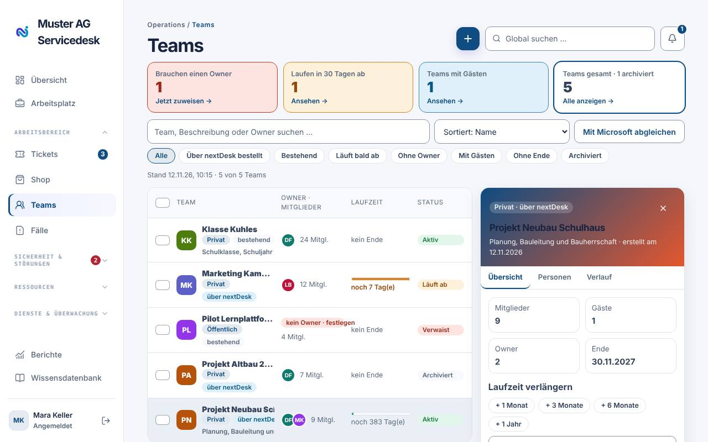

## IP-Adressen

Unter **Dienste und Überwachung → IP-Adressen** verwaltest du Subnetze,
VLANs, Standorte und einzelne IP-Adressen (IPv4 und IPv6). Der Bereich
erscheint, wenn das Modul _IP-Adressverwaltung_ eingeschaltet ist und du das
Recht «IP-Adressverwaltung ansehen» haben; Änderungen brauchen «IP-Adressen,
Subnetze und VLANs verwalten». Subnetze, VLANs und Standorte mit einer
Abteilung sehen nur deren Mitglieder; ohne Abteilung gelten sie für alle.

Oben wählst du die Register **Übersicht**, **Netze**, **VLANs**,
**Standorte** und **Funde** (die Zahl nennt die offenen Funde). Rechts daneben
öffnet **Subnetz-Planer** den Planer mit IP-Rechner. Das Menü **Verwaltung**
enthält den **Bereinigungs-Assistenten**, den **Import** (Excel, phpIPAM,
NetBox), **Export & Sophos-Objekte**, **Discovery & Agenten**, **API &
Webhooks** und **VRF anlegen**.

Hilfen in allen Ansichten:

- **Suche überall**: Ausserhalb der Übersicht steht das Suchfeld oben rechts.
  Die Taste **/** setzt den Cursor ins Suchfeld, mit ↑/↓ wählst du einen
  Treffer, **Enter** öffnet ihn, **Esc** leert das Feld. Tickets findest du
  auch über einen Teil der Nummer: «82» oder «0082» findet ICT-2026-000082.
- nextDesk merkt sich in diesem Browser das zuletzt gewählte Register und
  Netz; beim nächsten Öffnen geht es dort weiter.
- Nach einer Änderung erscheint unten eine Meldung. Lässt sich die Änderung
  zurücknehmen (z. B. Reservierung, Freigabe, Archivieren, Massenänderung),
  enthält sie den Knopf **Rückgängig**. Darum fragt nextDesk bei diesen
  Aktionen nicht mehr nach; nur endgültiges Entfernen (z. B. eines VLAN)
  verlangt eine Bestätigung.
- Fachbegriffe wie Gateway, VLAN, Zone, DHCP-Pool, VRF oder Container sind
  gepunktet unterstrichen: Zeige darauf oder wähle sie mit der
  Tabulatortaste an, erscheint eine kurze Erklärung.
- Neben IP-Adressen und Netzen kopiert das kleine Kopier-Symbol den Wert in
  die Zwischenablage.

**Übersicht**

- Das grosse **Suchfeld** zeigt schon während der Eingabe Treffer: IP-Adressen,
  MAC-Adressen, Hostnamen, Subnetze und VLANs (z. B. «10.20.30» oder
  «SW016»). Ein Klick öffnet den Treffer, mit ↑/↓ und der Eingabetaste wählst
  du per Tastatur.
- Vier **Kennzahlen**: freie IPv4-Adressen in aktiven Subnetzen (mit Ring für
  die Belegung aller aktiven IPv4-Subnetze), Subnetze über der Warnschwelle
  (und wie viele davon in unter 30 Tagen voll sind), offene Funde nach Art
  (farbiger Balken) und Reservierungen, die in den nächsten 30 Tagen ablaufen.
- **Am stärksten ausgelastet** listet die vollsten Subnetze mit Balken, einer
  kleinen Verlaufskurve der letzten 30 Tage und der **Prognose** («voll in ca.
  18 Tagen», «stabil», «sinkt»). Ein Klick auf die Zeile öffnet das Subnetz.
  Balken und Kurve werden ab der Warnschwelle des Subnetzes (standardmässig
  85 %) orange, ab 95 % rot.
- **Netzwerkagenten** zeigt jeden Agenten als «Online», «Verspätet» (länger
  als 30 Minuten still), «Offline» (länger als einen Tag) oder «Deaktiviert».
- **Zuletzt geändert** nennt die letzten Änderungen; **Protokoll** führt zum
  vollständigen Änderungsprotokoll.

**Netze**

- Links steht der **Baum** mit einem Feld **Netz, Name oder VLAN filtern**
  (z. B. «10.10.4», «Drucker» oder «120»). Mit **Hierarchie** siehst du
  Supernetze mit ihren Teilnetzen (bei mehreren VRFs je VRF), mit **Nach
  Standort** die Subnetze je Standort. Jedes Netz steht auf drei Zeilen:
  IP-Bereich, Beschreibung und VLAN. Alle Supernetze sind zu Beginn
  zugeklappt; mit dem Pfeil davor klappst du die Teilnetze auf oder zu. Der
  Pfad zum gewählten Netz wird automatisch aufgeklappt. **Filter** blendet die Auswahl
  nach Standort, Zone und Status sowie **Veraltete zeigen** ein; die Zahl am
  Knopf nennt die aktiven Filter, **Filter zurücksetzen** hebt sie auf. Beim
  Filtern bleiben die übergeordneten Netze blass sichtbar, damit der
  Zusammenhang erhalten bleibt. Die Marke «prüfen» kennzeichnet ein aktives
  Netz, das selbst aktive Teilnetze enthält – meist sollte es ein Container
  sein. Auf dem Smartphone ist der Baum unter **Netz wählen** zugeklappt.
- Über dem gewählten Netz zeigt ein **Pfad** die übergeordneten Supernetze
  (z. B. 10.0.0.0/8 › 10.10.0.0/16 › 10.10.4.0/22); ein Klick springt dorthin.
- **Mehrere auswählen** blendet Kästchen ein. Für die gewählten Netze setzt
  du danach in der Leiste Status, Abteilung, Zone oder Standort und
  bestätigen mit **Übernehmen** (bis 200 Netze auf einmal); **Rückgängig** in
  der Meldung stellt die vorherigen Werte wieder her.
- Ein **Supernetz** (Container oder Netz mit Teilnetzen) zeigt im Ring, wie
  viel an Teilnetze vergeben ist, dazu freie Adressen, den grössten freien
  Block, die Zahl der Teilnetze und die Grösse. Der **Adressraum** teilt das
  Supernetz in bis zu 256 gleich grosse Felder (bei einem /16 ist ein Feld
  ein /24). Teilnetze haben je eine Farbe, die auch in der Legende und in der
  Tabelle darunter steht; halb gefüllte Felder enthalten kleinere Teilnetze.
  Zeige auf ein Feld, erscheinen Netz, Name und Auslastung. Ein Klick auf
  ein Teilnetz öffnet es; ein Klick auf ein freies Feld zeigt den freien
  Block, die Grösse und einen Vorschlag – **Subnetz anlegen …** öffnet das
  Formular mit diesem Netz, VRF, Standort und Abteilung vorausgefüllt. **Im
  Planer aufteilen** öffnet den Subnetz-Planer für dieses Supernetz.
- Ein **Subnetz** zeigt oben die Auslastung als Ring, Gateway, VLAN, Zone,
  DHCP-Pool, Grösse mit Netzmaske, Standort (bei Bedarf VRF und Abteilung).
  Darunter stehen die **Zusammensetzung** («59 von 254 belegt · DHCP-Pool:
  0 von 139 belegt»; farbiger Balken: belegt ausserhalb des Pools, belegt im
  DHCP-Pool, DHCP-Pool frei, frei) und die **Prognose** («Warnschwelle 85 %
  in ca. 14 Monaten») aus dem Verlauf (bis 90 Tage). **Nächste freie IP**
  schlägt die erste freie Adresse ausserhalb von Gateway und DHCP-Pool vor und
  öffnet den Dialog **Adresse reservieren** (Hostname, Zweck, verantwortliche
  Person oder Team, auf Wunsch «Befristet bis»).
- Register **Belegung**: Ein Raster mit 16 Feldern pro Zeile zeigt jede
  Adresse; links steht der Beginn der Zeile (z. B. «.32»), oben der Versatz
  (+0 … +15). Die Farben sind in der Legende erklärt (Aktiv, Reserviert,
  DHCP-Pool, Ghost-IP gestreift, Konflikt, Veraltet, Gateway,
  Netz/Broadcast, Frei); ein Klick auf einen Legendeneintrag hebt nur diese
  Adressen hervor. Bei Subnetzen grösser als /24 (bis /20) wählst du oben den
  /24-Block; jeder Block zeigt seine Belegung und offene Funde. Zeige auf
  ein Feld, erscheinen IP, Status, Hostname, MAC, Switch-Port und zuletzt
  gesehen. Ein Klick öffnet die Adresse rechts im Detail. Mit den Pfeiltasten
  bewegst du dich im Raster, Enter öffnet.
- **Mehrere Adressen reservieren**: Halte die Umschalttaste und klicke
  auf die erste und die letzte Adresse, oder wähle **Bereich
  wählen** und tippe die Felder an (Leertaste per Tastatur). Die Leiste
  unten nennt den Bereich; **… Adressen reservieren** öffnet den Dialog für
  alle freien Adressen der Auswahl (belegte werden übersprungen, Hostnamen
  werden nummeriert).
- Register **Adressen**: Liste mit IP, Status, Hostname, MAC, Switch-Port und
  zuletzt gesehen; die Kopfzeile bleibt beim Blättern stehen. Filtere mit
  dem Suchfeld und den Knöpfen **Alle**, **Aktiv**, **Reserviert**, **DHCP**,
  **Veraltet** und **Mit Fund**. **Freie Bereiche zeigen** fasst freie
  Adressen zu einer Zeile zusammen («10.10.1.141 – 10.10.1.254 · 114 frei»);
  **Erste reservieren** reserviert die erste davon. Ein Klick auf die Zeile
  öffnet die Adresse. IPv6-Subnetze erscheinen nur in dieser Liste (mit
  Seiten).
- **So wird die Auslastung gezählt** (überall gleich: Baum, Listen,
  Übersicht, Standorte, Funde, Prognose und Verlauf): Belegt sind die
  erfassten Adressen ausserhalb des DHCP-Pools plus die Adressen im Pool, die
  erfasst sind oder eine aktive DHCP-Lease haben – jede Adresse einmal. Die
  Auslastung ist «belegt geteilt durch alle Adressen des Netzes». Freie
  Adressen im DHCP-Pool zählen nicht als belegt; die Grösse des Pools steht
  nur zur Information daneben.
- Register **Verlauf & Prognose**: täglich gemessene Belegung mit Linie
  «heute» und gestrichelter Prognose samt Unsicherheitsbereich. Das Diagramm
  zeigt vier Linien: **Warnschwelle** (gestrichelt, Einstellung am Netz),
  **Belegt ohne DHCP-Pool** (erfasste Adressen ausserhalb des Pools geteilt
  durch die Adressen des Netzes ohne Pool), **Belegt im DHCP-Pool**
  (gepunktet; Adressen im Pool, die erfasst sind oder eine aktive DHCP-Lease
  haben, geteilt durch die Grösse des Pools – nur bei Netzen mit DHCP-Pool)
  und **Belegt gesamt** (Fläche; belegte Adressen ausserhalb und innerhalb
  des Pools geteilt durch alle Adressen des Netzes, jede Adresse einmal
  gezählt). Aktive Leases zählen nur im globalen VRF, IPv6-Netze haben keinen
  Pool. Die Zeitachse beginnt am ersten Messtag: Gibt es weniger als 90 Tage
  Daten, steht links «seit 12.11.» statt «vor 90 Tagen»; davor wird nichts
  verlängert. Gibt es für eine Linie nur einen Tag, erscheint sie als Punkt.
  Die Kennzahlen darüber (**Heute**, **Vor … Tagen** = ältester Tag im
  Zeitraum, **Veränderung**) und die **Prognose** beziehen sich auf «Belegt
  gesamt»; der Wert von heute wird beim Öffnen frisch berechnet. Für Tage
  vor Einführung der Aufschlüsselung fehlen die Lease-Daten: «Belegt gesamt»
  zählt dort die erfassten Adressen (Näherung, im Tooltip «(ohne Leases)»),
  die beiden anderen Linien fehlen. Zeige auf das Diagramm (oder wähle es an
  und nutze die Pfeiltasten), so erscheinen alle Werte des jeweiligen Tages.
- Register **Funde**: offene Funde in diesem Subnetz.
- **Bearbeiten** öffnet alle Felder des Netzes, inklusive einer **Notiz** für
  interne Hinweise. Das Scheren-Symbol (**Aufteilen**) zerlegt ein Subnetz in
  gleich grosse Teilnetze. Mit dem Archiv-Symbol markierst du ein Netz als
  «Veraltet»; Adressen und Verlauf bleiben erhalten, **Rückgängig** stellt den
  vorherigen Status wieder her. Ein neues Netz legst du mit
  **+ Subnetz** in CIDR-Schreibweise an (z. B. 10.20.30.0/24). Dasselbe
  Subnetz darf im selben VRF nur einmal vorkommen, Gateway und DHCP-Pool
  müssen darin liegen.

**Bereinigungs-Assistent**

Nach einem Import finden sich oft Altlasten. Der Assistent (Knopf
**Bereinigen** in «Netze» oder **Verwaltung → Bereinigungs-Assistent**) schlägt
Korrekturen vor: aktive Netze mit Teilnetzen werden Container, Hinweise wie
«--> neu im Datacenter» wandern aus der Beschreibung in die Notiz, Gateway
oder DHCP-Bereich ausserhalb des Subnetzes werden geleert, alte
Zusammenfassungen («OLD», «ALT») werden als veraltet markiert. Doppelte VLANs
und leere Container erscheinen nur als Hinweis (nicht vorausgewählt). Wähle
die gewünschten Vorschläge und übernimm sie in einem Schritt; jede
Änderung steht danach im Änderungsprotokoll und lässt sich dort zurücknehmen.

**Subnetz-Planer und IP-Rechner**

- Im **Planer** wählst du ein Supernetz und erfasst die gewünschten
  Teilnetze mit Name, Grösse, VLAN-ID und Zone. nextDesk setzt jedes Teilnetz
  in der eingegebenen Reihenfolge in die kleinste passende freie Lücke. Der
  Balken zeigt bestehende (grau), geplante (blau) und freie Bereiche, die
  Tabelle das Ergebnis und die Anzahl Hosts; passt ein Teilnetz nicht, steht
  dort der Grund. **Geplante Teilnetze anlegen** legt alle in einem Schritt
  an – mit Standort und Abteilung des Supernetzes, der ersten Adresse als
  Gateway und, falls eine VLAN-ID angegeben ist und am Standort fehlt, dem
  VLAN.
- Der **IP-Rechner** steht allen zur Verfügung: Eingabe wie
  «172.16.68.0/22» oder «10.0.0.5 255.255.255.0» ergibt Netz, Maske,
  Wildcard, erste und letzte nutzbare Adresse, Broadcast und Anzahl Hosts
  (auch für IPv6). «In nextDesk» zeigt, ob das Netz erfasst ist oder in
  welchem erfassten Netz es liegt.

**VLANs**

- Die **Matrix** vergleicht jeden Standort mit der **Standort-Vorlage**:
  Zeilen sind die Funktionen der Vorlage (z. B. MGMT, PRINTER, WLAN), Spalten
  die Standorte. Grün heisst «wie Vorlage», gelb «Name oder Grösse weicht ab»
  (mit Grund, z. B. «/23 statt /22»), gestrichelt «fehlt» mit Vorschlag für
  VLAN-ID und Subnetz. Mit **+ anlegen** erstellst du das fehlende VLAN samt
  Subnetz. Standorte ohne passende VLANs (z. B. VPN) zeigen «–». VLANs
  ausserhalb der Vorlage stehen darunter unter «Weitere VLANs».
- Die **Liste** zeigt die VLANs je Standort mit ID, Name, Beschreibung, Zone,
  Subnetz und Auslastung; hier bearbeitest oder entfernst du VLANs. Einträge,
  die noch von Subnetzen verwendet werden, lassen sich nicht entfernen.
- **Standort-Vorlage** legt fest, welche VLANs und Subnetze ein Standort hat:
  je Funktion den VLAN-Versatz zur VLAN-Basis des Standorts, den Versatz im
  Standort-Supernetz in /24-Schritten, die Grösse, die Zone und ob DHCP
  vorgesehen ist. Gibt es noch keine Vorlage, schlägt nextDesk eine aus dem
  Standort mit den meisten VLANs vor.
- **+ Standort aus Vorlage** legt einen neuen Standort in einem Schritt an:
  Name, Supernetz (freie Blöcke der passenden Grösse werden vorgeschlagen),
  VLAN-Basis und Asset-Standort (neu anlegen, bestehenden wählen oder nicht
  verknüpfen). Die Vorschau zeigt VLAN, Subnetz und Gateway je Funktion;
  einzelne Funktionen lassen sich abwählen.

**Standorte**

- Jede **Kachel** zeigt VLANs, Netze, Switches, Access Points, die Auslastung
  aller aktiven Subnetze, den Status des zuständigen Netzwerkagenten und ob
  der Standort mit einem **Asset-Standort** verknüpft ist. Ist er verknüpft,
  erscheinen die Geräte dieses Asset-Standorts automatisch.
- Im Detail wählst du den Asset-Standort direkt in der Auswahl oben.
  **Bearbeiten** öffnet auch Standort-Supernetz, VLAN-Basis und Vorlage (sie
  steuern den Abgleich in der VLAN-Matrix).
- Register **VLANs & Netze** (mit Gateway, DHCP und Auslastung), **Geräte**
  (Switches, Access Points und weitere Infrastruktur mit IP, Ort und
  Uplink) und **Netzwerkkarte** (Geräte nach Uplink geordnet, mit Anzahl
  Access Points je Switch).
- **Dokumentation (PDF)** öffnet eine Druckansicht mit VLANs und Netzen,
  Geräten mit Seriennummern und der Netzwerkkarte. Mit **Drucken / als PDF
  speichern** wählst du im Druckdialog «Als PDF speichern». Passwörter und
  WLAN-Schlüssel sind nie enthalten.

**Funde, Soll/Ist und Änderungsprotokoll**

Im Register **Funde** schaltest du oben zwischen drei Ansichten um:

- **Funde**: Die Discovery meldet Abweichungen – Konflikte und fremde MAC auf
  einer reservierten IP (rot), Ghost-IPs (aktiv, aber nicht dokumentiert),
  DNS-Abweichungen und lange nicht gesehene Adressen. Stündlich prüft nextDesk
  ausserdem die **Auslastung**: Ein Subnetz über seiner Warnschwelle oder ein
  DHCP-Bereich über 90 % wird zum Fund und schliesst sich von selbst, sobald
  die Auslastung wieder darunter liegt. Täglich erscheinen wichtige Geräte
  (Server, Switches, Firewalls, Router) ohne PRTG-Überwachung als
  **PRTG-Lücke**. Ghost-IPs übernimmst du mit **Übernehmen** als
  dokumentierte Adresse, mit **Ticket** entsteht ein Ticket, mit **Erledigt**
  oder **Ignorieren** schliesst du den Fund (ignorierte Funde kommen nicht
  wieder).
- **Soll / Ist** vergleicht je Subnetz die dokumentierten Adressen mit dem,
  was die Netzwerkagenten in den letzten 7 Tagen gesehen haben:
  Übereinstimmung in Prozent, «Nur gesehen» (nicht dokumentiert) und «Nur
  dokumentiert» (nicht gesehen).
- Das **Änderungsprotokoll** zeigt jede Änderung an Netzen, VLANs, Standorten
  und Adressen mit Zeit, Person oder Herkunft (z. B. Planer, Bereinigung,
  Standort-Vorlage, Discovery, Intune-Abgleich, Import, API) und dem Vorher und
  Nachher. Filtere nach Objekt, Herkunft und Zeitraum. **Rückgängig** setzt
  eine Änderung zurück, solange der Eintrag seither nicht erneut geändert
  wurde; die Rücknahme wird selbst protokolliert.

**Eine Adresse**

Ein Klick auf eine Adresse öffnet sie: Status, Hostname, MAC und Hersteller,
Gerätetyp, Switch-Port, VLAN, Verantwortung, zuletzt gesehen, Verknüpfungen in
nextDesk (Infrastruktur-Gerät mit derselben IP, Asset, Dienst und Tickets, in
denen die IP oder der Hostname vorkommt), eigene Felder und der Verlauf. Mit
**Freigeben** wird die Adresse sofort als «Veraltet» markiert und wieder als
frei vorgeschlagen; der Verlauf bleibt, **Rückgängig** in der Meldung stellt
den vorherigen Eintrag wieder her. **Ticket erstellen** legt ein Ticket mit
den Angaben zur Adresse an, **Bearbeiten** öffnet alle Felder. Eine eben
reservierte Adresse gibst du mit **Rückgängig** in der Meldung gleich wieder
frei. **Esc** schliesst die Detailansicht.

**Export & Sophos-Objekte**

Unter **Verwaltung → Export & Sophos-Objekte** lädst du Subnetze, Adressen
und VLANs als CSV oder JSON herunter. Unter **Firewall-Objekte (Sophos)**
erzeugst du eine Import-Datei mit Netzwerken, einzelnen Hosts und je Subnetz
einer Hostgruppe für die Sophos Firewall (XML) oder eine Objektliste als CSV.

**Discovery & Agenten**

Unter **Verwaltung → Discovery & Agenten** siehst du die Netzwerkagenten mit
Status und letzter Meldung, die letzten **Scans** und unter **DHCP & DNS** die
DHCP-Bereiche mit Auslastung, Leases und den Vergleich der DNS-Einträge mit
der Dokumentation. Mit **Jetzt scannen** stösst du einen Scan an. Dort
beauftragst du auch DHCP-Reservierungen oder fehlende bzw. abweichende
DNS-Einträge; der Agent führt den Auftrag aus, sobald eine Person mit
Verwaltungsrecht ihn freigegeben hat. Neue Konflikte und volle Subnetze
melden sich per Glocke, Push und E-Mail (Kategorie **IP-Adressverwaltung**).
Meldet sich ein Agent länger als zwei Stunden nicht, erhalten alle mit
Verwaltungsrecht einmal pro Ausfall die Mitteilung «Netzwerkagent offline»;
die Karte des Agenten zeigt dann «Ausfall gemeldet».

**Reservierungen mit Ablaufdatum**

Hat eine reservierte Adresse ein Datum «Reserviert bis», erinnert nextDesk
bis zu drei Tage vorher die verantwortliche Person und das Team
(«Reservierung läuft ab»). Nach Ablauf wird die Adresse automatisch
freigegeben (Status Veraltet); Verlauf und Änderungsprotokoll nennen als
Herkunft «System».

**Geräte-IP und IP-Adressverwaltung**

Die IP-Adresse eines Infrastruktur-Geräts muss eine gültige IP sein (optional
mit Präfixlänge, z. B. 10.1.2.3/24). Trage eine IP ein, verknüpft
nextDesk die dokumentierte Adresse mit dem Gerät bzw. legt sie in einem
bekannten Subnetz an. Umgekehrt ergänzt das Verknüpfen einer Adresse mit
einem Gerät dessen IP, wenn sie noch leer ist.

**Import**

Unter **Verwaltung → Import** übernimmst du bestehende Listen in vier
Schritten (Datei wählen, Zuordnung prüfen, Vorschau, Übernehmen):

- **Excel** (.xlsx) oder **CSV**: IP-Listen mit einem Blatt pro Subnetz,
  eine Übersicht mit VLANs und Subnetzen, Switch-Listen und Access-Point-
  Listen. nextDesk erkennt die Spalten selbst; in der Zuordnung kannst du sie
  ändern.
- **phpIPAM** und **NetBox**: CSV-Exporte der Subnetze bzw. Prefixe,
  Adressen und VLANs.
- Switches und Access Points werden zusätzlich als Geräte in der
  **Infrastruktur** angelegt (mit Seriennummer, MAC und Uplink-Switch).

Die Vorschau zeigt, was neu ist, was sich ändert und was übersprungen wird,
mit Hinweisen zu jeder Zeile (z. B. fehlende Präfixlänge, Gateway ausserhalb
des Subnetzes, doppelte Geräte). Bestehende Einträge werden nur ergänzt, nicht
überschrieben. Blätter mit Zugangsdaten (z. B. WLAN-Schlüssel) und Vorlagen
werden nie übernommen. Danach lohnt sich ein Durchgang mit dem
Bereinigungs-Assistenten.

**Abgleich mit Intune und PRTG**

Jede Nacht gleicht nextDesk die dokumentierten Adressen mit den Geräten aus
Intune und den Sensoren aus PRTG ab: Hostname, MAC und zuletzt gesehen werden
ergänzt, Geräte ohne dokumentierte IP erscheinen als Fund. In der Adresse
siehst du die Verknüpfung zum Intune-Gerät bzw. zum PRTG-Sensor.

**Netzwerkkarte der Infrastruktur**

In der **Infrastruktur → Netzwerkkarte** zeigt jedes Gerät zusätzlich sein
Subnetz und VLAN (aus der IP-Adresse des Geräts). Über die Legende über der
Karte hebst du die Geräte eines VLAN hervor.

**Netzwerk im Ticket**

Kommt in einem Ticket eine IP-Adresse, ein Subnetz, eine MAC-Adresse oder ein
dokumentierter Hostname vor, zeigt das Ticket rechts die Box **Netzwerk**:
Subnetz und VLAN, Gerät, Switch-Port, verantwortliche Person und zuletzt
gesehen. Mit **In der IP-Adressverwaltung öffnen** springst du zur Adresse.
Darfst du das Ticket bearbeiten, hängst du mit **Gerät … ans Ticket
hängen** bzw. **Dienst … ans Ticket hängen** das Gerät und seine Dienste
direkt an (bereits verknüpfte erscheinen als «am Ticket»). Für eine erkannte,
noch nicht dokumentierte IP in einem bekannten Subnetz reserviert **IP
reservieren** die Adresse nach einer Bestätigung (braucht das Recht,
IP-Adressen zu verwalten). Tickets zu einer Adresse findet die
IP-Adressverwaltung über einen Suchindex auch in grossen Ticketbeständen
schnell.

**In der App**

In der iPhone-App zeigen die Detailseiten von Assets und Infrastruktur-Geräten
die Karte **Netzwerk** mit IP, Subnetz, VLAN, Gateway und Switch-Port. Scanne
den QR-Code am Gerät, siehst du diese Angaben direkt vor Ort. Tippe
auf eine Mitteilung der IP-Adressverwaltung, öffnet die App das Gerät oder
die Netzwerkdaten der betroffenen Adresse.

**KI-Assistent**

Über die nextDesk-Schnittstelle für KI-Assistenten (MCP) kannst du Fragen
wie «Welche IP hat der Drucker im 2. OG?», «Wie viele Adressen sind in VLAN
20 frei?» oder «Reserviere die nächste freie IP im Server-Netz» stellen. Es
gelten dieselben Rechte und Abteilungsgrenzen wie in der Weboberfläche.

## Benachrichtigungen und Erreichbarkeit

- Die **Glocke** zeigt Zuweisungen, Erwähnungen, Antworten und Eskalationen.
  Ein Klick auf einen Eintrag öffnet genau das auslösende Objekt: das Ticket,
  den Phishing-/Junk-Fall, die Störung, die Bestellung, den Lagerartikel, die
  Serviceaufgabe, das Infrastruktur-Gerät oder in der IP-Adressverwaltung die
  Adresse, das Netz bzw. die Funde und die Agenten.
- Ein **Tipp auf eine Push-Mitteilung** öffnet in der iPhone-App ebenfalls
  direkt das auslösende Objekt – auch wenn die App geschlossen war. Gehört die
  Mitteilung zu einem anderen Arbeitsbereich, wechselt die App zuerst dorthin.
  Serviceaufgaben öffnen sich in einer eigenen Ansicht, in der du die
  Checkliste abhakst und die Aufgabe erledigst; fällige Inventuren zeigen die
  Artikel des Lagerorts. Für Vertragsfristen und Netzwerkagenten gibt es in der
  App keine Ansicht; die App weist dann auf die Web-App hin.
- Eine **Sammelmitteilung** («5 neue Hinweise in nextDesk») öffnet in der App die
  **Mitteilungen**: die letzten Benachrichtigungen aller Arten (Tickets,
  Bestellungen, Störungen, Lager …), Ungelesene markiert. Ein Tipp öffnet den
  Eintrag wie die einzelne Push-Mitteilung und markiert ihn als gelesen;
  **Alle gelesen** leert die Liste. Die Mitteilungen erreichst du jederzeit
  über die **Glocke** oben auf der Startseite der App (mit Anzahl
  ungelesener Einträge).
- Der Knopf in einer **E-Mail-Benachrichtigung** öffnet in der Web-App genau
  das auslösende Objekt. Bist du noch nicht angemeldet, öffnet es sich nach
  der Anmeldung (auch per SSO); gehört es zu einem anderen Mandanten, in dem
  du Mitglied bist, wechselt nextDesk zuerst dorthin. Hast du keinen
  Zugriff mehr, erscheint ein Hinweis.
- **Push-Benachrichtigungen** auf dem iPhone kommen ohne Einchecken. Unter
  _Persönliche Einstellungen → Benachrichtigungen → Benachrichtigungszeit_
  legst du fest, an welchen **Tagen** und zu welchen **Zeiten** du
  Mitteilungen erhältst (z. B. Mo–Fr, 06:00–17:00) oder ob **Jederzeit**. Was
  ausserhalb dieser Zeit anfällt, kommt zu Beginn der nächsten
  Benachrichtigungszeit.
- In der Tabelle **Benachrichtigungen** schaltest du pro Benachrichtigung
  (z. B. Zuweisungen, Eskalationen, Erwähnungen, Phishing-Meldungen, Phishing / Junk,
  Störungen, IP-Adressverwaltung) einzeln **Push** und **E-Mail** ein oder
  aus. Für Agenten sind zu Beginn alle Benachrichtigungen per Push und
  E-Mail eingeschaltet – ausser **Phishing-Meldungen** und **Phishing / Junk**: Diese
  sind ausgeschaltet. Wer sie erhalten möchte, schaltet sie dort selbst ein.
  Mitglieder des in den Phishing-Einstellungen hinterlegten Teams erhalten
  Phishing-Meldungen, überfällige Phishing-/Junk-Fälle, «geklickt» und Kampagnen
  immer; die Tabelle weist darauf hin. **IP-Adressverwaltung** (Funde,
  Netzwerkagent offline, ablaufende Reservierungen) sehen Personen mit Zugriff
  auf die IP-Adressverwaltung; **Lager** umfasst Mindestbestand,
  Nachbestellung und fällige Inventur, **Shop** auch Erinnerungen zu
  Ausleihen und offenen Freigaben. E-Mails kommen über das Exchange-Postfach
  deines Unternehmens und sind verfügbar, sobald eines verbunden ist.
- Das iPhone-Widget **Meine Prioritäten** zeigt deine wichtigsten Tickets in
  den Farben deines Unternehmens. Öffne die App einmal, damit es aktuell
  ist.

## Persönliche Einstellungen

Zusätzlich zu den Karten für Mitarbeitende sehen Agenten:

- **Passwort setzen oder ändern** (ohne SSO)
- **Handbücher** – Handbuch für Mitarbeitende und Handbuch für Agenten

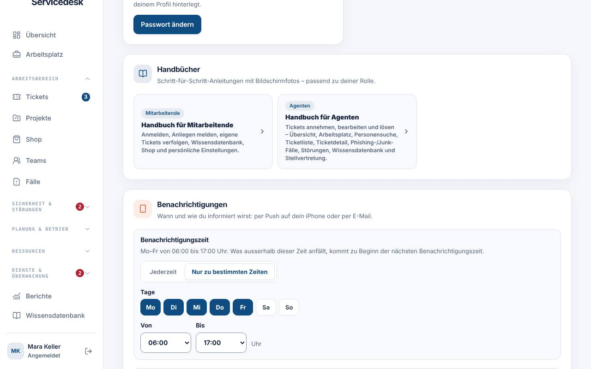

## Gute Praxis

- Neue Tickets zeitnah **zuweisen** – auch wenn du sie nicht sofort löst.
- Für Rückfragen einen wartenden Status (z. B. **Wartend auf Kunde**) setzen,
  damit die SLA pausiert und die Person erinnert wird.
- Interne Informationen immer als **Interne Notiz**, nie als externe Antwort.
- Lösungen, die mehr als einmal gebraucht werden, als **Wissensartikel**
  festhalten.
