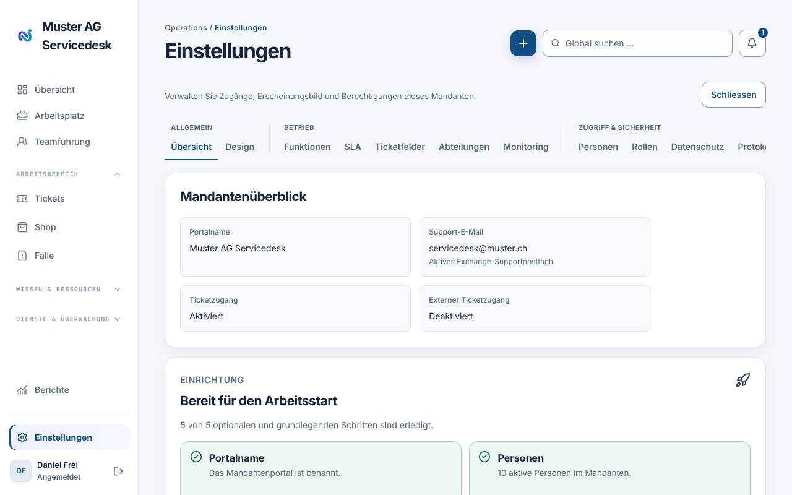
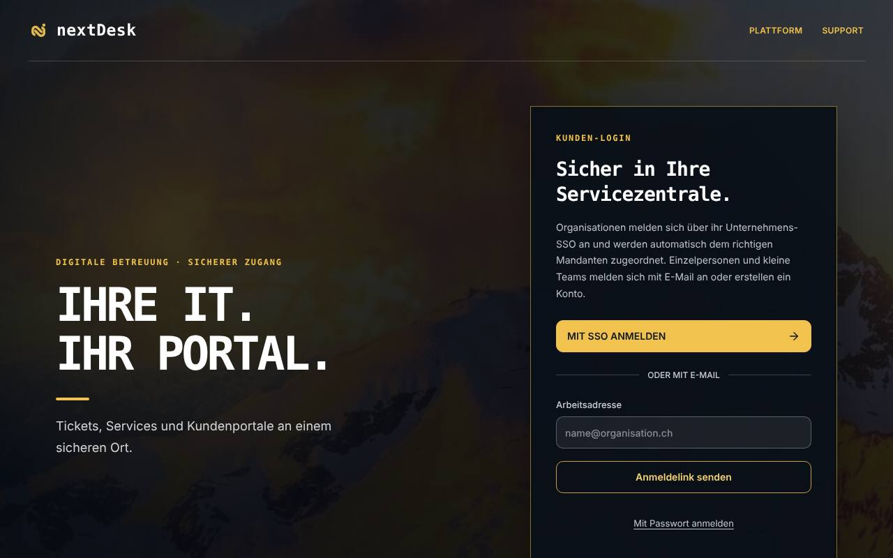
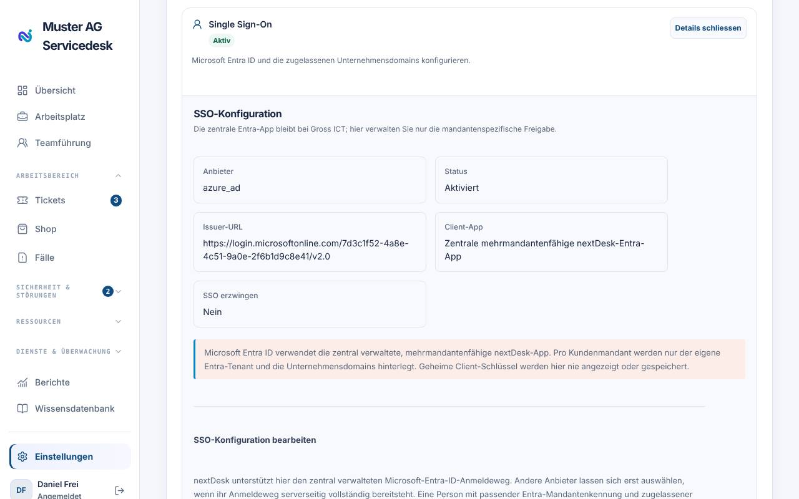
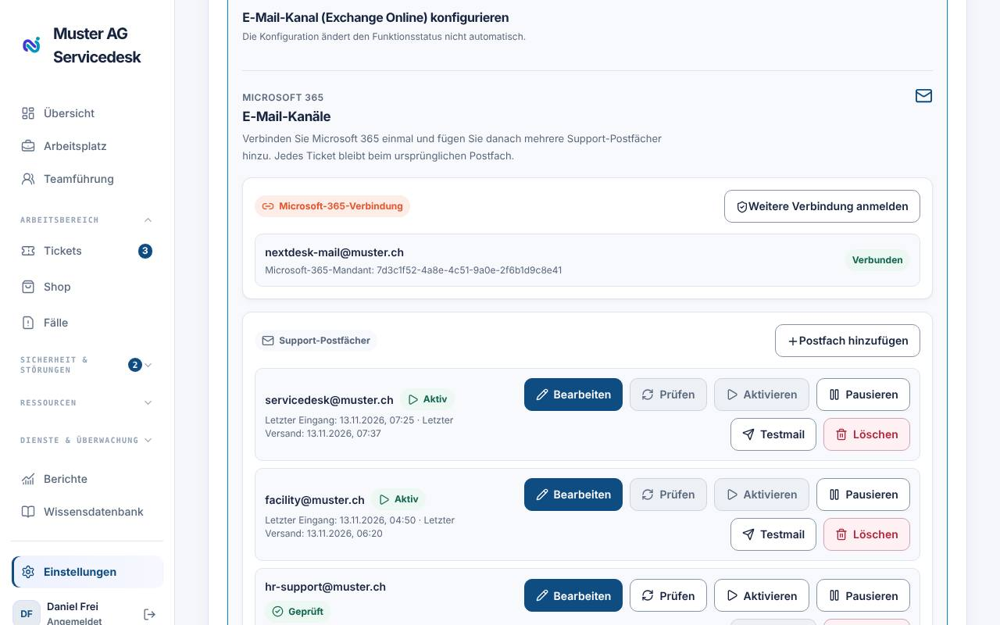
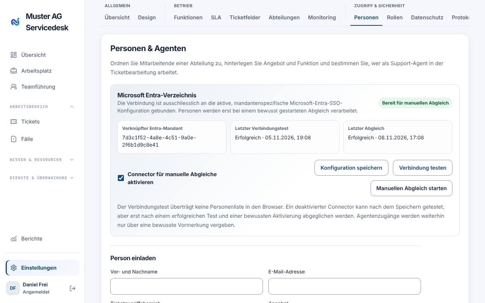
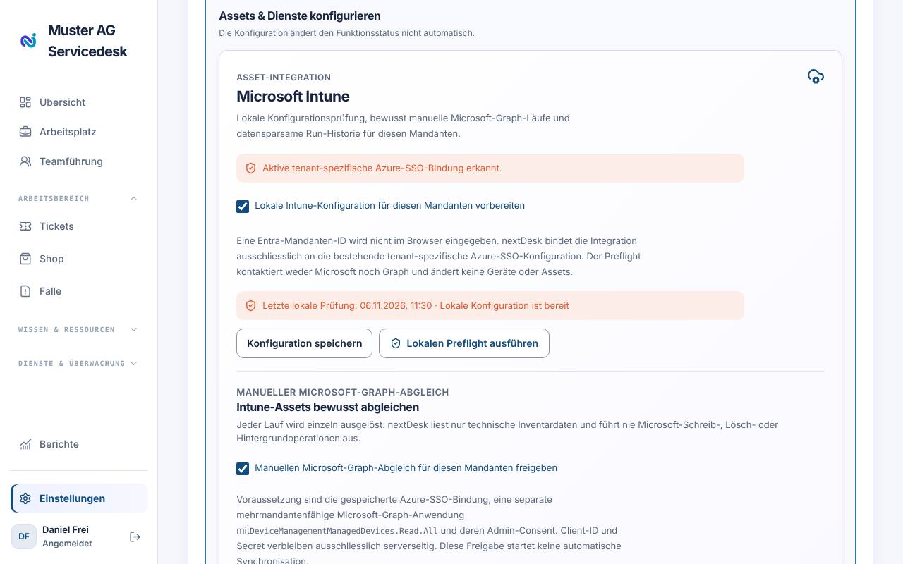
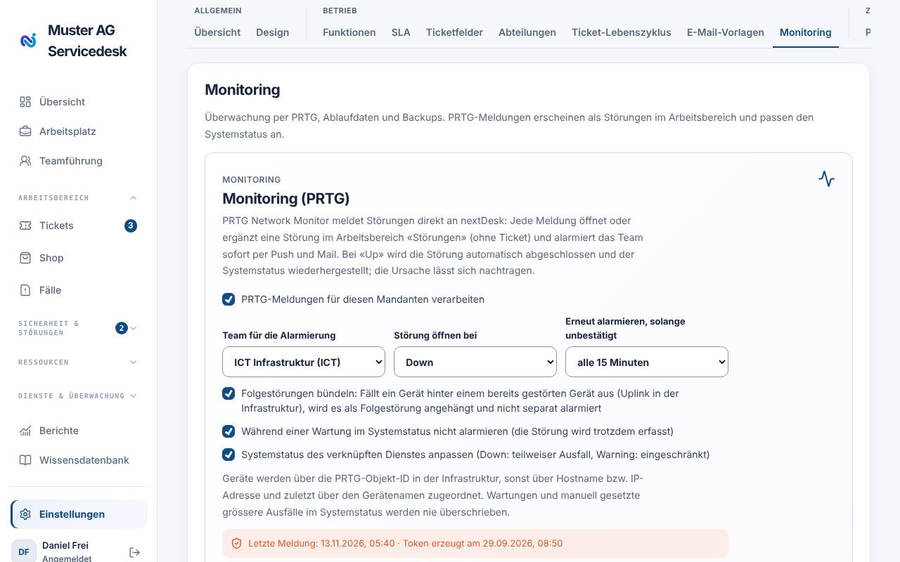

# Installationsanleitung

Diese Anleitung führt Administratoren durch die Inbetriebnahme von nextDesk
für ein Unternehmen. nextDesk wird als Cloud-Dienst betrieben – Server,
Datenbank und zentrale Microsoft-Apps stellt der Plattformbetreiber (Gross
ICT) bereit. Sie richten Ihren **Mandanten** ein und erteilen in Ihrem
Microsoft-365-Konto die nötigen Freigaben.

In jedem Abschnitt ist markiert, wer handelt:

- **[Betreiber]** – Gross ICT (einmalig für die Plattform, meist bereits erledigt)
- **[Admin]** – Sie als nextDesk-Administrator
- **[Microsoft-Admin]** – globale Administratorin bzw. globaler Administrator Ihres Microsoft-365-Mandanten

## Übersicht und Reihenfolge

1. Mandant und ersten Administrator erhalten (Betreiber)
2. Grundeinstellungen: Design, Abteilungen, Teams (Admin)
3. Microsoft Entra SSO (Admin + Microsoft-Admin)
4. Personen einladen und Rollen vergeben (Admin)
5. Exchange Online als E-Mail-Kanal (Admin + Microsoft-Admin)
6. Optional: Verzeichnisabgleich, Intune, Push, PRTG, Backup- und Ablaufüberwachung
7. Mobile-App verteilen und Abschluss-Test

Die Checkliste **Einstellungen → Übersicht → «Bereit für den Arbeitsstart»**
zeigt jederzeit, was noch fehlt.



## Voraussetzungen

- Ein aktueller Browser (Edge, Chrome, Firefox oder Safari) und die Adresse
  `https://app.nextdesk.ch`.
- Ein nextDesk-Konto mit der Rolle **Administrator** in Ihrem Mandanten.
  Der Betreiber legt den Mandanten an und lädt die erste Administratorin
  bzw. den ersten Administrator per E-Mail ein.
- Für die Microsoft-Integrationen: Zugang zu einem Konto mit der Rolle
  _Globaler Administrator_ (für die Freigaben) bzw. _Exchange-Administrator_
  (für Postfachberechtigungen).
- Eine Liste Ihrer E-Mail-Domains, Abteilungen und Support-Postfächer.

## Schritt 1: Erste Anmeldung

1. Öffnen Sie den Link in der Einladungs-E-Mail. Die Einladung ist 7 Tage
   gültig.
2. Melden Sie sich mit der eingeladenen E-Mail-Adresse an (Anmeldelink per
   E-Mail oder Passwort).
3. Prüfen Sie, dass links unten der Menüpunkt **Einstellungen** erscheint.



## Schritt 2: Grundeinstellungen

1. **Einstellungen → Design**: Portalname, Logo und Farben hinterlegen,
   **Corporate Design speichern**.
2. **Einstellungen → Abteilungen**: Abteilungen anlegen (z. B. ICT,
   Facility, HR), Leitungen bestimmen und **Teams pro Abteilung** mit
   Supportstufe erfassen.
3. **Einstellungen → Funktionen**: die gewünschten Module aktivieren (z. B.
   Wissensdatenbank, Self-Service, Ticketvorlagen, SLA-Automatisierung).
4. **Einstellungen → SLA**: mindestens eine SLA-Regel pro Priorität anlegen.

Details zu jedem Register stehen im _Handbuch für Administratoren_.

## Schritt 3: Microsoft Entra SSO

Mit SSO melden sich Mitarbeitende mit ihrem Microsoft-Konto an.

**[Betreiber]** Die zentrale, mehrmandantenfähige App-Registrierung
«nextDesk – Kunden SSO» ist bereits vorhanden. Sie erhalten vom Betreiber
deren **Client-ID** (Anwendungs-ID).

**[Microsoft-Admin]** Erteilen Sie die Administratorzustimmung für Ihren
Microsoft-Mandanten. Der Betreiber sendet Ihnen dafür einen Link der Form:

```text
https://login.microsoftonline.com/<IHRE-TENANT-ID>/adminconsent?client_id=<CLIENT-ID>
```

Ihre Tenant-ID finden Sie im Microsoft Entra Admin Center unter
_Übersicht → Mandanten-ID_.

**[Admin]** In nextDesk unter **Einstellungen → Funktionen → Single Sign-On
→ Konfigurieren**:

| Feld                       | Wert                                                                                       |
| -------------------------- | ------------------------------------------------------------------------------------------ |
| Anbieter                   | Microsoft Entra ID                                                                         |
| Client-ID                  | vom Betreiber erhalten                                                                     |
| Issuer-URL                 | `https://login.microsoftonline.com/<IHRE-TENANT-ID>/v2.0`                                  |
| Discovery-URL              | `https://login.microsoftonline.com/<IHRE-TENANT-ID>/v2.0/.well-known/openid-configuration` |
| Zugelassene E-Mail-Domains | z. B. `muster.ch` – eine pro Zeile                                                         |

1. **SSO aktivieren** ankreuzen, **SSO für die Anmeldung erzwingen** vorerst
   _nicht_ ankreuzen, **SSO-Konfiguration speichern**.
2. In einem privaten Browserfenster mit **Mit SSO anmelden** testen.
3. Erst wenn der Test klappt, **SSO für die Anmeldung erzwingen** setzen.

> Eine Domain kann nur einem nextDesk-Mandanten zugeordnet sein. Personen aus
> zugelassenen Domains werden beim ersten Login als _anfragende Person_
> angelegt – Agenten- und Adminrechte vergeben Sie separat.



## Schritt 4: Personen und Rollen

1. **Einstellungen → Personen → Person einladen**: Agenten mit **Arbeitet als
   Support-Agent** und Ticketzugriffsbereich einladen. Mitarbeitende ohne
   Ticketbearbeitung müssen mit SSO nicht eingeladen werden.
2. **Einstellungen → Rollen → Rollen zuweisen**: weitere Administratoren
   oder eigene Rollen vergeben.

## Schritt 5: Exchange Online (E-Mail-Kanal)

E-Mails an Ihre Support-Adresse werden zu Tickets, Agentenantworten gehen als
E-Mail zurück.

**[Betreiber]** Die App «nextDesk – Exchange Online» mit den delegierten
Berechtigungen _User.Read, Mail.Read, Mail.Send, Mail.Read.Shared,
Mail.Send.Shared_ ist eingerichtet. nextDesk verwendet keine
Anwendungsberechtigungen für Mail.

**[Microsoft-Admin]** Bestimmen Sie ein Connector-Konto (z. B.
`nextdesk-connector@muster.ch`). Geben Sie diesem Konto im Exchange Admin
Center unter _Empfänger → Postfächer → Postfachdelegierung_ für **jedes**
Support-Postfach die Rechte **Vollzugriff** und **Senden als**.

**[Admin]** In nextDesk:

1. **Einstellungen → Funktionen → E-Mail-Kanal (Exchange Online)** aktivieren
   und **Konfigurieren** öffnen.
2. **Microsoft 365 verbinden** und mit dem Connector-Konto anmelden.
3. **Postfach hinzufügen**: Support-Postfach, _Ziel-Abteilung für neue
   Tickets_ und die gewünschten Mitteilungen (Eingangsbestätigung,
   Agentenantworten per E-Mail, Lösungsmitteilung) wählen →
   **Postfach speichern**.
4. **Prüfen** → **Aktivieren** → **Testmail** senden.

Neue E-Mails werden etwa alle 5 Minuten abgeholt. Ein Postfach kann nur einem
Mandanten gehören. Optional aktivieren Sie im selben Bereich die
**Phishing-Meldungen** mit eigener Meldeadresse und Zielabteilung.



## Schritt 6: Optionale Integrationen

### Microsoft-Entra-Verzeichnisabgleich

Übernimmt Name, E-Mail, Funktion, Abteilung und Aktivstatus aus Entra.

- Voraussetzung: SSO ist mit Ihrer **eigenen Tenant-ID** konfiguriert
  (nicht `common`).
- **[Microsoft-Admin]** Zustimmung für die Berechtigung _User.Read.All_
  erteilen (Link vom Betreiber).
- **[Admin]** **Einstellungen → Personen → Microsoft Entra-Verzeichnis**:
  _Connector für manuelle Abgleiche aktivieren_ → **Konfiguration speichern**
  → **Verbindung testen** → **Manuellen Abgleich starten**.

Der Abgleich läuft nur manuell; es werden keine Personen gelöscht.



### Microsoft Intune (Geräte)

- **[Microsoft-Admin]** Zustimmung für die Intune-App mit
  _DeviceManagementManagedDevices.Read.All_ (nur lesend) erteilen.
- **[Admin]** Funktion **Asset-Management** aktivieren →
  **Konfigurieren** → _Manuellen Microsoft-Graph-Abgleich für diesen Mandanten
  freigeben_ → Vorschau prüfen → **Übernahme ausdrücklich bestätigen** →
  **Jetzt einmalig abgleichen**.

Geräte mit bereits vorhandener Seriennummer werden übersprungen, es wird nie
etwas gelöscht.



### Push-Benachrichtigungen (iOS)

- **[Admin]** Funktion **Push-Benachrichtigungen** aktivieren und die
  Inhaltsstufe **Nur Ticketnummer** (empfohlen) wählen. Ein Einchecken ist
  nicht nötig: Jede Person legt unter _Persönliche Einstellungen →
  Push-Benachrichtigungen → Benachrichtigungszeit_ selbst fest, an welchen
  Tagen und zu welchen Zeiten sie Mitteilungen erhält.
- Anwenderinnen und Anwender testen in der iOS-App unter _Profil →
  Benachrichtigungen → Testmitteilung senden_.

### PRTG-Monitoring

1. **[Admin]** **Einstellungen → Monitoring → Monitoring (PRTG)**: Verarbeitung
   aktivieren, Abteilung/Team, «Ticket erstellen bei» (Down bzw. Down und
   Warning) und Priorität wählen, **Token erzeugen**. Die Webhook-Adresse wird
   **nur einmal** angezeigt – sofort kopieren.
2. In PRTG unter _Setup → Kontoeinstellungen → Benachrichtigungsvorlagen_
   eine Vorlage **HTTP-Aktion ausführen** mit Methode **POST** anlegen.
   Postdaten:

   ```text
   device=%device&host=%host&sensor=%sensor&status=%status&message=%message&down=%down&lastvalue=%lastvalue&datetime=%datetime&group=%group&probe=%probe&sensorid=%sensorid&deviceid=%deviceid
   ```

3. Zustands-Trigger auf der Gruppe oder dem Gerät setzen: _Fehler_ (Down),
   bei Bedarf _Warnung_ und **zwingend** die Zeile «nicht mehr im Status …»
   (Up) mit derselben Vorlage. Ohne den Up-Trigger erfährt nextDesk nie, dass
   die Störung vorbei ist, und der Dienst bleibt im Systemstatus gestört. Bei
   _Up_ kann nextDesk das Ticket automatisch lösen. nextDesk versteht die
   Statuswörter deutsch (Fehler, Warnung, OK, Pausiert) und englisch (Down,
   Warning, Up, Paused).
4. **Geräte und Dienste verknüpfen** (nur damit ändert sich der Systemstatus):
   unter **Infrastruktur → Gerät bearbeiten** die **PRTG-Objekt-ID** eintragen
   (am besten die Geräte-ID aus der PRTG-Adresse `device.htm?id=…`, dann gelten
   alle Sensoren des Geräts) und bei **Dienste (für Systemstatus)** einen oder
   **mehrere Dienste** ankreuzen. Ohne ID ordnet nextDesk über Hostname bzw.
   IP-Adresse und zuletzt über den Gerätenamen zu. Bei Down wechseln alle
   gewählten Dienste auf «Teilweiser Ausfall» (Warning: «Eingeschränkt»), bei
   Up zurück auf «Betriebsbereit», sobald kein anderer Alarm sie mehr betrifft.
5. Blockiert Ihre Firewall die Webhook-Adresse (typisch: Webfilter oder
   HTTPS-Prüfung, PRTG meldet «403 Forbidden»), geben Sie die Domain
   `supabase.co` für den PRTG-Server in der Firewall frei oder verwenden Sie
   die Weiterleitung über die eigene Domain:
   `https://app.nextdesk.ch/prtg-relay.php?token=<TOKEN>`. Auch diese Domain
   muss die Firewall für den PRTG-Server zulassen; die Prüfung erfolgt mit
   `curl.exe -ik …` auf dem PRTG-Server (Antwort 401 mit falschem Token =
   erreichbar).
6. Geht ein «Up» verloren, bleibt ein Alarm offen. Im Register **Monitoring**
   beenden Sie ihn unter **Alarme aus PRTG → Alarm beenden**; dabei werden die
   gestörten Dienste zurückgesetzt.



### Zertifikate, Domains und Backups

Im selben Register erfassen Sie **Zertifikate und Domains** (Erinnerung vor
Ablauf) und die **Backup-Überwachung** (z. B. Veeam per E-Mail oder Webhook mit
erwartetem Intervall und Toleranz).

## Schritt 7: Mobile-App und Abschluss

- Die **nextDesk-App** für iOS steht im App Store. Mitarbeitende melden sich
  mit derselben Adresse bzw. per SSO an.
- Abschluss-Test:
  1. Als Mitarbeitende/r ein Ticket erfassen.
  2. Als Agent das Ticket übernehmen und öffentlich antworten.
  3. Eine E-Mail an das Support-Postfach senden und prüfen, dass ein Ticket
     entsteht.
  4. Im **Protokoll** prüfen, dass alle Einrichtungsschritte erfasst sind.

## Fehlerbehebung

| Problem                                         | Lösung                                                                                       |
| ----------------------------------------------- | -------------------------------------------------------------------------------------------- |
| SSO-Anmeldung meldet fehlende Zustimmung        | Admin-Consent-Link erneut durch den Microsoft-Admin ausführen lassen                         |
| Person landet im falschen bzw. keinem Mandanten | Domain unter «Zugelassene E-Mail-Domains» prüfen; eine Domain gehört nur zu einem Mandanten  |
| Postfach lässt sich nicht prüfen                | Vollzugriff und «Senden als» für das Connector-Konto prüfen, danach erneut **Prüfen**        |
| Keine Tickets aus E-Mails                       | Postfach aktiv? Bis zu 5 Minuten warten; Status im Bereich E-Mail-Kanäle prüfen              |
| PRTG-Alarme erzeugen keine Tickets              | Token neu erzeugen, Postdaten und Methode POST prüfen, ggf. `prtg-relay.php` verwenden       |
| PRTG meldet «403 Forbidden» beim Zustellen      | Firewall/Webfilter des PRTG-Servers blockiert die Domain; Freigabe oder Weiterleitung nutzen |
| Dienst bleibt auf «Teilweiser Ausfall»          | Fehlt der Up-Trigger oder kam das Up nicht an? Alarm im Register Monitoring beenden          |
| Agent sieht keine Tickets                       | Rolle und Ticketzugriffsbereich unter **Personen** bzw. **Rollen** prüfen                    |

## Anhang: Plattformbetrieb (nur Betreiber)

Für den Betrieb der Plattform selbst (nicht für Kunden-Administratoren):
Supabase in der Region Zürich (`eu-central-2`) für Datenbank, Anmeldung und
Edge Functions; Auslieferung der Web-App per GitHub-Workflow auf das
Webhosting; Secrets ausschliesslich in Supabase bzw. GitHub, nie im
Browser. Die vollständigen Betriebsanleitungen stehen im Repository unter
`DEPLOYMENT.md`, `SUPABASE.md` und `docs/deployment/`.
