# Handbuch für Mitarbeitende

Mit nextDesk meldest du Anliegen an den Support – zum Beispiel ein defektes
Gerät, eine fehlende Berechtigung oder eine Frage – und verfolgen jederzeit,
wie weit dein Anliegen ist. Dieses Handbuch erklärt alles, was du dafür
brauchst.

## Wie mache ich …?

Hier findest du zu jeder Aufgabe eine kurze Anleitung. Ausführliche
Erklärungen stehen in den weiteren Abschnitten.

### Wie melde ich mich an?

1. Öffne `https://app.nextdesk.ch` im Browser.
2. Ist dein Unternehmen mit Microsoft 365 verbunden, wähle **Mit SSO
   anmelden** und melde dich mit deinem gewohnten Microsoft-Konto an.
3. Ohne SSO gibst du unter «Oder mit E-Mail» deine E-Mail-Adresse ein und
   wählst **Anmeldelink senden**.
4. Öffne den Link aus der E-Mail im selben Browser.

Mehr dazu unter «Anmelden».

### Wie melde ich mich mit einem Passwort an?

1. Öffne `https://app.nextdesk.ch` im Browser.
2. Wähle «Mit Passwort anmelden». Das Passwortfeld erscheint.
3. Gib deine Zugangsdaten ein. Das geht nur, wenn du ein Passwort gesetzt hast.

Mehr dazu unter «Anmelden».

### Wie erstelle ich ein Konto?

1. Öffne `https://app.nextdesk.ch` im Browser.
2. Wähle «Neu bei nextDesk? Konto erstellen». Das brauchst du nur, wenn dich
   dein Unternehmen nicht eingeladen hat.
3. Bestätige dein Konto per E-Mail.
4. Erstelle danach deinen eigenen Arbeitsbereich.

Gehört deine E-Mail-Domain zu einem Unternehmen mit SSO, meldest du dich
stattdessen mit SSO an. Mehr dazu unter «Anmelden».

### Wie gehe ich vor, wenn die Anmeldung scheitert?

1. Lies die rote Meldung unter dem Formular.
2. Gib den Text dieser Meldung an deine IT weiter.
3. Kommt kein Anmeldelink an, prüfe den Spam-Ordner und ob die
   E-Mail-Adresse stimmt.
4. Funktioniert der Anmeldelink nicht, öffne ihn im selben Browser, in dem du
   ihn angefordert hast, und fordere bei Bedarf einen neuen an.

Mehr dazu unter «Anmelden» und «Häufige Fragen».

### Wie erfasse ich ein Ticket?

1. Klicke oben rechts auf **+** und dann auf **Ticket erfassen**.
2. Gib einen kurzen, aussagekräftigen **Betreff** ein.
3. Wähle unter **Einordnung** die **Abteilung / Angebot** und, wenn du
   möchtest, **Kategorie** und **Unterkategorie**.
4. Wähle die **Priorität**. Im Zweifel belässt du die vorgeschlagene.
5. Beschreibe das Anliegen in der **Beschreibung**: Was ist passiert? Seit
   wann? Welche Fehlermeldung? Welches Gerät?
6. Klicke auf **Ticket erstellen**.
7. Notiere dir die **Ticketnummer**. Mit **Öffnen** springst du direkt ins
   Ticket.

Mehr dazu unter «Ein Anliegen melden (Ticket erfassen)».

### Wie finde ich eine Lösung, bevor ich ein Ticket erfasse?

1. Beginne, ein Ticket zu erfassen, und schreibe den Betreff.
2. Schau dir die Artikel an, die nextDesk unter «Könnte dir das helfen?»
   vorschlägt.
3. Öffne einen passenden Artikel und prüfe, ob er dein Problem löst.
4. Löst er es nicht, erfasst du das Ticket wie gewohnt.

Mehr dazu unter «Ein Anliegen melden (Ticket erfassen)».

### Wie löse ich mein Anliegen mit dem Assistenten?

1. Klicke oben rechts auf **+** und dann auf **Ticket erfassen**.
2. Wähle **Mit dem Assistenten lösen**. Das gibt es nur, wenn der Assistent
   aktiviert ist.
3. Schildere dein Anliegen im Dialog.
4. Übernimm den vorbereiteten Entwurf, wenn du ein Ticket brauchst.

Mehr dazu unter «Ein Anliegen melden (Ticket erfassen)».

### Wie verwerfe ich einen Ticket-Entwurf?

1. Klicke oben rechts auf **+** und dann auf **Ticket erfassen**. Halbfertige
   Eingaben sind als Entwurf noch da.
2. Wähle **Entwurf verwerfen**.
3. Beginne neu.

Mehr dazu unter «Ein Anliegen melden (Ticket erfassen)».

### Wie sehe ich den Stand meiner Tickets?

1. Wähle im Menü **Tickets**.
2. Lies bei jedem Anliegen Nummer, Betreff und Status.
3. Klicke auf ein Ticket, um Einzelheiten zu sehen.
4. Der Block **Fortschritt** zeigt die Schritte mit Zeitpunkten.

Mehr dazu unter «Eigene Tickets verfolgen» und «Ein Ticket öffnen und
antworten».

### Wie suche ich ein Ticket?

1. Klicke oben rechts in die **globale Suche** («Global suchen …»).
2. Gib ein Stichwort oder einen Teil der Ticketnummer ein, zum Beispiel «82»
   für ICT-2026-000082.
3. Klicke auf den passenden Treffer.

Mehr dazu unter «Die Oberfläche im Überblick».

### Wie antworte ich auf ein Ticket?

1. Wähle im Menü **Tickets** und klicke auf das Ticket.
2. Schreibe deine Antwort in **Deine Nachricht**.
3. Klicke auf **Nachricht senden**.

Du kannst auch direkt auf die E-Mail des Supports antworten. Mehr dazu unter
«Ein Ticket öffnen und antworten».

### Wie hänge ich eine Datei an ein Ticket an?

1. Öffne das Ticket und schreibe deine Nachricht in **Deine Nachricht**.
2. Wähle **Dateien anhängen** und suche den Screenshot oder das Dokument aus.
   Erlaubt sind unter anderem PDF, Office-Dokumente, TXT, CSV, PNG und JPG.
3. Klicke auf **Nachricht senden**.

Mehr dazu unter «Ein Ticket öffnen und antworten».

### Wie bestätige ich, dass mein Problem gelöst ist?

1. Öffne das Ticket mit dem Status «Wartet auf dich».
2. Beantworte die Frage «Ist dein Problem inzwischen gelöst?» mit **Problem
   ist gelöst**.

Mehr dazu unter «Ein Ticket öffnen und antworten».

### Wie melde ich, dass ich noch Hilfe brauche?

1. Öffne das Ticket mit dem Status «Wartet auf dich».
2. Klicke bei der Frage «Ist dein Problem inzwischen gelöst?» auf **Ich
   brauche noch Hilfe**.
3. Beschreibe kurz, was noch offen ist.
4. Wähle **Rückmeldung senden**.

Mehr dazu unter «Ein Ticket öffnen und antworten».

### Wie gebe ich etwas frei oder lehne es ab?

1. Öffne das Ticket, in dem eine Freigabe auf dich wartet.
2. Entscheide direkt im Ticket mit **Freigeben** oder **Ablehnen**.

Mehr dazu unter «Ein Ticket öffnen und antworten».

### Wie bewerte ich ein gelöstes Ticket?

1. Öffne das gelöste Ticket. Unter «Fortschritt» steht die Frage **Wie
   zufrieden bist du?**
2. Wähle 1 bis 5 Sterne.
3. Schreibe bei Bedarf einen kurzen Kommentar.
4. Klicke auf **Bewertung senden**.

Mehr dazu unter «Ticket bewerten».

### Wie ändere ich meine Bewertung?

1. Öffne das bewertete Ticket. Das geht innerhalb von 14 Tagen nach der
   Bewertung.
2. Wähle **Bewertung ändern**.
3. Ändere Sterne oder Kommentar.
4. Klicke auf **Bewertung senden**.

Du kannst die Bewertung nur einmal ändern. Mehr dazu unter «Ticket bewerten».

### Wie bewerte ich ein Ticket per E-Mail?

1. Öffne die E-Mail «Ticket gelöst».
2. Klicke auf einen der fünf Sterne. Du musst dafür nicht angemeldet sein.
3. Ändere auf der Seite, die sich öffnet, bei Bedarf die Sterne und schreibe
   einen Kommentar.
4. Bestätige mit **Bewertung senden**.

Der Link ist persönlich und 14 Tage gültig. Mehr dazu unter «Ticket bewerten».

### Wie melde ich eine verdächtige E-Mail?

1. Klicke in der verdächtigen E-Mail keine Links an und öffne keine Anhänge.
2. Wähle in **Outlook** **Melden → Phishing melden**. Oder wähle im Portal oder
   in der App **Phishing melden**.
3. Antworte ehrlich, wenn das Sicherheitsteam nachfragt, ob du einen Link
   geöffnet oder Daten eingegeben hast.

Hast du bereits dein Passwort eingegeben, melde dich sofort beim Support. Mehr
dazu unter «Verdächtige E-Mail melden (Phishing)».

### Wie suche ich in der Wissensdatenbank?

1. Wähle im Menü **Wissensdatenbank**.
2. Tippe ein Stichwort ins Suchfeld. Mit der Taste `/` springst du direkt
   hinein.
3. Klicke auf einen Treffer, um den Artikel zu öffnen.
4. Wähle **Alle Artikel** oder **Zurück zu den Treffern**, um zur Liste
   zurückzukehren.

Mehr dazu unter «Wissensdatenbank».

### Wie finde ich einen Artikel nach Thema?

1. Wähle im Menü **Wissensdatenbank**.
2. Wähle ein **Thema**. Die Reihe mit Symbolen scrollt seitlich.
3. Wähle bei Bedarf ein Unterthema.
4. Klicke auf einen Artikel.

Bei langen Artikeln springst du über **Auf dieser Seite** zum Abschnitt. Mehr
dazu unter «Wissensdatenbank».

### Wie bestelle ich im Shop?

1. Wähle im Menü **Shop** und dort das Register **Katalog**.
2. Wähle einen Artikel und klicke auf **In den Warenkorb**.
3. Gib im Warenkorb den **Grund der Bestellung** an.
4. Wähle die Lieferung: _Abholung beim Support_ oder _An meinen Arbeitsplatz_.
5. Klicke auf **Jetzt bestellen**. Ist eine Freigabe nötig, heisst der Knopf
   **Zur Freigabe senden**.

Fehlt dir ein Artikel, wende dich an den Support. Mehr dazu unter «Shop –
Geräte und Zubehör bestellen».

### Wie leihe ich ein Gerät aus?

1. Wähle im Menü **Shop** und dort das Register **Katalog**.
2. Wähle das Leihgerät und klicke auf **Ausleihen**.
3. Gib den Zeitraum an.
4. Gib im Warenkorb den **Grund der Bestellung** an und wähle die Lieferung.
5. Klicke auf **Jetzt bestellen** bzw. **Zur Freigabe senden**.

nextDesk erinnert dich zwei Tage vor dem Rückgabedatum. Mehr dazu unter «Shop –
Geräte und Zubehör bestellen».

### Wie sehe ich den Stand meiner Bestellungen?

1. Wähle im Menü **Shop**.
2. Öffne **Meine Bestellungen**.

Mehr dazu unter «Shop – Geräte und Zubehör bestellen».

### Wie sehe ich meine Geräte?

1. Öffne **Mein Bereich**.
2. Wähle **Geräte**. Dort steht ein Gerät, das du aus dem Shop erhalten hast.

Mehr dazu unter «Shop – Geräte und Zubehör bestellen».

### Wie entscheide ich über Bestellungen meines Teams?

1. Wähle im Menü **Shop**.
2. Öffne das Register **Freigaben**.
3. Entscheide über die Bestellungen deines Teams.

Das gilt für dich als vorgesetzte Person. Mehr dazu unter «Shop – Geräte und
Zubehör bestellen».

### Wie bestelle ich ein neues Team in Microsoft Teams?

1. Wähle im Shop im Katalog die Kachel **Microsoft Teams: neues Team**.
2. Wähle **Team zusammenstellen …**.
3. Fülle nacheinander **Grunddaten**, **Kanäle & Tabs**, **Personen** und
   **Laufzeit** aus.
4. Lege unter **Personen** mindestens einen Owner fest.
5. Lege unter **Laufzeit** Start und Ende fest. Das Ende ist Pflicht.
6. Prüfe alles in der **Übersicht** und wähle **Verbindlich bestellen**.

Mehr dazu unter «Microsoft Teams: neues Team bestellen».

### Wie verlängere ich ein Team?

1. Öffne im Shop **Meine Teams**.
2. Wähle das Team.
3. Verlängere die Laufzeit mit einem Klick um 1, 3, 6 Monate oder 1 Jahr.

Ohne Verlängerung wird das Team nach dem Ende archiviert. Mehr dazu unter
«Microsoft Teams: neues Team bestellen».

### Wie bearbeite ich ein Team?

1. Öffne im Shop **Meine Teams**.
2. Wähle beim Team **Bearbeiten**. Das geht als Besteller oder Owner.
3. Füge Personen hinzu oder entferne sie, oder ändere ihre Owner-Rolle. Ein
   Owner bleibt immer.
4. Verlängere bei Bedarf die Laufzeit oder **archiviere** das Team.

Name, Kanäle und Tabs änderst du direkt in Microsoft Teams. Mehr dazu unter
«Microsoft Teams: neues Team bestellen».

### Wie sehe ich meine Benachrichtigungen?

1. Klicke oben rechts auf die **Glocke**.
2. Klicke auf einen Eintrag, um das Ticket bzw. die Bestellung zu öffnen.
3. Wähle «Alle als gelesen markieren», um die Liste zu leeren.

In der App öffnest du die **Glocke** oben auf der Startseite. Mehr dazu unter
«Die Oberfläche im Überblick».

### Wie erkenne ich eine Störung oder Wartung?

1. Achte oben auf einen Hinweis oder im Menü auf den Eintrag **Aktive
   Störung**.
2. Wähle **+1 weitere**, wenn es mehrere Störungen gibt, um alle aufzuklappen.
3. Lies bei einer Wartung den blauen Hinweis «Laufende Wartung» bzw.
   «Geplante Wartung» mit Zeitraum und betroffenen Diensten.

Für eine bekannte Störung musst du kein eigenes Ticket erfassen. Mehr dazu
unter «Die Oberfläche im Überblick».

### Wie blende ich einen Hinweis der ICT aus?

1. Suche den Hinweis oben auf der Startseite.
2. Klicke auf das **X-Symbol**.

Der Hinweis erscheint danach nicht mehr. Mehr dazu unter «Hinweise der ICT».

### Wie ändere ich die Darstellung?

1. Klicke unten links auf deinen **Namen**. Die **Persönlichen
   Einstellungen** öffnen sich.
2. Öffne **Profil & Darstellung** und wähle **Darstellung anpassen**.
3. Wähle das Farbschema (Hell, Dunkel, Systemeinstellung).
4. Schalte bei Bedarf hohen Kontrast oder Bewegung reduzieren ein.

Mehr dazu unter «Persönliche Einstellungen und Handbücher».

### Wie stelle ich Benachrichtigungen ein?

1. Klicke unten links auf deinen **Namen**.
2. Öffne **Benachrichtigungen**.
3. Schalte bei jeder Benachrichtigung **Push** und **E-Mail** ein oder aus.

E-Mail-Benachrichtigungen gibt es, sobald dein Unternehmen ein
Exchange-Postfach verbunden hat. Mehr dazu unter «Persönliche Einstellungen und
Handbücher».

### Wie erhalte ich eine Push-Mitteilung bei Störungen?

1. Klicke unten links auf deinen **Namen** und öffne **Benachrichtigungen**. In der App: **Einstellungen → Benachrichtigungen**.
2. Schalte **Störungen** ein.
3. Wähle unter **Dienste**, für welche Dienste du informiert werden willst. Ohne Auswahl gilt **Alle**.

Die Mitteilung kommt auf iPhone und Android, sobald eine Störung gemeldet wird – dann, wenn auch der Banner erscheint. Mehr dazu unter «Persönliche Einstellungen und Handbücher».

### Wie lege ich fest, wann ich Benachrichtigungen erhalte?

1. Klicke unten links auf deinen **Namen** und öffne **Benachrichtigungen**.
2. Wähle bei der **Benachrichtigungszeit** **Jederzeit** oder **Nur zu
   bestimmten Zeiten**.
3. Wähle bei **Nur zu bestimmten Zeiten** die Tage (Mo–So) und die Uhrzeit von
   und bis.

Was ausserhalb der Zeit anfällt, kommt zu Beginn der nächsten
Benachrichtigungszeit. Mehr dazu unter «Persönliche Einstellungen und
Handbücher».

### Wie melde ich mich von allen anderen Geräten ab?

1. Klicke unten links auf deinen **Namen**.
2. Öffne die **Sitzungsverwaltung**.
3. Melde alle anderen Geräte ab.

Mehr dazu unter «Persönliche Einstellungen und Handbücher».

### Wie melde ich mich ab?

1. Klicke unten links auf deinen **Namen**.
2. Wähle **Abmelden**.

Mehr dazu unter «Persönliche Einstellungen und Handbücher».

### Wie lösche ich mein Konto?

1. Klicke unten links auf deinen **Namen**.
2. Wähle **Konto löschen**.

Meldest du dich mit SSO deines Unternehmens an, kannst du das Konto hier nicht
löschen. Wende dich dann an deine IT. Mehr dazu unter «Persönliche
Einstellungen und Handbücher».

### Wie lese oder drucke ich ein Handbuch?

1. Klicke unten links auf deinen **Namen**.
2. Öffne **Handbücher** und wähle das Handbuch.
3. Wähle **Drucken / PDF**, um es auszudrucken oder als PDF zu speichern.

In der App findest du die Handbücher unter **Profil → Hilfe und Rechtliches**.
Mehr dazu unter «Persönliche Einstellungen und Handbücher».

### Wie erfasse ich ein Ticket in der App?

1. Wähle in der App **Neues Ticket**.
2. Fülle das Formular aus wie im Browser.
3. Füge unter **Fotos (optional)** bei Bedarf Bilder hinzu. Bis zu fünf pro
   Ticket sind möglich.
4. Sende das Ticket ab.

Mehr dazu unter «nextDesk auf dem iPhone».

### Wie füge ich in der App ein Foto zum Ticket hinzu?

1. Öffne in der App **Neues Ticket**.
2. Wähle unter **Fotos (optional)** **Foto aufnehmen** oder **Aus Mediathek**.
3. Erlaube beim ersten Mal den Zugriff auf die Kamera.
4. Wähle **Markieren**, um eine Stelle im Bild zu kennzeichnen.
5. Entferne ein Bild mit dem **×**.

Hast du den Kamerazugriff abgelehnt, erlaubst du ihn in den Einstellungen des
Geräts oder wählst ein Bild aus der Mediathek. Mehr dazu unter «nextDesk auf dem
iPhone».

### Wie hänge ich in der App eine Datei an eine Nachricht an?

1. Öffne in der App das Ticket.
2. Tippe auf die **Büroklammer** neben dem Nachrichtenfeld.
3. Wähle Fotos aus der Mediathek oder Dateien (PDF, Word, Excel, TXT, CSV). Bis
   zu fünf pro Nachricht sind möglich.
4. Sende die Nachricht.

Mehr dazu unter «nextDesk auf dem iPhone».

### Wie öffne ich in der App eine Datei aus einem Ticket?

1. Öffne in der App das Ticket.
2. Suche die Datei in der **Unterhaltung** oder unter der Beschreibung.
3. Tippe auf die Datei.

Mehr dazu unter «nextDesk auf dem iPhone».

### Wie filtere ich meine Tickets in der App?

1. Wähle in der App unten **Tickets**. Die Liste beginnt mit dem Filter
   **Meine**.
2. Wechsle die Ansicht mit **Alle**, **Beobachtet**, **Offen**, **Gelöst** oder
   **Nicht zugewiesen**.
3. Tippe auf das Filtersymbol in der Suchleiste für weitere Filter, zum Beispiel
   **Priorität** oder **Sortieren nach**.
4. Wähle **Filter zurücksetzen**, um wieder zu **Meine** zu kommen.

Mehr dazu unter «nextDesk auf dem iPhone».

### Wie lese ich einen Wissensartikel in der App?

1. Wähle in der App unten rechts **Wissen**.
2. Suche einen Artikel oder wische durch die Themen.
3. Tippe auf den Artikel.
4. Teile ihn unten im Artikel, oder erstelle mit **Ticket erstellen** eine
   Rückfrage dazu.

Mehr dazu unter «nextDesk auf dem iPhone».

### Wie passe ich die Home-Seite in der App an?

1. Tippe auf der **Home**-Seite oben rechts auf **Home anpassen**.
2. Blende die Bereiche ein oder aus, zum Beispiel Suche, Zuletzt geöffnet oder
   Geräte.
3. Verschiebe Bereiche mit den Pfeilen.
4. Wähle **Standard wiederherstellen**, um alles zurückzusetzen.

Die Einstellung gilt nur für dich und wird zwischen deinen Geräten abgeglichen.
Mehr dazu unter «nextDesk auf dem iPhone».

### Wie stelle ich Benachrichtigungen in der App ein?

1. Öffne die App-Einstellungen.
2. Schalte bei jedem Hinweis **Push** und **Mail** einzeln ein oder aus.
3. Wähle unter **Benachrichtigungszeit** die Tage und Zeiten.

Ein Tipp auf eine Mitteilung öffnet direkt das Ticket bzw. die Bestellung. Mehr
dazu unter «nextDesk auf dem iPhone».

### Wie sehe ich meine letzten Mitteilungen in der App?

1. Tippe auf der Startseite oben auf die **Glocke**.
2. Lies die **Mitteilungen**.

Die rote Zahl auf dem App-Symbol zeigt, wie viele Mitteilungen du noch nicht
gelesen hast. Mehr dazu unter «nextDesk auf dem iPhone».

### Wie finde ich die App-Version?

1. Öffne in der App das Profil.
2. Scrolle ganz nach unten.
3. Lies **Version** und **Build** ab.

Nenne diese Angaben dem Support, wenn du ein Problem meldest. Mehr dazu unter
«nextDesk auf dem iPhone».

### Wie arbeite ich in einem Projekt mit?

1. Öffne in der Navigation **Projekte**. Der Menüpunkt erscheint, sobald du in ein Projekt aufgenommen bist.
2. Klicke auf das Projekt.
3. Im **Zeitplan**, im **Board** oder in der **Liste** siehst du die Aufgaben; ein Klick auf einen Titel öffnet die Aufgabe.
4. Je nach Rolle änderst du dort Status und Checkliste oder schreibst einen Kommentar.

Mehr dazu unter «Projekte».

### Wie öffne ich ein Projekt, zu dem ich als Gast eingeladen bin?

1. Öffne den Anmeldelink aus der Einladungs-E-Mail.
2. Nach der Anmeldung siehst du den Menüpunkt **Projekte** mit dem Projekt.
3. Klicke auf das Projekt. Du siehst Überblick, Zeitplan, Board, Liste und die freigegebene Dokumentation.

Mehr dazu unter «Projekte».

## Anmelden

Öffne `https://app.nextdesk.ch` im Browser.

- **Mit SSO anmelden**: Ist dein Unternehmen mit Microsoft 365 verbunden,
  meldest du dich mit deinem gewohnten Microsoft-Konto an. Das ist der
  empfohlene Weg.
- **Anmeldelink per E-Mail**: Gib unter «Oder mit E-Mail» deine
  E-Mail-Adresse ein und wähle **Anmeldelink senden**. Öffne den Link
  aus der E-Mail **im selben Browser**.
- **Mit Passwort anmelden**: Falls du ein Passwort gesetzt hast, wechselst
  du über «Mit Passwort anmelden» zum Passwortfeld.
- **Konto erstellen**: Ohne Einladung deines Unternehmens legst du über
  «Neu bei nextDesk? Konto erstellen» (in der App «Konto erstellen») ein
  eigenes Konto an. Nach der Bestätigung per E-Mail erstellst du deinen
  eigenen Arbeitsbereich; die Wissensdatenbank enthält darin drei
  Beispielartikel, die du bearbeiten oder löschen kannst. Gehört deine E-Mail-Domain zu einem Unternehmen mit
  SSO, meldest du dich stattdessen mit SSO an.

Scheitert die Anmeldung, erscheint unter dem Formular eine rote Meldung mit dem
Text des Anmeldedienstes (z. B. von Microsoft). Gib diesen Text an deine
IT weiter.

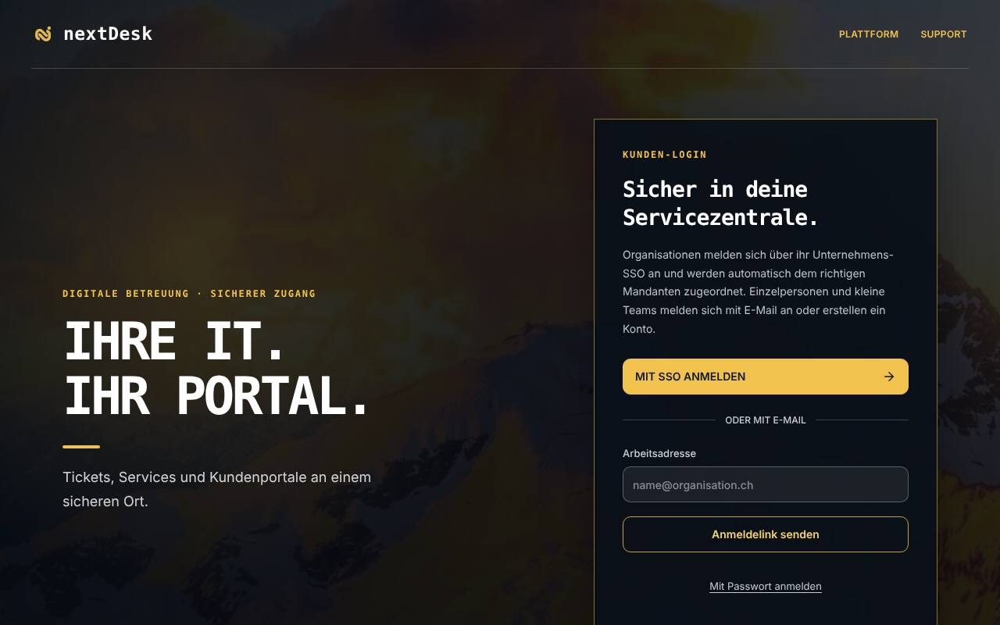

## Die Oberfläche im Überblick

Nach der Anmeldung siehst du links das Menü und rechts den Inhalt.

- **Tickets** – deine eigenen Anliegen (Startseite)
- **Wissensdatenbank** – Anleitungen und Antworten auf häufige Fragen
  (falls aktiviert)
- **Shop** – Geräte und Zubehör bestellen (falls aktiviert)
- **Projekte** – Projekte, in denen eine Mitarbeit oder Einladung besteht

Oben rechts findest du:

- **+ (Erfassen)** → **Ticket erfassen**
- die **globale Suche** («Global suchen …») über deine Tickets, auch mit
  einem Teil der Ticketnummer (z. B. «82» für ICT-2026-000082)
- die **Glocke** für Benachrichtigungen; ein Klick auf einen Eintrag öffnet
  das betroffene Ticket bzw. die Bestellung, mit «Alle als gelesen markieren»
  leerst du die Liste. Öffnest du ein Ticket, gelten seine Benachrichtigungen
  automatisch als gelesen. Der Knopf in einer E-Mail-Benachrichtigung öffnet
  ebenfalls direkt das Ticket bzw. die Bestellung, bei Bedarf nach der
  Anmeldung

Gibt es eine aktive Störung (z. B. «E-Mail ausgefallen»), erscheint oben ein
Hinweis bzw. im Menü der Eintrag **Aktive Störung**, bei Bedarf mit den
**betroffenen Diensten**. Bei mehreren Störungen steht die älteste oben; mit
**+1 weitere** (bzw. **+2 weitere** …) klappst du alle auf, jede mit einem
Ausschnitt des Textes (in der App tippst du auf den Text, um ihn ganz zu
lesen). Ist eine Störung behoben, verschwindet der Hinweis von selbst
(spätestens nach 30 Sekunden, ohne neu zu laden). Dann musst du dafür kein
eigenes Ticket erfassen.
Hast du den Systemstatus per E-Mail abonniert, erhältst du zu jeder
öffentlichen Störungsmeldung und jedem Update eine E-Mail.

Ist eine **Wartung** geplant, erscheint oben zusätzlich ein blauer Hinweis
«Laufende Wartung» bzw. «Geplante Wartung» (ab 24 Stunden vor Beginn) mit
Zeitraum und den betroffenen Diensten und Geräten – im Portal und in der App.
Er verschwindet nach dem Ende der Wartung von selbst. Mit einem E-Mail-Abo des Systemstatus erhältst du
öffentliche Wartungen 24 Stunden vorher angekündigt.

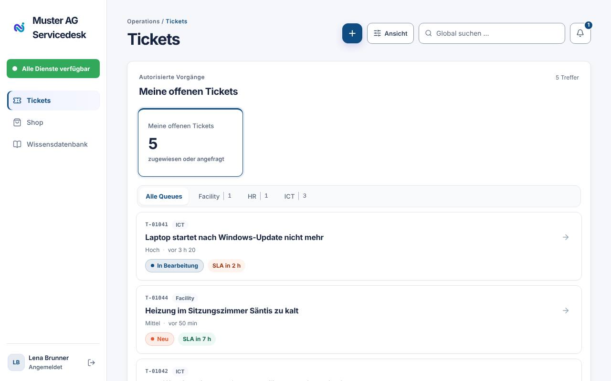

## Ein Anliegen melden (Ticket erfassen)

1. Klicke oben auf **+** und dann auf **Ticket erfassen**.
2. Gib einen kurzen, aussagekräftigen **Betreff** ein, z. B.
   «Drucker im 2. OG druckt nicht».
3. Unter **Einordnung** wählst du **Abteilung / Angebot** (z. B. ICT),
   optional eine **Ticketvorlage** sowie **Kategorie** und **Unterkategorie**.
4. Wähle die **Priorität** – im Zweifel die vorgeschlagene belassen.
5. Beschreibe das Anliegen in der **Beschreibung** möglichst konkret:
   Was ist passiert? Seit wann? Welche Fehlermeldung? Welches Gerät?
6. Klicke auf **Ticket erstellen**.

Links siehst du eine Zusammenfassung deiner Angaben, rechts die Abschnitte des
Formulars. Pflichtfelder sind mit einem roten **\*** markiert; die Schaltfläche
zum Erstellen bleibt am unteren Rand sichtbar.

Du erhältst sofort die **Ticketnummer** sowie die erwarteten Reaktions- und
Lösungszeiten. Mit **Öffnen** springst du direkt ins Ticket.

> **Tipp:** Während du schreibst, schlägt nextDesk passende Artikel vor
> («Könnte dir das helfen?»). Oft ist das Problem damit schon gelöst.
> Halbfertige Eingaben bleiben als Entwurf erhalten; mit **Entwurf verwerfen**
> beginnst du neu.

Ist der **Assistent** aktiviert, kannst du dein Anliegen auch mit **Mit dem
Assistenten lösen** im Dialog klären und den vorbereiteten Entwurf übernehmen.

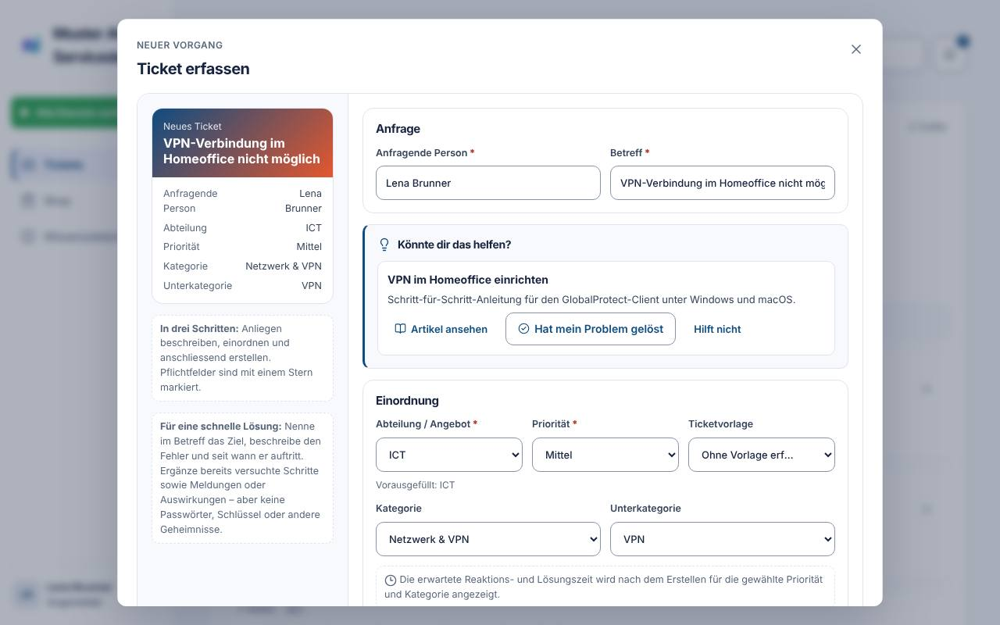

## Hinweise der ICT

Die ICT weist dich gelegentlich auf neue Angebote hin, zum Beispiel «Neu im
Shop: Teams bestellen». Solche Hinweise erscheinen:

- im Portal als **Banner** oben auf der Startseite oder als schmale
  **Hinweisleiste**,
- in der **iPhone- und Android-App** als Karte oben auf der Startseite,
- in Ticket-Mails (Ticket erfasst, Antwort, gelöst) als Karte **unter** dem
  eigentlichen Inhalt, gekennzeichnet mit «Neu bei der ICT».

Mit dem **X-Symbol** blendest du einen Hinweis aus; er erscheint dann nicht mehr. Die
Schaltfläche führt direkt zum Ziel (Shop, Wissensartikel, Ticket erfassen
oder eine Seite). In Sicherheits-, Phishing-, Erinnerungs- und
Freigabemails erscheinen nie Hinweise, und in Mails höchstens in der von der
ICT festgelegten Häufigkeit (Standard: einmal pro Woche).

## Eigene Tickets verfolgen

Unter **Tickets** siehst du alle deine Anliegen mit Nummer, Betreff und Status.

| Status          | Bedeutung                                                 |
| --------------- | --------------------------------------------------------- |
| Eingegangen/Neu | Das Ticket ist beim Support angekommen                    |
| In Bearbeitung  | Jemand kümmert sich darum                                 |
| Wartet auf dich | Der Support braucht eine Antwort oder Bestätigung von dir |
| Gelöst          | Der Support hat das Anliegen erledigt                     |
| Geschlossen     | Das Ticket ist abgeschlossen                              |

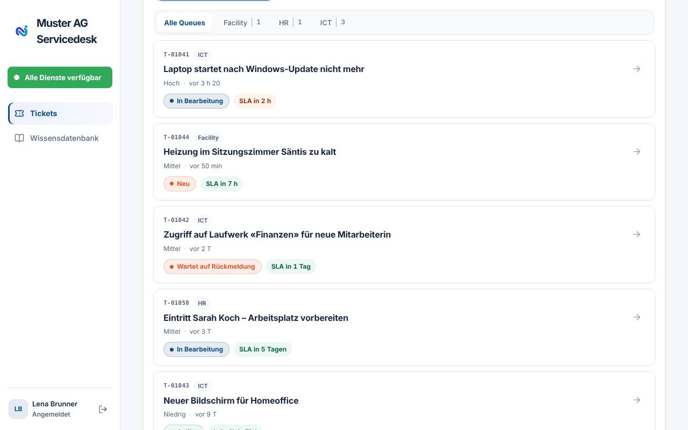

Meldest du dasselbe Anliegen mehrmals (oder melden es mehrere Personen),
führt der Support die Tickets zusammen. Du erhältst dann eine Mail mit der
Nummer, unter der dein Anliegen weiterläuft. Antworten des Supports erhältst
du weiterhin, und antwortest du auf eine Mail zum alten Ticket, kommt deine
Nachricht trotzdem an.

## Ein Ticket öffnen und antworten

Klicke auf ein Ticket. Der Block **Fortschritt** zeigt die Schritte
_Eingegangen → In Bearbeitung → Wartet auf dich → Gelöst → Geschlossen_ mit
Zeitpunkten.

Die Beschreibung deines Anliegens ist eingeklappt, sobald es Nachrichten
gibt; ein Klick darauf zeigt sie wieder ganz.

- **Antworten:** Schreibe in **Deine Nachricht** und klicke auf
  **Nachricht senden**. Mit **Dateien anhängen** fügst du Screenshots oder Dokumente hinzu.
  Erlaubt sind u. a. PDF, Office-Dokumente, TXT, CSV, PNG und JPG.
- **Wartet auf dich:** nextDesk fragt «Ist dein Problem inzwischen gelöst?».
  Klicke auf **Problem ist gelöst** oder **Ich brauche noch Hilfe**. Bei
  Letzterem beschreibst du kurz, was noch offen ist, und wählst
  **Rückmeldung senden**.
- **Freigaben:** Musst du etwas freigeben (z. B. als vorgesetzte Person),
  entscheidest du direkt im Ticket mit **Freigeben** oder **Ablehnen**.

Antworten des Supports erhältst du zusätzlich per E-Mail (falls im
Unternehmen eingerichtet). Du kannst auch direkt auf diese E-Mail antworten.

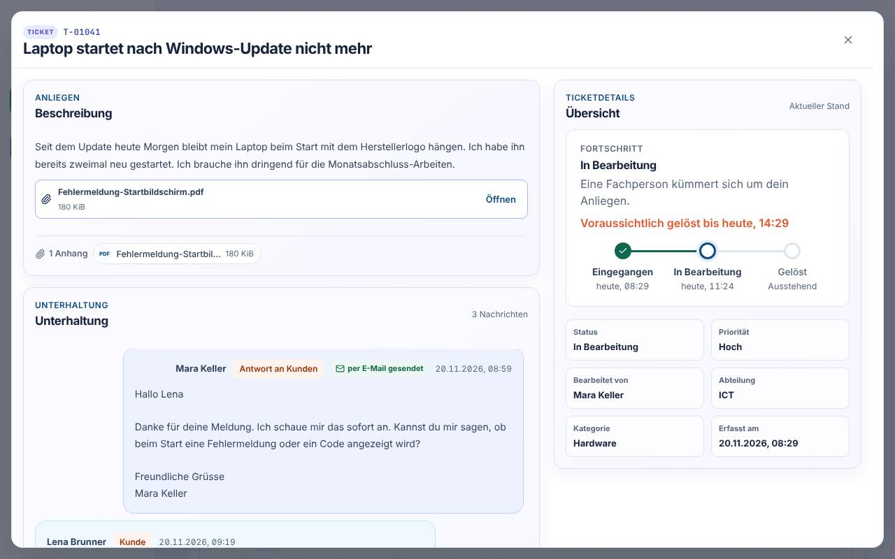

## Ticket bewerten

Sobald dein Ticket **gelöst** ist, erscheint im Ticket unter «Fortschritt» die
Frage **Wie zufrieden bist du?**

1. Wähle 1 bis 5 Sterne.
2. Schreibe bei Bedarf einen kurzen Kommentar – was war gut, was können
   wir besser machen?
3. Klicke auf **Bewertung senden**.

Du kannst deine Bewertung innerhalb von 14 Tagen **einmal ändern**
(**Bewertung ändern**). Bewerten können nur du als anfragende bzw.
betroffene Person. Deine Rückmeldung hilft dem Support-Team, besser zu werden.

In der iPhone-App findest du die Bewertung im Ticket direkt unter dem
Fortschritt.

**Per E-Mail:** Die E-Mail «Ticket gelöst» enthält fünf Sterne. Ein Klick auf
einen Stern öffnet eine Seite mit deiner Auswahl; dort kannst du die Sterne noch
ändern, einen Kommentar schreiben und mit **Bewertung senden** bestätigen. Du
musst dafür nicht angemeldet sein. Der Link ist persönlich und 14 Tage gültig.
Ein Ticket lässt sich nur einmal per E-Mail-Link bewerten.
Hast du drei Tage nach der Mail «Ticket gelöst» noch nicht bewertet, erhältst
du einmalig eine freundliche Erinnerung mit denselben Sternen.

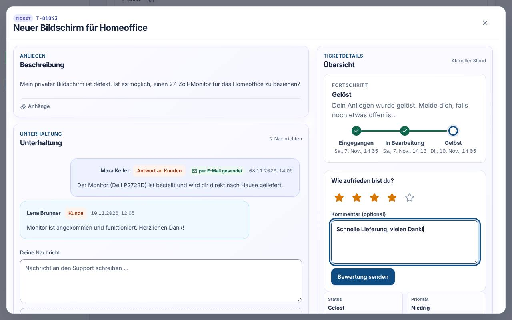

## Verdächtige E-Mail melden (Phishing)

Kommt dir eine E-Mail verdächtig vor, klicke keine Links an und öffne
keine Anhänge. Melde sie stattdessen:

- in **Outlook** mit **Melden → Phishing melden** (die Mail verschwindet danach
  aus deinem Posteingang) oder
- im Portal und in der App unter **Phishing melden**.

Du erhältst eine kurze Dankesnachricht. Sobald das Sicherheitsteam die Mail
geprüft hat, bekommst du per E-Mail das Ergebnis, zum Beispiel «harmlos» oder
«Phishing». Manchmal fragt das Team zusätzlich, ob du einen Link geöffnet oder
Daten eingegeben hast; antworte bitte ehrlich über die Schaltfläche in
der E-Mail. Hast du bereits dein Passwort eingegeben, melde dich sofort
beim Support.

## Wissensdatenbank

In der **Wissensdatenbank** findest du Anleitungen, z. B. «VPN einrichten»
oder «Passwort zurücksetzen». Tippe ein Stichwort ins Suchfeld (mit der
Taste `/` springst du direkt hinein). Die Treffer erscheinen beim Tippen,
die Suchbegriffe sind markiert. Oder wähle ein **Thema** (die Reihe mit Symbolen
scrollt seitlich, die häufigsten Themen stehen vorne) und bei Bedarf ein Unterthema. Ohne Suche zeigt die Seite
die neusten Artikel als Karten. Ein Klick auf einen Treffer öffnet den Artikel; mit **Alle
Artikel** bzw. **Zurück zu den Treffern** kehrst du zur Liste zurück. Lange
Artikel haben oben ein Inhaltsverzeichnis **Auf dieser Seite**, das zum
Abschnitt springt. Prüfe
hier zuerst, ob es eine Lösung gibt – das geht oft schneller als ein
Ticket.

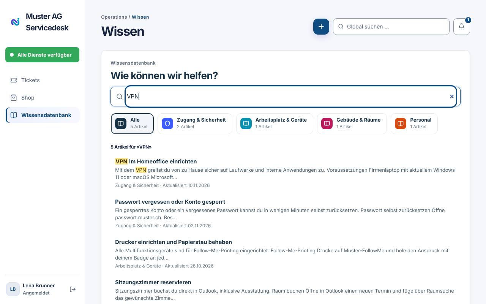

## Shop – Geräte und Zubehör bestellen

Falls dein Unternehmen den Shop nutzt:

1. Im Register **Katalog** einen Artikel wählen → **In den Warenkorb**
   (bei Leihgeräten **Ausleihen** mit Zeitraum).
2. Im Warenkorb den **Grund der Bestellung** angeben und die Lieferung wählen:
   _Abholung beim Support_ oder _An meinen Arbeitsplatz_.
3. **Jetzt bestellen** bzw. **Zur Freigabe senden**, wenn eine Freigabe nötig
   ist.

Manche Artikel sind nur für bestimmte Kaderstufen freigegeben und erscheinen
deshalb nicht bei allen Mitarbeitenden. Fehlt dir ein Artikel, wende dich
an den Support.

Unter **Meine Bestellungen** siehst du den Stand. Die Benachrichtigungen zur
Bestellung (Mail, Push) nennen die gewählte Übergabe: Ist sie bereit, heisst es
bei Abholung «Bereit zur Abholung – Abholung beim Support», bei Lieferung
«Bereit zur Lieferung» mit dem angegebenen Arbeitsplatz bzw. Raum. Als vorgesetzte Person
entscheidest du im Register **Freigaben** über Bestellungen deines Teams.

nextDesk erinnert automatisch (Benachrichtigung «Shop»):

- **Ausleihe endet bald:** zwei Tage vor dem Rückgabedatum.
- **Ausleihe überfällig:** am Tag nach dem Rückgabedatum; drei Tage später
  auch deine vorgesetzte Person.
- **Freigabe offen:** Wartet eine Bestellung zwei Arbeitstage auf deine
  Freigabe, erhältst du eine Erinnerung; nach fünf Arbeitstagen geht sie an
  deine Stellvertretung (sonst an deine vorgesetzte Person).

Erhältst du ein Gerät aus dem Shop, ist es danach unter **Mein Bereich →
Geräte** dir zugewiesen.

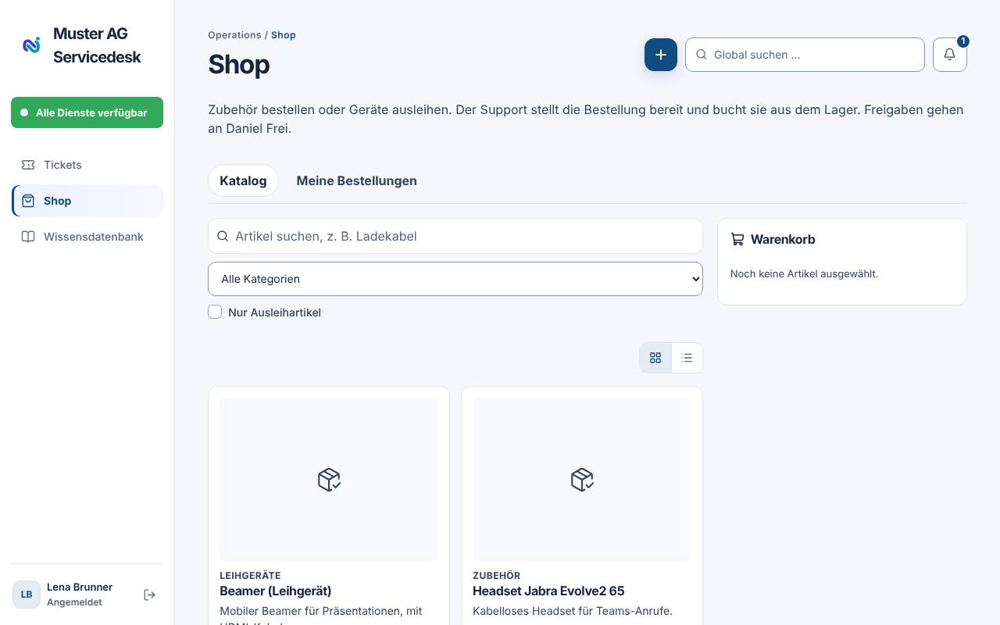

### Microsoft Teams: neues Team bestellen

Falls dein Unternehmen Microsoft Teams im Shop anbietet, erscheint im Katalog
die Kachel **Microsoft Teams: neues Team**. Ein Team wird ohne Genehmigung
bestellt und danach automatisch angelegt.

1. **Team zusammenstellen …** wählen und die fünf Schritte durchgehen:
   **Grunddaten** (Name, Beschreibung, _Privat_ oder _Öffentlich_, Gäste
   erlauben), **Kanäle & Tabs** (weitere Kanäle, auch privat, mit
   Website-Tabs), **Personen** (mindestens ein Owner, Mitglieder, bei
   erlaubten Gästen deren E-Mail-Adressen) und **Laufzeit** (Start und Ende).
2. In der **Übersicht** prüfen und **Verbindlich bestellen**.

Das **Ende** ist eine Pflichtangabe (höchstens ein Jahr; die ICT kann das anders einstellen). Das Team wird am
Ende nicht gelöscht: 14 Tage, 7 Tage und 1 Tag vorher erhalten die Owner und
die bestellende Person eine Benachrichtigung (E-Mail und Push, Kategorie
«Shop»). Unter **Meine Teams** verlängerst du die Laufzeit mit einem Klick um
1, 3, 6 Monate oder 1 Jahr. Ohne Verlängerung wird das Team nach dem Ende
archiviert; es bleibt lesbar und kann in Teams wiederhergestellt werden.

Unter **Meine Teams** bearbeitest du ein fertiges Team mit **Bearbeiten**
(als Besteller oder Owner): Personen hinzufügen oder entfernen, zum Owner
machen oder die Owner-Rolle entziehen (ein Owner bleibt immer), die Laufzeit
verlängern und das Team **archivieren**. Name, Kanäle und Tabs änderst du
direkt in Microsoft Teams.

Gäste erhalten eine Einladung von Microsoft und erscheinen erst nach Annahme
im Team. Weitere Tabs wie Planner oder OneNote ergänzt das Team danach in
Teams selbst.

## Projekte

Der Menüpunkt **Projekte** erscheint, wenn du in einem Projekt mitarbeitest
oder als Gast eingeladen bist. Die Übersicht zeigt deine Projekte mit Ampel,
Status, Leitung, Fortschritt und nächstem Meilenstein.

In einem Projekt findest du:

- **Überblick** – Beschreibung, Meilensteine, Eckdaten und Kommentare
- **Zeitplan** – die Zeitleiste mit Phasen, Aufgaben, Meilensteinen und
  Abhängigkeiten
- **Board** – die Aufgaben nach Status
- **Liste** – alle Elemente als Tabelle mit Filtern
- **Dokumentation** – Konzepte und Protokolle

Was du ändern darfst, hängt von deiner Rolle im Projekt ab. Als
**Mitarbeit** bearbeitest du Aufgaben, buchst Zeit und schreibst Dokumente.
Als **Gast** siehst du den Plan sowie Dokumente und Kommentare, die für Gäste
freigegeben sind; mit der Rolle «kommentierend» kannst du zusätzlich
Kommentare schreiben. Zeiten, Budget und Verknüpfungen sehen Gäste nicht.

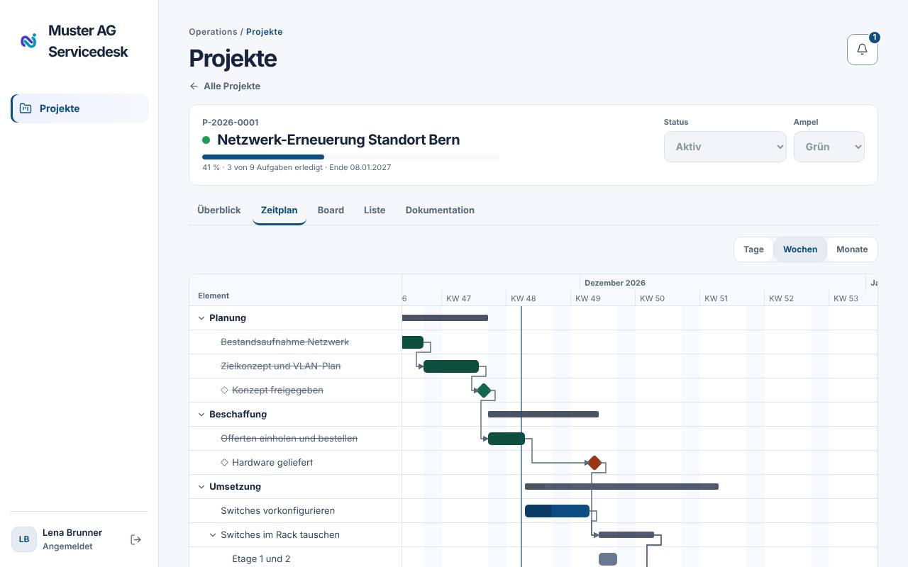

## Persönliche Einstellungen und Handbücher

Klicke unten links auf deinen **Namen**, um die **Persönlichen
Einstellungen** zu öffnen:

- **Profil und Anmeldung** – deine E-Mail-Adresse und die Anmeldeart
- **Profil & Darstellung** → **Darstellung anpassen**: Farbschema (Hell,
  Dunkel, Systemeinstellung), hoher Kontrast, Bewegung reduzieren
- **Handbücher** – dieses Handbuch (und weitere, falls deine Rolle es erlaubt)
- **Benachrichtigungen** – die **Benachrichtigungszeit** (**Jederzeit** oder
  **Nur zu bestimmten Zeiten** mit Tagen Mo–So und Uhrzeit von/bis; was
  ausserhalb anfällt, kommt zu Beginn der nächsten Benachrichtigungszeit),
  pro Benachrichtigung je ein Schalter für **Push** und **E-Mail** sowie deine
  registrierten iPhones. E-Mail-Benachrichtigungen gibt es, sobald dein
  Unternehmen ein Exchange-Postfach verbunden hat.

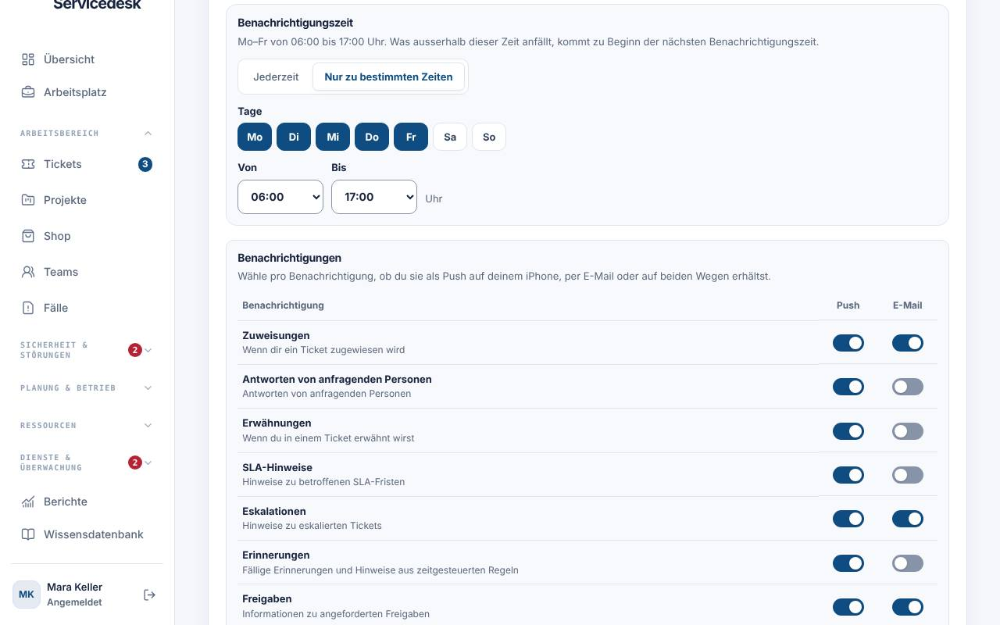

- **Störungen** (unter Benachrichtigungen) – eine Push-Mitteilung auf iPhone
  und Android, sobald die ICT eine Störung meldet, also dann, wenn auch der
  Banner erscheint. Nach dem Einschalten wählst du unter **Dienste**, für
  welche Dienste du informiert werden willst (**Alle**, **Keine** oder
  einzelne); Störungen ohne zugeordneten Dienst werden immer gemeldet. Die
  Mitteilung kommt sofort, unabhängig von der Benachrichtigungszeit, und
  braucht die nextDesk-App mit erlaubten Mitteilungen.
- **Sitzungsverwaltung** – alle anderen Geräte abmelden
- **Abmelden** und **Konto löschen**. Meldest du dich mit SSO deines
  Unternehmens an, wird dein Konto von deinem Unternehmen verwaltet und kann
  hier nicht gelöscht werden; wende dich dafür an deine IT.

Jedes Handbuch kannst du mit **Drucken / PDF** ausdrucken oder als PDF
speichern.

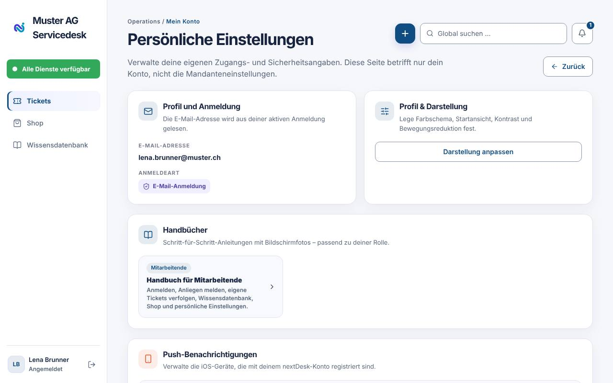

## nextDesk auf dem iPhone

Lade die **nextDesk-App** aus dem App Store und melde dich wie im
Browser an. Im Ticket siehst du Dateien direkt in der **Unterhaltung** – auch die
Anhänge deiner E-Mail unter der Beschreibung – und öffnest sie mit einem Tipp.
Mit der **Büroklammer** neben dem Nachrichtenfeld hängst du Fotos aus der
Mediathek oder Dateien (PDF, Word, Excel, TXT, CSV) an deine Nachricht an, bis
fünf pro Nachricht. Unten findest du links vom **Home**-Knopf **Tickets** und rechts
**Shop**, **Wissen** und **Scan**; wer im zuständigen Team ist, sieht links
zusätzlich **Störungen** und **Phishing**. Unter **Wissen** (auch auf Android) suchst du Artikel, wischst durch
die Themen und liest sie im Design deines Unternehmens: oben «Kurz gesagt»,
darunter Abschnitte zum Aufklappen, Schritte als nummerierte Karten und
Hinweisboxen. Unten im Artikel teilst du ihn oder erstellst mit **Ticket
erstellen** eine Rückfrage dazu. Die **Home**-Seite gestaltest du selbst: Mit dem Symbol
**Home anpassen** oben rechts blendest du Bereiche (z. B. Suche, Heute im
Fokus, Zuletzt geöffnet, Übersicht, Ticketliste, Erwähnungen, Geräte) ein oder
aus und verschieben sie mit den Pfeilen. **Standard wiederherstellen** setzt
alles zurück. Die Einstellung gilt nur für dich und wird zwischen deinen
Geräten (iPhone, Android) abgeglichen: Die letzte Änderung gilt überall. Die **Ticketliste** unter der Übersicht zeigt ohne gewählte Kachel die nicht zugewiesenen Tickets (gibt es keine, die offenen); ein Tipp auf _Meine Tickets_, _Offen_ oder _Nicht zugewiesen_ wechselt die Liste. Die zuletzt geöffneten Tickets stehen unter **Zuletzt angesehen**.
Unter **Tickets** siehst du zuerst den Filter **Meine**: Tickets, die du
angefragt hast oder die dir zugewiesen sind. Über das Filtersymbol in
der Suchleiste öffnest du dieselben Filter wie im Web: **Bereich** (Alle,
Beobachtet, Offen, Gelöst), **Agent**, **Abteilung**, **Priorität**,
**Sortieren nach** und **Reihenfolge**. **Filter zurücksetzen** stellt
**Meine** wieder her. **Nicht zugewiesen** und die Status-Filter stehen direkt unter dem Titel. Kehrst
du aus einem Ticket zurück, bleibt dein Filter erhalten; wechselst du über die
Leiste unten wieder zu **Tickets**, beginnt die Liste erneut mit **Meine**. Auf jeder Ticketkarte steht, wann das Ticket erstellt wurde
(z. B. «Erstellt heute, 14:32»). Über **Neues Ticket** erfasst du Anliegen
unterwegs. Unter **Fotos (optional)** nimmst du mit **Foto aufnehmen** direkt
ein Bild mit der Kamera auf oder wählst mit **Aus Mediathek** bestehende Bilder
aus, insgesamt bis zu fünf pro Ticket. Mit **Markieren** kennzeichnest du eine
Stelle im Bild, mit dem **×** entfernst du es wieder. Die Kamera fragt beim
ersten Mal nach deiner Erlaubnis; für die Mediathek braucht nextDesk keinen
Zugriff auf alle Fotos, sondern erhält nur die Bilder, die du auswählst.
Standortdaten werden vor dem Hochladen entfernt. Hast du den Kamerazugriff
abgelehnt, kannst du ihn in den Einstellungen des Geräts erlauben oder
stattdessen ein Bild aus der Mediathek wählen.

In den App-Einstellungen schaltest du Benachrichtigungen, z. B.
für Antworten des Supports, pro Hinweis einzeln als **Push** und als **Mail**
ein oder aus (gleich wie im Browser) und wählst unter **Benachrichtigungszeit**, an
welchen Tagen und zu welchen Zeiten sie kommen. Ein Tipp auf eine
Mitteilung öffnet direkt das betroffene Ticket bzw. die Bestellung im Shop,
auch wenn die App vorher geschlossen war. Über die **Glocke** oben auf der
Startseite öffnest du die **Mitteilungen** mit deinen letzten
Benachrichtigungen; dorthin führt auch eine Sammelmitteilung mit mehreren
Neuigkeiten.

Auf dem **App-Symbol** zeigt eine rote Zahl, wie viele Mitteilungen du noch nicht
gelesen hast (alle Arbeitsbereiche zusammen). Die Zahl sinkt, sobald du Mitteilungen
liest, das Ticket dazu öffnest oder alle als gelesen markierst, auch wenn du das
im Web tust (zum Beispiel mit **Alle gesehen** bei der Glocke): Die Zahl auf dem
Smartphone passt sich nach wenigen Sekunden an, ohne dass du die App öffnest. Auf
dem iPhone aktualisiert sie sich auch bei neuen Mitteilungen, wenn die App
geschlossen ist. Auf Android erscheint sie, wenn dein Startbildschirm Zahlen auf
Symbolen unterstützt; sind alle Mitteilungen gelesen, verschwinden auch die
Mitteilungen von nextDesk aus der Benachrichtigungsleiste. Auf Android erhältst du ausserdem die Push-Mitteilungen der
Administration (zum Beispiel zu Wartungen), sobald du die Benachrichtigungen der
App erlaubt hast.

Die Handbücher findest du auch in der App: **Profil → Hilfe und
Rechtliches**. Bildschirmfotos lassen sich dort antippen und vergrössern.
Ganz unten im Profil steht die installierte **Version** mit der **Build**-Nummer
der App; nenne sie dem Support, wenn du ein Problem meldest.

## Häufige Fragen

**Ich erhalte keinen Anmeldelink.** Prüfe den Spam-Ordner und ob die
E-Mail-Adresse stimmt. Nutzt dein Unternehmen SSO, melde dich mit **Mit
SSO anmelden** an.

**Der Anmeldelink funktioniert nicht.** Öffne ihn im selben Browser, in
dem du ihn angefordert hast, und fordere bei Bedarf einen neuen an.

**Ich sehe den Shop oder die Wissensdatenbank nicht.** Diese Bereiche schaltet
dein Unternehmen frei.

**Mein Problem ist von selbst verschwunden.** Antworte kurz im Ticket
oder klicke bei «Wartet auf dich» auf **Problem ist gelöst**.
