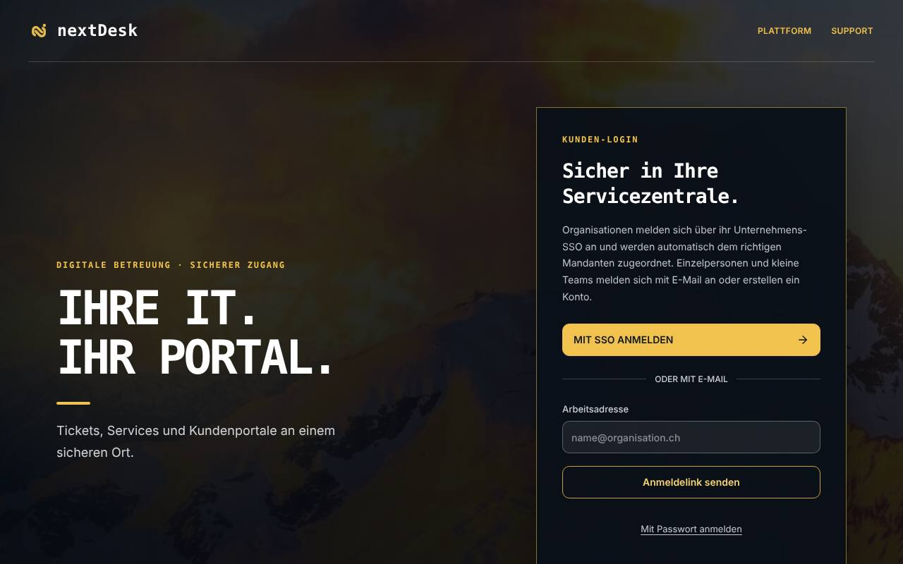
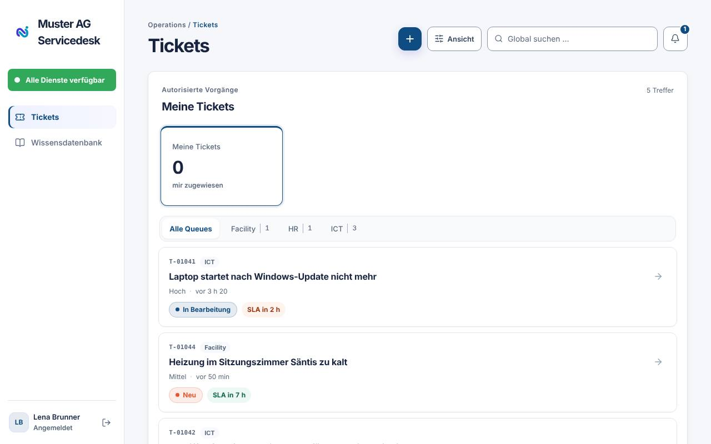
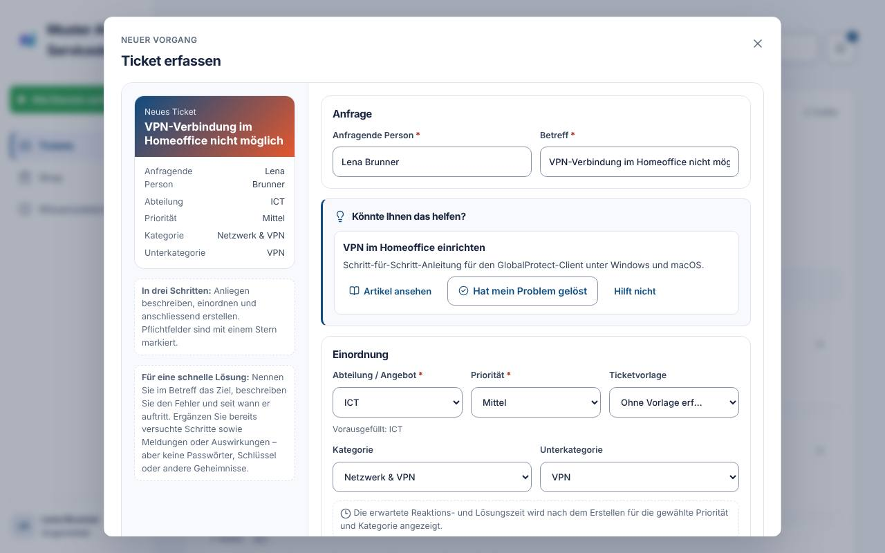
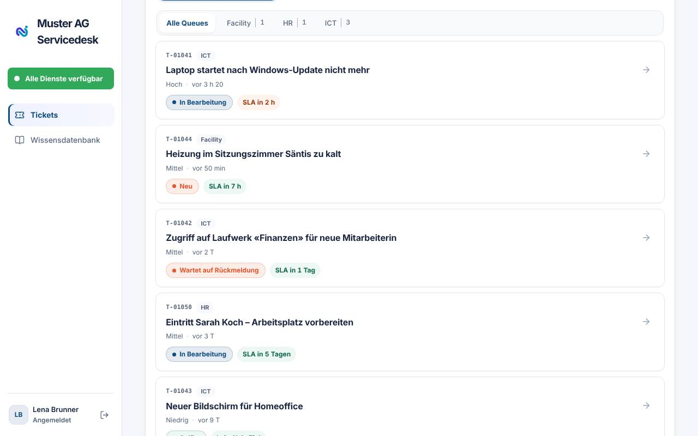
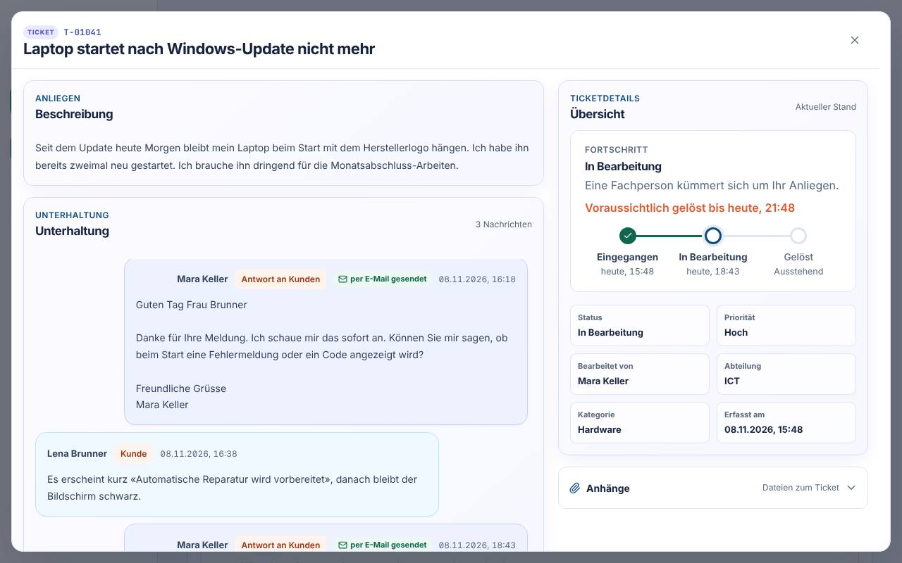
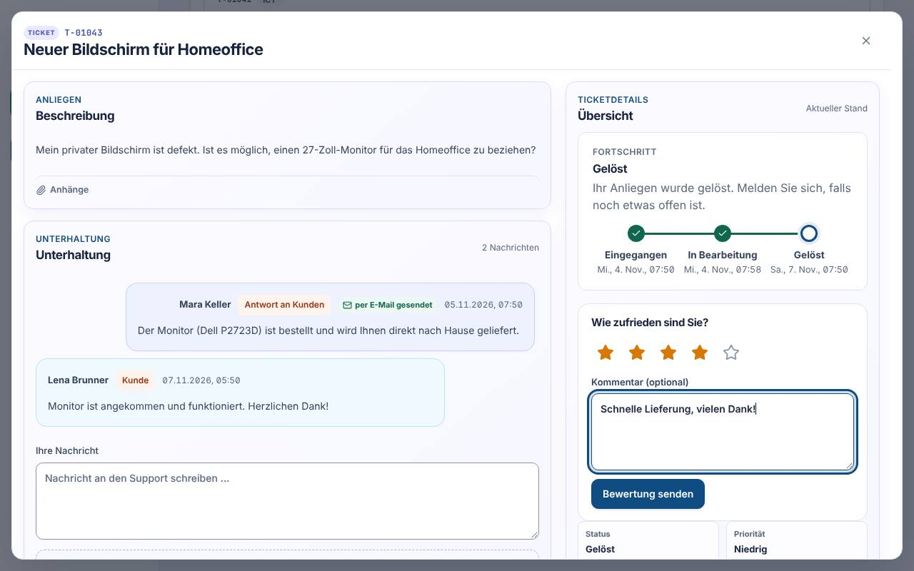
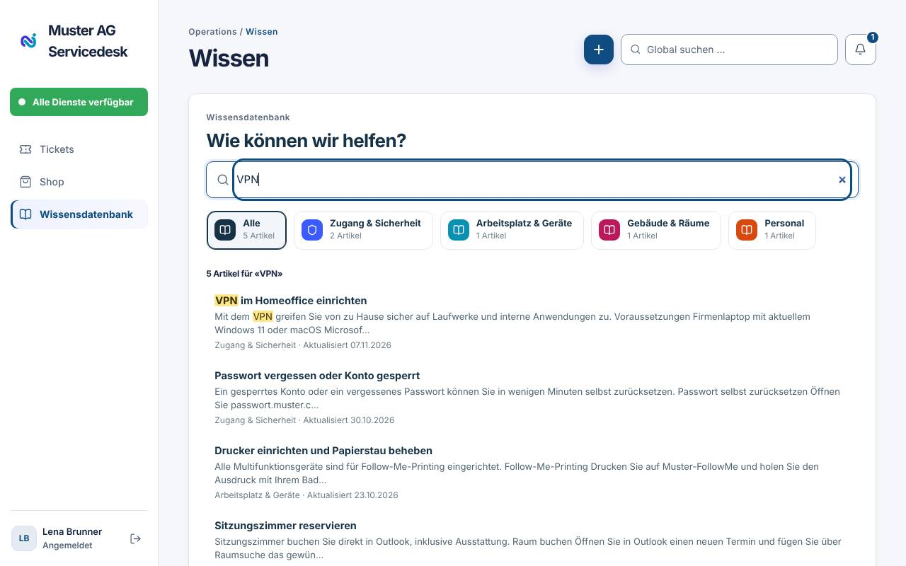
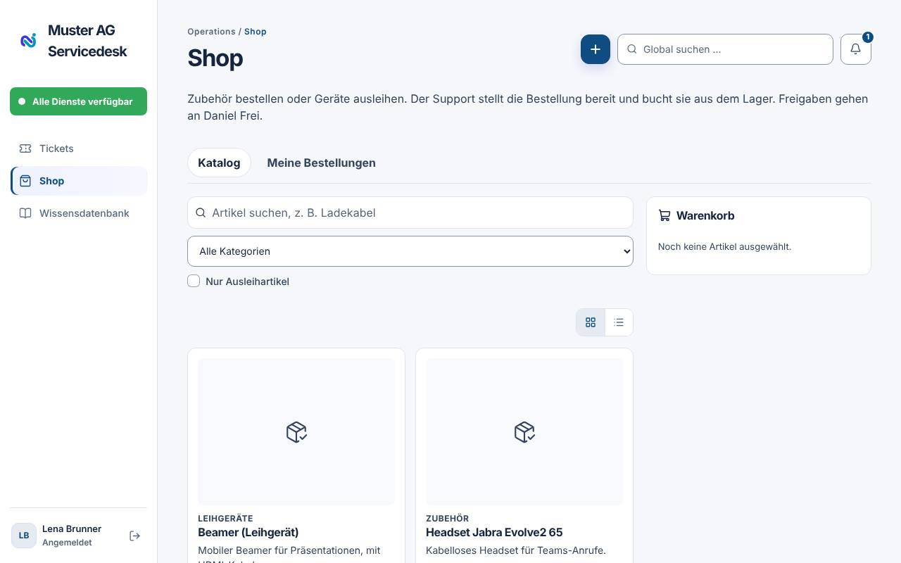
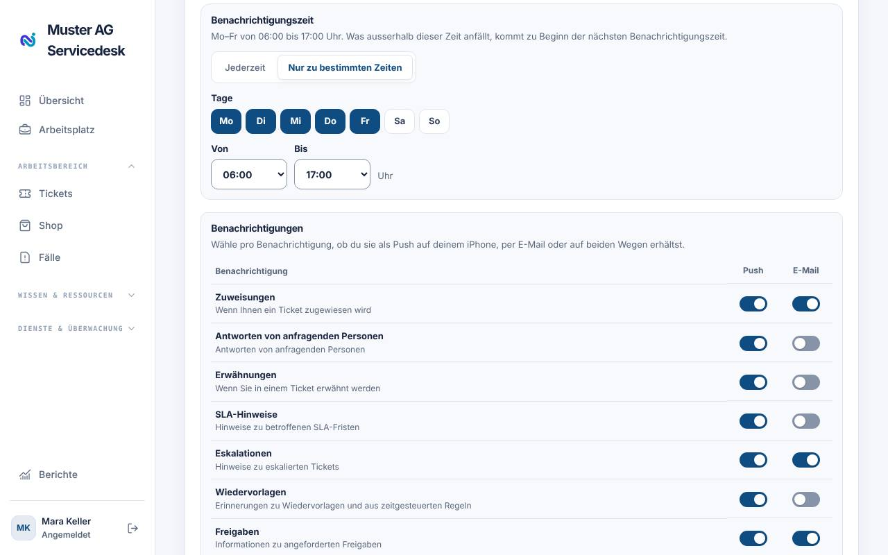
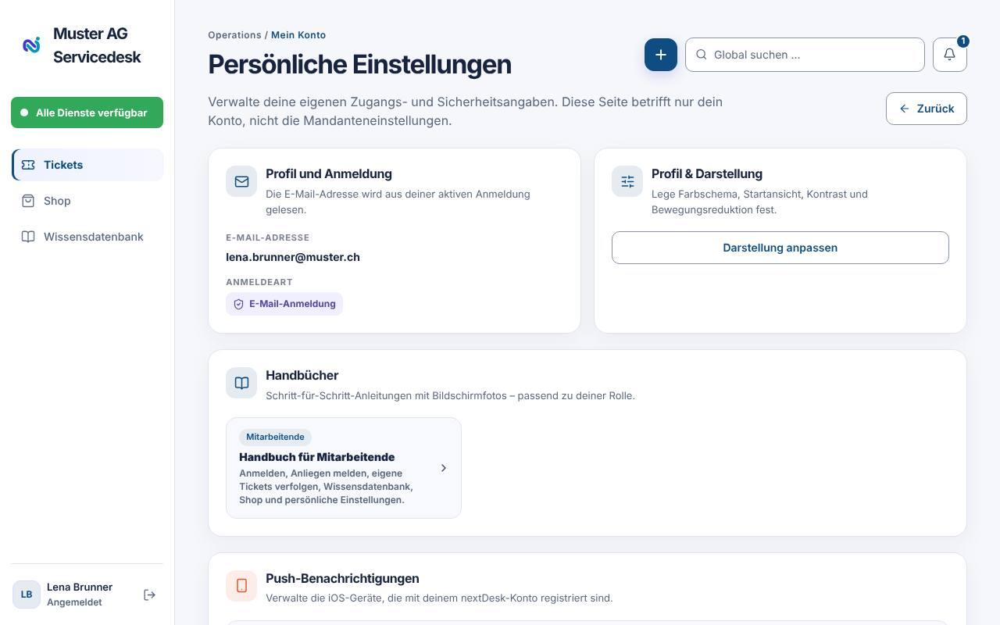

# Handbuch für Mitarbeitende

Mit nextDesk melden Sie Anliegen an den Support – zum Beispiel ein defektes
Gerät, eine fehlende Berechtigung oder eine Frage – und verfolgen jederzeit,
wie weit Ihr Anliegen ist. Dieses Handbuch erklärt alles, was Sie dafür
brauchen.

## Anmelden

Öffnen Sie `https://app.nextdesk.ch` im Browser.

- **Mit SSO anmelden**: Ist Ihr Unternehmen mit Microsoft 365 verbunden,
  melden Sie sich mit Ihrem gewohnten Microsoft-Konto an. Das ist der
  empfohlene Weg.
- **Anmeldelink per E-Mail**: Geben Sie unter «Oder mit E-Mail» Ihre
  E-Mail-Adresse ein und wählen Sie **Anmeldelink senden**. Öffnen Sie den Link
  aus der E-Mail **im selben Browser**.
- **Mit Passwort anmelden**: Falls Sie ein Passwort gesetzt haben, wechseln
  Sie über «Mit Passwort anmelden» zum Passwortfeld.
- **Konto erstellen**: Ohne Einladung Ihres Unternehmens legen Sie über
  «Neu bei nextDesk? Konto erstellen» (in der App «Konto erstellen») ein
  eigenes Konto an. Nach der Bestätigung per E-Mail erstellen Sie Ihren
  eigenen Arbeitsbereich. Gehört Ihre E-Mail-Domain zu einem Unternehmen mit
  SSO, melden Sie sich stattdessen mit SSO an.

## Die Oberfläche im Überblick

Nach der Anmeldung sehen Sie links das Menü und rechts den Inhalt.

- **Tickets** – Ihre eigenen Anliegen (Startseite)
- **Wissensdatenbank** – Anleitungen und Antworten auf häufige Fragen
  (falls aktiviert)
- **Shop** – Geräte und Zubehör bestellen (falls aktiviert)

Oben rechts finden Sie:

- **+ (Erfassen)** → **Ticket erfassen**
- die **globale Suche** («Global suchen …») über Ihre Tickets
- die **Glocke** für Benachrichtigungen; mit «Alle als gelesen markieren»
  leeren Sie die Liste

Gibt es eine aktive Störung (z. B. «E-Mail ausgefallen»), erscheint oben ein
Hinweis bzw. im Menü der Eintrag **Aktive Störung**. Dann müssen Sie dafür kein
eigenes Ticket erfassen.

## Ein Anliegen melden (Ticket erfassen)

1. Klicken Sie oben auf **+** und dann auf **Ticket erfassen**.
2. Geben Sie einen kurzen, aussagekräftigen **Betreff** ein, z. B.
   «Drucker im 2. OG druckt nicht».
3. Unter **Ticket einordnen** wählen Sie **Abteilung / Angebot** (z. B. ICT),
   optional eine **Ticketvorlage** sowie **Kategorie** und **Unterkategorie**.
4. Wählen Sie die **Priorität** – im Zweifel die vorgeschlagene belassen.
5. Beschreiben Sie das Anliegen in der **Beschreibung** möglichst konkret:
   Was ist passiert? Seit wann? Welche Fehlermeldung? Welches Gerät?
6. Klicken Sie auf **Ticket erstellen**.

Sie erhalten sofort die **Ticketnummer** sowie die erwarteten Reaktions- und
Lösungszeiten. Mit **Öffnen** springen Sie direkt ins Ticket.

> **Tipp:** Während Sie schreiben, schlägt nextDesk passende Artikel vor
> («Könnte Ihnen das helfen?»). Oft ist das Problem damit schon gelöst.
> Halbfertige Eingaben bleiben als Entwurf erhalten; mit **Entwurf verwerfen**
> beginnen Sie neu.

Ist der **Assistent** aktiviert, können Sie Ihr Anliegen auch mit **Mit dem
Assistenten lösen** im Dialog klären und den vorbereiteten Entwurf übernehmen.

## Eigene Tickets verfolgen

Unter **Tickets** sehen Sie alle Ihre Anliegen mit Nummer, Betreff und Status.

| Status          | Bedeutung                                                   |
| --------------- | ----------------------------------------------------------- |
| Eingegangen/Neu | Das Ticket ist beim Support angekommen                      |
| In Bearbeitung  | Jemand kümmert sich darum                                   |
| Wartet auf Sie  | Der Support braucht eine Antwort oder Bestätigung von Ihnen |
| Gelöst          | Der Support hat das Anliegen erledigt                       |
| Geschlossen     | Das Ticket ist abgeschlossen                                |

## Ein Ticket öffnen und antworten

Klicken Sie auf ein Ticket. Der Block **Fortschritt** zeigt die Schritte
_Eingegangen → In Bearbeitung → Wartet auf Sie → Gelöst → Geschlossen_ mit
Zeitpunkten.

- **Antworten:** Schreiben Sie in **Ihre Nachricht** und klicken Sie auf
  **Nachricht senden**. Mit **Bilder hochladen** fügen Sie Screenshots hinzu.
  Erlaubt sind u. a. PDF, Office-Dokumente, TXT, CSV, PNG und JPG.
- **Wartet auf Sie:** nextDesk fragt «Ist Ihr Problem inzwischen gelöst?».
  Klicken Sie auf **Problem ist gelöst** oder **Ich brauche noch Hilfe**. Bei
  Letzterem beschreiben Sie kurz, was noch offen ist, und wählen
  **Rückmeldung senden**.
- **Freigaben:** Müssen Sie etwas freigeben (z. B. als vorgesetzte Person),
  entscheiden Sie direkt im Ticket mit **Freigeben** oder **Ablehnen**.

Antworten des Supports erhalten Sie zusätzlich per E-Mail (falls im
Unternehmen eingerichtet). Sie können auch direkt auf diese E-Mail antworten.

## Ticket bewerten

Sobald Ihr Ticket **gelöst** ist, erscheint im Ticket unter «Fortschritt» die
Frage **Wie zufrieden sind Sie?**

1. Wählen Sie 1 bis 5 Sterne.
2. Schreiben Sie bei Bedarf einen kurzen Kommentar – was war gut, was können
   wir besser machen?
3. Klicken Sie auf **Bewertung senden**.

Sie können Ihre Bewertung innerhalb von 14 Tagen **einmal ändern**
(**Bewertung ändern**). Bewerten können nur Sie als anfragende bzw.
betroffene Person. Ihre Rückmeldung hilft dem Support-Team, besser zu werden.

In der iPhone-App finden Sie die Bewertung im Ticket direkt unter dem
Fortschritt.

## Verdächtige E-Mail melden (Phishing)

Kommt Ihnen eine E-Mail verdächtig vor, klicken Sie keine Links an und öffnen
Sie keine Anhänge. Melden Sie sie stattdessen:

- in **Outlook** mit **Melden → Phishing melden** (die Mail verschwindet danach
  aus Ihrem Posteingang) oder
- im Portal und in der App unter **Phishing melden**.

Sie erhalten eine kurze Dankesnachricht. Sobald das Sicherheitsteam die Mail
geprüft hat, bekommen Sie per E-Mail das Ergebnis, zum Beispiel «harmlos» oder
«Phishing». Manchmal fragt das Team zusätzlich, ob Sie einen Link geöffnet oder
Daten eingegeben haben; antworten Sie bitte ehrlich über die Schaltfläche in
der E-Mail. Haben Sie bereits Ihr Passwort eingegeben, melden Sie sich sofort
beim Support.

## Wissensdatenbank

In der **Wissensdatenbank** finden Sie Anleitungen, z. B. «VPN einrichten»
oder «Passwort zurücksetzen». Suchen Sie über **Wissensdatenbank
durchsuchen** oder filtern Sie nach Kategorie. Prüfen Sie hier zuerst, ob es
eine Lösung gibt – das geht oft schneller als ein Ticket.

## Shop – Geräte und Zubehör bestellen

Falls Ihr Unternehmen den Shop nutzt:

1. Im Register **Katalog** einen Artikel wählen → **In den Warenkorb**
   (bei Leihgeräten **Ausleihen** mit Zeitraum).
2. Im Warenkorb den **Grund der Bestellung** angeben und die Lieferung wählen:
   _Abholung beim Support_ oder _An meinen Arbeitsplatz_.
3. **Jetzt bestellen** bzw. **Zur Freigabe senden**, wenn eine Freigabe nötig
   ist.

Manche Artikel sind nur für bestimmte Kaderstufen freigegeben und erscheinen
deshalb nicht bei allen Mitarbeitenden. Fehlt Ihnen ein Artikel, wenden Sie
sich an den Support.

Unter **Meine Bestellungen** sehen Sie den Stand. Als vorgesetzte Person
entscheiden Sie im Register **Freigaben** über Bestellungen Ihres Teams.

## Persönliche Einstellungen und Handbücher

Klicken Sie unten links auf Ihren **Namen**, um die **Persönlichen
Einstellungen** zu öffnen:

- **Profil und Anmeldung** – Ihre E-Mail-Adresse und die Anmeldeart
- **Profil & Darstellung** → **Darstellung anpassen**: Farbschema (Hell,
  Dunkel, Systemeinstellung), hoher Kontrast, Bewegung reduzieren
- **Handbücher** – dieses Handbuch (und weitere, falls Ihre Rolle es erlaubt)
- **Benachrichtigungen** – die **Benachrichtigungszeit** (**Jederzeit** oder
  **Nur zu bestimmten Zeiten** mit Tagen Mo–So und Uhrzeit von/bis; was
  ausserhalb anfällt, kommt zu Beginn der nächsten Benachrichtigungszeit),
  pro Benachrichtigung je ein Schalter für **Push** und **E-Mail** sowie Ihre
  registrierten iPhones. E-Mail-Benachrichtigungen gibt es, sobald Ihr
  Unternehmen ein Exchange-Postfach verbunden hat.

- **Sitzungsverwaltung** – alle anderen Geräte abmelden
- **Abmelden** und **Konto löschen**. Melden Sie sich mit SSO Ihres
  Unternehmens an, wird Ihr Konto von Ihrem Unternehmen verwaltet und kann
  hier nicht gelöscht werden; wenden Sie sich dafür an Ihre IT.

Jedes Handbuch können Sie mit **Drucken / PDF** ausdrucken oder als PDF
speichern.

## nextDesk auf dem iPhone

Laden Sie die **nextDesk-App** aus dem App Store und melden Sie sich wie im
Browser an. Unten finden Sie **Tickets**, **Shop**, **Home**, **Wissen** und
**Scan**. Über **Neues Ticket** erfassen Sie Anliegen unterwegs, auf Wunsch
mit Foto. In den App-Einstellungen aktivieren Sie Benachrichtigungen, z. B.
für Antworten des Supports, und wählen unter **Benachrichtigungszeit**, an
welchen Tagen und zu welchen Zeiten sie kommen.

Die Handbücher finden Sie auch in der App: **Profil → Hilfe und
Rechtliches**. Bildschirmfotos lassen sich dort antippen und vergrössern.

## Häufige Fragen

**Ich erhalte keinen Anmeldelink.** Prüfen Sie den Spam-Ordner und ob die
E-Mail-Adresse stimmt. Nutzt Ihr Unternehmen SSO, melden Sie sich mit **Mit
SSO anmelden** an.

**Der Anmeldelink funktioniert nicht.** Öffnen Sie ihn im selben Browser, in
dem Sie ihn angefordert haben, und fordern Sie bei Bedarf einen neuen an.

**Ich sehe den Shop oder die Wissensdatenbank nicht.** Diese Bereiche schaltet
Ihr Unternehmen frei.

**Mein Problem ist von selbst verschwunden.** Antworten Sie kurz im Ticket
oder klicken Sie bei «Wartet auf Sie» auf **Problem ist gelöst**.
